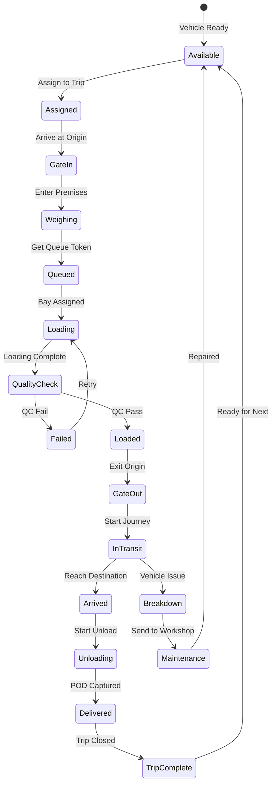
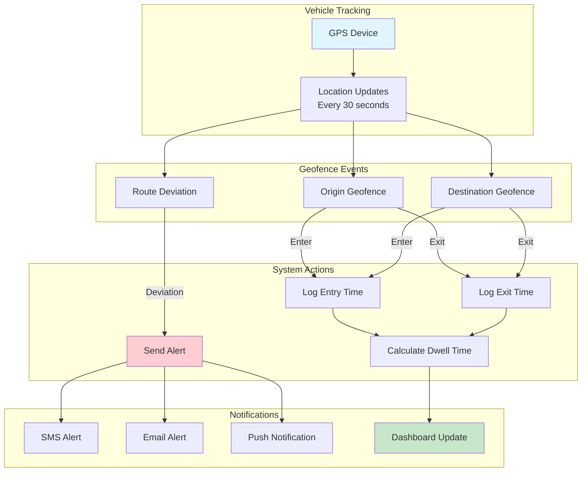
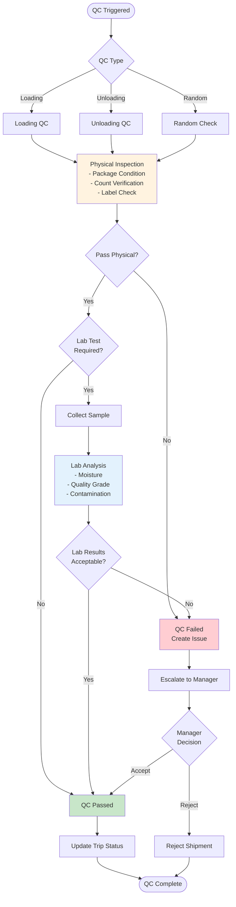
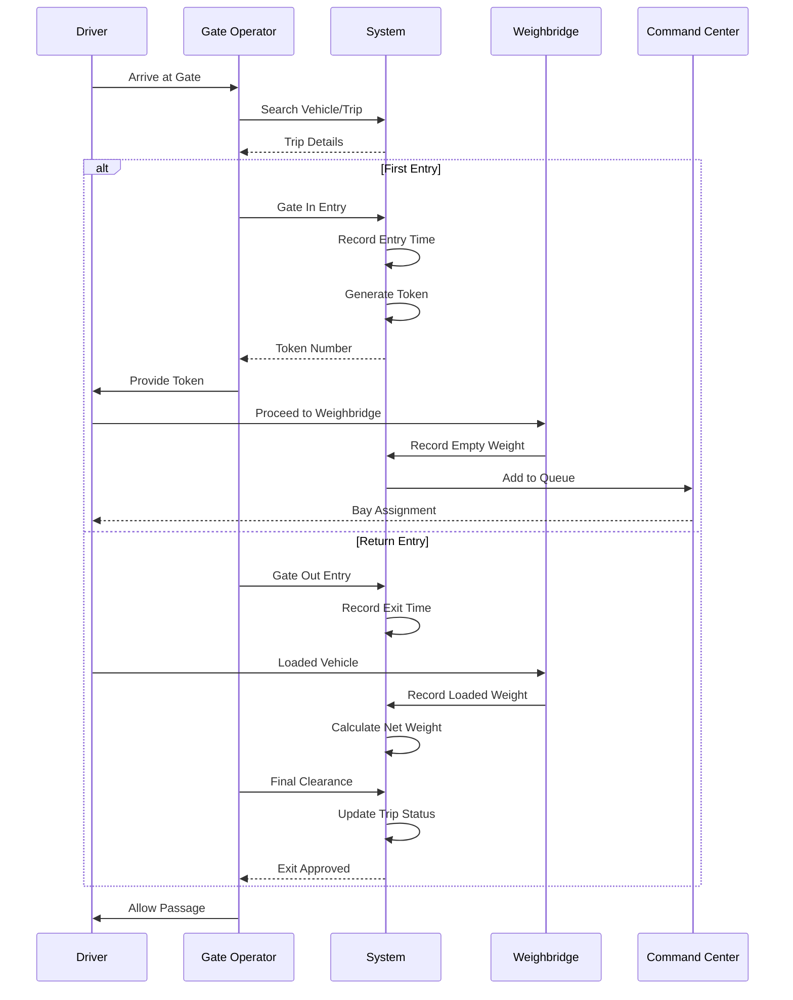
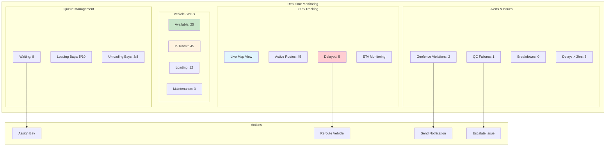
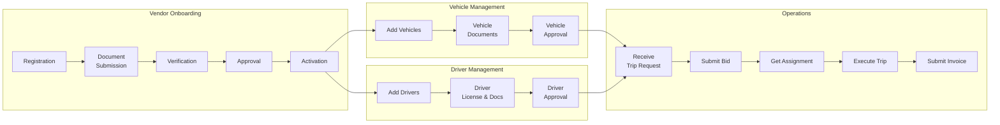
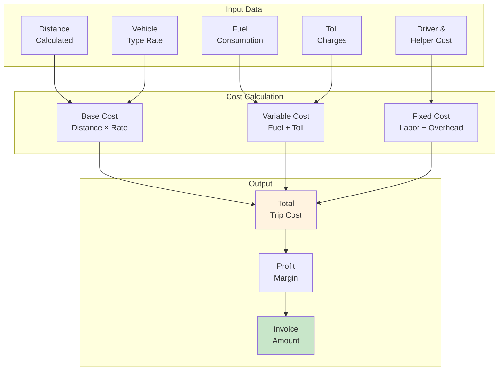

# Logistics Flow Diagrams

## 1. Complete Distribution Workflow

```mermaid
flowchart TB
    Start([Start]) --> PR[Product Requisition<br/>Created by Requester]

    PR --> Validate{Validate<br/>Stock & Rules}
    Validate -->|Invalid| Reject1[Rejected]
    Validate -->|Valid| DistApproval[Distribution<br/>Officer Review]

    DistApproval --> DistDecision{Approve?}
    DistDecision -->|No| Reject1
    DistDecision -->|Yes| MgrApproval[Manager<br/>Final Approval]

    MgrApproval --> MgrDecision{Approve?}
    MgrDecision -->|No| Reject1
    MgrDecision -->|Yes| TR[Transport<br/>Requisition Created]

    TR --> TO[Transport Order<br/>Generated]
    TO --> Assign[Assign Vehicle<br/>& Driver]

    Assign --> GateIn[Gate In<br/>Vehicle Entry]
    GateIn --> ScaleIn[Scale In<br/>Empty Weight]

    ScaleIn --> Queue[Queue Token<br/>Generation]
    Queue --> Command[Command Center<br/>Bay Assignment]

    Command --> Loading{Loading or<br/>Unloading?}
    Loading -->|Loading| LoadStart[Loading Start]
    Loading -->|Unloading| UnloadStart[Unloading Start]

    LoadStart --> LoadEnd[Loading Complete]
    UnloadStart --> UnloadEnd[Unloading Complete]

    LoadEnd --> QC1[Quality Control<br/>Physical Check]
    UnloadEnd --> QC1

    QC1 --> QCDecision{QC Pass?}
    QCDecision -->|Fail| QCFail[QC Failed<br/>Escalation]
    QCDecision -->|Pass| ScaleOut[Scale Out<br/>Loaded Weight]

    ScaleOut --> GateOut[Gate Out<br/>Vehicle Exit]
    GateOut --> Transit[In Transit<br/>GPS Tracking]

    Transit --> Delivery[Delivery at<br/>Destination]
    Delivery --> POD[Proof of Delivery<br/>Capture]

    POD --> TripClose[Trip Closure]
    TripClose --> Costing[Trip Costing<br/>Calculation]

    Costing --> End([End])
    Reject1 --> End
    QCFail --> End

    style PR fill:#e3f2fd
    style TR fill:#e8f5e9
    style TO fill:#fff3e0
    style QC1 fill:#ffebee
    style POD fill:#f3e5f5
    style Costing fill:#fce4ec
```

## 2. Vehicle Trip Lifecycle

## 3. Multi-Stop Trip Flow

```mermaid
flowchart LR
    subgraph "Origin"
        O_Gate[Gate In]
        O_Scale[Scale In]
        O_Load[Loading]
        O_QC[QC Check]
    end

    subgraph "Stop 1"
        S1_Arrive[Arrive]
        S1_Deliver[Partial Delivery]
        S1_POD[POD Capture]
    end

    subgraph "Stop 2"
        S2_Arrive[Arrive]
        S2_Deliver[Partial Delivery]
        S2_POD[POD Capture]
    end

    subgraph "Final Destination"
        F_Arrive[Arrive]
        F_Deliver[Final Delivery]
        F_POD[POD Capture]
        F_Close[Trip Close]
    end

    O_Gate --> O_Scale
    O_Scale --> O_Load
    O_Load --> O_QC
    O_QC --> S1_Arrive

    S1_Arrive --> S1_Deliver
    S1_Deliver --> S1_POD
    S1_POD --> S2_Arrive

    S2_Arrive --> S2_Deliver
    S2_Deliver --> S2_POD
    S2_POD --> F_Arrive

    F_Arrive --> F_Deliver
    F_Deliver --> F_POD
    F_POD --> F_Close
```

## 4. Geofencing & GPS Tracking

## 5. Quality Control Process

## 6. Gate Management Flow

## 7. Command Center Dashboard View

## 8. Vendor Management Flow

## 9. Approval Hierarchy

```mermaid
graph TD
    subgraph "Product Requisition Approval"
        PR_CREATE[Requester<br/>Creates PR]
        PR_L1[Distribution Officer<br/>Level 1 Approval]
        PR_L2[Distribution Manager<br/>Level 2 Approval]
        PR_FINAL[Approved PR]
    end

    subgraph "Transport Order Approval"
        TO_CREATE[Transport Planner<br/>Creates TO]
        TO_REVIEW[TDO Review]
        TO_APPROVE[Manager Approval]
        TO_FINAL[Approved TO]
    end

    subgraph "QC Escalation"
        QC_ISSUE[QC Failure]
        QC_SUPER[QC Supervisor<br/>Review]
        QC_MGR[Manager<br/>Decision]
        QC_FINAL[Final Decision]
    end

    PR_CREATE --> PR_L1
    PR_L1 -->|Approve| PR_L2
    PR_L1 -->|Reject| PR_CREATE
    PR_L2 -->|Approve| PR_FINAL
    PR_L2 -->|Reject| PR_CREATE

    TO_CREATE --> TO_REVIEW
    TO_REVIEW --> TO_APPROVE
    TO_APPROVE --> TO_FINAL

    QC_ISSUE --> QC_SUPER
    QC_SUPER --> QC_MGR
    QC_MGR --> QC_FINAL

    style PR_FINAL fill:#c8e6c9
    style TO_FINAL fill:#c8e6c9
    style QC_FINAL fill:#e1f5fe
```

## 10. Data Flow for Trip Costing

---

## Legend

### Colors Used in Diagrams
- 🟦 **Blue** (#e3f2fd): Input/Initial stages
- 🟩 **Green** (#c8e6c9): Success/Approved states
- 🟨 **Yellow** (#fff3e0): Processing/In-progress
- 🟥 **Red** (#ffcdd2): Failure/Alert states
- 🟪 **Purple** (#f3e5f5): External systems/Special processes
- 🟧 **Orange** (#ffe0b2): Intermediate stages

### Shapes
- **Rectangle**: Process/Action
- **Diamond**: Decision point
- **Circle**: Start/End point
- **Parallelogram**: Input/Output
- **Cylinder**: Database/Storage