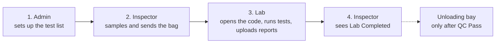
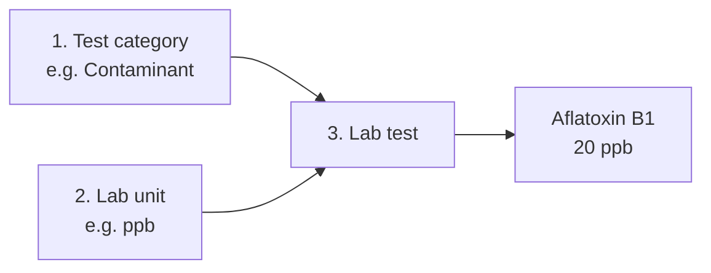
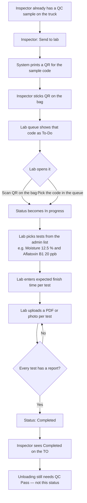
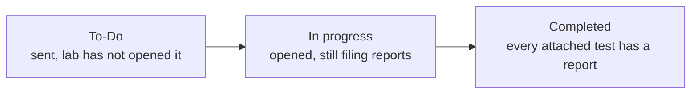
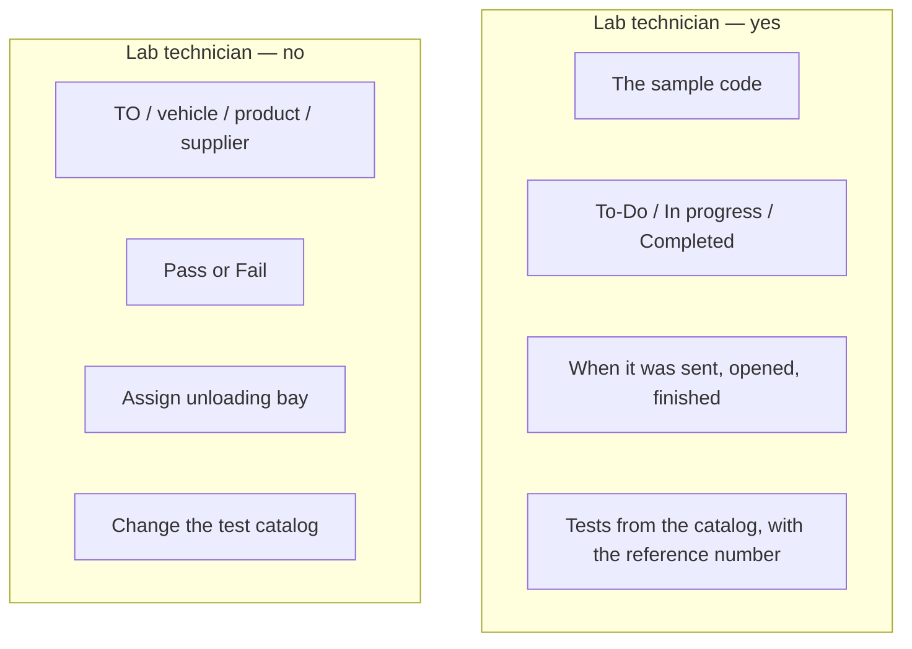

# Lab Test flow — MDM-05 + QC-02

**The story in one line:** Admin defines the tests → Inspector sends the bag → Lab works a **code**, not a truck → Unloading still needs **QC Pass**.

Use this order in the room. Each section is one slide.

---

## Slide 1 — The four steps

Follow left to right. Lab Complete does **not** open the unloading bay.

| Step | Who | What they do |
|------|-----|----------------|
| 1 | Tenant Admin | Create categories, units, and tests (with a reference number, e.g. `20 ppb`) |
| 2 | Inspector | Sample is already on the truck (QC-01). They **send it to lab** and **stick a QR on the bag** |
| 3 | Lab technician | Scan the QR **or** pick the code. They never see the truck, TO, or product. Tenant Super Admin / Tenant Admin can do the same Lab Queue work after selecting **Working site**. |
| 4 | Inspector | Sees lab status on **their** QC screen. Command Center still waits for **Pass** |

---

## Slide 2 — Step 1: Admin builds the catalog (MDM-05)

A test cannot be saved until a **category** and a **unit** exist. The number on the test is a **reference** (`Aflatoxin B1 — 20 ppb`). The system does not treat it as max or min.

**Example row after save**

| Code | Name | Category | Reference |
|------|------|----------|-----------|
| AFLA-B1 | Aflatoxin B1 | Contaminant | 20 ppb |
| MOISTURE | Moisture | Moisture | 12.5 % |

**Rules to say out loud**

- Only **Admin** (or Tenant Super Admin) can do this. Lab cannot.
- Pick category and unit from the list — do not type them on the test.
- Lab unit is **not** Bag / Ton / KG (those are for products).
- Do not delete. **Deactivate** — old samples keep the name; new work cannot pick it.

---

## Slide 3 — Steps 2–4: Bag goes to the lab (QC-02)

Inspector owns the **shipment**. Lab owns the **bag code**. Opening by QR or by picking the code is the **same** sample.

---

## Slide 4 — Lab queue status

- Lab cannot jump from To-Do to Completed. They must open first.
- They must attach **at least one** test from the catalog. They cannot type a new name.
- Completed ≠ Pass. Pass is still the inspector on QC-01.

---

## Slide 5 — What the lab sees (and what they must not)

The lab screen is **blind** to the truck. Same rule on the API.

Inspector **does** see the TO. Blindness is for Lab Queue (technician, and Tenant Super Admin / Tenant Admin when covering lab). Catalog setup stays admin-only (MDM-05).

---

## Order of work

1. Ship **MDM-05** (category → unit → tests).
2. Then ship **QC-02** (send, QR, lab queue, attach, report).
3. Do **not** change QC-01 Pass / Fail or Command Center for this work.
