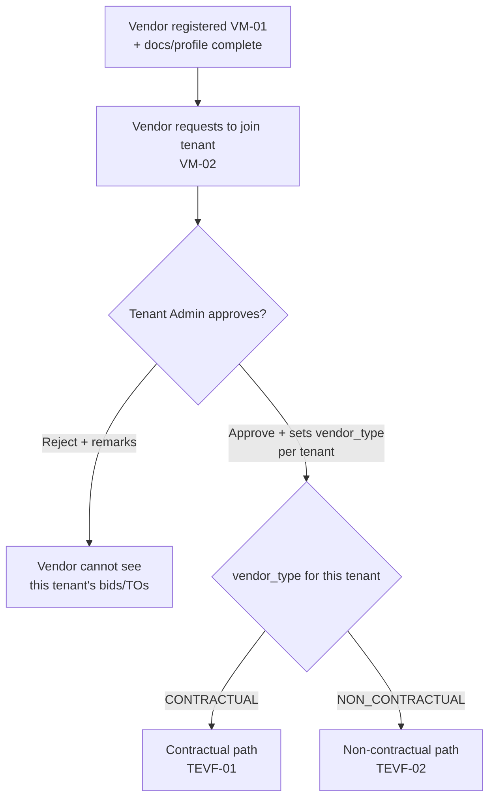
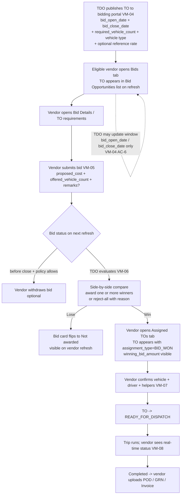
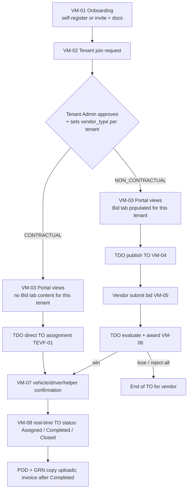

# Sprint 4 — Vendor Management — Vendor Mobile App Context

This page is the **sprint-folder entrypoint** into Vendor Mobile work, while keeping the **source-of-truth specs** in:

- `DFMS-product-context/05-modules/09-mobile-apps/vendor-mobile/`

It also documents the **two end-to-end flows** every Vendor Mobile screen must respect:

- **Contractual** (no bidding — direct TO assignment, rate hidden)
- **Non-Contractual** (bidding — vendor submits rate + offered vehicle count)

## Where to read the full Vendor Mobile App specs (source of truth)

- **Vendor Mobile App index**: [`vendor-mobile/README.md`](../../../../05-modules/09-mobile-apps/vendor-mobile/README.md)
- **00 — Navigation & IA**: [`00-navigation-and-information-architecture.md`](../../../../05-modules/09-mobile-apps/vendor-mobile/00-navigation-and-information-architecture.md)
- **01 — Onboarding & verification**: [`01-onboarding-and-verification.md`](../../../../05-modules/09-mobile-apps/vendor-mobile/01-onboarding-and-verification.md)
- **02 — Tenant membership**: [`02-tenant-membership.md`](../../../../05-modules/09-mobile-apps/vendor-mobile/02-tenant-membership.md)
- **03 — Bid opportunities list**: [`03-bid-opportunities-list.md`](../../../../05-modules/09-mobile-apps/vendor-mobile/03-bid-opportunities-list.md)
- **04 — Bid submission**: [`04-bid-submission.md`](../../../../05-modules/09-mobile-apps/vendor-mobile/04-bid-submission.md)
- **05 — Assigned TOs list**: [`05-assigned-tos-list.md`](../../../../05-modules/09-mobile-apps/vendor-mobile/05-assigned-tos-list.md)
- **06 — Post-award driver/vehicle submission**: [`06-post-award-driver-vehicle-submission.md`](../../../../05-modules/09-mobile-apps/vendor-mobile/06-post-award-driver-vehicle-submission.md)
- **07 — Active trip tracking**: [`07-active-trip-tracking.md`](../../../../05-modules/09-mobile-apps/vendor-mobile/07-active-trip-tracking.md)
- **08 — Completed trip history**: [`08-completed-trip-history.md`](../../../../05-modules/09-mobile-apps/vendor-mobile/08-completed-trip-history.md)
- **09 — Profile management**: [`09-profile-management.md`](../../../../05-modules/09-mobile-apps/vendor-mobile/09-profile-management.md)
- **10 — Security & access control**: [`10-security-and-access-control.md`](../../../../05-modules/09-mobile-apps/vendor-mobile/10-security-and-access-control.md)
- **11 — Integration & design decisions**: [`11-integration-and-design-decisions.md`](../../../../05-modules/09-mobile-apps/vendor-mobile/11-integration-and-design-decisions.md)
- **12 — Contractual vs Non-Contractual user journeys**: [`12-vendor-type-flows.md`](../../../../05-modules/09-mobile-apps/vendor-mobile/12-vendor-type-flows.md)

---

## How a vendor gets assigned a TO (the fork)

**Vendor type is set per tenant** at **tenant-join approval** (VM-02). The vendor never picks it — the Tenant Admin assigns it as part of approving the join request.



**Key invariant:** vendor type is a property of the **(vendor, tenant)** pair. A vendor may be **Contractual for Tenant A** and **Non-Contractual for Tenant B**; per-tenant gating applies independently.

---

## Path A — Contractual vendor (TEVF-01)

> No bidding. TDO assigns TO directly. Contractual rates are backend-controlled and **hidden** from the vendor.

```mermaid
flowchart TD
  T[TDO identifies a contractual-eligible TO] --> AS[TDO assigns TO to one or more<br/>contractual vendor(s)<br/>capacity split allowed]
  AS --> AUD[Assignment audited<br/>who/when/which vendor/which TO]
  AUD --> AT[Vendor opens Assigned TOs tab<br/>TO appears with assignment_type=CONTRACTUAL<br/>rate hidden]
  AT --> CONF[Vendor confirms vehicle + driver + helpers VM-07]
  CONF --> RDY[TO -> READY_FOR_DISPATCH]
  RDY --> TRIP[Trip runs; vendor sees real-time status VM-08]
  TRIP --> DONE[Completed -> vendor uploads POD / GRN / Invoice]
```

> Phase 1 vendor mobile has **no notifications** (no push, in-app banner, email, or SMS triggered by the app). The vendor discovers the assigned TO by opening the **Assigned TOs** tab — the list refreshes on pull-to-refresh / tab focus.

### Mobile screens used (Contractual)

| Step | Mobile screen | Source-of-truth file |
|---|---|---|
| Entry (vendor refreshes Assigned TOs tab) | Assigned TOs list | `05-assigned-tos-list.md` |
| Review TO requirements | TO Details (Assigned TOs list) | `05-assigned-tos-list.md` |
| Confirm vehicle/driver/helpers | Post-award Submission form | `06-post-award-driver-vehicle-submission.md` |
| Watch trip | Active Trip Tracking | `07-active-trip-tracking.md` |
| After completion | Completed Trip History + uploads | `08-completed-trip-history.md`, `06-...` (invoice gated on Completed) |

### Mobile screens NOT shown to a Contractual vendor (for that tenant)

- **Bid Opportunities List** (`03-bid-opportunities-list.md`) — hidden
- **Bid Submission Form** (`04-bid-submission.md`) — not accessible
- **Rate / bid amount fields** on TO Details, Assigned TOs list, Completed Trip History — **hidden by backend** for assignment_type=CONTRACTUAL

---

## Path B — Non-Contractual vendor (TEVF-02 → VM-04 / VM-05 / VM-06)

> Vendor competes via bidding. TDO publishes → vendor bids rate + vehicle count → TDO picks winner(s) → TO assigned.



> Phase 1 vendor mobile has **no notifications**. Vendors discover bid publish, bid outcome, and TO state transitions by refreshing the Bids and Assigned TOs tabs (pull-to-refresh / tab focus / polling).
>
> **TDO-side bid session mutability:** post-publish, the **only** TDO edit is to the bidding window timeline (`bid_open_date` and/or `bid_close_date`) — see VM-04 AC-6. All other parameters are immutable; any other change requires **cancel + republish**. Vendor mobile picks up updated `bid_close_date` on the next list refresh; already-submitted bids stay valid.

### Mobile screens used (Non-Contractual)

| Step | Mobile screen | Source-of-truth file |
|---|---|---|
| Discover bid | Bid Opportunities List | `03-bid-opportunities-list.md` |
| Review requirements | Bid Details (TO details) | `03-...` (drilldown) |
| Submit bid | Bid Submission Form | `04-bid-submission.md` |
| Track bid outcome | Bid list (badge: Submitted / Won / Rejected / Withdrawn) | `03-...` `04-...` |
| Won → execution entry | Assigned TOs tab | `05-assigned-tos-list.md` |
| Confirm vehicle/driver/helpers | Post-award Submission form | `06-post-award-driver-vehicle-submission.md` |
| Watch trip | Active Trip Tracking | `07-active-trip-tracking.md` |
| After completion | Completed Trip History + uploads | `08-completed-trip-history.md` |

---

## Path comparison (side-by-side cheat sheet)

| Aspect | Contractual (TEVF-01) | Non-Contractual (TEVF-02) |
|---|---|---|
| Who decides? | TDO assigns directly | TDO publishes → vendor bids → TDO awards |
| Rate source | Backend rate tables / contracts | Vendor-submitted `proposed_cost` |
| Rate visibility to vendor | **Hidden** in mobile app | Visible (vendor's own bid amount) |
| Bidding screens visible | **No** | **Yes** (Bid Opportunities, Bid Submission) |
| Required vendor inputs to start trip | Vehicle, driver, helpers (VM-07) | Bid first (rate + offered count), then vehicle/driver/helpers on win (VM-07) |
| Capacity split / multi-vendor | Allowed at assignment | Allowed via multi-winner award (VM-06) |
| Cancel / reject mechanism | TDO can reassign / cancel (audit) | TDO reject-all with reason; vendor withdraw (policy) |
| TDO post-publish edits | n/a | **Bidding window timeline only** (`bid_open_date` / `bid_close_date`); all other params immutable → cancel + republish |
| Vendor app discovery | Refresh Assigned TOs tab — no notifications in Phase 1 | Refresh Bids tab + Assigned TOs tab — no notifications in Phase 1 |
| Trip + POD / GRN / Invoice | Same VM-07 / VM-08 path | Same VM-07 / VM-08 path |

> **Common leg:** Once a TO is in `ASSIGNED` (either path), all downstream behavior (VM-07 confirmation, VM-08 status, POD / GRN / invoice gating) is **identical**.

---

## End-to-end flow this context enables (both paths)



---

## Sprint 4 backlog ↔ Vendor Mobile App mapping (quick navigation)

Backlog files are numbered **VM-01 … VM-08** in delivery order (see [`README.md`](README.md)).

| Sprint item | Sprint 4 file | Applies to | Vendor Mobile App context file(s) |
|---|---|---|---|
| VM-01 Vendor mobile onboarding (docs/profile) | [`VM-01-vendor-mobile-onbiorading.md`](VM-01-vendor-mobile-onbiorading.md) | Both | [`01-onboarding-and-verification.md`](../../../../05-modules/09-mobile-apps/vendor-mobile/01-onboarding-and-verification.md), [`09-profile-management.md`](../../../../05-modules/09-mobile-apps/vendor-mobile/09-profile-management.md) |
| VM-02 Vendor ↔ tenant join + tenant sets vendor_type | [`VM-02-vendor-tenant-join-and-approval.md`](VM-02-vendor-tenant-join-and-approval.md) | Both (decides fork) | [`02-tenant-membership.md`](../../../../05-modules/09-mobile-apps/vendor-mobile/02-tenant-membership.md) |
| VM-03 Vendor portal views (per-tenant gating) | [`VM-03-vendor-portal-views.md`](VM-03-vendor-portal-views.md) | Both (gated by type per tenant) | [`03-bid-opportunities-list.md`](../../../../05-modules/09-mobile-apps/vendor-mobile/03-bid-opportunities-list.md), [`05-assigned-tos-list.md`](../../../../05-modules/09-mobile-apps/vendor-mobile/05-assigned-tos-list.md), [`07-active-trip-tracking.md`](../../../../05-modules/09-mobile-apps/vendor-mobile/07-active-trip-tracking.md), [`08-completed-trip-history.md`](../../../../05-modules/09-mobile-apps/vendor-mobile/08-completed-trip-history.md) |
| VM-04 TDO publish TO to bidding portal | [`VM-04-tdo-publish-to-bidding-portal.md`](VM-04-tdo-publish-to-bidding-portal.md) | **Non-Contractual only** | *(admin/TDO surface; mobile consumes publish via bid opportunities)* |
| VM-05 Bid submission | [`VM-05-bid-submission.md`](VM-05-bid-submission.md) | **Non-Contractual only** | [`04-bid-submission.md`](../../../../05-modules/09-mobile-apps/vendor-mobile/04-bid-submission.md) |
| VM-06 Bid evaluation (TDO surface) | [`VM-06-bid-evaluation.md`](VM-06-bid-evaluation.md) | **Non-Contractual only** | *(mobile sees outcomes via status changes in lists/details)* |
| VM-07 Bid/TO requirements + vehicle–driver confirmation | [`VM-07-vehicle-driver-submission.md`](VM-07-vehicle-driver-submission.md) | **Both** | [`06-post-award-driver-vehicle-submission.md`](../../../../05-modules/09-mobile-apps/vendor-mobile/06-post-award-driver-vehicle-submission.md) |
| VM-08 Real-time TO updates | [`VM-08-realtime-to-updates.md`](VM-08-realtime-to-updates.md) | **Both** | [`07-active-trip-tracking.md`](../../../../05-modules/09-mobile-apps/vendor-mobile/07-active-trip-tracking.md), [`10-security-and-access-control.md`](../../../../05-modules/09-mobile-apps/vendor-mobile/10-security-and-access-control.md) |

---

## TEVF cross-references (TO Execution — Vendor Fleet)

| TEVF doc | Scope | Applies to mobile flow |
|---|---|---|
| [`TEVF-01-contractual-vendor-assignment.md`](../09-to-execution-vendor-fleet/TEVF-01-contractual-vendor-assignment.md) | TDO direct assignment, contractual rate handling, hide-rate rule | Path A above |
| [`TEVF-02-non-contractual-bidding.md`](../09-to-execution-vendor-fleet/TEVF-02-non-contractual-bidding.md) | Publish → bid → award lifecycle | Path B above |
| [`TEVF-03-vendor-execution-confirmation.md`](../09-to-execution-vendor-fleet/TEVF-03-vendor-execution-confirmation.md) | Post-assignment execution handoff, POD/GRN/invoice rules | Common leg (both paths) |
| [`TEVF-04-fleet-availability-own-fleet.md`](../09-to-execution-vendor-fleet/TEVF-04-fleet-availability-own-fleet.md) | Own-fleet eligibility — **NOT** vendor mobile | — |

---

## Sprint 4 note (tracking vs driver mobile)

Sprint 4 includes tracking backend + dashboard work that references a **Driver Mobile app** (separate from Vendor Mobile).
If you're looking for that, start from:

- `../02-trip-closure-tracking/TC-03-realtime-map-tracking.md`
