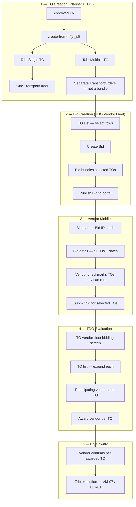

# TO Creation & Vendor Bidding Flow — Product Revision

## Summary

This document captures a **product flow change** agreed for Sprint 5 planning. It separates two concerns that were previously conflated:

| Concern | Old assumption (Sprint 4 backlog) | New flow |
|---------|-------------------------------------|----------|
| **Multiple TOs from one TR** | Multiple TOs created as a **bundle** and published in **one bidding session** at TO-creation time (VM-04-11 / VM-04-12 / FB-018) | Multiple TOs are created as **independent TO records** on the TR. No bundle at TO-creation time. |
| **Bid grouping** | Bidding session tied 1:1 to a single TO (or multi-TO bundle at creation) | TDO **selects existing TOs** from the TO list and **creates a Bid** that bundles them. Bundle is a **Bid** concept, not a TO concept. |
| **Vendor discovery** | Vendor mobile lists opportunities keyed by **TO number** | Vendor mobile lists **Bids** keyed by **Bid ID**; each Bid exposes one or more TOs inside. |
| **Vendor participation** | Vendor bids on the whole published TO/session | Vendor reviews all TOs in the Bid, **checks which TOs they can execute**, and submits participation for the selected subset. |
| **TDO award** | Award one winner per bidding session / TO | Evaluation screen is **TO-centric**: expand each TO to see participating vendors; **award per TO independently**. |
| **Post-award** | Single confirmation path per award | Vendor **confirms per awarded TO** (vehicle/driver submission per TO). |

Use this file as the **canonical product context** when writing implementation plans. Sprint 4 story files remain the baseline for APIs and AC detail; where they conflict, **this revision wins**.

---

## End-to-end flow (revised)



---

## 1. TO creation UI

**Entry:** Transport Order create-from-TR screen  
`/admin/transport/transportorder/create-from-tr/{tr_id}/`

**Applies to:** Own Fleet **and** Vendor Fleet — same tab pattern in both cases.

### Tabs

| Tab | Behaviour |
|-----|-----------|
| **Single TO** | Existing single-TO creation flow: fleet type, planned delivery date/time, line allocation, notes. Creates **one** `TransportOrder` linked to the TR. |
| **Multiple TO** | TDO defines **multiple TO rows** in one form session (e.g. per delivery date, per quantity split, per vehicle slot). On save, the system creates **separate `TransportOrder` records** — each with its own TO number, status, and line allocation. |

### Rules

- **No bundle TO** — there is no parent/child bundle entity, no shared TO number, and no single record representing “multiple legs”.
- Each TO retains a **mandatory FK to the parent TR** (`tr_id` on `TransportOrder`).
- Each TO may have its **own planned delivery date/time** (dates may differ across TOs from the same TR).
- Fleet type (Own / Vendor) is chosen per tab session; multiple TOs created in one Multiple-TO save share the same fleet type for that batch unless the UI explicitly allows per-row fleet type (default: **same fleet type for all rows in the batch**).
- After creation, TOs appear individually on the Transport Orders list with normal lifecycle (`created` → planning → …).

### Out of scope on this screen

- Bidding parameters (window, reference rate, etc.) — captured later when creating a **Bid** (§2).
- Publishing to the vendor portal — separate **Create Bid** action from the TO list.

---

## 2. Bid creation (TDO — Vendor Fleet)

**Entry:** Transport Orders list  
`/admin/transport/transportorder/`

**Actor:** TDO (Vendor Fleet) — and Tenant Admin (full access).

### Workflow

1. TDO filters/selects **one or more TOs** that are eligible for non-contractual bidding (e.g. Vendor Fleet, correct status, not already in an active bid for that TO).
2. TDO chooses **Create Bid** (bulk action or dedicated flow).
3. TDO configures **bid-level parameters** on the Bid entity:
   - Bidding window: `bid_open_date`, `bid_close_date`
   - Required vehicle type / capacity (session-level defaults; per-TO overrides only if product allows — default: **shared requirements across bundled TOs**)
   - Reference / guide rate (optional)
   - Eligibility rules (non-contractual vendors, rating threshold, etc.) — align with VM-04 AC-4
4. System creates a **Bid** (bundle) linking the selected TOs and publishes to the vendor bidding portal.
5. Linked TOs transition to an open-for-bidding state (or equivalent) **via the Bid**, not via per-TO publish from the TO detail form alone.

### Bid entity (conceptual)

```
Bid {
  bid_number / bid_id          # Display ID for vendor mobile & TDO Bids Management
  tr: FK → TransportRequisition  # Derived / validated — all member TOs must share this TR
  bidding_window: open, close
  publish_params: vehicle type, capacity, reference rate, …
  status: SCHEDULED | OPEN | CLOSED | AWARDED | CANCELLED
  created_by: TDO user
}

BidTransportOrder {            # Join table
  bid: FK → Bid
  to: FK → TransportOrder
  sort_order: int              # Display order within bid (same TR grouping)
}
```

### Validation — same TR constraint

| Rule | Detail |
|------|--------|
| **Same TR** | Every TO in a Bid **must** belong to the **same** `TransportRequisition`. Mixed-TR selection is **rejected** in UI and API. |
| **Dates may differ** | Member TOs may have different `planned_delivery_datetime` values. Bid detail surfaces each TO’s date explicitly. |
| **Same route** | Because all TOs share one TR, source/destination POIs are implicitly the same route — satisfies FB-019 (single route per bid session). |
| **One active bid per TO** | A TO must not appear in two concurrently active Bids. |
| **One vehicle per TO** | `required_vehicle_count = 1` per TO remains (FB-016). Bid does not change per-TO vehicle capacity. |
| **Eligibility** | Only Vendor Fleet TOs in a biddable status can be added. Own-fleet TOs are excluded from bid creation. |

### TO list UX hints

- When selecting TOs for a new Bid, the list should **group or sort by TR** so the TDO can easily pick TOs from the same TR.
- After a Bid is created, TO rows show a **Bid reference** (Bid ID / link to Bids Management).

---

## 3. Bids Management (admin menu)

**New menu section:** **Bids Management**

| Role | Access |
|------|--------|
| **TDO (Vendor Fleet)** | Full access for Bids they created (create, view, manage window, cancel, navigate to evaluation) |
| **Tenant Admin** | Full access (all bids in tenant) |
| **TDO (Own Fleet)** | No access (own-fleet path does not use bidding) |
| **Transport Planner** | Read-only or no access — confirm in planning session (default: **read-only list** for visibility) |

### Bids Management screens (minimum)

- **Bid list** — Bid ID, TR reference, TO count, window, status, created by, created at
- **Bid detail** — member TOs (number, date, qty), window timeline, publish params, link to evaluation
- **Actions** — extend/shrink window (VM-04 AC-6), cancel bid, open evaluation view

---

## 4. Vendor mobile — Bids tab

**Applies to:** Non-Contractual vendors (`vendor_type = NON_CONTRACTUAL` for the tenant).

### Bids list

- Primary identifier on each card: **Bid ID** (`bid_number`), **not** TO number.
- Secondary context: TR route summary (source → destination), TO count in bid, bidding window (`bid_open_date` / `bid_close_date`), urgency.
- Filters: All open bids / Submitted / Urgent — unchanged pattern from VM-03.
- Tab refresh on focus (FB-014) reloads bid list from server.

### Bid detail (tap a bid)

- Header: Bid ID, window, TDO/tenant context (FB-015).
- **TO table / checklist:** each member TO shows:
  - TO number (secondary)
  - Planned delivery date/time
  - Product / quantity / vehicle requirements
  - Checkbox: **“I can execute this trip”**
- Vendor selects **one or more TOs** they can fulfil, then proceeds to rate submission.
- Vendor submits **one bid submission per Bid** that records:
  - Proposed rate (and currency)
  - **Subset of TO IDs** the vendor is bidding on (`participating_to_ids`)
  - Offered vehicle count per selected TO = **1** (FB-016)
  - Optional remarks

### Business rules (vendor side)

| Rule | Detail |
|------|--------|
| **Selective participation** | Vendor is not required to bid on every TO in the Bid; unchecked TOs are excluded from their submission. |
| **One submission per Bid per vendor** | At most one active vendor bid per Bid (withdraw + resubmit per VM-05 policy). |
| **Immutable TO selection post-submit** | Changing which TOs are included requires withdraw (if allowed) and resubmit. |
| **Blind bidding** | Competitor rates hidden (unchanged). |
| **After award** | Awarded TOs surface in Assigned TOs / Active Trips per existing lifecycle; non-awarded TOs in the same Bid show “not awarded” on those lines only. |

### Module doc impact

Update when implementing:

- `05-modules/15-mobile-apps/vendor-mobile/03-bid-opportunities-list.md` — list keyed by Bid ID
- `05-modules/15-mobile-apps/vendor-mobile/04-bid-submission.md` — multi-TO checklist + selective participation

---

## 5. TDO bid evaluation & award

**Entry:** Per-TO vendor-fleet bidding view (existing pattern, extended)  
`/admin/transport/transportorder/{to_id}/vendor-fleet/`

This screen becomes the **evaluation hub** for TOs that are part of one or more Bids.

### Layout (revised)

- **Primary list: TOs** involved in active/recent bidding (filterable by Bid, TR, status).
- Each TO row is **expandable**:
  - Collapsed: TO number, date, qty, bid session reference, award status
  - Expanded: **participating vendors** who included this TO in their bid submission (vendor name, proposed rate, offered vehicle count, submission time)
- **Award action is per TO** — TDO selects a winning vendor for that TO independently of sibling TOs in the same Bid.
- Comparison aggregates (min/avg/max) computed **per TO** among vendors who opted into that TO (VM-06).

### Award semantics

| Scenario | Behaviour |
|----------|-----------|
| Bid has TO-A, TO-B, TO-C; Vendor X bid on A+B; Vendor Y bid on B only | TDO can award A→X, B→Y or B→X, C→another vendor, etc. |
| Partial award across a Bid | Bid session status moves to **partially awarded** until all member TOs are awarded or closed; exact enum TBD in implementation plan. |
| Reject all for one TO | Does not auto-reject other TOs in the same Bid. |
| One vehicle per TO | Award grants exactly one vehicle slot on that TO (FB-016, VM-06-9). |

### Winner visibility (FB-015)

- Winning vendor badge on evaluation screen per TO.
- Vendor mobile bid detail shows per-TO award outcome (won / not awarded / not participated).

---

## 6. Post-award vendor confirmation

Unchanged in principle (VM-07 / TEVF-03), applied **per awarded TO**:

1. Vendor receives award outcome per TO (in-app on refresh).
2. For each **awarded** TO, vendor submits vehicle + driver confirmation independently.
3. Each confirmed TO progresses to `ready_for_dispatch` and enters TLS-01 execution on its own timeline.
4. Non-awarded TOs in the same Bid remain open for re-bid or TDO cancel — product rule TBD in planning.

---

## 7. Relationship to existing backlog items

### Superseded or reframed

| Item | Previous intent | Revised intent |
|------|-----------------|----------------|
| **FB-018** | Bid requirement form **before** TO creation | **Removed.** TOs are created first (Single / Multiple tab). Bid parameters captured at **Create Bid** from TO list. |
| **VM-04-11** | Bid requirement form before TO creation | **Replaced by** Bid creation flow from TO list (§2). |
| **VM-04-12** | Single TR → multiple TOs in one bid session at creation | **Split:** (a) Multiple TO tab creates separate TOs; (b) TDO bundles them into a Bid later. |
| **TEVF-02-8** | Multi-TO bidding session at TR→TO creation | **Replaced by** Bid bundle model (§2) + same-TR validation. |

### Still applies unchanged

| Item | Notes |
|------|-------|
| **FB-016** | One vehicle per TO at publish/bid/award. |
| **FB-019** | Single route per bid session — satisfied when all TOs share one TR. |
| **FB-015** | Winner indication and window labels on vendor + TDO surfaces. |
| **FB-014** | Tab auto-refresh on vendor portal. |
| **FB-013** | TO lifecycle in vendor app post-award. |
| **VM-04 AC-3–AC-8** | Window policy, auto-close, cancel/republish, audit — apply to **Bid** entity instead of per-TO session where noted. |
| **VM-05 / VM-06** | Submission, withdraw, evaluation, winning log — extend payloads for multi-TO participation and per-TO award. |

### New scope (to be story-split in planning)

| ID (proposed) | Description |
|---------------|-------------|
| **VM-04-15** | TO create-from-TR UI — Single / Multiple tabs; multiple save creates separate TOs (no bundle) |
| **VM-04-16** | Create Bid from TO list — multi-select, same-TR validation, publish to portal |
| **VM-04-17** | Bids Management admin menu + list/detail for TDO Vendor Fleet and Admin |
| **VM-05-12** | Vendor bid submission with per-TO checkmark participation |
| **VM-06-11** | TDO evaluation UI — TO-expandable vendor list; per-TO award |
| **VM-03-12** | Vendor Bids list displays Bid ID; bid detail shows multi-TO checklist |

---

## 8. API surface (indicative — for planning)

Existing per-TO bidding endpoints in VM-04/05/06 may need a **Bid-centric** layer:

```
POST   /api/v1/tdo/bids                          # Create bid from to_ids[] + publish params
GET    /api/v1/tdo/bids                          # Bids Management list
GET    /api/v1/tdo/bids/{bid_id}                 # Bid detail + member TOs
PATCH  /api/v1/tdo/bids/{bid_id}/window          # Window timeline only (VM-04 AC-6)
POST   /api/v1/tdo/bids/{bid_id}/cancel          # Cancel bid

GET    /api/v1/vendor/bids                       # Vendor opportunities (Bid ID cards)
GET    /api/v1/vendor/bids/{bid_id}              # Bid detail + TO checklist
POST   /api/v1/vendor/bids/{bid_id}/submissions    # Rate + participating_to_ids[]

GET    /api/v1/tdo/transport-orders/{to_id}/bids  # Participating vendors for this TO (evaluation)
POST   /api/v1/tdo/transport-orders/{to_id}/award  # Award one vendor for this TO
```

Exact paths may align with existing `BiddingSession` model during implementation — planning should decide migrate vs. new `Bid` aggregate.

---

## 9. E2E journey impact

Revise **Sub-Path A Step 4–6** when implementing:

| Step | Old script | New script |
|------|------------|------------|
| 4 | Bid requirement form before TO; publish single TO | TDO creates **multiple TOs** via Multiple tab on create-from-TR; selects TOs on list; **creates Bid** and publishes |
| 5 | Vendor bids on TO | Vendor opens **Bid ID**; checks subset of TOs; submits |
| 6 | TDO awards session winner | TDO opens vendor-fleet bidding; **expands TO**; awards **per TO**; partial awards across Bid allowed |

---

## 10. Open decisions for implementation plan

1. **Bid partial-award terminal state** — when some TOs in a Bid are awarded and others are not, does the Bid stay `OPEN`, move to `PARTIALLY_AWARDED`, or split into child sessions?
2. **Re-bid for unawarded TOs** — new Bid from remaining TOs, or reopen same Bid?
3. **Transport Planner visibility** — read-only Bids Management or hidden?
4. **Rate model** — single rate for entire vendor submission vs. per-TO rate when vendor selects subset (default assumption: **one rate per bid submission** covering all checked TOs).
5. **Backward compatibility** — existing `BiddingSession` 1:1 with TO: migration path for in-flight sessions.
6. **Own Fleet Multiple TO tab** — confirm same UX as Vendor Fleet (assumed **yes** per product input).

---

## Reference links

- [VM-04 — TDO Publish to Bidding Portal](VM-04-tdo-publish-to-bidding-portal.md)
- [VM-05 — Bid Submission](VM-05-bid-submission.md)
- [VM-06 — Bid Evaluation](VM-06-bid-evaluation.md)
- [TEVF-02 — Non-Contractual Bidding](../09-to-execution-vendor-fleet/TEVF-02-non-contractual-bidding.md)
- [Vendor Mobile — Bid Opportunities](../../../05-modules/15-mobile-apps/vendor-mobile/03-bid-opportunities-list.md)
- [Sprint 5 Feedback Resolution](../feedback-resolution.md)

---

*Author: product revision 2026-06-09 | Status: Draft for planning*
