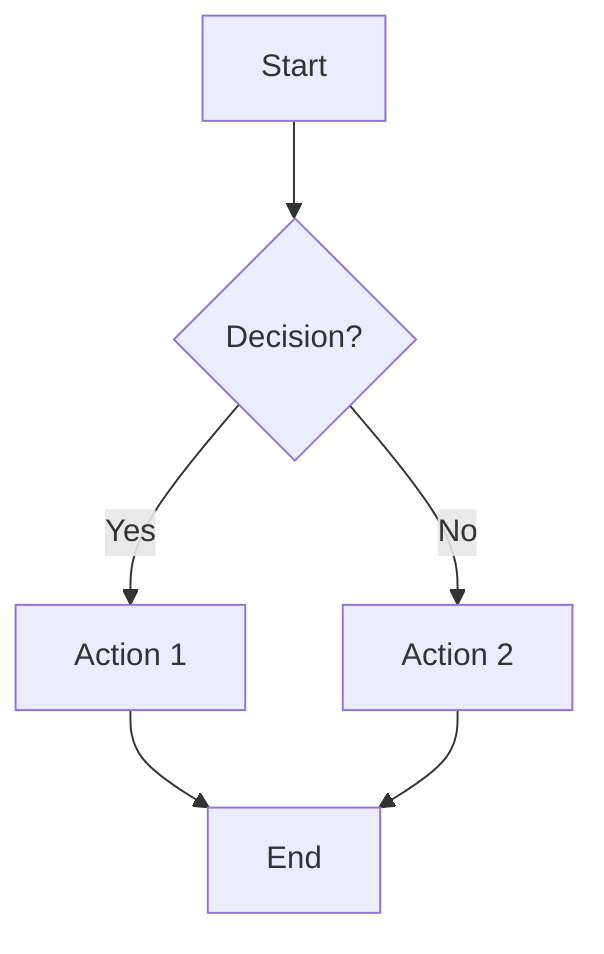

# DFMS Workflows

> Operational and user workflows for DFMS

**Status**: 🚧 In Progress  
**Last Updated**: February 13, 2026

---

## 📋 Overview

This section documents the workflows that power DFMS operations. Workflows are categorized into:
1. **Operational Flows** - System-level business processes
2. **User Workflows** - Role-specific user journeys
3. **Exception Handling** - Error and exception scenarios

---

## 📁 Documents in This Section

### **[Operational Flows](./operational-flows/)**
End-to-end business process flows (Mermaid diagrams):
- Product Requisition Flow
- Transport Order Creation Flow
- Trip Execution Flow
- Vendor Bidding Flow
- QC Inspection Flow
- Trip Costing & Invoicing Flow
- Gate & Operations Flow
- Fleet Management Flow

### **[User Workflows](./user-workflows/)**
Role-specific workflows:
- Logistics Coordinator Workflows
- Driver Workflows
- QC Supervisor Workflows
- Vendor Workflows
- Finance Team Workflows
- Fleet Manager Workflows
- System Administrator Workflows

### **[Exception Handling](./exception-handling/)**
Error and exception scenarios:
- Trip cancellation scenarios
- QC failure handling
- Vendor no-show handling
- System failure recovery
- Data inconsistency resolution

---

## 🎯 Workflow Principles

### 1. **User-Centric**
Workflows are designed around user needs and pain points.

### 2. **Clear Steps**
Each workflow has clear, numbered steps with decision points.

### 3. **Exception Handling**
All workflows include error handling and recovery paths.

### 4. **System Integration**
Workflows show integration points with external systems.

### 5. **Visual First**
All workflows are visualized using Mermaid diagrams.

---

## 🔄 Workflow Types

### Type 1: Sequential Workflows
Linear processes with clear start and end.

**Example**: Product Requisition Approval

```
Create PR → Submit → Approve → Generate TR
```

---

### Type 2: Parallel Workflows
Multiple paths executing simultaneously.

**Example**: Vendor Bidding

```
TO Created → Notify Vendors (parallel) → Collect Bids → Select Winner
```

---

### Type 3: Conditional Workflows
Branching based on conditions.

**Example**: QC Inspection

```
Inspect → Pass? → Yes: Complete Trip | No: Escalate
```

---

### Type 4: Event-Driven Workflows
Triggered by events.

**Example**: Trip Completion Notifications

```
Trip Completed (event) → Notify Stakeholders (parallel)
```

---

## 📊 Workflow Coverage

| Business Process | Operational Flow | User Workflows | Exception Handling |
|------------------|------------------|----------------|-------------------|
| Product Requisition | ✅ | ✅ | ✅ |
| Transport Management | ✅ | ✅ | ✅ |
| Vendor Management | ✅ | ✅ | ✅ |
| Operations | ✅ | ✅ | ✅ |
| Quality Control | ✅ | ✅ | ✅ |
| Trip Costing | ✅ | ✅ | ✅ |
| Fleet Management | ✅ | ✅ | ⏳ |
| Fuel Management | ⏳ | ⏳ | ⏳ |

**Legend**: ✅ Complete | 🚧 In Progress | ⏳ Planned

---

## 🔗 Related Documents

### Architecture
- [System Overview](../01-system-design/system-overview.md) - System context
- [Module Boundaries](../01-system-design/modules/module-boundaries.md) - Module responsibilities
- [Module Interactions](../01-system-design/modules/module-interactions.md) - Communication patterns

### Business Context
- [Business Processes](../../02-domain/04-business-processes/business-processes-overview.md)
- [User Stories](../../03-backlog/sprints/README.md) (94 stories, US-001–US-094; WBS: [01-source/04-wbs/](../../01-source/04-wbs/README.md))
- [Business Rules](../../02-domain/03-business-rules/business-rules.md)

**Note**: Story IDs in workflow narrative may use older references. Use the **Related Documents** links in each workflow for the current story files (WBS-aligned).

---

## 📝 How to Read Workflows

### Mermaid Diagram Notation



**Shapes**:
- **Rectangle** `[Action]` - Process step
- **Diamond** `{Decision?}` - Decision point
- **Rounded Rectangle** `([Event])` - Event
- **Cylinder** `[(Database)]` - Data store
- **Cloud** `{{External System}}` - External integration

**Arrows**:
- **Solid** `-->` - Synchronous flow
- **Dashed** `-.->` - Asynchronous flow
- **Labeled** `-->|Label|` - Conditional flow

---

## 🎓 Workflow Best Practices

### 1. **Start with Happy Path**
Document the ideal scenario first, then add exceptions.

### 2. **Show Decision Points**
Make all decision points explicit with clear conditions.

### 3. **Include Actors**
Show who performs each action (User, System, External).

### 4. **Reference Business Rules**
Link to business rules that govern the workflow.

### 5. **Show Integration Points**
Highlight external system calls and API interactions.

---

**Last Updated**: February 13, 2026  
**Status**: 🚧 In Progress  
**Contact**: Md. Mahfuzur Rahman (Mahfuzur.rahman@brainstation-23.com)
