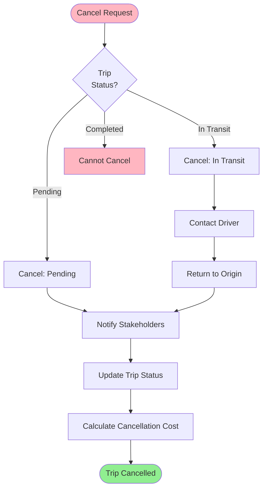

# Exception Scenarios

> Comprehensive exception scenarios and handling procedures

**Status**: ✅ Complete  
**Last Updated**: February 13, 2026

---

## 📋 Overview

This document covers all exception scenarios in DFMS, their triggers, impact, handling procedures, and recovery steps. Exceptions are organized by category and severity.

---

## 🚨 Trip-Related Exceptions

### Exception 1: Trip Cancellation

**Severity**: High  
**Frequency**: Low (5-10% of trips)  
**Impact**: Operational disruption, cost implications

#### Triggers
- Customer cancels order
- Product unavailable
- Weather conditions
- Vehicle breakdown before start
- Driver emergency

#### Detection
- User-initiated cancellation
- System detects pre-start conditions
- External notification

#### Handling Procedure

**Step 1: Cancel Trip**

**Step 2: Notify Stakeholders**
- Driver: SMS + Push notification
- Logistics Coordinator: Email + In-app
- Destination: Email notification
- Vendor (if applicable): SMS notification

**Step 3: Cost Calculation**
- If cancelled before start: No cost (or minimal)
- If cancelled in transit: Partial cost (distance traveled)
- If cancelled after operations: Full cost

**Step 4: Resource Release**
- Release vehicle assignment
- Release driver assignment
- Update availability
- Create new trip if needed

**Recovery**:
- ✅ Trip cancelled successfully
- ✅ Resources released
- ✅ Stakeholders notified
- ✅ Costs calculated

---

### Exception 2: Vehicle Breakdown

**Severity**: High  
**Frequency**: Low (2-5% of trips)  
**Impact**: Trip delay, customer impact

#### Triggers
- Mechanical failure
- Accident
- Flat tire
- Engine failure

#### Detection
- Driver reports via mobile app
- GPS shows vehicle stopped > 30 minutes
- Emergency button pressed

#### Handling Procedure

**Step 1: Receive Breakdown Report**
- Driver reports via mobile app
- System creates incident record
- Alert logistics coordinator

**Step 2: Assess Situation**
- Contact driver for details
- Determine breakdown severity
- Check vehicle location
- Estimate repair time

**Step 3: Decision Point**

**Option A: Quick Fix (< 2 hours)**
- Wait for repair
- Update ETA
- Notify destination
- Continue trip

**Option B: Replacement Vehicle**
- Find replacement vehicle
- Assign replacement driver
- Transfer product
- Continue trip with new vehicle

**Option C: Trip Cancellation**
- Cancel trip
- Return to origin
- Reschedule if needed

**Step 4: Execute Decision**
- Update trip status
- Notify stakeholders
- Log incident
- Calculate additional costs

**Recovery**:
- ✅ Breakdown handled
- ✅ Trip continued or cancelled
- ✅ Stakeholders notified
- ✅ Costs updated

---

### Exception 3: Driver Unavailability

**Severity**: Medium  
**Frequency**: Low (1-3% of trips)  
**Impact**: Trip delay, resource reallocation

#### Triggers
- Driver illness
- Driver emergency
- Driver no-show
- License expired

#### Detection
- Driver reports via app
- Driver doesn't start trip on time
- System detects license expiry

#### Handling Procedure

**Step 1: Identify Unavailability**
- Check trip status
- Contact driver
- Verify reason

**Step 2: Find Replacement**
- Search available drivers
- Check driver qualifications
- Assign replacement driver

**Step 3: Update Trip**
- Assign new driver
- Notify new driver
- Update trip details
- Notify stakeholders

**Recovery**:
- ✅ Replacement driver assigned
- ✅ Trip continues
- ✅ Stakeholders notified

---

### Exception 4: Route Deviation

**Severity**: Medium  
**Frequency**: Medium (10-15% of trips)  
**Impact**: Monitoring alert, potential delay

#### Triggers
- Vehicle deviates > 500m from planned route
- Driver takes alternative route
- Traffic conditions
- Road closure

#### Detection
- GPS tracking detects deviation
- Geofence violation
- Real-time monitoring

#### Handling Procedure

**Step 1: Detect Deviation**
- System generates alert
- Calculate deviation distance
- Check if within tolerance

**Step 2: Contact Driver**
- Send alert to driver
- Contact via phone
- Verify reason

**Step 3: Decision**

**If Valid Reason**:
- Traffic, road closure, accident
- Update route
- Log reason
- Continue monitoring

**If Invalid Reason**:
- Alert logistics coordinator
- Escalate if needed
- Log incident
- May require return to route

**Recovery**:
- ✅ Route updated or corrected
- ✅ Trip continues
- ✅ Incident logged

---

### Exception 5: Delayed Arrival

**Severity**: Medium  
**Frequency**: Medium (15-20% of trips)  
**Impact**: Customer impact, SLA breach

#### Triggers
- Traffic congestion
- Vehicle breakdown
- Route deviation
- Loading/unloading delays

#### Detection
- ETA calculation exceeds SLA
- Real-time monitoring
- Destination reports delay

#### Handling Procedure

**Step 1: Detect Delay**
- System calculates ETA
- Compares with SLA
- Generates alert if exceeded

**Step 2: Assess Impact**
- Calculate delay duration
- Check customer SLA
- Determine severity

**Step 3: Notify Stakeholders**
- Update destination ETA
- Notify customer (if required)
- Alert logistics coordinator

**Step 4: Mitigation**
- Expedite if possible
- Provide updated ETA
- Document reason

**Recovery**:
- ✅ Delay communicated
- ✅ Stakeholders notified
- ✅ ETA updated

---

## 🔬 QC-Related Exceptions

### Exception 6: QC Failure

**Severity**: High  
**Frequency**: Low (3-5% of inspections)  
**Impact**: Product rejection, return process

#### Triggers
- Product damaged
- Quantity mismatch
- Packaging damaged
- Contamination detected
- Lab test failure

#### Detection
- QC supervisor marks as failed
- Lab test results fail
- Visual inspection failure

#### Handling Procedure

**Step 1: Record Failure**
- QC supervisor records failure
- Upload evidence (photos/videos)
- Document failure reason

**Step 2: Escalate to Manager**
- System escalates automatically
- Manager reviews failure
- Manager makes decision

**Step 3: Manager Decision**

**Option A: Approve (Override)**
- Manager approves despite failure
- Product accepted
- Trip continues
- Log override reason

**Option B: Reject**
- Manager confirms rejection
- Initiate return process
- Trip status: `rejected`
- Notify all stakeholders

**Step 4: Return Process** (if rejected)
- Create return trip
- Assign vehicle/driver
- Return product to origin
- Update original trip

**Recovery**:
- ✅ Failure handled
- ✅ Decision made
- ✅ Return process initiated (if needed)
- ✅ Stakeholders notified

---

### Exception 7: Lab Test Failure

**Severity**: High  
**Frequency**: Low (1-2% of samples)  
**Impact**: Product rejection, quality concern

#### Triggers
- Sample fails quality tests
- Contamination detected
- Parameter out of range

#### Detection
- Lab technician records failure
- Test results uploaded
- System flags failure

#### Handling Procedure

**Step 1: Receive Test Results**
- Lab test completed
- Results uploaded
- System flags failure

**Step 2: Notify QC Supervisor**
- Alert QC supervisor
- Show test results
- Request decision

**Step 3: QC Decision**
- Review test results
- Make pass/fail decision
- Escalate if needed

**Step 4: Follow QC Failure Process**
- If fail: Follow Exception 6
- If pass: Complete inspection

**Recovery**:
- ✅ Test failure handled
- ✅ Decision made
- ✅ Process continues

---

## 🏢 Vendor-Related Exceptions

### Exception 8: Vendor No-Show

**Severity**: High  
**Frequency**: Low (2-5% of vendor assignments)  
**Impact**: Trip delay, customer impact

#### Triggers
- Vendor doesn't arrive at scheduled time
- Vendor cancels last minute
- Vendor vehicle unavailable

#### Detection
- Scheduled time passed
- No vehicle arrival
- Vendor reports cancellation

#### Handling Procedure

**Step 1: Detect No-Show**
- Check scheduled time
- Verify vehicle arrival
- Contact vendor

**Step 2: Contact Vendor**
- Call vendor
- Verify reason
- Determine if delay or cancellation

**Step 3: Decision**

**If Delay (< 2 hours)**:
- Wait for vendor
- Update ETA
- Notify destination

**If Cancellation**:
- Mark vendor as no-show
- Find replacement vendor
- Or convert to own fleet

**Step 4: Replacement**
- Search available vendors
- Or assign own fleet vehicle
- Update trip assignment
- Notify stakeholders

**Step 5: Vendor Penalty**
- Record no-show incident
- Update vendor rating
- Apply penalty (if contractual)
- Notify vendor

**Recovery**:
- ✅ No-show handled
- ✅ Replacement assigned
- ✅ Vendor penalized
- ✅ Trip continues

---

### Exception 9: Bid Withdrawal

**Severity**: Medium  
**Frequency**: Low (1-3% of bids)  
**Impact**: Bidding process disruption

#### Triggers
- Vendor withdraws bid before deadline
- Vendor realizes error in bid
- Vendor vehicle unavailable

#### Detection
- Vendor requests withdrawal
- System processes withdrawal

#### Handling Procedure

**Step 1: Process Withdrawal**
- Vendor requests withdrawal
- Validate withdrawal allowed (before deadline)
- Remove bid from consideration

**Step 2: Notify Stakeholders**
- Notify logistics coordinator
- Update bid count
- Continue bidding process

**Step 3: Continue Bidding**
- Other bids remain valid
- Select from remaining bids
- Or extend deadline if needed

**Recovery**:
- ✅ Bid withdrawn
- ✅ Bidding continues
- ✅ Process unaffected

---

## 💻 System Exceptions

### Exception 10: GPS Tracking Failure

**Severity**: Medium  
**Frequency**: Low (5-10% of trips)  
**Impact**: Loss of real-time tracking

#### Triggers
- GPS device failure
- Network connectivity issues
- GPS provider API down
- Device battery dead

#### Detection
- No location updates for > 5 minutes
- GPS API returns error
- Device status shows offline

#### Handling Procedure

**Step 1: Detect Failure**
- System detects no updates
- Check GPS provider status
- Verify device status

**Step 2: Fallback Options**

**Option A: Use Last Known Location**
- Display last known location
- Show timestamp
- Alert: "Location data may be stale"

**Option B: Manual Location Update**
- Driver manually updates location
- System accepts manual update
- Continue tracking

**Option C: Contact Driver**
- Call driver for location
- Update manually
- Continue monitoring

**Step 3: Recovery**
- Monitor for GPS restoration
- Auto-resume when available
- Update location history

**Recovery**:
- ✅ Fallback activated
- ✅ Tracking continues (manual or cached)
- ✅ GPS restored when available

---

### Exception 11: Network Outage

**Severity**: Critical  
**Frequency**: Very Low (< 1%)  
**Impact**: System unavailable

#### Triggers
- Internet connectivity loss
- Server downtime
- Database failure
- API gateway failure

#### Detection
- Health checks fail
- Monitoring alerts
- User reports

#### Handling Procedure

**Step 1: Detect Outage**
- Health checks fail
- Alert system administrators
- Assess severity

**Step 2: Activate Failover**
- Switch to backup servers
- Activate disaster recovery
- Maintain critical operations

**Step 3: Offline Mode** (Mobile Apps)
- Enable offline mode
- Cache data locally
- Sync when online

**Step 4: Recovery**
- Restore services
- Sync pending data
- Verify system health

**Recovery**:
- ✅ Services restored
- ✅ Data synced
- ✅ System operational

---

### Exception 12: ERP Sync Failure

**Severity**: Medium  
**Frequency**: Low (2-5% of syncs)  
**Impact**: Financial data not synced

#### Triggers
- ERP API unavailable
- Authentication failure
- Data validation error
- Network timeout

#### Detection
- Sync job fails
- Error logged
- Alert finance team

#### Handling Procedure

**Step 1: Detect Failure**
- Sync job fails
- Log error details
- Alert finance team

**Step 2: Retry Logic**
- Automatic retry (3 attempts)
- Exponential backoff
- Check ERP status

**Step 3: Manual Sync** (if retries fail)
- Finance team reviews
- Manual sync option
- Verify data before sync

**Step 4: Recovery**
- Sync successful
- Verify in ERP
- Mark as synced

**Recovery**:
- ✅ Sync completed
- ✅ Data verified
- ✅ Status updated

---

## 🏭 Operations Exceptions

### Exception 13: Weight Mismatch

**Severity**: Medium  
**Frequency**: Low (3-5% of weighings)  
**Impact**: Operations delay, data accuracy

#### Triggers
- Empty weight doesn't match vehicle master data
- Net weight doesn't match loaded quantity
- Scale calibration issue

#### Detection
- System validates weight
- Compares with expected values
- Flags if outside tolerance

#### Handling Procedure

**Step 1: Detect Mismatch**
- System flags mismatch
- Alert weighing operator
- Show expected vs actual

**Step 2: Re-Weigh**
- Re-weigh vehicle
- Verify scale calibration
- Check for errors

**Step 3: Decision**

**If Re-Weigh Matches**:
- Accept new weight
- Log original error
- Continue operations

**If Still Mismatch**:
- Escalate to supervisor
- Check vehicle master data
- May require manual override

**Step 4: Resolution**
- Update weight record
- Log resolution
- Continue operations

**Recovery**:
- ✅ Weight verified
- ✅ Operations continue
- ✅ Data corrected

---

### Exception 14: Quantity Mismatch

**Severity**: Medium  
**Frequency**: Low (2-4% of operations)  
**Impact**: Inventory accuracy, customer impact

#### Triggers
- Loaded quantity ≠ PR quantity
- Unloaded quantity ≠ Loaded quantity
- Counting error

#### Detection
- System compares quantities
- Flags if outside tolerance
- Operations staff reports

#### Handling Procedure

**Step 1: Detect Mismatch**
- System flags mismatch
- Alert operations staff
- Show expected vs actual

**Step 2: Investigate**
- Re-count quantity
- Check loading/unloading records
- Verify product details

**Step 3: Resolution**

**If Counting Error**:
- Correct count
- Update records
- Continue operations

**If Actual Mismatch**:
- Document reason
- Update quantity
- Notify stakeholders
- May require manager approval

**Step 4: Update Records**
- Update trip quantity
- Update inventory
- Log incident

**Recovery**:
- ✅ Quantity verified
- ✅ Records updated
- ✅ Operations continue

---

## 📊 Exception Summary Matrix

| Exception | Severity | Frequency | Auto-Recovery | Manual Required |
|-----------|----------|-----------|---------------|-----------------|
| Trip Cancellation | High | Low | ❌ | ✅ |
| Vehicle Breakdown | High | Low | ❌ | ✅ |
| Driver Unavailability | Medium | Low | ❌ | ✅ |
| Route Deviation | Medium | Medium | ⚠️ | ⚠️ |
| Delayed Arrival | Medium | Medium | ⚠️ | ⚠️ |
| QC Failure | High | Low | ❌ | ✅ |
| Lab Test Failure | High | Low | ❌ | ✅ |
| Vendor No-Show | High | Low | ❌ | ✅ |
| Bid Withdrawal | Medium | Low | ✅ | ❌ |
| GPS Failure | Medium | Low | ⚠️ | ⚠️ |
| Network Outage | Critical | Very Low | ⚠️ | ✅ |
| ERP Sync Failure | Medium | Low | ⚠️ | ⚠️ |
| Weight Mismatch | Medium | Low | ❌ | ✅ |
| Quantity Mismatch | Medium | Low | ❌ | ✅ |

**Legend**:
- ✅ Fully automated
- ⚠️ Partial automation
- ❌ Manual intervention required

---

## 🔗 Related Documents

### Operational Flows
- [Trip Execution Flow](../operational-flows/03-trip-execution-flow.md)
- [QC Inspection Flow](../operational-flows/06-qc-inspection-flow.md)
- [Vendor Bidding Flow](../operational-flows/04-vendor-bidding-flow.md)

### Architecture
- [Integration Patterns](../../01-system-design/integration/integration-patterns.md)
- [Design Principles](../../00-overview/design-principles.md)

---

**Document Status**: ✅ Complete  
**Last Reviewed**: February 13, 2026  
**Contact**: Md. Mahfuzur Rahman (Mahfuzur.rahman@brainstation-23.com)

