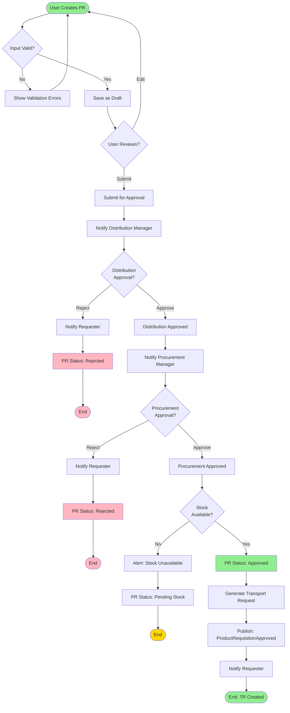

# Product Requisition Flow

> End-to-end workflow for product requisition creation and approval

**Status**: ✅ Complete  
**Last Updated**: February 13, 2026  
**Complexity**: Low  
**Estimated Duration**: 1-3 days (depending on approvals)

---

## 📋 Overview

The Product Requisition (PR) flow is the starting point for all transport operations in DFMS. It captures the demand for product movement from one location to another and routes it through appropriate approval workflows.

**Trigger**: User creates a new product requisition  
**Outcome**: Approved PR generates a Transport Request (TR)

---

## 👥 Actors

| Actor | Role | Responsibilities |
|-------|------|------------------|
| **Requester** | Distribution/Sales Team | Creates product requisition |
| **Distribution Manager** | Approver 1 | Reviews and approves from distribution perspective |
| **Procurement Manager** | Approver 2 | Reviews and approves from procurement perspective |
| **System** | Automation | Validates stock, generates TR |

---

## 🔄 Workflow Diagram



---

## 📝 Detailed Steps

### Phase 1: PR Creation (Requester)

#### Step 1: Create Product Requisition
**Actor**: Requester  
**Action**: Navigate to "Create PR" and fill in details

**Input Data**:
- Product (from master data)
- Quantity
- Origin POI (from master data)
- Destination POI (from master data)
- Requested delivery date
- Priority (normal/urgent)
- Special instructions (optional)

**Validation Rules**:
- PR-001: Product must exist in master data
- PR-002: Quantity must be > 0
- PR-003: Origin and destination must be different
- PR-004: Requested date must be in future
- PR-005: All mandatory fields must be filled

**System Actions**:
- Validate input data
- Check business rules
- Save as draft
- Generate PR number (format: PR-YYYYMMDD-XXXX)

---

#### Step 2: Review and Submit
**Actor**: Requester  
**Action**: Review PR details and submit for approval

**User Options**:
- **Save Draft**: Save for later editing
- **Submit**: Send for approval workflow
- **Cancel**: Discard PR

**System Actions** (on Submit):
- Change status: `draft` → `pending_distribution_approval`
- Create approval workflow
- Send notification to Distribution Manager
- Log audit trail

---

### Phase 2: Distribution Approval

#### Step 3: Distribution Manager Review
**Actor**: Distribution Manager  
**Action**: Review PR from distribution perspective

**Review Criteria**:
- Is the product movement justified?
- Is the destination correct?
- Is the timing appropriate?
- Are there any conflicts with existing plans?

**User Options**:
- **Approve**: Approve from distribution perspective
- **Reject**: Reject with reason
- **Request Changes**: Ask for modifications

**System Actions** (on Approve):
- Change status: `pending_distribution_approval` → `pending_procurement_approval`
- Log approval with timestamp
- Send notification to Procurement Manager
- Publish event: `DistributionApproved`

**System Actions** (on Reject):
- Change status: `pending_distribution_approval` → `rejected`
- Log rejection reason
- Send notification to Requester
- Publish event: `ProductRequisitionRejected`

---

### Phase 3: Procurement Approval

#### Step 4: Procurement Manager Review
**Actor**: Procurement Manager  
**Action**: Review PR from procurement perspective

**Review Criteria**:
- Is stock available at origin?
- Is the quantity feasible?
- Are there procurement constraints?
- Is the timing aligned with procurement plans?

**User Options**:
- **Approve**: Approve from procurement perspective
- **Reject**: Reject with reason
- **Request Changes**: Ask for modifications

**System Actions** (on Approve):
- Change status: `pending_procurement_approval` → `approved`
- Log approval with timestamp
- Trigger stock validation
- Publish event: `ProcurementApproved`

**System Actions** (on Reject):
- Change status: `pending_procurement_approval` → `rejected`
- Log rejection reason
- Send notification to Requester
- Publish event: `ProductRequisitionRejected`

---

### Phase 4: Stock Validation & TR Generation

#### Step 5: Stock Validation
**Actor**: System (automated)  
**Action**: Validate stock availability at origin

**Validation Logic**:
```python
available_stock = get_stock_at_poi(origin_poi, product)
if available_stock >= requested_quantity:
    return True
else:
    return False
```

**If Stock Available**:
- Proceed to TR generation

**If Stock Not Available**:
- Change status: `approved` → `pending_stock`
- Send alert to Procurement Manager
- Wait for stock availability
- End workflow (will resume when stock available)

---

#### Step 6: Generate Transport Request
**Actor**: System (automated)  
**Action**: Create Transport Request from approved PR

**TR Data** (copied from PR):
- PR reference
- Product, quantity
- Origin, destination
- Requested date
- Priority

**TR Data** (additional):
- TR number (format: TR-YYYYMMDD-XXXX)
- Vehicle type required (based on product and quantity)
- Status: `pending`
- Created timestamp

**System Actions**:
- Create TR record
- Link TR to PR
- Publish event: `ProductRequisitionApproved`
- Publish event: `TransportRequestCreated`
- Send notifications to stakeholders

---

## 📊 Business Rules

| Rule ID | Description | Enforcement |
|---------|-------------|-------------|
| PR-001 | Product must exist in master data | System validation |
| PR-002 | Quantity must be greater than 0 | System validation |
| PR-003 | Origin and destination must be different | System validation |
| PR-004 | Requested date must be in future | System validation |
| PR-005 | All mandatory fields required | System validation |
| PR-006 | Distribution approval required | Workflow |
| PR-007 | Procurement approval required | Workflow |
| PR-008 | Stock must be available | System check |
| PR-009 | Rejected PR cannot be resubmitted | Business logic |
| PR-010 | Approved PR generates TR automatically | System automation |

**Reference**: [Business Rules](../../../02-domain/01-business-domain/business-rules/business-rules.md)

---

## 🔔 Notifications

| Event | Recipients | Channel | Content |
|-------|-----------|---------|---------|
| PR Submitted | Distribution Manager | Email + In-app | "New PR #{pr_number} awaits your approval" |
| Distribution Approved | Procurement Manager | Email + In-app | "PR #{pr_number} approved by Distribution, awaits your approval" |
| PR Approved | Requester | Email + SMS | "PR #{pr_number} approved, TR #{tr_number} created" |
| PR Rejected | Requester | Email + In-app | "PR #{pr_number} rejected: {reason}" |
| Stock Unavailable | Procurement Manager | Email + In-app | "PR #{pr_number} pending stock availability" |

---

## 📡 Events Published

```python
# Event 1: PR Submitted
ProductRequisitionSubmitted(
    pr_id=uuid,
    pr_number=string,
    product_id=uuid,
    quantity=decimal,
    origin_poi_id=uuid,
    destination_poi_id=uuid,
    requested_date=date,
    submitted_by=uuid,
    submitted_at=timestamp
)

# Event 2: PR Approved
ProductRequisitionApproved(
    pr_id=uuid,
    pr_number=string,
    tr_id=uuid,  # Generated TR
    tr_number=string,
    approved_by=[uuid, uuid],  # Distribution + Procurement
    approved_at=timestamp
)

# Event 3: PR Rejected
ProductRequisitionRejected(
    pr_id=uuid,
    pr_number=string,
    rejected_by=uuid,
    rejection_reason=string,
    rejected_at=timestamp
)
```

---

## ⚠️ Exception Scenarios

### Scenario 1: Both Approvers Reject
**Trigger**: Distribution or Procurement Manager rejects  
**Handling**: 
- PR status → `rejected`
- Notify requester with reason
- End workflow
- Requester can create new PR (cannot resubmit)

### Scenario 2: Stock Becomes Unavailable
**Trigger**: Stock check fails after approval  
**Handling**:
- PR status → `pending_stock`
- Alert Procurement Manager
- Pause workflow
- Resume when stock available

### Scenario 3: Approval Timeout
**Trigger**: Approver doesn't respond within SLA (e.g., 24 hours)  
**Handling**:
- Send reminder notification
- Escalate to approver's manager (if configured)
- Log SLA breach

### Scenario 4: Requester Cancels During Approval
**Trigger**: Requester requests cancellation  
**Handling**:
- Check current status
- If not yet approved: Allow cancellation
- If approved: Require manager approval for cancellation
- If TR already created: Cannot cancel PR (must cancel TR)

---

## 📈 Performance Metrics

| Metric | Target | Measurement |
|--------|--------|-------------|
| **PR Creation Time** | < 5 minutes | Time from start to submit |
| **Distribution Approval Time** | < 4 hours | Time from submit to distribution approval |
| **Procurement Approval Time** | < 4 hours | Time from distribution approval to procurement approval |
| **Total Approval Time** | < 24 hours | Time from submit to final approval |
| **Approval Rate** | > 90% | % of PRs approved |
| **Stock Availability** | > 95% | % of approved PRs with available stock |

---

## 🔗 Related Documents

### Architecture
- [Module Boundaries](../../01-system-design/modules/module-boundaries.md#2-product-requisition-management)
- [Module Interactions](../../01-system-design/modules/module-interactions.md)

### Business Context
- [Business Process](../../../02-domain/01-business-domain/business-processes/business-processes-overview.md)
- [User Story: US-009](../../../02-domain/03-backlog/phase-1/user-stories/US-009-fg-transfer-requisition.md)
- [User Story: US-011](../../../02-domain/03-backlog/phase-1/user-stories/US-011-distribution-approval.md)

### Other Workflows
- [Transport Order Creation Flow](./02-transport-order-creation-flow.md) - Next step after PR approval

---

## 📝 Source Documents

- [source-documents/01-prd/PRD_DFMS_v1.0.md](../../../../source-documents/01-prd/PRD_DFMS_v1.0.md) - Product requirements
- [source-documents/02-flow-diagram/](../../../../source-documents/02-flow-diagram/) - Flow diagrams
- [02-domain/02-requirements/functional-requirements/](../../../../02-domain/02-requirements/functional-requirements/)

---

**Document Status**: ✅ Complete  
**Last Reviewed**: February 13, 2026  
**Contact**: Md. Mahfuzur Rahman (Mahfuzur.rahman@brainstation-23.com)

