# Trip Execution Flow

> Complete trip lifecycle from start to completion

**Status**: ✅ Complete  
**Last Updated**: February 13, 2026  
**Complexity**: High  
**Estimated Duration**: 4-12 hours (depending on distance)

---

## 📋 Overview

The Trip Execution flow covers the complete lifecycle of a trip from driver starting the trip to final completion, including real-time tracking, operations integration, and status updates.

**Trigger**: Driver starts trip via mobile app  
**Outcome**: Trip completed with all operations recorded

---

## 👥 Actors

| Actor | Role | Responsibilities |
|-------|------|------------------|
| **Driver** | Primary Executor | Starts trip, drives, completes trip |
| **Gate Operator** | Operations | Records gate entry/exit |
| **Weighing Operator** | Operations | Records weighing |
| **Loading/Unloading Staff** | Operations | Records loading/unloading |
| **QC Supervisor** | Quality Control | Performs inspection |
| **System** | Automation | Tracks location, updates status |
| **GPS/VTS Provider** | External System | Provides real-time location |

---

## 🔄 Workflow Diagram

```mermaid
graph TD
    Start([Trip Scheduled]) --> DriverStart{Driver Starts<br/>Trip?}
    
    DriverStart -->|Yes| StartTrip[Driver: Start Trip via Mobile]
    StartTrip --> RecordStart[Record: Start Time, Odometer, Location]
    RecordStart --> UpdateStatus1[Status: in_transit]
    UpdateStatus1 --> PublishStart[Publish: TripStarted]
    PublishStart --> NotifyStakeholders1[Notify: Logistics, Operations]
    
    NotifyStakeholders1 --> RealTimeTracking[Real-time GPS Tracking]
    RealTimeTracking --> ArriveOrigin{Arrived at<br/>Origin?}
    
    ArriveOrigin -->|No| ContinueTracking[Continue Tracking]
    ContinueTracking --> RealTimeTracking
    
    ArriveOrigin -->|Yes| GateIn[Gate Operator: Gate-In]
    GateIn --> RecordGateIn[Record: Gate Entry Time]
    RecordGateIn --> PublishGateIn[Publish: GateInCompleted]
    
    PublishGateIn --> Weighing[Weighing Operator: Weighing]
    Weighing --> RecordWeight[Record: Empty Weight]
    RecordWeight --> PublishWeighing1[Publish: WeighingCompleted]
    
    PublishWeighing1 --> Loading[Loading Staff: Start Loading]
    Loading --> RecordLoading[Record: Loading Start Time]
    RecordLoading --> CompleteLoading[Complete Loading]
    CompleteLoading --> RecordLoadingEnd[Record: Loading End Time, Quantity]
    RecordLoadingEnd --> PublishLoading[Publish: LoadingCompleted]
    
    PublishLoading --> Weighing2[Weighing Operator: Weighing]
    Weighing2 --> RecordWeight2[Record: Loaded Weight]
    RecordWeight2 --> PublishWeighing2[Publish: WeighingCompleted]
    
    PublishWeighing2 --> GateOut[Gate Operator: Gate-Out]
    GateOut --> RecordGateOut[Record: Gate Exit Time]
    RecordGateOut --> PublishGateOut[Publish: GateOutCompleted]
    
    PublishGateOut --> InTransit[In Transit to Destination]
    InTransit --> RealTimeTracking2[Real-time GPS Tracking]
    RealTimeTracking2 --> ArriveDest{Arrived at<br/>Destination?}
    
    ArriveDest -->|No| ContinueTracking2[Continue Tracking]
    ContinueTracking2 --> RealTimeTracking2
    
    ArriveDest -->|Yes| GateInDest[Gate Operator: Gate-In]
    GateInDest --> RecordGateInDest[Record: Gate Entry Time]
    RecordGateInDest --> PublishGateInDest[Publish: GateInCompleted]
    
    PublishGateInDest --> Unloading[Unloading Staff: Start Unloading]
    Unloading --> RecordUnloading[Record: Unloading Start Time]
    RecordUnloading --> CompleteUnloading[Complete Unloading]
    CompleteUnloading --> RecordUnloadingEnd[Record: Unloading End Time]
    RecordUnloadingEnd --> PublishUnloading[Publish: UnloadingCompleted]
    
    PublishUnloading --> QCInspection[QC Supervisor: QC Inspection]
    QCInspection --> QCResult{QC<br/>Result?}
    
    QCResult -->|Pass| QCPass[QC Passed]
    QCPass --> PublishQCPass[Publish: QCInspectionCompleted]
    
    QCResult -->|Fail| QCFail[QC Failed]
    QCFail --> Escalate[Escalate to Manager]
    Escalate --> ManagerDecision{Manager<br/>Decision?}
    
    ManagerDecision -->|Approve| QCPass
    ManagerDecision -->|Reject| TripRejected[Trip Rejected]
    TripRejected --> End1([End: Trip Failed])
    
    PublishQCPass --> CompleteTrip[Driver: Complete Trip]
    CompleteTrip --> RecordEnd[Record: End Time, Odometer, Location]
    RecordEnd --> UpdateStatus2[Status: completed]
    UpdateStatus2 --> PublishComplete[Publish: TripCompleted]
    
    PublishComplete --> CalculateDistance[Calculate: Distance Traveled]
    CalculateDistance --> UpdateTripData[Update Trip: Final Data]
    UpdateTripData --> NotifyStakeholders2[Notify: All Stakeholders]
    NotifyStakeholders2 --> TriggerCosting[Trigger: Trip Costing]
    TriggerCosting --> End2([End: Trip Completed])
    
    style Start fill:#90EE90
    style End1 fill:#FFB6C1
    style End2 fill:#90EE90
    style QCPass fill:#90EE90
    style QCFail fill:#FFB6C1
```



---

## 📝 Detailed Steps

### Phase 1: Trip Start

#### Step 1: Driver Starts Trip
**Actor**: Driver  
**Action**: Open mobile app, select trip, tap "Start Trip"

**Pre-conditions**:
- Trip status = `pending`
- Scheduled date = today
- Driver is at origin location (or within 500m)

**Mobile App Actions**:
- Display trip details
- Show origin location on map
- Enable "Start Trip" button
- Validate driver location

**System Actions** (on Start):
- Record start time
- Record start odometer reading
- Record start location (GPS)
- Update trip status: `pending` → `in_transit`
- Publish event: `TripStarted`
- Start real-time location tracking (every 30-60 seconds)

**Data Captured**:
```python
{
    "trip_id": uuid,
    "start_time": timestamp,
    "start_odometer": decimal,
    "start_location": {
        "latitude": float,
        "longitude": float,
        "address": string
    },
    "status": "in_transit",
    "started_by": driver_id
}
```

---

#### Step 2: Real-Time Location Tracking
**Actor**: System (automated)  
**Action**: Continuously track vehicle location

**Tracking Frequency**: Every 30-60 seconds

**Data Captured**:
```python
{
    "trip_id": uuid,
    "timestamp": timestamp,
    "location": {
        "latitude": float,
        "longitude": float,
        "speed": float,
        "heading": float
    },
    "odometer": decimal
}
```

**Storage**:
- Real-time: Redis cache (for dashboard)
- Historical: Database (`trip_locations` table)

**System Actions**:
- Update Redis cache with latest location
- Push to WebSocket for real-time dashboard
- Store in database (batch every 5 minutes)
- Check geofence violations
- Calculate ETA to destination

---

### Phase 2: Origin Operations

#### Step 3: Gate-In at Origin
**Actor**: Gate Operator  
**Action**: Record vehicle entry at origin gate

**Trigger**: Vehicle arrives at origin gate

**Gate Operator Actions**:
- Scan vehicle registration number (or manual entry)
- Verify trip number
- Record entry time
- Take photo (optional)

**System Actions**:
- Create gate entry record
- Link to trip
- Publish event: `GateInCompleted`
- Notify weighing operator

**Data Captured**:
```python
{
    "gate_entry_id": uuid,
    "trip_id": uuid,
    "poi_id": origin_poi_id,
    "entry_time": timestamp,
    "vehicle_registration": string,
    "operator_id": uuid
}
```

---

#### Step 4: Empty Vehicle Weighing
**Actor**: Weighing Operator  
**Action**: Weigh empty vehicle

**System Actions**:
- Display trip details
- Show expected empty weight (from vehicle master data)
- Record actual weight
- Validate weight (should match ±5% of expected)

**Data Captured**:
```python
{
    "weighing_id": uuid,
    "trip_id": uuid,
    "weighing_type": "empty",
    "weight": decimal,
    "weighing_time": timestamp,
    "operator_id": uuid
}
```

**Business Rules**:
- SCALE-001: Empty weight must match vehicle master data (±5%)
- SCALE-002: Weighing must be done before loading

---

#### Step 5: Loading Operations
**Actor**: Loading Staff  
**Action**: Load product onto vehicle

**Loading Process**:
1. Loading staff starts loading operation
2. Record loading start time
3. Load product (manual or automated)
4. Record quantity loaded
5. Complete loading
6. Record loading end time

**System Actions**:
- Create loading operation record
- Update trip with loaded quantity
- Publish event: `LoadingStarted` → `LoadingCompleted`
- Notify weighing operator for loaded weight check

**Data Captured**:
```python
{
    "loading_id": uuid,
    "trip_id": uuid,
    "start_time": timestamp,
    "end_time": timestamp,
    "quantity_loaded": decimal,
    "loaded_by": uuid
}
```

---

#### Step 6: Loaded Vehicle Weighing
**Actor**: Weighing Operator  
**Action**: Weigh vehicle after loading

**System Actions**:
- Record loaded weight
- Calculate net weight: `loaded_weight - empty_weight`
- Validate against loaded quantity
- Publish event: `WeighingCompleted`

**Validation**:
- SCALE-003: Net weight should match loaded quantity (±2%)
- SCALE-004: Loaded weight must be > empty weight

---

#### Step 7: Gate-Out at Origin
**Actor**: Gate Operator  
**Action**: Record vehicle exit at origin gate

**System Actions**:
- Create gate exit record
- Record exit time
- Publish event: `GateOutCompleted`
- Notify destination gate operator (if configured)

---

### Phase 3: In Transit

#### Step 8: Real-Time Tracking During Transit
**Actor**: System (automated)  
**Action**: Continuously track vehicle location

**Tracking Features**:
- Real-time location updates
- Speed monitoring
- Route deviation alerts
- ETA calculation
- Geofence monitoring

**Alerts Generated**:
- Route deviation (> 500m from planned route)
- Speed violation (> speed limit)
- Long stop (> 30 minutes)
- ETA delay (> 1 hour)

**Dashboard Display**:
- Live vehicle location on map
- Current speed
- Distance traveled
- Distance remaining
- ETA to destination

---

### Phase 4: Destination Operations

#### Step 9: Gate-In at Destination
**Actor**: Gate Operator  
**Action**: Record vehicle entry at destination gate

**Similar to Step 3**, but at destination:
- Create gate entry record
- Record entry time
- Publish event: `GateInCompleted`
- Notify unloading staff

---

#### Step 10: Unloading Operations
**Actor**: Unloading Staff  
**Action**: Unload product from vehicle

**Unloading Process**:
1. Unloading staff starts unloading operation
2. Record unloading start time
3. Unload product
4. Record quantity unloaded
5. Complete unloading
6. Record unloading end time

**System Actions**:
- Create unloading operation record
- Update trip with unloaded quantity
- Publish event: `UnloadingStarted` → `UnloadingCompleted`
- Trigger QC inspection creation

**Validation**:
- LOAD-001: Unloaded quantity should match loaded quantity (±1%)

---

#### Step 11: QC Inspection
**Actor**: QC Supervisor  
**Action**: Perform quality inspection

**Inspection Process**:
1. QC supervisor receives notification
2. Opens QC inspection in mobile app
3. Performs physical inspection
4. Takes photos/videos
5. Records inspection results
6. Submits inspection

**Inspection Criteria**:
- Product condition
- Quantity verification
- Packaging integrity
- Temperature (if applicable)
- Documentation check

**System Actions**:
- Create QC inspection record
- Upload photos/videos to S3
- Publish event: `QCInspectionStarted` → `QCInspectionCompleted`

**If QC Passes**:
- Trip can proceed to completion
- Publish event: `QCInspectionCompleted` (status: pass)

**If QC Fails**:
- Escalate to manager
- Manager reviews and decides
- If approved: Trip proceeds
- If rejected: Trip fails, initiate return process

---

### Phase 5: Trip Completion

#### Step 12: Driver Completes Trip
**Actor**: Driver  
**Action**: Tap "Complete Trip" in mobile app

**Pre-conditions**:
- QC inspection completed (if required)
- Unloading completed
- Driver is at destination location

**System Actions**:
- Record end time
- Record end odometer reading
- Record end location (GPS)
- Calculate distance traveled: `end_odometer - start_odometer`
- Update trip status: `in_transit` → `completed`
- Publish event: `TripCompleted`

**Data Captured**:
```python
{
    "trip_id": uuid,
    "end_time": timestamp,
    "end_odometer": decimal,
    "end_location": {
        "latitude": float,
        "longitude": float,
        "address": string
    },
    "distance_traveled": decimal,
    "duration": timedelta,
    "status": "completed"
}
```

---

#### Step 13: Final Trip Data Update
**Actor**: System (automated)  
**Action**: Calculate and update final trip metrics

**Calculations**:
- Total distance: `end_odometer - start_odometer`
- Total duration: `end_time - start_time`
- Average speed: `distance / duration`
- Fuel consumption (if available from IoT)
- Route efficiency: `actual_distance / planned_distance`

**System Actions**:
- Update trip record with final metrics
- Generate trip summary report
- Publish event: `TripCompleted` (with full data)
- Trigger trip costing workflow

---

## 📊 Business Rules

| Rule ID | Description | Enforcement |
|---------|-------------|-------------|
| TRIP-001 | Trip can only be started by assigned driver | System validation |
| TRIP-002 | Trip start location must be at origin (±500m) | GPS validation |
| TRIP-003 | Gate-in must be recorded before weighing | Workflow |
| TRIP-004 | Empty weighing must be done before loading | Workflow |
| TRIP-005 | Loading must be done before gate-out | Workflow |
| TRIP-006 | Gate-out must be done before transit | Workflow |
| TRIP-007 | QC inspection required after unloading | Workflow |
| TRIP-008 | Trip can only be completed after QC pass | System validation |
| TRIP-009 | Distance traveled must be > 0 | System validation |
| TRIP-010 | Trip duration must be reasonable | System validation |

---

## 🔔 Notifications

| Event | Recipients | Channel | Content |
|-------|-----------|---------|---------|
| Trip Started | Logistics, Operations | Email + In-app | "Trip TRIP-001 started" |
| Gate-In | Weighing Operator | In-app | "Vehicle at gate, ready for weighing" |
| Loading Completed | Gate Operator | In-app | "Loading complete, ready for gate-out" |
| Gate-Out | Destination Gate | In-app | "Vehicle departed, ETA: {time}" |
| Arrived Destination | Unloading Staff | SMS + In-app | "Vehicle arrived at destination" |
| Unloading Completed | QC Supervisor | SMS + In-app | "Unloading complete, QC required" |
| QC Completed | Driver, Logistics | Email + In-app | "QC completed, trip can be finished" |
| Trip Completed | All Stakeholders | Email + SMS | "Trip TRIP-001 completed successfully" |

---

## 📡 Events Published

```python
# Event 1: Trip Started
TripStarted(
    trip_id=uuid,
    trip_number=string,
    to_id=uuid,
    vehicle_id=uuid,
    driver_id=uuid,
    start_time=timestamp,
    start_location=location,
    started_by=uuid
)

# Event 2: Gate-In Completed
GateInCompleted(
    gate_entry_id=uuid,
    trip_id=uuid,
    poi_id=uuid,
    entry_time=timestamp,
    vehicle_registration=string
)

# Event 3: Loading Completed
LoadingCompleted(
    loading_id=uuid,
    trip_id=uuid,
    quantity_loaded=decimal,
    completed_at=timestamp
)

# Event 4: Gate-Out Completed
GateOutCompleted(
    gate_exit_id=uuid,
    trip_id=uuid,
    poi_id=uuid,
    exit_time=timestamp
)

# Event 5: Unloading Completed
UnloadingCompleted(
    unloading_id=uuid,
    trip_id=uuid,
    quantity_unloaded=decimal,
    completed_at=timestamp
)

# Event 6: QC Inspection Completed
QCInspectionCompleted(
    inspection_id=uuid,
    trip_id=uuid,
    result='pass' | 'fail',
    inspector_id=uuid,
    completed_at=timestamp
)

# Event 7: Trip Completed
TripCompleted(
    trip_id=uuid,
    trip_number=string,
    distance_traveled=decimal,
    duration=timedelta,
    end_time=timestamp,
    completed_at=timestamp
)
```

---

## ⚠️ Exception Scenarios

### Scenario 1: Driver Cannot Start Trip
**Trigger**: Driver not at origin location  
**Handling**:
- Show error: "You must be at origin to start trip"
- Display origin location on map
- Allow manual override (with manager approval)

### Scenario 2: Route Deviation
**Trigger**: Vehicle deviates > 500m from planned route  
**Handling**:
- Send alert to logistics coordinator
- Log deviation event
- Allow driver to update route (if valid reason)
- Continue tracking

### Scenario 3: Long Stop
**Trigger**: Vehicle stopped > 30 minutes  
**Handling**:
- Send alert to logistics coordinator
- Contact driver for reason
- Log stop event
- Resume tracking when vehicle moves

### Scenario 4: QC Failure
**Trigger**: QC inspection fails  
**Handling**:
- Escalate to manager
- Manager reviews and decides
- If approved: Trip proceeds
- If rejected: Initiate return process
- Create incident report

### Scenario 5: GPS Tracking Lost
**Trigger**: GPS signal lost for > 5 minutes  
**Handling**:
- Alert logistics coordinator
- Contact driver via phone
- Use last known location
- Resume tracking when signal returns

---

## 📈 Performance Metrics

| Metric | Target | Measurement |
|--------|--------|-------------|
| **Trip Start Time** | < 5 minutes | Time from scheduled to actual start |
| **Origin Operations Time** | < 2 hours | Gate-in to gate-out at origin |
| **Transit Time** | Per route | Actual vs planned |
| **Destination Operations Time** | < 2 hours | Gate-in to completion at destination |
| **Total Trip Time** | Per route | Start to completion |
| **Route Adherence** | > 95% | % trips following planned route |
| **On-Time Completion** | > 90% | % trips completed within SLA |

---

## 🔗 Related Documents

### Architecture
- [Module Boundaries](../../01-system-design/modules/module-boundaries.md#3-transport-management)
- [Module Interactions](../../01-system-design/modules/module-interactions.md)

### Business Context
- [User Story: US-052](../../../_meta/archive/backlog-stories-pre-sprint2/US-052-driver-mobile-interface.md)
- [Business Process](../../../02-domain/04-business-processes/business-processes-overview.md)

### Other Workflows
- [Transport Order Creation Flow](./02-transport-order-creation-flow.md) - Previous step
- [Gate & Operations Flow](./05-gate-operations-flow.md) - Operations details
- [QC Inspection Flow](./06-qc-inspection-flow.md) - QC details
- [Trip Costing Flow](./07-trip-costing-invoicing-flow.md) - Next step

---

**Document Status**: ✅ Complete  
**Last Reviewed**: February 13, 2026  
**Contact**: Md. Mahfuzur Rahman (Mahfuzur.rahman@brainstation-23.com)

