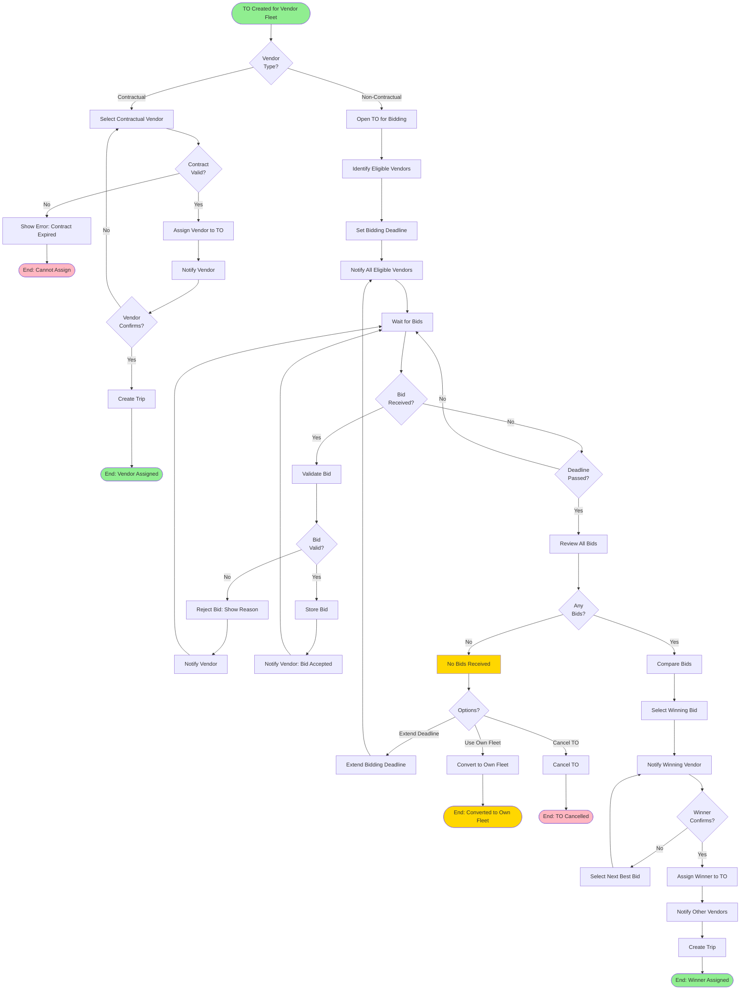

# Vendor Bidding Flow

> Vendor bidding and selection process for transport orders

**Status**: ✅ Complete  
**Last Updated**: February 13, 2026  
**Complexity**: Medium  
**Estimated Duration**: 2-6 hours (bidding window)

---

## 📋 Overview

The Vendor Bidding flow manages the competitive bidding process for transport orders assigned to vendor fleet. Vendors submit bids, and the system facilitates bid review and selection.

**Trigger**: TO created with fleet_type = `vendor` and vendor_type = `non-contractual`  
**Outcome**: Winning vendor selected and assigned to TO

---

## 👥 Actors

| Actor | Role | Responsibilities |
|-------|------|------------------|
| **Logistics Coordinator** | Bid Manager | Creates TO, reviews bids, selects winner |
| **Vendor** | Bidder | Submits bid, provides vehicle/driver details |
| **System** | Automation | Notifies vendors, validates bids, tracks deadline |
| **SMS Gateway** | External System | Sends bid notifications |

---

## 🔄 Workflow Diagram



---

## 📝 Detailed Steps

### Phase 1: TO Creation & Vendor Type Decision

#### Step 1: Create TO for Vendor Fleet
**Actor**: Logistics Coordinator  
**Action**: Create TO and select fleet_type = `vendor`

**System Actions**:
- Create TO record
- Set fleet_type = `vendor`
- Determine vendor_type (contractual vs non-contractual)
- Publish event: `TransportOrderCreated`

**Vendor Type Logic**:
```python
if vendor_has_active_contract(vendor_id, route):
    vendor_type = 'contractual'
else:
    vendor_type = 'non-contractual'
```

---

### Phase 2A: Contractual Vendor Path

#### Step 2: Select Contractual Vendor
**Actor**: Logistics Coordinator  
**Action**: Select vendor from contractual vendor list

**Vendor Selection Criteria**:
- Active contract for route
- Contract validity period
- Vendor rating
- Vehicle availability
- Performance history

**System Actions**:
- Validate contract exists and is active
- Check contract terms (rates, vehicle types)
- Display vendor details

---

#### Step 3: Assign Contractual Vendor
**Actor**: Logistics Coordinator  
**Action**: Assign vendor to TO

**System Actions**:
- Update TO with vendor_id
- Set TO status: `pending` → `vendor_assigned`
- Publish event: `VendorAssigned`
- Send notification to vendor

**Vendor Notification**:
- SMS: "TO-001 assigned to you. Route: Dhaka to Mymensingh. Confirm vehicle/driver details."
- Email: TO details with confirmation link
- Push: Notification in vendor mobile app

---

#### Step 4: Vendor Confirmation
**Actor**: Vendor  
**Action**: Confirm vehicle and driver details

**Vendor Provides**:
- Vehicle registration number
- Driver name and contact
- Driver license number
- Expected arrival time

**System Actions**:
- Validate vehicle (must be registered vendor vehicle)
- Validate driver (must have valid license)
- Update TO with vehicle/driver details
- Create trip
- Publish event: `TripCreated`

---

### Phase 2B: Non-Contractual Bidding Path

#### Step 5: Open TO for Bidding
**Actor**: System (automated)  
**Action**: Open TO for competitive bidding

**System Actions**:
- Set TO status: `open_for_bidding`
- Set bidding deadline (default: 4 hours from creation)
- Identify eligible vendors
- Publish event: `TransportOrderOpenForBidding`

**Eligible Vendor Criteria**:
```python
eligible_vendors = Vendor.objects.filter(
    status='active',
    vehicle_types__contains=to.vehicle_type_required,
    service_zones__contains=to.origin_poi.zone,
    rating__gte=3.0  # Minimum rating
)
```

---

#### Step 6: Notify Eligible Vendors
**Actor**: System (automated)  
**Action**: Send bid invitations to all eligible vendors

**Notification Channels**:
- SMS: "New TO available! TO-001: Dhaka to Mymensingh. Bid by 2PM. Amount: 15,000 BDT"
- Push: Notification in vendor mobile app
- Email: Detailed TO information

**Notification Content**:
- TO number
- Route (origin → destination)
- Product and quantity
- Vehicle type required
- Bidding deadline
- Estimated value
- Link to submit bid

**System Actions**:
- Create bid invitation records
- Track notification delivery
- Log vendor responses

---

#### Step 7: Vendor Submits Bid
**Actor**: Vendor  
**Action**: Submit bid via mobile app or web portal

**Bid Submission Form**:
- Bid amount (required)
- Vehicle registration number (required)
- Driver name and contact (required)
- Driver license number (required)
- Estimated arrival time (optional)
- Special notes (optional)

**Bid Validation**:
```python
def validate_bid(bid):
    errors = []
    
    # VEN-011: Bid amount must be > 0
    if bid.amount <= 0:
        errors.append("Bid amount must be greater than 0")
    
    # VEN-012: Vehicle must be registered vendor vehicle
    if not is_vendor_vehicle(bid.vehicle_registration, bid.vendor_id):
        errors.append("Vehicle must be registered to vendor")
    
    # VEN-013: Driver must have valid license
    if not is_valid_license(bid.driver_license):
        errors.append("Driver license is invalid or expired")
    
    # VEN-014: Bid must be submitted before deadline
    if bid.submitted_at > bid.to.bidding_deadline:
        errors.append("Bid submitted after deadline")
    
    return errors
```

**System Actions** (on Submit):
- Validate bid data
- Store bid record
- Publish event: `VendorBidSubmitted`
- Send confirmation to vendor

---

#### Step 8: Bid Review & Validation
**Actor**: System (automated)  
**Action**: Validate and store bid

**Validation Checks**:
- Bid amount is positive
- Vehicle belongs to vendor
- Driver license is valid
- Bid submitted before deadline
- Vendor has active account

**If Valid**:
- Store bid with status: `submitted`
- Send confirmation: "Bid submitted successfully"
- Publish event: `VendorBidSubmitted`

**If Invalid**:
- Reject bid with reason
- Send notification: "Bid rejected: {reason}"
- Allow vendor to resubmit (if deadline not passed)

---

#### Step 9: Wait for Bidding Deadline
**Actor**: System (automated)  
**Action**: Monitor bidding window

**System Actions**:
- Track time remaining
- Send reminder notifications (1 hour before deadline)
- Close bidding at deadline
- Publish event: `BiddingDeadlineReached`

**Reminder Notifications**:
- 1 hour before: "1 hour left to bid on TO-001"
- 30 minutes before: "30 minutes left to bid on TO-001"
- 15 minutes before: "Final 15 minutes to bid on TO-001"

---

#### Step 10: Review All Bids
**Actor**: Logistics Coordinator  
**Action**: Review submitted bids after deadline

**Bid Comparison Display**:
| Vendor | Bid Amount | Vehicle | Driver | Rating | Status |
|--------|------------|---------|--------|--------|--------|
| Vendor A | 14,500 BDT | ABC-123 | Driver X | 4.5 | Submitted |
| Vendor B | 15,000 BDT | XYZ-789 | Driver Y | 4.2 | Submitted |
| Vendor C | 14,800 BDT | DEF-456 | Driver Z | 4.8 | Submitted |

**Sorting Options**:
- By bid amount (lowest first)
- By vendor rating (highest first)
- By vehicle availability
- By driver experience

---

#### Step 11: Select Winning Bid
**Actor**: Logistics Coordinator  
**Action**: Select best bid based on criteria

**Selection Criteria** (in priority order):
1. **Bid Amount** (lowest cost)
2. **Vendor Rating** (reliability)
3. **Vehicle Availability** (immediate availability preferred)
4. **Driver Experience** (experienced drivers preferred)
5. **Past Performance** (on-time delivery rate)

**System Actions**:
- Mark selected bid as `accepted`
- Mark other bids as `rejected`
- Update TO with winning vendor
- Publish event: `VendorBidAccepted`
- Publish event: `VendorBidRejected` (for others)

---

#### Step 12: Notify Vendors
**Actor**: System (automated)  
**Action**: Send notifications to all vendors

**Winning Vendor Notification**:
- SMS: "Congratulations! Your bid for TO-001 accepted. Amount: 14,500 BDT. Confirm vehicle/driver."
- Email: Detailed acceptance letter
- Push: "Bid Accepted" notification

**Losing Vendor Notification**:
- SMS: "Thank you for bidding. Your bid for TO-001 was not selected."
- Email: Polite rejection notice
- Push: "Bid Not Selected" notification

---

#### Step 13: Winner Confirmation
**Actor**: Winning Vendor  
**Action**: Confirm vehicle and driver details

**Similar to Step 4**:
- Vendor confirms vehicle/driver
- System validates details
- Create trip
- Publish event: `TripCreated`

---

### Phase 3: No Bids Scenario

#### Step 14: Handle No Bids
**Actor**: Logistics Coordinator  
**Action**: Decide on action when no bids received

**Options**:

**Option 1: Extend Deadline**
- Extend bidding deadline by 2-4 hours
- Re-notify eligible vendors
- Resume bidding process

**Option 2: Convert to Own Fleet**
- Convert TO to use own fleet
- Follow Transport Order Creation Flow (own fleet path)
- Assign own vehicle/driver

**Option 3: Cancel TO**
- Cancel TO
- Notify requester
- Create new TO if needed

---

## 📊 Business Rules

| Rule ID | Description | Enforcement |
|---------|-------------|-------------|
| VEN-001 | Vendor must be active to bid | System validation |
| VEN-002 | Bid amount must be > 0 | System validation |
| VEN-003 | Vehicle must belong to vendor | System validation |
| VEN-004 | Driver must have valid license | System validation |
| VEN-005 | Bid must be submitted before deadline | System validation |
| VEN-006 | Vendor can submit only one bid per TO | Business logic |
| VEN-007 | Bid cannot be modified after submission | Business logic |
| VEN-008 | Bid can be withdrawn before deadline | Business logic |
| VEN-009 | Winning bid must be confirmed by vendor | Workflow |
| VEN-010 | Contractual vendor has priority | Business logic |

---

## 🔔 Notifications

| Event | Recipients | Channel | Content |
|-------|-----------|---------|---------|
| TO Open for Bidding | Eligible Vendors | SMS + Push | "New TO available, bid by {deadline}" |
| Bid Submitted | Vendor | SMS + In-app | "Bid submitted successfully" |
| Bid Rejected | Vendor | SMS + In-app | "Bid rejected: {reason}" |
| Bidding Reminder | Eligible Vendors | SMS | "1 hour left to bid" |
| Bid Accepted | Winning Vendor | SMS + Email | "Your bid accepted for TO-001" |
| Bid Not Selected | Losing Vendors | SMS + Email | "Thank you for bidding" |
| No Bids Received | Logistics Coordinator | Email + In-app | "No bids received for TO-001" |

---

## 📡 Events Published

```python
# Event 1: TO Open for Bidding
TransportOrderOpenForBidding(
    to_id=uuid,
    to_number=string,
    bidding_deadline=timestamp,
    eligible_vendors=[uuid, ...],
    created_at=timestamp
)

# Event 2: Bid Submitted
VendorBidSubmitted(
    bid_id=uuid,
    to_id=uuid,
    vendor_id=uuid,
    bid_amount=decimal,
    vehicle_registration=string,
    driver_id=uuid,
    submitted_at=timestamp
)

# Event 3: Bid Accepted
VendorBidAccepted(
    bid_id=uuid,
    to_id=uuid,
    vendor_id=uuid,
    bid_amount=decimal,
    accepted_by=uuid,
    accepted_at=timestamp
)

# Event 4: Bid Rejected
VendorBidRejected(
    bid_id=uuid,
    to_id=uuid,
    vendor_id=uuid,
    rejection_reason=string,
    rejected_at=timestamp
)

# Event 5: Vendor Assigned
VendorAssigned(
    to_id=uuid,
    vendor_id=uuid,
    vehicle_id=uuid,
    driver_id=uuid,
    assigned_at=timestamp
)
```

---

## ⚠️ Exception Scenarios

### Scenario 1: No Eligible Vendors
**Trigger**: No vendors match eligibility criteria  
**Handling**:
- Alert logistics coordinator
- Suggest: Expand eligibility criteria
- Suggest: Convert to own fleet
- Option to manually invite vendors

### Scenario 2: All Bids Rejected
**Trigger**: All bids fail validation  
**Handling**:
- Alert logistics coordinator
- Show reasons for rejection
- Option to extend deadline
- Option to relax requirements

### Scenario 3: Winner Doesn't Confirm
**Trigger**: Winning vendor doesn't confirm within SLA (e.g., 2 hours)  
**Handling**:
- Send reminder notification
- If still no response: Select next best bid
- Notify previous winner: "Confirmation deadline missed"
- Assign to new winner

### Scenario 4: Bid Amount Too High
**Trigger**: All bids exceed budget threshold  
**Handling**:
- Alert logistics coordinator
- Show comparison with own fleet cost
- Option to negotiate with lowest bidder
- Option to convert to own fleet

---

## 📈 Performance Metrics

| Metric | Target | Measurement |
|--------|--------|-------------|
| **Bid Response Rate** | > 60% | % of notified vendors submitting bids |
| **Bidding Window** | 2-6 hours | Time from TO creation to deadline |
| **Bid Selection Time** | < 30 minutes | Time from deadline to selection |
| **Winner Confirmation Time** | < 2 hours | Time from selection to confirmation |
| **Average Bids per TO** | 3-5 | Number of bids received |
| **Bid Acceptance Rate** | > 80% | % of bids accepted (not rejected) |

---

## 🔗 Related Documents

### Architecture
- [Module Boundaries](../../01-system-design/modules/module-boundaries.md#4-vendor-management)
- [Module Interactions](../../01-system-design/modules/module-interactions.md)

### Business Context
- [User Story: US-024](../../../02-domain/03-backlog/phase-1/user-stories/US-024-vendor-bidding-portal.md)
- [User Story: US-063](../../../02-domain/03-backlog/phase-1/user-stories/US-063-vendor-mobile-app.md)

### Other Workflows
- [Transport Order Creation Flow](./02-transport-order-creation-flow.md) - Previous step
- [Trip Execution Flow](./03-trip-execution-flow.md) - Next step after assignment

---

**Document Status**: ✅ Complete  
**Last Reviewed**: February 13, 2026  
**Contact**: Md. Mahfuzur Rahman (Mahfuzur.rahman@brainstation-23.com)

