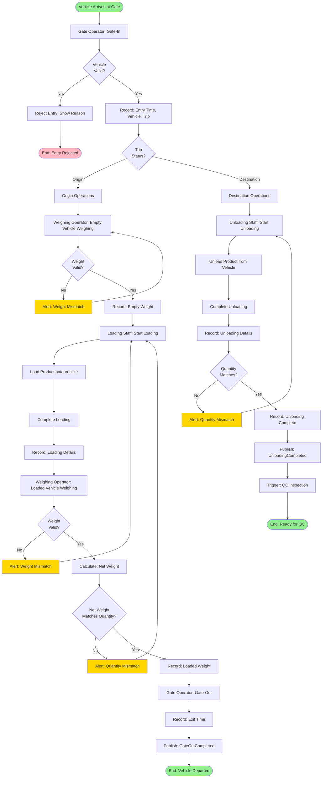

# Gate & Operations Flow

> Gate management, weighing, and loading/unloading operations

**Status**: ✅ Complete  
**Last Updated**: February 13, 2026  
**Complexity**: Medium  
**Estimated Duration**: 1-3 hours per location

---

## 📋 Overview

The Gate & Operations flow covers all on-ground operations at origin and destination locations: gate entry/exit, vehicle weighing, and loading/unloading operations.

**Trigger**: Vehicle arrives at gate (origin or destination)  
**Outcome**: All operations recorded and trip status updated

---

## 👥 Actors

| Actor | Role | Responsibilities |
|-------|------|------------------|
| **Gate Operator** | Gate Management | Records gate entry/exit |
| **Weighing Operator** | Weighing | Records vehicle weights |
| **Loading Staff** | Loading | Records loading operations |
| **Unloading Staff** | Unloading | Records unloading operations |
| **Driver** | Vehicle Operator | Coordinates with operations staff |
| **System** | Automation | Validates, records, triggers next steps |

---

## 🔄 Workflow Diagram



---

## 📝 Detailed Steps

### Phase 1: Gate Entry

#### Step 1: Vehicle Arrives at Gate
**Actor**: Driver  
**Action**: Vehicle arrives at origin or destination gate

**System Actions**:
- Detect vehicle arrival (manual or automated)
- Display trip details for gate operator
- Show expected arrival time vs actual

---

#### Step 2: Gate-In Recording
**Actor**: Gate Operator  
**Action**: Record vehicle entry

**Gate Operator Actions**:
- Scan vehicle registration (barcode/QR) or manual entry
- Verify trip number
- Record entry time
- Take photo (optional, for audit)
- Check vehicle condition (visual inspection)

**System Actions**:
- Validate vehicle matches trip assignment
- Validate trip status (should be `pending` or `in_transit`)
- Create gate entry record
- Update trip status if needed
- Publish event: `GateInCompleted`

**Data Captured**:
```python
{
    "gate_entry_id": uuid,
    "trip_id": uuid,
    "poi_id": uuid,
    "vehicle_registration": string,
    "entry_time": timestamp,
    "operator_id": uuid,
    "photo_url": string  # Optional
}
```

**Business Rules**:
- GATE-001: Vehicle must match trip assignment
- GATE-002: Trip must be in valid status
- GATE-003: Entry time must be within working hours
- GATE-004: Vehicle must not have pending violations

---

### Phase 2A: Origin Operations

#### Step 3: Empty Vehicle Weighing
**Actor**: Weighing Operator  
**Action**: Weigh vehicle before loading

**Weighing Process**:
1. Vehicle moves to weighing scale
2. Operator records empty weight
3. System validates weight against vehicle master data
4. If valid: Proceed to loading
5. If invalid: Alert operator, re-weigh

**Validation Logic**:
```python
expected_empty_weight = vehicle.tare_weight
actual_empty_weight = weighing_record.weight
tolerance = expected_empty_weight * 0.05  # 5% tolerance

if abs(actual_empty_weight - expected_empty_weight) > tolerance:
    # Alert: Weight mismatch
    alert_operator("Weight mismatch detected")
    return False
else:
    return True
```

**Business Rules**:
- SCALE-001: Empty weight must match vehicle master data (±5%)
- SCALE-002: Weighing must be done before loading
- SCALE-003: Weighing scale must be calibrated

---

#### Step 4: Loading Operations
**Actor**: Loading Staff  
**Action**: Load product onto vehicle

**Loading Process**:
1. Loading staff starts loading operation
2. Record loading start time
3. Load product (manual or automated)
4. Record quantity loaded (per item if multiple)
5. Complete loading
6. Record loading end time
7. Verify loading completeness

**System Actions**:
- Create loading operation record
- Update trip with loaded quantity
- Publish event: `LoadingStarted` → `LoadingCompleted`
- Notify weighing operator for loaded weight check

**Data Captured**:
```python
{
    "loading_id": uuid,
    "trip_id": uuid,
    "start_time": timestamp,
    "end_time": timestamp,
    "quantity_loaded": decimal,
    "items": [
        {
            "product_id": uuid,
            "quantity": decimal,
            "unit": string
        }
    ],
    "loaded_by": uuid,
    "notes": string  # Optional
}
```

**Business Rules**:
- LOAD-001: Loading must be done after empty weighing
- LOAD-002: Loaded quantity must match PR quantity (±2%)
- LOAD-003: Loading must be completed before gate-out
- LOAD-004: Loading staff must be authorized

---

#### Step 5: Loaded Vehicle Weighing
**Actor**: Weighing Operator  
**Action**: Weigh vehicle after loading

**Weighing Process**:
1. Vehicle moves to weighing scale (after loading)
2. Operator records loaded weight
3. System calculates net weight: `loaded_weight - empty_weight`
4. System validates net weight against loaded quantity
5. If valid: Proceed to gate-out
6. If invalid: Alert operator, investigate

**Validation Logic**:
```python
net_weight = loaded_weight - empty_weight
expected_weight = loaded_quantity * product.weight_per_unit
tolerance = expected_weight * 0.02  # 2% tolerance

if abs(net_weight - expected_weight) > tolerance:
    # Alert: Quantity mismatch
    alert_operator("Quantity mismatch detected")
    return False
else:
    return True
```

**Business Rules**:
- SCALE-004: Loaded weight must be > empty weight
- SCALE-005: Net weight must match loaded quantity (±2%)
- SCALE-006: Loaded weighing must be done before gate-out

---

#### Step 6: Gate-Out Recording
**Actor**: Gate Operator  
**Action**: Record vehicle exit

**Gate Operator Actions**:
- Verify loading completed
- Verify weighing completed
- Record exit time
- Take photo (optional)
- Issue gate pass

**System Actions**:
- Validate all operations completed
- Create gate exit record
- Update trip status: `in_transit`
- Publish event: `GateOutCompleted`
- Notify destination gate operator (if configured)

**Data Captured**:
```python
{
    "gate_exit_id": uuid,
    "trip_id": uuid,
    "poi_id": uuid,
    "exit_time": timestamp,
    "operator_id": uuid,
    "gate_pass_number": string
}
```

---

### Phase 2B: Destination Operations

#### Step 7: Unloading Operations
**Actor**: Unloading Staff  
**Action**: Unload product from vehicle

**Unloading Process**:
1. Unloading staff starts unloading operation
2. Record unloading start time
3. Unload product
4. Record quantity unloaded (per item if multiple)
5. Verify quantity matches loaded quantity
6. Complete unloading
7. Record unloading end time

**System Actions**:
- Create unloading operation record
- Update trip with unloaded quantity
- Validate quantity matches loaded quantity
- Publish event: `UnloadingStarted` → `UnloadingCompleted`
- Trigger QC inspection creation

**Data Captured**:
```python
{
    "unloading_id": uuid,
    "trip_id": uuid,
    "start_time": timestamp,
    "end_time": timestamp,
    "quantity_unloaded": decimal,
    "items": [
        {
            "product_id": uuid,
            "quantity": decimal,
            "unit": string,
            "condition": string  # good, damaged, etc.
        }
    ],
    "unloaded_by": uuid,
    "notes": string  # Optional
}
```

**Business Rules**:
- LOAD-005: Unloading must be done after gate-in at destination
- LOAD-006: Unloaded quantity must match loaded quantity (±1%)
- LOAD-007: Unloading must be completed before QC inspection
- LOAD-008: Unloading staff must be authorized

**Validation**:
```python
quantity_difference = abs(unloaded_quantity - loaded_quantity)
tolerance = loaded_quantity * 0.01  # 1% tolerance

if quantity_difference > tolerance:
    # Alert: Quantity mismatch
    alert_operator("Quantity mismatch detected")
    escalate_to_manager()
    return False
else:
    return True
```

---

## 📊 Business Rules

| Rule ID | Description | Enforcement |
|---------|-------------|-------------|
| GATE-001 | Vehicle must match trip assignment | System validation |
| GATE-002 | Trip must be in valid status | System validation |
| GATE-003 | Entry time must be within working hours | System validation |
| GATE-004 | Vehicle must not have pending violations | System validation |
| SCALE-001 | Empty weight must match vehicle master data (±5%) | System validation |
| SCALE-002 | Weighing must be done before loading | Workflow |
| SCALE-003 | Weighing scale must be calibrated | Business rule |
| SCALE-004 | Loaded weight must be > empty weight | System validation |
| SCALE-005 | Net weight must match loaded quantity (±2%) | System validation |
| LOAD-001 | Loading must be done after empty weighing | Workflow |
| LOAD-002 | Loaded quantity must match PR quantity (±2%) | System validation |
| LOAD-003 | Loading must be completed before gate-out | Workflow |
| LOAD-004 | Loading staff must be authorized | System validation |
| LOAD-005 | Unloading must be done after gate-in | Workflow |
| LOAD-006 | Unloaded quantity must match loaded quantity (±1%) | System validation |
| LOAD-007 | Unloading must be completed before QC | Workflow |
| LOAD-008 | Unloading staff must be authorized | System validation |

---

## 🔔 Notifications

| Event | Recipients | Channel | Content |
|-------|-----------|---------|---------|
| Gate-In | Weighing Operator | In-app | "Vehicle at gate, ready for weighing" |
| Empty Weighing Complete | Loading Staff | In-app | "Empty weighing complete, ready for loading" |
| Loading Complete | Weighing Operator | In-app | "Loading complete, ready for loaded weighing" |
| Gate-Out | Destination Gate, Logistics | SMS + In-app | "Vehicle departed, ETA: {time}" |
| Gate-In (Destination) | Unloading Staff | SMS + In-app | "Vehicle arrived, ready for unloading" |
| Unloading Complete | QC Supervisor | SMS + In-app | "Unloading complete, QC required" |

---

## 📡 Events Published

```python
# Event 1: Gate-In Completed
GateInCompleted(
    gate_entry_id=uuid,
    trip_id=uuid,
    poi_id=uuid,
    vehicle_registration=string,
    entry_time=timestamp,
    operator_id=uuid
)

# Event 2: Weighing Completed
WeighingCompleted(
    weighing_id=uuid,
    trip_id=uuid,
    weighing_type='empty' | 'loaded',
    weight=decimal,
    weighing_time=timestamp,
    operator_id=uuid
)

# Event 3: Loading Completed
LoadingCompleted(
    loading_id=uuid,
    trip_id=uuid,
    quantity_loaded=decimal,
    completed_at=timestamp,
    loaded_by=uuid
)

# Event 4: Gate-Out Completed
GateOutCompleted(
    gate_exit_id=uuid,
    trip_id=uuid,
    poi_id=uuid,
    exit_time=timestamp,
    operator_id=uuid
)

# Event 5: Unloading Completed
UnloadingCompleted(
    unloading_id=uuid,
    trip_id=uuid,
    quantity_unloaded=decimal,
    completed_at=timestamp,
    unloaded_by=uuid
)
```

---

## ⚠️ Exception Scenarios

### Scenario 1: Weight Mismatch
**Trigger**: Empty or loaded weight doesn't match expected  
**Handling**:
- Alert operator
- Re-weigh vehicle
- If still mismatch: Escalate to manager
- Log incident

### Scenario 2: Quantity Mismatch
**Trigger**: Loaded/unloaded quantity doesn't match  
**Handling**:
- Alert operator
- Investigate discrepancy
- Escalate to manager if significant
- Update trip with actual quantity
- Log incident

### Scenario 3: Vehicle Not Authorized
**Trigger**: Vehicle doesn't match trip assignment  
**Handling**:
- Reject gate entry
- Alert logistics coordinator
- Verify trip assignment
- Allow entry after verification

### Scenario 4: Operations Out of Order
**Trigger**: Operations performed in wrong sequence  
**Handling**:
- Prevent invalid operation
- Show correct sequence
- Guide operator to next step

---

## 📈 Performance Metrics

| Metric | Target | Measurement |
|--------|--------|-------------|
| **Gate-In Time** | < 5 minutes | Time from arrival to entry recorded |
| **Empty Weighing Time** | < 10 minutes | Time from gate-in to empty weighing |
| **Loading Time** | < 2 hours | Time from empty weighing to loading complete |
| **Loaded Weighing Time** | < 10 minutes | Time from loading to loaded weighing |
| **Gate-Out Time** | < 5 minutes | Time from loaded weighing to exit |
| **Total Origin Operations** | < 3 hours | Gate-in to gate-out |
| **Unloading Time** | < 2 hours | Time from gate-in to unloading complete |
| **Weight Accuracy** | > 98% | % of weighings within tolerance |

---

## 🔗 Related Documents

### Architecture
- [Module Boundaries](../../01-system-design/modules/module-boundaries.md#5-operations-management)
- [Module Interactions](../../01-system-design/modules/module-interactions.md)

### Business Context
- [Business Process](../../../02-domain/04-business-processes/business-processes-overview.md)
- [User Story: US-035](../../../03-backlog/stories/README.mdREADME.mdREADME.mdUS-035-gate-in-source.md)

### Other Workflows
- [Trip Execution Flow](./03-trip-execution-flow.md) - Part of trip execution
- [QC Inspection Flow](./06-qc-inspection-flow.md) - Next step after unloading

---

**Document Status**: ✅ Complete  
**Last Reviewed**: February 13, 2026  
**Contact**: Md. Mahfuzur Rahman (Mahfuzur.rahman@brainstation-23.com)

