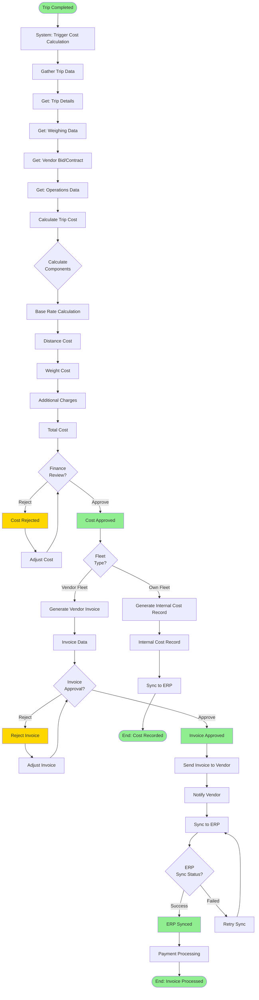

# Trip Costing & Invoicing Flow

> Calculate trip costs, generate invoices, and sync with ERP

**Status**: ✅ Complete  
**Last Updated**: February 13, 2026  
**Complexity**: Medium  
**Estimated Duration**: 1-4 hours (automated + manual review)

---

## 📋 Overview

The Trip Costing & Invoicing flow calculates trip costs after completion, generates invoices for vendors (if vendor fleet), and synchronizes financial data with ERP systems.

**Trigger**: Trip completed successfully  
**Outcome**: Invoice generated and synced to ERP

---

## 👥 Actors

| Actor | Role | Responsibilities |
|-------|------|------------------|
| **Finance Team** | Cost Reviewer | Reviews costs, approves invoices |
| **System** | Automation | Calculates costs, generates invoices |
| **ERP System** | External System | Receives financial data |
| **Vendor** | Invoice Recipient | Receives invoice, submits payment |

---

## 🔄 Workflow Diagram



---

## 📝 Detailed Steps

### Phase 1: Cost Calculation

#### Step 1: Trigger Cost Calculation
**Actor**: System (automated)  
**Action**: Trigger cost calculation after trip completion

**Trigger**: `TripCompleted` event received

**System Actions**:
- Create trip cost record
- Set status: `pending_calculation`
- Gather all trip data
- Publish event: `TripCostCalculationStarted`

---

#### Step 2: Gather Trip Data
**Actor**: System (automated)  
**Action**: Collect all data needed for cost calculation

**Data Sources**:
```python
# Trip data
trip = get_trip(trip_id)
- Distance traveled
- Duration
- Vehicle type
- Driver details

# Weighing data
weighing_records = get_weighing_records(trip_id)
- Empty weight
- Loaded weight
- Net weight

# Vendor data (if vendor fleet)
if trip.fleet_type == 'vendor':
    vendor_bid = get_vendor_bid(trip.to_id)
    - Bid amount
    - Contract terms
    
# Operations data
operations = get_operations(trip_id)
- Gate entries/exits
- Loading/unloading times
- Any additional charges
```

---

#### Step 3: Calculate Base Rate
**Actor**: System (automated)  
**Action**: Determine base rate for trip

**Rate Calculation Logic**:

**For Vendor Fleet**:
```python
if vendor_bid.exists():
    base_rate = vendor_bid.bid_amount
else:
    # Use contract rate
    contract = get_vendor_contract(vendor_id, route)
    base_rate = contract.rate_per_km * trip.distance
```

**For Own Fleet**:
```python
# Use internal rate card
rate_card = get_rate_card(vehicle_type, route)
base_rate = rate_card.base_rate
```

---

#### Step 4: Calculate Distance Cost
**Actor**: System (automated)  
**Action**: Calculate cost based on distance traveled

**Distance Cost Calculation**:
```python
distance_cost = base_rate * (trip.distance / 100)  # Per 100 km
```

**Business Rules**:
- COST-001: Distance is actual distance traveled (from GPS)
- COST-002: Minimum distance charge applies
- COST-003: Distance cost is primary component

---

#### Step 5: Calculate Weight Cost
**Actor**: System (automated)  
**Action**: Calculate additional cost based on weight

**Weight Cost Calculation**:
```python
net_weight = loaded_weight - empty_weight
weight_cost = net_weight * weight_rate_per_ton
```

**Business Rules**:
- COST-004: Weight cost applies if > threshold
- COST-005: Weight rate varies by product type
- COST-006: Overweight charges apply if exceeds capacity

---

#### Step 6: Calculate Additional Charges
**Actor**: System (automated)  
**Action**: Calculate any additional charges

**Additional Charges**:
- **Waiting Time**: If loading/unloading exceeds SLA
- **Overtime**: If trip completed outside working hours
- **Toll Charges**: Road tolls (if applicable)
- **Parking Charges**: Parking fees (if applicable)
- **Penalties**: Late delivery, route deviation, etc.

**Calculation**:
```python
additional_charges = (
    waiting_time_charge +
    overtime_charge +
    toll_charges +
    parking_charges -
    penalties
)
```

---

#### Step 7: Calculate Total Cost
**Actor**: System (automated)  
**Action**: Sum all cost components

**Total Cost Calculation**:
```python
total_cost = (
    base_rate +
    distance_cost +
    weight_cost +
    additional_charges
)

# Apply discounts (if any)
if vendor.has_discount():
    discount = total_cost * vendor.discount_percentage
    total_cost = total_cost - discount

# Apply taxes
tax = total_cost * tax_rate
final_cost = total_cost + tax
```

**System Actions**:
- Store cost breakdown
- Update trip cost record
- Set status: `pending_review`
- Publish event: `TripCostCalculated`

**Cost Breakdown Stored**:
```python
{
    "trip_cost_id": uuid,
    "trip_id": uuid,
    "base_rate": decimal,
    "distance_cost": decimal,
    "weight_cost": decimal,
    "additional_charges": decimal,
    "discount": decimal,
    "tax": decimal,
    "total_cost": decimal,
    "status": "pending_review",
    "calculated_at": timestamp
}
```

---

### Phase 2: Cost Review & Approval

#### Step 8: Finance Review
**Actor**: Finance Team  
**Action**: Review calculated costs

**Review Criteria**:
- Cost components are reasonable
- Distance matches actual route
- Weight matches weighing records
- Additional charges are justified
- Total cost is within budget

**Finance Options**:
- **Approve**: Accept calculated cost
- **Reject**: Request adjustment
- **Modify**: Manually adjust cost components

**System Actions** (on Approve):
- Update status: `pending_review` → `approved`
- Publish event: `TripCostApproved`
- Proceed to invoice generation

**System Actions** (on Reject):
- Update status: `pending_review` → `rejected`
- Record rejection reason
- Notify cost calculation team
- Allow recalculation

---

### Phase 3: Invoice Generation

#### Step 9: Generate Invoice
**Actor**: System (automated)  
**Action**: Generate invoice for vendor (if vendor fleet)

**Invoice Generation Logic**:
```python
if trip.fleet_type == 'vendor':
    invoice = create_invoice(
        vendor_id=trip.vendor_id,
        trip_id=trip.id,
        amount=trip_cost.total_cost,
        due_date=calculate_due_date(),
        line_items=[
            {
                "description": "Transport service - Trip {trip_number}",
                "quantity": 1,
                "rate": trip_cost.total_cost,
                "amount": trip_cost.total_cost
            }
        ]
    )
```

**Invoice Data**:
```python
{
    "invoice_id": uuid,
    "invoice_number": string,  # Format: INV-YYYYMMDD-XXXX
    "vendor_id": uuid,
    "trip_id": uuid,
    "amount": decimal,
    "tax": decimal,
    "total_amount": decimal,
    "due_date": date,
    "status": "pending_approval",
    "created_at": timestamp
}
```

**Business Rules**:
- COST-007: Invoice must reference trip
- COST-008: Invoice amount must match trip cost
- COST-009: Invoice must be generated within 24 hours of trip completion
- COST-010: Invoice must include all cost components

---

#### Step 10: Invoice Approval
**Actor**: Finance Team  
**Action**: Review and approve invoice

**Review Process**:
- Verify invoice details
- Check vendor account status
- Verify trip completion
- Approve or reject

**System Actions** (on Approve):
- Update invoice status: `pending_approval` → `approved`
- Publish event: `InvoiceApproved`
- Send invoice to vendor
- Proceed to ERP sync

---

#### Step 11: Send Invoice to Vendor
**Actor**: System (automated)  
**Action**: Send approved invoice to vendor

**Delivery Channels**:
- Email: PDF invoice attached
- SMS: "Invoice INV-001 generated. Amount: 15,000 BDT. Due: 2026-02-20"
- Vendor Portal: Invoice available for download
- Push: Notification in vendor mobile app

**Invoice PDF Contains**:
- Invoice number and date
- Vendor details
- Trip details
- Cost breakdown
- Payment instructions
- Due date

---

### Phase 4: ERP Synchronization

#### Step 12: Sync to ERP
**Actor**: System (automated)  
**Action**: Synchronize invoice/cost data to ERP

**ERP Sync Process**:
1. Prepare ERP payload
2. Call ERP API
3. Handle response
4. Update sync status

**ERP Payload**:
```python
{
    "invoice_number": string,
    "vendor_id": string,  # ERP vendor code
    "amount": decimal,
    "tax": decimal,
    "total_amount": decimal,
    "invoice_date": date,
    "due_date": date,
    "trip_reference": string,
    "cost_center": string,
    "gl_account": string
}
```

**System Actions**:
- Call ERP API: `POST /api/invoices`
- Handle success/failure
- Update sync status
- Log sync attempt

**If Sync Success**:
- Update status: `erp_synced`
- Publish event: `ERPSyncCompleted`
- Mark invoice as synced

**If Sync Failure**:
- Update status: `erp_sync_failed`
- Log error
- Queue for retry
- Alert finance team

---

#### Step 13: Retry ERP Sync
**Actor**: System (automated)  
**Action**: Retry failed ERP syncs

**Retry Strategy**:
- Retry immediately (first attempt)
- Retry after 1 hour (second attempt)
- Retry after 4 hours (third attempt)
- Escalate to manual sync after 3 failures

**System Actions**:
- Check for failed syncs
- Retry with exponential backoff
- Update sync status
- Notify if all retries fail

---

### Phase 5: Payment Processing (Phase 3)

#### Step 14: Payment Processing
**Actor**: Vendor / Finance Team  
**Action**: Process invoice payment

**Payment Methods** (Phase 3):
- Online payment gateway
- Bank transfer
- Cash payment
- Check payment

**System Actions**:
- Receive payment confirmation
- Update invoice status: `approved` → `paid`
- Record payment details
- Publish event: `PaymentProcessed`
- Update vendor account balance

---

## 📊 Business Rules

| Rule ID | Description | Enforcement |
|---------|-------------|-------------|
| COST-001 | Distance is actual distance traveled | System validation |
| COST-002 | Minimum distance charge applies | Business logic |
| COST-003 | Distance cost is primary component | Business logic |
| COST-004 | Weight cost applies if > threshold | Business logic |
| COST-005 | Weight rate varies by product type | Business logic |
| COST-006 | Overweight charges apply if exceeds capacity | Business logic |
| COST-007 | Invoice must reference trip | System validation |
| COST-008 | Invoice amount must match trip cost | System validation |
| COST-009 | Invoice must be generated within 24 hours | SLA |
| COST-010 | Invoice must include all cost components | System validation |
| COST-011 | Cost must be reviewed before invoice generation | Workflow |
| COST-012 | Invoice must be approved before ERP sync | Workflow |
| COST-013 | ERP sync must be completed within 48 hours | SLA |
| COST-014 | Failed ERP syncs must be retried | System automation |
| COST-015 | Payment must be recorded within payment terms | Business rule |

---

## 🔔 Notifications

| Event | Recipients | Channel | Content |
|-------|-----------|---------|---------|
| Cost Calculated | Finance Team | Email + In-app | "Cost calculated for TRIP-001: 15,000 BDT" |
| Cost Approved | Logistics | In-app | "Cost approved for TRIP-001" |
| Invoice Generated | Vendor, Finance | Email + SMS | "Invoice INV-001 generated: 15,000 BDT" |
| Invoice Approved | Vendor | Email + SMS | "Invoice INV-001 approved, payment due: 2026-02-20" |
| ERP Sync Failed | Finance Team | Email + In-app | "ERP sync failed for INV-001" |
| Payment Received | Finance Team | Email + In-app | "Payment received for INV-001" |

---

## 📡 Events Published

```python
# Event 1: Trip Cost Calculated
TripCostCalculated(
    trip_cost_id=uuid,
    trip_id=uuid,
    total_cost=decimal,
    cost_breakdown={
        "base_rate": decimal,
        "distance_cost": decimal,
        "weight_cost": decimal,
        "additional_charges": decimal
    },
    calculated_at=timestamp
)

# Event 2: Trip Cost Approved
TripCostApproved(
    trip_cost_id=uuid,
    trip_id=uuid,
    approved_by=uuid,
    approved_at=timestamp
)

# Event 3: Invoice Generated
InvoiceGenerated(
    invoice_id=uuid,
    invoice_number=string,
    vendor_id=uuid,
    trip_id=uuid,
    amount=decimal,
    generated_at=timestamp
)

# Event 4: Invoice Approved
InvoiceApproved(
    invoice_id=uuid,
    invoice_number=string,
    approved_by=uuid,
    approved_at=timestamp
)

# Event 5: ERP Sync Completed
ERPSyncCompleted(
    invoice_id=uuid,
    erp_reference=string,
    synced_at=timestamp
)

# Event 6: Payment Processed
PaymentProcessed(
    invoice_id=uuid,
    payment_amount=decimal,
    payment_method=string,
    processed_at=timestamp
)
```

---

## ⚠️ Exception Scenarios

### Scenario 1: Cost Calculation Error
**Trigger**: Unable to calculate cost (missing data)  
**Handling**:
- Alert finance team
- Log error
- Allow manual cost entry
- Recalculate when data available

### Scenario 2: Cost Exceeds Budget
**Trigger**: Calculated cost exceeds budget threshold  
**Handling**:
- Alert finance team
- Require manager approval
- Flag for review
- May reject trip cost

### Scenario 3: ERP Sync Failure
**Trigger**: ERP API unavailable or returns error  
**Handling**:
- Queue for retry
- Alert finance team
- Allow manual sync
- Log error for investigation

### Scenario 4: Invoice Dispute
**Trigger**: Vendor disputes invoice amount  
**Handling**:
- Finance team reviews dispute
- May adjust invoice
- May require manager approval
- Update invoice if approved

---

## 📈 Performance Metrics

| Metric | Target | Measurement |
|--------|--------|-------------|
| **Cost Calculation Time** | < 5 minutes | Time from trip completion to cost calculated |
| **Cost Review Time** | < 2 hours | Time from calculation to approval |
| **Invoice Generation Time** | < 1 hour | Time from cost approval to invoice generated |
| **Invoice Approval Time** | < 4 hours | Time from generation to approval |
| **ERP Sync Success Rate** | > 95% | % of successful ERP syncs |
| **ERP Sync Time** | < 1 hour | Time from approval to ERP sync |
| **Payment Processing Time** | < 7 days | Time from invoice to payment |

---

## 🔗 Related Documents

### Architecture
- [Module Boundaries](../../01-system-design/modules/module-boundaries.md#9-trip-costing--finance)
- [Module Interactions](../../01-system-design/modules/module-interactions.md)

### Business Context
- [User Story: US-059](../../../_meta/archive/backlog-stories-pre-sprint2/US-059-trip-cost-calculation.md)
- [Business Process](../../../02-domain/04-business-processes/business-processes-overview.md)

### Other Workflows
- [Trip Execution Flow](./03-trip-execution-flow.md) - Previous step
- [QC Inspection Flow](./06-qc-inspection-flow.md) - QC must pass before costing

---

**Document Status**: ✅ Complete  
**Last Reviewed**: February 13, 2026  
**Contact**: Md. Mahfuzur Rahman (Mahfuzur.rahman@brainstation-23.com)

