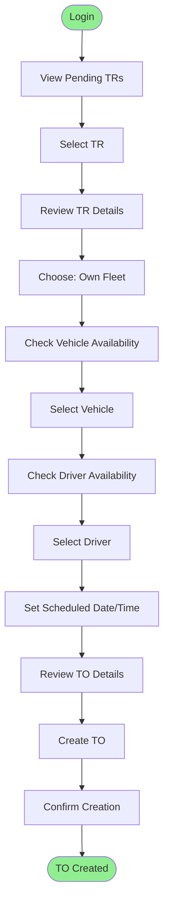
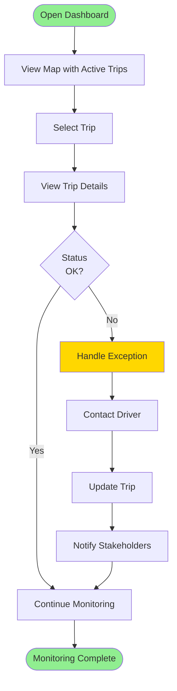
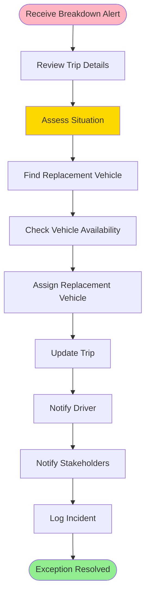

# Logistics Coordinator Workflows

> Daily workflows for logistics coordinators

**Status**: ✅ Complete  
**Last Updated**: February 13, 2026  
**User Role**: Logistics Coordinator  
**Primary Device**: Desktop/Web Application

---

## 📋 Overview

Logistics Coordinators are responsible for converting Transport Requests (TRs) into Transport Orders (TOs), assigning vehicles and drivers, monitoring trips, and handling exceptions. This document covers their daily workflows.

---

## 👤 User Profile

**Role**: Logistics Coordinator  
**Department**: Transport Operations  
**Primary Responsibilities**:
- Convert TRs to TOs
- Assign vehicles and drivers
- Monitor trip progress
- Handle exceptions
- Coordinate with vendors

**Daily Tasks**:
- Review pending TRs
- Create TOs
- Assign resources
- Monitor active trips
- Handle exceptions

---

## 🔄 Daily Workflow

### Morning Routine (8:00 AM - 10:00 AM)

#### Task 1: Review Pending Transport Requests
**Duration**: 30 minutes  
**Frequency**: Daily

**Steps**:
1. Login to DFMS web portal
2. Navigate to "Transport Requests" → "Pending"
3. Review list of approved TRs
4. Sort by priority and requested date
5. Identify TRs requiring immediate attention

**UI Elements**:
- TR list table with filters
- Priority indicators
- Age badges (days since creation)
- Quick actions menu

**Key Information Displayed**:
- TR number
- Product and quantity
- Origin → Destination
- Requested date
- Priority level
- Age (days pending)

---

#### Task 2: Create Transport Orders
**Duration**: 1-2 hours  
**Frequency**: Daily (as needed)

**Steps**:
1. Select TR to convert
2. Review TR details
3. Determine fleet type (own vs vendor)
4. If own fleet:
   - Check vehicle availability
   - Select vehicle
   - Check driver availability
   - Select driver
   - Set scheduled date/time
5. If vendor fleet:
   - Select vendor type (contractual vs bidding)
   - Assign or open for bidding
6. Review TO details
7. Create TO
8. Confirm trip created

**UI Flow**:
```
TR List → Select TR → TO Creation Form
  ├─ Fleet Type Selection
  ├─ Vehicle Selection (if own)
  ├─ Driver Selection (if own)
  ├─ Vendor Selection (if vendor)
  └─ Schedule Setting
```

**Validation Points**:
- Vehicle capacity matches requirement
- Driver license valid
- No schedule conflicts
- Vendor contract valid (if contractual)

**Success Criteria**:
- TO created successfully
- Trip auto-generated
- Driver/vendor notified

---

### Mid-Day Monitoring (10:00 AM - 2:00 PM)

#### Task 3: Monitor Active Trips
**Duration**: Ongoing (check every 30 minutes)  
**Frequency**: Throughout day

**Steps**:
1. Navigate to "Active Trips" dashboard
2. Review trip statuses
3. Check for alerts/warnings
4. Monitor real-time locations
5. Identify trips needing attention

**Dashboard Elements**:
- Map view with vehicle locations
- Trip list with status indicators
- Alert panel
- ETA displays
- Route visualization

**Key Metrics Displayed**:
- Total active trips
- Trips on schedule
- Trips delayed
- Trips with alerts
- Average ETA

**Alerts to Monitor**:
- Route deviations
- Long stops
- Delayed arrivals
- GPS signal loss
- Exception requests

---

#### Task 4: Handle Exceptions
**Duration**: As needed  
**Frequency**: As they occur

**Common Exceptions**:

**Exception 1: Vehicle Breakdown**
- **Trigger**: Driver reports breakdown
- **Actions**:
  1. Receive notification
  2. Review trip details
  3. Assign replacement vehicle
  4. Update trip
  5. Notify stakeholders

**Exception 2: Route Deviation**
- **Trigger**: Vehicle deviates > 500m from route
- **Actions**:
  1. Receive alert
  2. Contact driver
  3. Verify reason
  4. Update route if valid
  5. Log incident

**Exception 3: Delayed Arrival**
- **Trigger**: ETA exceeds SLA
- **Actions**:
  1. Receive alert
  2. Check trip progress
  3. Contact driver
  4. Update destination ETA
  5. Notify destination

**Exception 4: Driver Unavailable**
- **Trigger**: Driver cannot start trip
- **Actions**:
  1. Receive notification
  2. Find replacement driver
  3. Update trip assignment
  4. Notify new driver
  5. Cancel old assignment

---

### Afternoon Tasks (2:00 PM - 5:00 PM)

#### Task 5: Review Completed Trips
**Duration**: 30 minutes  
**Frequency**: Daily

**Steps**:
1. Navigate to "Completed Trips" (today)
2. Review trip summaries
3. Check for issues
4. Verify completion data
5. Flag any discrepancies

**Review Checklist**:
- Trip completed on time
- Distance matches expected
- Operations completed
- QC passed
- No incidents reported

---

#### Task 6: Plan Next Day
**Duration**: 30 minutes  
**Frequency**: Daily

**Steps**:
1. Review TRs for next day
2. Check vehicle availability
3. Check driver availability
4. Pre-assign resources (if possible)
5. Create tentative TOs

**Planning Tools**:
- Calendar view
- Resource availability calendar
- TR forecast
- Capacity planning

---

## 📱 Key User Journeys

### Journey 1: Convert TR to TO (Own Fleet)



**Time**: 5-10 minutes per TO  
**Complexity**: Medium

---

### Journey 2: Monitor Trip Progress



**Time**: 2-5 minutes per trip check  
**Complexity**: Low

---

### Journey 3: Handle Vehicle Breakdown



**Time**: 15-30 minutes  
**Complexity**: High

---

## 🎯 Key Features Used

### 1. TR Management
- View pending TRs
- Filter and sort TRs
- Review TR details
- Convert TR to TO

### 2. TO Creation
- Fleet type selection
- Vehicle assignment
- Driver assignment
- Schedule setting
- Vendor assignment

### 3. Trip Monitoring
- Real-time dashboard
- Map view
- Trip details
- Status updates
- Alert management

### 4. Exception Handling
- Alert notifications
- Exception forms
- Resource reassignment
- Communication tools
- Incident logging

### 5. Reporting
- Daily trip summary
- Performance metrics
- Exception reports
- Resource utilization

---

## 📊 Performance Metrics

| Metric | Target | Measurement |
|--------|--------|-------------|
| **TRs Converted per Day** | 50-100 | Daily count |
| **TO Creation Time** | < 10 minutes | Average time per TO |
| **Exception Response Time** | < 15 minutes | Time to acknowledge |
| **Exception Resolution Time** | < 30 minutes | Time to resolve |
| **Trip Monitoring Frequency** | Every 30 minutes | Check interval |
| **On-Time TO Creation** | > 95% | % of TRs converted on time |

---

## 💡 Tips & Best Practices

### Efficiency Tips
1. **Batch Processing**: Process multiple TRs at once
2. **Pre-planning**: Plan next day's TOs in advance
3. **Quick Filters**: Use filters to find urgent TRs quickly
4. **Keyboard Shortcuts**: Learn shortcuts for common actions
5. **Dashboard Customization**: Customize dashboard for your needs

### Exception Handling Tips
1. **Quick Response**: Respond to alerts immediately
2. **Communication**: Keep stakeholders informed
3. **Documentation**: Log all exceptions
4. **Learning**: Review exceptions to prevent recurrence
5. **Escalation**: Know when to escalate

---

## 🔗 Related Documents

### Operational Flows
- [Transport Order Creation Flow](../operational-flows/02-transport-order-creation-flow.md)
- [Trip Execution Flow](../operational-flows/03-trip-execution-flow.md)
- [Vendor Bidding Flow](../operational-flows/04-vendor-bidding-flow.md)

### Business Context
- [User Persona](../../../02-domain/02-requirements/user-personas.md)
- [User Stories](../../../02-domain/03-backlog/phase-1/user-stories/)

---

**Document Status**: ✅ Complete  
**Last Reviewed**: February 13, 2026  
**Contact**: Md. Mahfuzur Rahman (Mahfuzur.rahman@brainstation-23.com)

