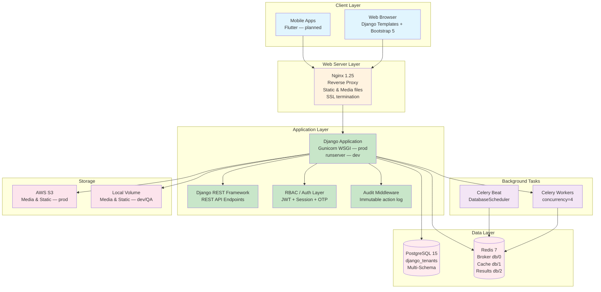
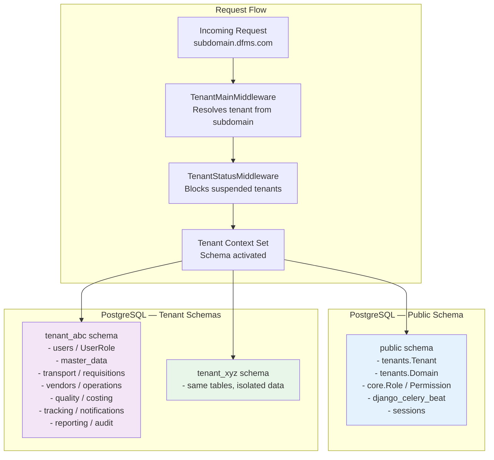
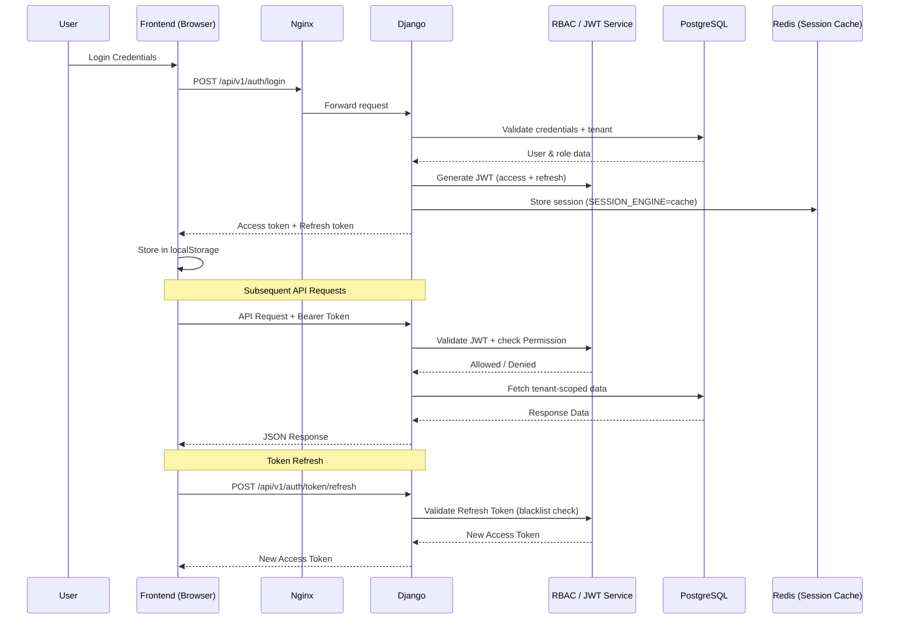
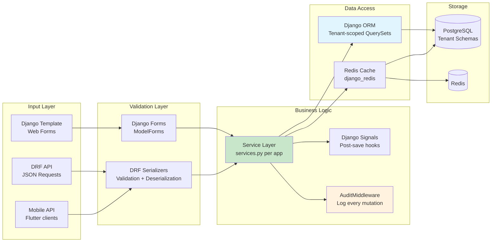
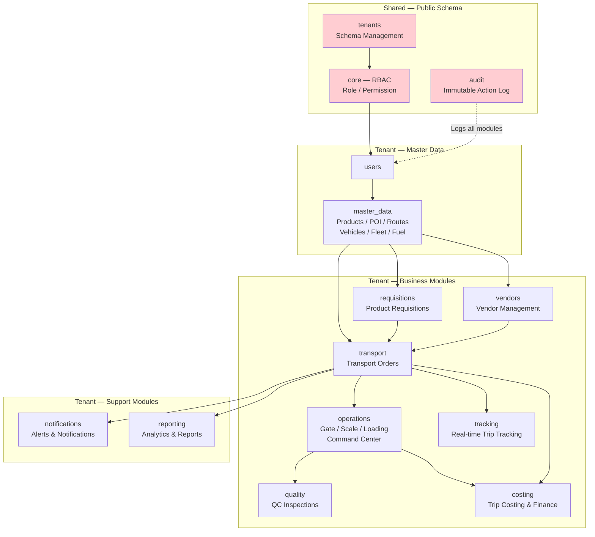
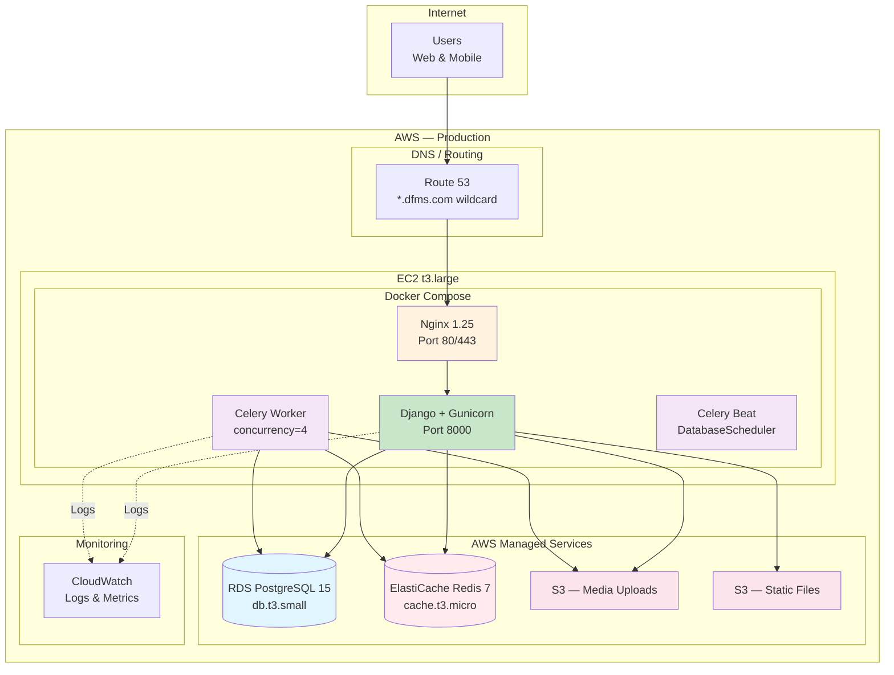
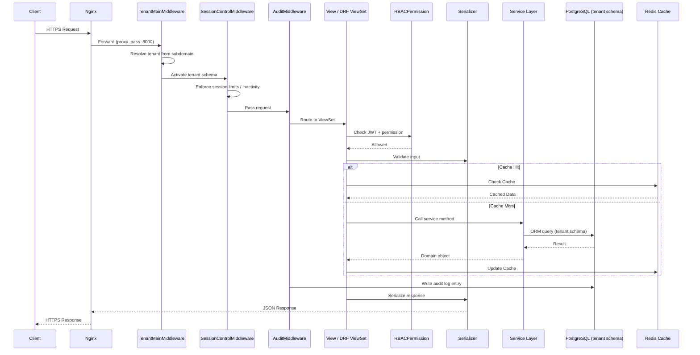
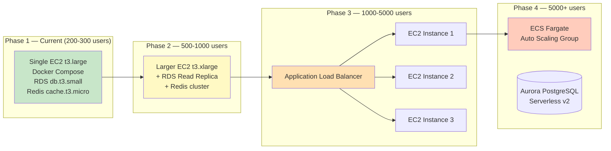

# Architecture Diagrams

> Django implementation-specific diagrams — updated to reflect Phase 1 implementation

## 📖 High-Level Architecture Diagrams

> **Source of Truth**: [`04-architecture/05-diagrams/`](../../05-diagrams/)

The high-level architecture diagrams are maintained in the DFMS Product Context submodule:

- **[System Architecture Overview](../../05-diagrams/architecture/system-architecture-overview.mmd)** - Single-page full-stack overview ⭐
- **[System Context Diagram](../../05-diagrams/architecture/system-context-diagram.mmd)** - C4 Level 1
- **[Container Diagram](../../05-diagrams/architecture/container-diagram.mmd)** - C4 Level 2
- **[Deployment Diagram](../../05-diagrams/deployment/deployment-diagram.mmd)** - Infrastructure architecture
- **[Sequence Diagrams](../../05-diagrams/sequences/)** - Interaction flows
- **[State Diagrams](../../05-diagrams/states/)** - State machines
- **[ER Diagram](../../05-diagrams/data/entity-relationship-diagram.mmd)** - Entity relationships
- **[Integration Diagram](../../05-diagrams/integration/integration-architecture-diagram.mmd)** - External integrations
- **[Diagrams Index](../../05-diagrams/diagrams-index.md)** - Complete list of all diagrams

This document contains **Django-specific component diagrams** showing implementation details.

---

## 1. System Architecture Overview

> Phase 1: Modular monolith on a single EC2, Docker Compose stack, Nginx + Gunicorn (prod) / runserver (dev).
> S3 storage is active in production (`USE_S3=True`); local media volume is used in dev/QA.



---

## 2. Multi-Tenant Architecture

> `django-tenants` with schema-per-tenant isolation.
> `SHARED_APPS` (public schema): tenants, core/RBAC, auth, DRF, Celery Beat.
> `TENANT_APPS` (per-tenant schema): all business modules + users + audit.



---

## 3. Authentication & Authorization Flow

> JWT stored in `localStorage` (web portal SPA calls) + Django session (server-side portal pages).
> OTP-based MFA available (`admin_otp.py`). Concurrent session limit enforced by `SessionControlMiddleware`.



---

## 4. RBAC (Role-Based Access Control) Architecture

> Four-tier role hierarchy. 135 permissions across 13 modules in `Module.Feature.Action` dot-notation.
> Roles and Permissions live in the public schema (`SHARED_APPS`); UserRole assignments are per-tenant.

```mermaid
graph TD
    subgraph "Public Schema — Shared"
        PERM[Permission<br/>Module.Feature.Action<br/>e.g. Fleet.Vehicle.Create]
        ROLE[Role<br/>name, access_scope<br/>department]
        ROLEPERM[RolePermission<br/>role ↔ permission]
    end

    subgraph "Tenant Schema — Per Tenant"
        USER[User<br/>tenant-scoped]
        USERROLE[UserRole<br/>user ↔ role<br/>location scope]
    end

    subgraph "Runtime Check"
        MW2[RBACPermission<br/>DRF permission class]
        RBAC_SVC[rbac_service.py<br/>has_permission()]
    end

    ROLE --> ROLEPERM
    PERM --> ROLEPERM
    USER --> USERROLE
    ROLE --> USERROLE
    MW2 --> RBAC_SVC
    RBAC_SVC --> USERROLE
    RBAC_SVC --> ROLEPERM

    style PERM fill:#ffcdd2
    style ROLE fill:#ffcdd2
    style ROLEPERM fill:#ffcdd2
    style USER fill:#c8e6c9
    style USERROLE fill:#c8e6c9
```

---

## 5. Data Flow Architecture



---

## 6. Module Dependencies

> Reflects actual implemented Django apps. Fleet/Fuel data lives in `master_data` (no separate app in Phase 1).



---

## 7. Deployment Architecture — Phase 1 (Current)

> Single EC2 instance, Docker Compose. S3 + RDS + ElastiCache in production.
> Dev/QA: local PostgreSQL + Redis containers, local media volume.



---

## 8. API Request Flow



---

## 9. Scaling Strategy



---

## How to View These Diagrams

1. **GitHub**: Mermaid diagrams render automatically in `.md` files
2. **VS Code**: Install the "Markdown Preview Mermaid Support" extension
3. **Online**: Use [Mermaid Live Editor](https://mermaid.live/)
4. **Documentation Sites**: MkDocs, Docusaurus, Notion — all support Mermaid natively
