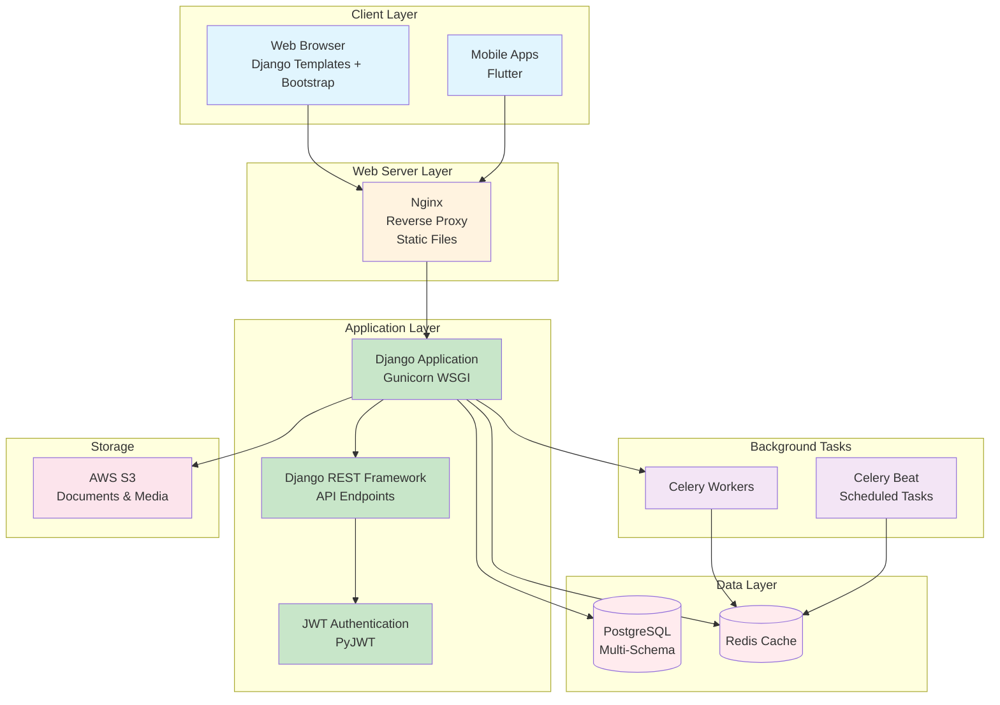
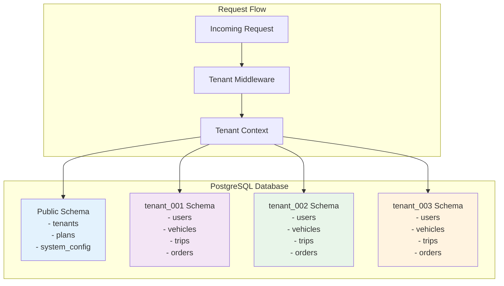
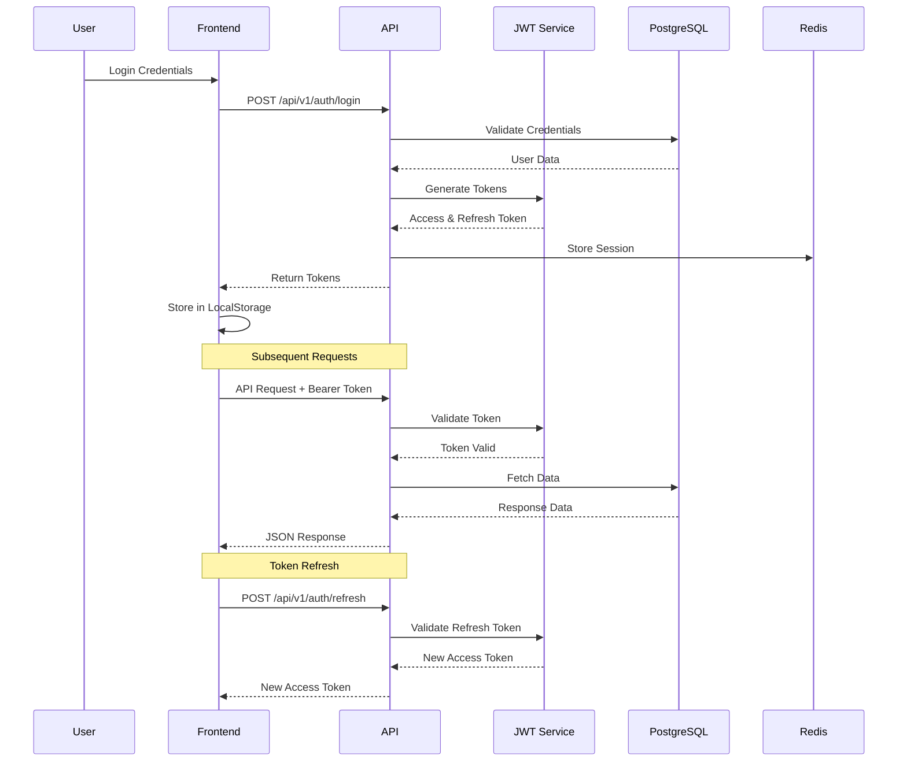
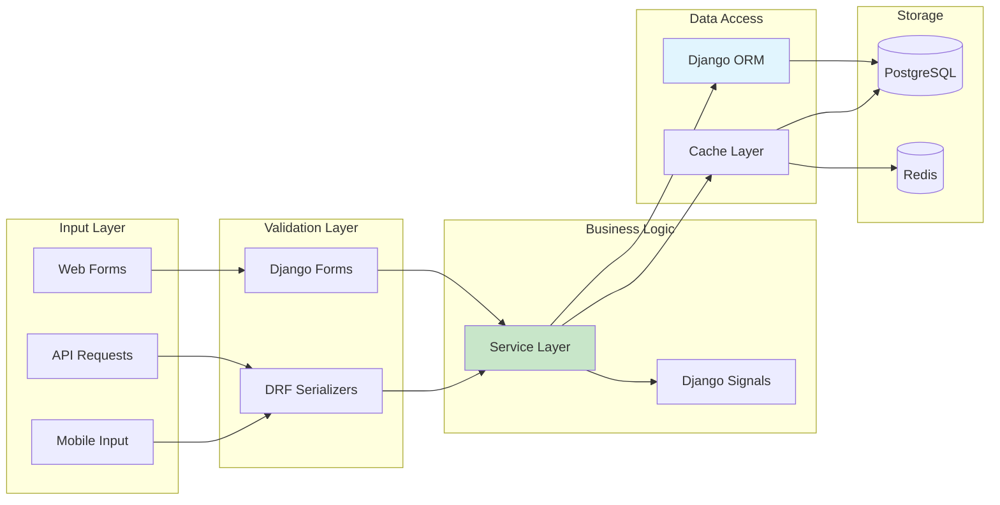
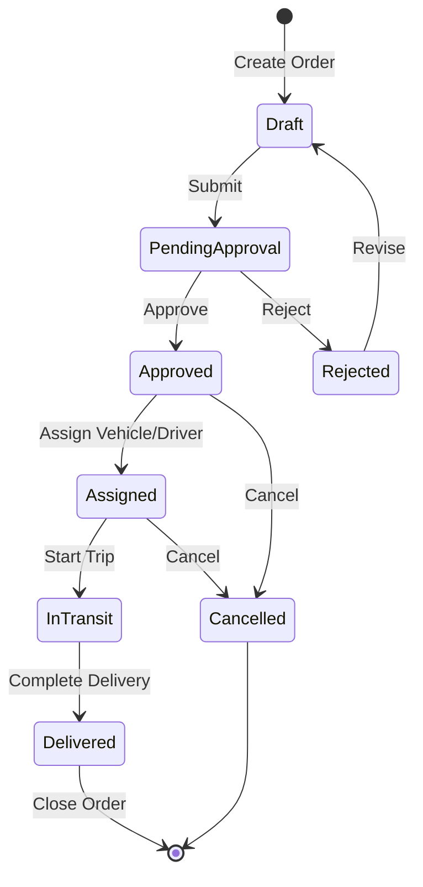
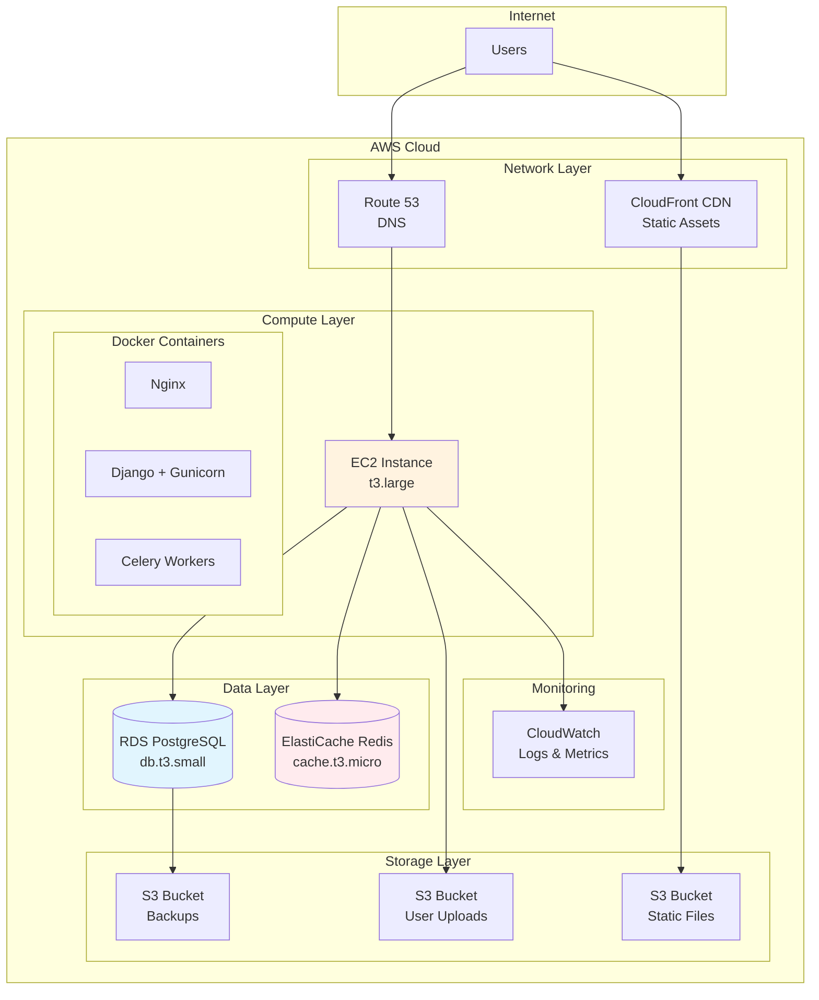
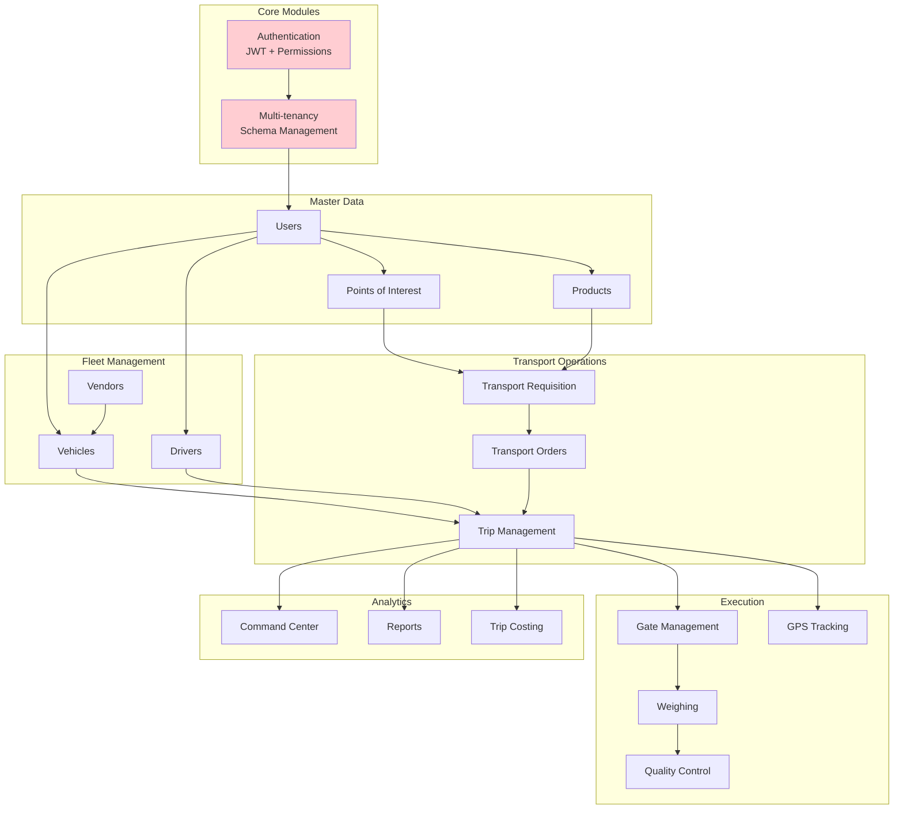
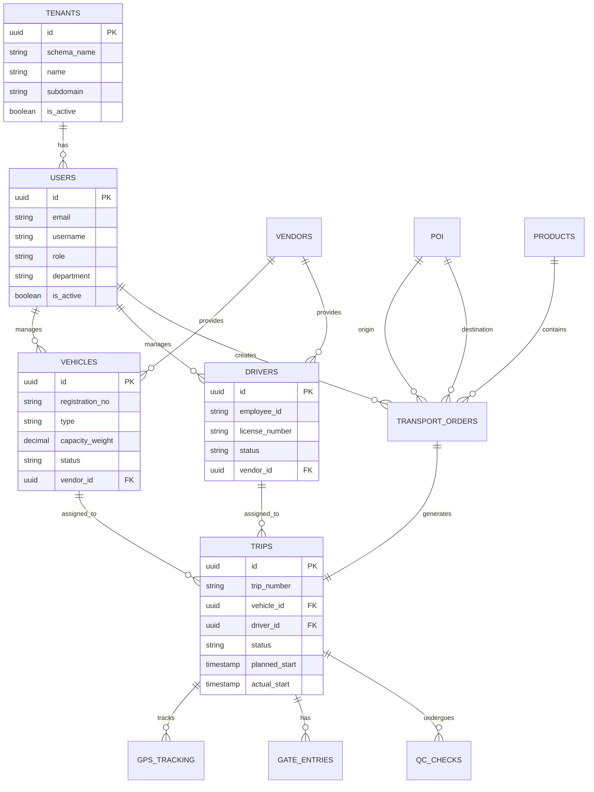
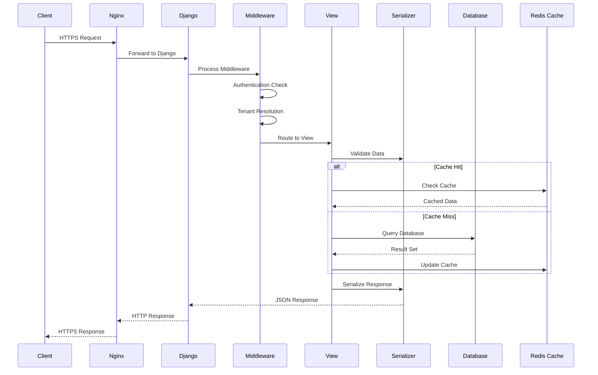
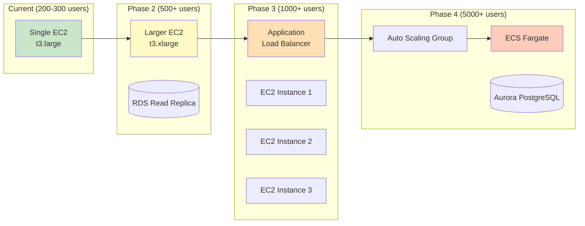

# Architecture Diagrams

> Django implementation-specific diagrams

## 📖 High-Level Architecture Diagrams

> **Source of Truth**: [`04-architecture/05-diagrams/`](../../04-diagrams/)

The high-level architecture diagrams are maintained in the DFMS Product Context submodule:

- **[System Context Diagram](../../01-system-design/diagrams/system-context-diagram.mmd)** - C4 Level 1
- **[Container Diagram](../../01-system-design/diagrams/container-diagram.mmd)** - C4 Level 2
- **[Deployment Diagram](../../04-diagrams/deployment/deployment-diagram.mmd)** - Infrastructure architecture
- **[Sequence Diagrams](../../04-diagrams/sequences/)** - Interaction flows
- **[State Diagrams](../../04-diagrams/states/)** - State machines
- **[ER Diagram](../../04-diagrams/data/entity-relationship-diagram.mmd)** - Entity relationships
- **[Integration Diagram](../../04-diagrams/integration/integration-architecture-diagram.mmd)** - External integrations
- **[Diagrams Index](../../04-diagrams/diagrams-index.md)** - Complete list of all diagrams

This document contains **Django-specific component diagrams** showing implementation details.

## Django Implementation Diagrams

## 1. System Architecture Overview

## 2. Multi-Tenant Architecture

## 3. Authentication & Authorization Flow

## 4. Data Flow Architecture

## 5. Transport Order Workflow

## 6. Deployment Architecture (AWS)

## 7. Module Dependencies

## 8. Database Schema Overview

## 9. API Request Flow

## 10. Scaling Strategy

---

## How to View These Diagrams

1. **GitHub**: These Mermaid diagrams will render automatically when viewed on GitHub
2. **VS Code**: Install the "Markdown Preview Mermaid Support" extension
3. **Online**: Use [Mermaid Live Editor](https://mermaid.live/)
4. **Documentation Sites**: Most modern documentation tools support Mermaid (MkDocs, Docusaurus, etc.)