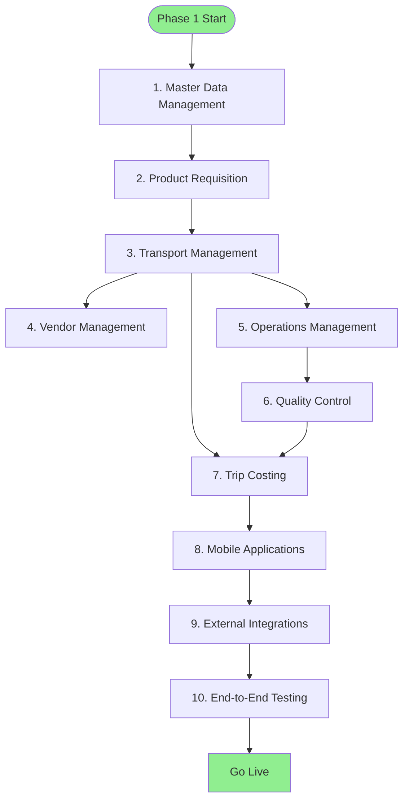

# Phase 1 Deployment Plan

> Core modules deployment strategy

**Status**: ✅ Complete  
**Last Updated**: May 8, 2026  
**Duration**: 3-4 months  
**Target Users**: 50-100 users

---

## 📋 Overview

Phase 1 deploys the core DFMS modules that form the foundation of the system. This phase focuses on establishing the basic transport management workflow from requisition to trip completion.

---

## Dev Environment: Single EC2 + Docker Compose

> **Purpose**: Internal testing only. Optimized for minimum cost.

### Infrastructure Overview

**Approach**: Single EC2 instance running all services via Docker Compose — mirrors the existing `docker-compose.yml` setup. No separate managed services.

**Components**:
- Single EC2 instance (t3.micro / t2.micro on free tier)
- PostgreSQL 15 — Docker container (same as local dev)
- Redis 7 — Docker container (same as local dev)
- Nginx — Docker container (reverse proxy)
- Django + Gunicorn — Docker container
- Celery Worker + Beat — Docker containers
- S3 bucket for media/static file storage (optional for dev)
- Elastic IP — static public address (free when attached)

**Monthly Cost**: ~$10–20/month (or free for the first 12 months on AWS Free Tier with t2.micro)

| Resource | Size | ~Monthly Cost |
|---|---|---|
| EC2 t3.micro | 2 vCPU, 1GB RAM | ~$8.50 |
| EC2 t2.micro (Free Tier) | 2 vCPU, 1GB RAM | $0 |
| EBS gp3 storage | 20 GB | ~$1.60 |
| Elastic IP (attached) | Static IP | Free |
| Data transfer | Low (internal testing) | ~$1–5 |
| **Total** | | **~$10–15/mo (or $0 on Free Tier)** |

> **Free Tier note**: New AWS accounts get 750 hours/month of t2.micro for the first 12 months — enough to run this dev server at essentially zero cost.

### Architecture Diagram

```
Internet
    │
    ▼
┌──────────────────────────────────────────────────┐
│          EC2 Instance (t2.micro / t3.micro)      │
│          Ubuntu 24.04 LTS                        │
│                                                  │
│  ┌────────────────────────────────────────────┐  │
│  │          Nginx (Port 80)                   │  │
│  │          Docker Container                  │  │
│  └──────────────────┬─────────────────────────┘  │
│                     │ proxy_pass :8000             │
│  ┌──────────────────▼─────────────────────────┐  │
│  │     Django + Gunicorn (Port 8000)          │  │
│  │     Docker Container                       │  │
│  └────────────────────────────────────────────┘  │
│  ┌──────────────────────────────────────────────┐ │
│  │  Celery Worker   │   Celery Beat             │ │
│  │  Docker Container│   Docker Container        │ │
│  └──────────────────────────────────────────────┘ │
│  ┌──────────────────────────────────────────────┐ │
│  │  PostgreSQL 15   │   Redis 7                 │ │
│  │  Docker Container│   Docker Container        │ │
│  └──────────────────────────────────────────────┘ │
└──────────────────────────────────────────────────┘
         │
    Elastic IP (static public address)
```

**Rationale**:
- Mirrors the existing `docker-compose.yml` — no new config needed
- All services on one box keeps cost near zero
- No managed services (RDS, ElastiCache) — saves ~$50–80/month vs. production setup
- Easy to stop/start the EC2 instance when not in use to save cost
- Clear migration path: swap Docker Postgres/Redis for RDS/ElastiCache when promoting to staging/production

**See**: [ADR-004: Phase 1 Modular Monolith](../03-decisions/adr-004-phase-1-modular-monolith.md)

---

## 🚀 Dev Environment Setup Steps

### Step 1: Launch EC2 Instance

1. Go to **EC2 → Launch Instance** in AWS Console
2. Choose **Ubuntu 24.04 LTS** (free tier eligible)
3. Select **t2.micro** (free tier) or **t3.micro** (after free tier)
4. Create or select a **key pair** (save the `.pem` file securely)
5. Configure **Security Group** — open these ports:

| Port | Protocol | Source | Purpose |
|------|----------|--------|---------|
| 22 | TCP | Your IP | SSH access |
| 80 | TCP | 0.0.0.0/0 | HTTP |
| 443 | TCP | 0.0.0.0/0 | HTTPS (future) |

6. Set storage to **20 GB gp3**
7. Launch and note the **Public IP**
8. Allocate an **Elastic IP** and associate it with the instance (prevents IP change on restart)

### Step 2: Connect and Install Docker

```bash
# SSH into instance
ssh -i your-key.pem ubuntu@<ELASTIC_IP>

# Install Docker
curl -fsSL https://get.docker.com | sh
sudo usermod -aG docker ubuntu
newgrp docker

# Install Docker Compose plugin
sudo apt-get install -y docker-compose-plugin

# Verify
docker --version
docker compose version
```

### Step 3: Deploy the Application

```bash
# Clone the repo
git clone <repo-url> /home/ubuntu/nourish-backend
cd /home/ubuntu/nourish-backend

# Copy and configure environment
cp .env.example .env
nano .env  # fill in SECRET_KEY, DB_PASSWORD, AWS keys, etc.

# Build and start all services
docker compose -f docker-compose.yml -f docker-compose.prod.yml up -d --build

# Check all containers are running
docker compose ps
```

### Step 4: Verify Deployment

```bash
# Check Django is running
curl http://localhost:8000/api/health/

# Tail logs
docker compose logs -f web
docker compose logs -f celery_worker
```

### Step 5: Access the Application

- API: `http://<ELASTIC_IP>/api/v1/`
- Admin: `http://<ELASTIC_IP>/admin/`

---

## 💰 Cost Saving Tips

| Tip | Saving |
|-----|--------|
| Stop EC2 when not testing (nights/weekends) | Up to 70% reduction |
| Use t2.micro on Free Tier (first 12 months) | ~$8.50/mo saved |
| Skip S3 for dev — use local media volume | ~$2–5/mo saved |
| No RDS/ElastiCache — use Docker containers | ~$50–80/mo saved vs. prod setup |

To stop the instance when not in use:
```bash
# From AWS Console or CLI
aws ec2 stop-instances --instance-ids <instance-id>
aws ec2 start-instances --instance-ids <instance-id>
```

> **Note**: Elastic IP has no charge while attached to a running instance. You are charged ~$0.005/hr only when the instance is stopped. Consider releasing the Elastic IP if the instance is stopped for extended periods.

---

## 📦 Docker Compose Services Reference

The dev environment uses the existing `docker-compose.yml` directly:

| Service | Image | Purpose |
|---------|-------|---------|
| `db` | postgres:15-alpine | PostgreSQL database |
| `redis` | redis:7-alpine | Celery broker + cache |
| `web` | Local build (dev target) | Django + runserver |
| `celery_worker` | Local build (dev target) | Async task worker (4 concurrent) |
| `celery_beat` | Local build (dev target) | Periodic task scheduler |
| `nginx` | nginx:1.25-alpine | Reverse proxy (ports 80/443) |

For production-like behaviour on the dev EC2, override with `docker-compose.prod.yml` which switches from `runserver` to `gunicorn`.

---

## 🔄 Promoting to Staging / Production

When ready to promote from dev to staging/production, the changes are minimal:

1. **Swap Docker Postgres → RDS** (change `DB_HOST` in `.env`)
2. **Swap Docker Redis → ElastiCache** (change `REDIS_URL`, `CELERY_BROKER_URL`)
3. **Add Route 53 DNS** record pointing to the instance
4. **Enable HTTPS** via Let's Encrypt (certbot) or AWS Certificate Manager
5. **Upgrade instance size** to t3.large if needed

See [Staging/Production Infrastructure](#infrastructure-requirements) below for full details.

---

## Phase 1: Production Deployment

### Infrastructure Overview

**Approach**: Single EC2 instance with Docker Compose + managed AWS services

**Components**:
- Single EC2 instance (t3.large)
- RDS PostgreSQL (db.t3.small)
- ElastiCache Redis (cache.t3.micro)
- S3 for file storage
- Nginx reverse proxy (no separate API Gateway)
- No Load Balancer (Nginx handles routing)

**Monthly Cost**: ~$107/month

### Architecture Diagram

```
┌─────────────────────────────────────────────────────────┐
│                     Route 53 (DNS)                      │
└─────────────────────────────────────────────────────────┘
                            │
┌─────────────────────────────────────────────────────────┐
│            EC2 Instance (t3.large)                      │
│  ┌─────────────────────────────────────────────────┐   │
│  │               Nginx (Port 80/443)                │   │
│  ├─────────────────────────────────────────────────┤   │
│  │         Docker Containers                        │   │
│  │  ┌──────────────┐  ┌──────────────┐            │   │
│  │  │   Django     │  │   Celery     │            │   │
│  │  │   Gunicorn   │  │   Workers    │            │   │
│  │  └──────────────┘  └──────────────┘            │   │
│  └─────────────────────────────────────────────────┘   │
└─────────────────────────────────────────────────────────┘
                     │                │
        ┌────────────┴───┐    ┌──────┴──────┐
        │  RDS PostgreSQL │    │ ElastiCache │
        │   (db.t3.small) │    │    Redis    │
        │                 │    │ (cache.t3.  │
        │                 │    │   micro)    │
        └─────────────────┘    └─────────────┘
```

**Rationale**:
- Cost-effective for single tenant (Nourish)
- Simpler operations and deployment
- Sufficient for 200-300 users
- Clear migration path to Phase 2

**See**: [ADR-004: Phase 1 Modular Monolith](../03-decisions/adr-004-phase-1-modular-monolith.md)

### Phase 2 Evolution

See [Phase 2 Deployment](../../README.md) for Kubernetes/ECS approach.

---

## 🎯 Deployment Objectives

1. **Establish Core Workflow**
   - Product Requisition → Transport Request → Transport Order → Trip Execution

2. **Enable Basic Operations**
   - Master data management
   - Transport planning and execution
   - Vendor management
   - Quality control

3. **Deploy Mobile Applications**
   - Driver mobile app
   - QC supervisor mobile app
   - Vendor mobile app

4. **Integrate External Systems**
   - GPS/VTS provider
   - ERP system
   - SMS gateway
   - Maps service

---

## 📦 Modules to Deploy

### 1. Master Data Management
**Priority**: Critical  
**Dependencies**: None

**Deployment Steps**:
1. Deploy master data API
2. Create initial master data (vehicles, drivers, vendors, POIs, products)
3. Configure data validation rules
4. Enable CRUD operations
5. Test data integrity

**Success Criteria**:
- ✅ All master data entities accessible
- ✅ CRUD operations working
- ✅ Data validation enforced
- ✅ Performance acceptable (< 200ms response time)

---

### 2. Product Requisition Management
**Priority**: Critical  
**Dependencies**: Master Data Management

**Deployment Steps**:
1. Deploy product requisition API
2. Configure approval workflows
3. Set up notifications
4. Test approval process
5. Enable TR generation

**Success Criteria**:
- ✅ PR creation working
- ✅ Approval workflow functional
- ✅ TR generation automatic
- ✅ Notifications sent correctly

---

### 3. Transport Management
**Priority**: Critical  
**Dependencies**: Master Data, Product Requisition

**Deployment Steps**:
1. Deploy transport API
2. Configure TR to TO conversion
3. Set up vehicle/driver assignment
4. Enable trip creation
5. Integrate GPS tracking
6. Test trip lifecycle

**Success Criteria**:
- ✅ TR to TO conversion working
- ✅ Vehicle/driver assignment functional
- ✅ Trip creation automatic
- ✅ GPS tracking integrated
- ✅ Trip status updates working

---

### 4. Vendor Management
**Priority**: High  
**Dependencies**: Transport Management

**Deployment Steps**:
1. Deploy vendor API
2. Set up vendor onboarding
3. Configure bidding portal
4. Enable bid submission and review
5. Test vendor assignment

**Success Criteria**:
- ✅ Vendor onboarding working
- ✅ Bidding portal functional
- ✅ Bid submission/review working
- ✅ Vendor assignment automatic

---

### 5. Operations Management
**Priority**: High  
**Dependencies**: Transport Management

**Deployment Steps**:
1. Deploy operations API
2. Configure gate management
3. Set up weighing operations
4. Enable loading/unloading tracking
5. Test operations workflow

**Success Criteria**:
- ✅ Gate entry/exit working
- ✅ Weighing operations functional
- ✅ Loading/unloading tracking working
- ✅ Operations integrated with trips

---

### 6. Quality Control
**Priority**: High  
**Dependencies**: Operations Management

**Deployment Steps**:
1. Deploy QC API
2. Configure inspection workflows
3. Set up photo/video upload
4. Enable pass/fail decision
5. Configure escalation workflow
6. Test QC process

**Success Criteria**:
- ✅ Inspection creation working
- ✅ Photo/video upload functional
- ✅ Pass/fail decision working
- ✅ Escalation workflow functional

---

### 7. Trip Costing & Finance
**Priority**: High  
**Dependencies**: Transport Management, Operations, QC

**Deployment Steps**:
1. Deploy costing API
2. Configure cost calculation logic
3. Set up invoice generation
4. Integrate ERP system
5. Enable payment tracking
6. Test costing workflow

**Success Criteria**:
- ✅ Cost calculation working
- ✅ Invoice generation functional
- ✅ ERP sync working
- ✅ Payment tracking enabled

---

### 8. Mobile Applications
**Priority**: Critical  
**Dependencies**: All backend modules

**Deployment Steps**:

**Driver Mobile App**:
1. Deploy iOS app to App Store
2. Deploy Android app to Play Store
3. Configure API endpoints
4. Enable GPS tracking
5. Test trip execution workflow

**QC Supervisor Mobile App**:
1. Deploy iOS app to App Store
2. Deploy Android app to Play Store
3. Configure inspection workflows
4. Enable photo/video capture
5. Test QC workflow

**Vendor Mobile App**:
1. Deploy iOS app to App Store
2. Deploy Android app to Play Store
3. Configure bidding interface
4. Enable trip tracking
5. Test vendor workflows

**Success Criteria**:
- ✅ All apps published
- ✅ API integration working
- ✅ Core workflows functional
- ✅ Offline capability (basic)

---

## 🔄 Deployment Sequence



**Timeline**:
- Week 1-2: Master Data + Product Requisition
- Week 3-4: Transport Management
- Week 5-6: Vendor + Operations
- Week 7-8: QC + Costing
- Week 9-10: Mobile Apps
- Week 11-12: Integration + Testing
- Week 13-16: Pilot + Rollout

---

## 🏗️ Infrastructure Requirements

### Phase 1: Cost-Optimized Infrastructure

#### Development Environment
- **Server**: Single EC2 instance (t2.micro free tier / t3.micro)
- **Database**: PostgreSQL 15 — Docker container on EC2 (no RDS)
- **Cache**: Redis 7 — Docker container on EC2 (no ElastiCache)
- **Storage**: Local Docker volume (S3 optional)
- **Monitoring**: `docker compose logs` + CloudWatch agent (optional)
- **Cost**: ~$10–20/month (free on AWS Free Tier for first 12 months)

#### Staging Environment
- **Server**: Single EC2 instance (t3.large)
- **Database**: RDS PostgreSQL (db.t3.small)
- **Cache**: ElastiCache Redis (cache.t3.micro)
- **Storage**: S3 (staging bucket)
- **Monitoring**: CloudWatch Logs + basic metrics
- **Reverse Proxy**: Nginx (on EC2 instance)

#### Production Environment
- **Server**: Single EC2 instance (t3.large)
- **Database**: RDS PostgreSQL (db.t3.small)
- **Cache**: ElastiCache Redis (cache.t3.micro)
- **Storage**: S3 (production bucket)
- **Monitoring**: CloudWatch Logs + Metrics
- **Reverse Proxy**: Nginx (on EC2 instance)
- **DNS**: Route 53
- **SSL**: Let's Encrypt or AWS Certificate Manager

**Note**: Phase 1 uses a simplified infrastructure to minimize costs. Phase 2 will evolve to Kubernetes/ECS with auto-scaling and load balancing.

### Phase 2+ Infrastructure (Future)

**Production Environment**:
- **Servers**: Kubernetes cluster or ECS (API cluster, Worker cluster)
- **Database**: PostgreSQL (primary + 2 read replicas)
- **Cache**: Redis cluster
- **Storage**: S3 (production bucket)
- **Monitoring**: Full observability stack (Prometheus + Grafana)
- **Load Balancer**: Application Load Balancer
- **API Gateway**: Kong or AWS API Gateway
- **CDN**: CloudFront

---

## 🔌 External Integrations

### 1. GPS/VTS Provider
**Integration Type**: Real-time API  
**Status**: Required for Phase 1

**Setup Steps**:
1. Obtain API credentials
2. Configure API endpoints
3. Test vehicle tracking
4. Enable real-time updates

---

### 2. ERP System
**Integration Type**: Batch + API  
**Status**: Required for Phase 1

**Setup Steps**:
1. Obtain ERP API credentials
2. Configure data mapping
3. Test invoice sync
4. Enable batch synchronization

---

### 3. SMS Gateway
**Integration Type**: Real-time API  
**Status**: Required for Phase 1

**Setup Steps**:
1. Obtain SMS gateway credentials
2. Configure sender IDs
3. Test SMS delivery
4. Enable notifications

---

### 4. Maps Service
**Integration Type**: Real-time API  
**Status**: Required for Phase 1

**Setup Steps**:
1. Obtain maps API key
2. Configure route planning
3. Test geocoding
4. Enable navigation

---

## 📊 Deployment Checklist

### Pre-Deployment
- [ ] Infrastructure provisioned
- [ ] Database schema deployed
- [ ] API servers deployed
- [ ] Background workers deployed
- [ ] Cache configured
- [ ] Storage configured
- [ ] Monitoring setup
- [ ] Security configured

### Module Deployment
- [ ] Master Data Management deployed
- [ ] Product Requisition deployed
- [ ] Transport Management deployed
- [ ] Vendor Management deployed
- [ ] Operations Management deployed
- [ ] Quality Control deployed
- [ ] Trip Costing deployed
- [ ] Mobile Apps deployed

### Integration
- [ ] GPS/VTS integrated
- [ ] ERP integrated
- [ ] SMS Gateway integrated
- [ ] Maps Service integrated

### Testing
- [ ] Unit tests passing
- [ ] Integration tests passing
- [ ] End-to-end tests passing
- [ ] Performance tests passing
- [ ] Security tests passing

### Go-Live
- [ ] Pilot users onboarded
- [ ] Training completed
- [ ] Support team ready
- [ ] Documentation complete
- [ ] Rollback plan ready

---

## 🚨 Risk Mitigation

### Risk 1: Data Migration Issues
**Mitigation**:
- Comprehensive data validation
- Staged migration approach
- Rollback procedures
- Data backup before migration

### Risk 2: Performance Issues
**Mitigation**:
- Load testing before deployment
- Performance monitoring
- Auto-scaling configured
- Database optimization

### Risk 3: Integration Failures
**Mitigation**:
- Integration testing
- Fallback mechanisms
- Circuit breakers
- Retry logic

### Risk 4: User Adoption
**Mitigation**:
- Comprehensive training
- User support
- Gradual rollout
- Feedback collection

---

## 📈 Success Metrics

| Metric | Target | Measurement |
|--------|--------|-------------|
| **Deployment Success Rate** | > 95% | % successful deployments |
| **System Uptime** | > 99.5% | Availability percentage |
| **API Response Time** | < 500ms | Average response time |
| **User Adoption Rate** | > 80% | % users actively using |
| **Error Rate** | < 1% | % failed requests |
| **Data Accuracy** | > 99% | % accurate data |

---

## 🔗 Related Documents

- [Technology Considerations](../07-implementation/strategies/technology-considerations.md)
- [Testing Approach](../07-implementation/strategies/testing-approach.md)
- [Rollout Plan](../07-implementation/strategies/rollout-plan.md)
- [Migration Strategy](../07-implementation/strategies/migration-strategy.md)

---

**Document Status**: ✅ Complete  
**Last Reviewed**: February 13, 2026  
**Contact**: Md. Mahfuzur Rahman (Mahfuzur.rahman@brainstation-23.com)

