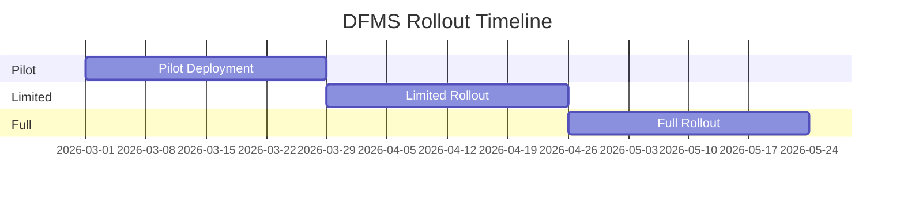

# Rollout Plan

> Gradual rollout strategy for DFMS

**Status**: ✅ Complete  
**Last Updated**: February 13, 2026

---

## 📋 Overview

This document outlines the gradual rollout strategy for DFMS, covering pilot deployment, phased rollout, user training, and support plan to ensure smooth adoption.

---

## 🎯 Rollout Principles

### 1. **Gradual Rollout**
Start small, expand gradually.

### 2. **User-Centric**
Prioritize user experience and training.

### 3. **Risk Mitigation**
Minimize risk through careful planning.

### 4. **Feedback-Driven**
Collect and act on user feedback.

### 5. **Support-Focused**
Provide comprehensive support during rollout.

---

## 📊 Rollout Phases

### Phase 1: Pilot Deployment (Weeks 1-4)

**Duration**: 4 weeks  
**Users**: 10-15 users  
**Scope**: Core workflows only

**Objectives**:
- Validate system functionality
- Identify issues early
- Gather user feedback
- Refine processes

**User Selection**:
- **Logistics Coordinators**: 3-5 users
- **Drivers**: 5-7 users
- **QC Supervisors**: 2-3 users

**Success Criteria**:
- ✅ System stable
- ✅ Core workflows functional
- ✅ User satisfaction > 70%
- ✅ Critical issues resolved

**Activities**:
1. **Week 1**: System setup and user onboarding
2. **Week 2**: Training and initial usage
3. **Week 3**: Full pilot operations
4. **Week 4**: Feedback collection and refinement

---

### Phase 2: Limited Rollout (Weeks 5-8)

**Duration**: 4 weeks  
**Users**: 30-50 users  
**Scope**: All Phase 1 modules

**Objectives**:
- Expand user base
- Validate scalability
- Refine based on feedback
- Prepare for full rollout

**User Selection**:
- **Logistics Coordinators**: 10-15 users
- **Drivers**: 15-20 users
- **QC Supervisors**: 5-10 users
- **Vendors**: 5-10 users

**Success Criteria**:
- ✅ System handles increased load
- ✅ User satisfaction > 80%
- ✅ Performance acceptable
- ✅ Support processes working

**Activities**:
1. **Week 5**: Expand user base
2. **Week 6**: Monitor and optimize
3. **Week 7**: Collect feedback
4. **Week 8**: Prepare for full rollout

---

### Phase 3: Full Rollout (Weeks 9-12)

**Duration**: 4 weeks  
**Users**: All users (50-100)  
**Scope**: Complete Phase 1

**Objectives**:
- Deploy to all users
- Achieve full adoption
- Optimize performance
- Establish support processes

**Success Criteria**:
- ✅ All users onboarded
- ✅ User adoption > 85%
- ✅ System stable
- ✅ Support processes established

**Activities**:
1. **Week 9**: Onboard remaining users
2. **Week 10**: Monitor and support
3. **Week 11**: Optimize and refine
4. **Week 12**: Stabilize and document

---

## 👥 User Onboarding

### Onboarding Process

**Step 1: User Registration**
- Create user accounts
- Assign roles and permissions
- Send welcome email
- Provide login credentials

**Step 2: Initial Training**
- Schedule training sessions
- Provide training materials
- Conduct hands-on training
- Answer questions

**Step 3: Access Provision**
- Grant system access
- Configure user preferences
- Set up mobile apps (if applicable)
- Test access

**Step 4: First Use Support**
- Provide initial support
- Monitor first usage
- Address issues quickly
- Collect feedback

---

### Training Plan

#### Logistics Coordinators

**Duration**: 4 hours  
**Format**: In-person + Online

**Topics**:
1. System overview (30 min)
2. Creating transport orders (1 hour)
3. Monitoring trips (1 hour)
4. Handling exceptions (1 hour)
5. Q&A (30 min)

**Materials**:
- Training manual
- Video tutorials
- Quick reference guide

---

#### Drivers

**Duration**: 2 hours  
**Format**: In-person + Mobile app demo

**Topics**:
1. Mobile app overview (30 min)
2. Starting and completing trips (1 hour)
3. Reporting issues (30 min)

**Materials**:
- Mobile app guide
- Video tutorials
- Quick reference card

---

#### QC Supervisors

**Duration**: 2 hours  
**Format**: In-person + Mobile app demo

**Topics**:
1. Mobile app overview (30 min)
2. Performing inspections (1 hour)
3. Making decisions (30 min)

**Materials**:
- Mobile app guide
- Video tutorials
- Inspection checklist

---

#### Vendors

**Duration**: 1 hour  
**Format**: Online + Mobile app demo

**Topics**:
1. System overview (15 min)
2. Submitting bids (30 min)
3. Managing trips (15 min)

**Materials**:
- Vendor guide
- Video tutorials

---

## 📚 Training Materials

### Documentation

- **User Manuals**: Comprehensive guides for each role
- **Quick Reference Guides**: One-page cheat sheets
- **Video Tutorials**: Step-by-step video guides
- **FAQs**: Common questions and answers

### Delivery Methods

- **In-Person Training**: Classroom sessions
- **Online Training**: Webinars and video courses
- **Self-Paced Learning**: Online materials
- **On-the-Job Training**: Hands-on support

---

## 🆘 Support Plan

### Support Channels

**1. Help Desk**
- **Email**: support@dfms.example.com
- **Phone**: +880-XXX-XXXXXXX
- **Hours**: 8 AM - 8 PM (Mon-Fri)

**2. In-App Support**
- **Chat**: Live chat in web app
- **Help Center**: Knowledge base
- **Ticket System**: Issue tracking

**3. Mobile App Support**
- **In-App Help**: Help section in app
- **Email Support**: support@dfms.example.com
- **Phone Support**: +880-XXX-XXXXXXX

---

### Support Levels

**Level 1: Basic Support**
- Password reset
- Basic questions
- Account issues
- **Response Time**: < 2 hours

**Level 2: Technical Support**
- System issues
- Bug reports
- Integration issues
- **Response Time**: < 4 hours

**Level 3: Escalation**
- Critical issues
- System outages
- Data issues
- **Response Time**: < 1 hour

---

### Support Team Structure

**Team Composition**:
- **Support Lead**: 1 person
- **Support Engineers**: 2-3 people
- **Technical Specialists**: 1-2 people

**Responsibilities**:
- Handle user inquiries
- Troubleshoot issues
- Escalate critical issues
- Maintain knowledge base

---

## 📊 Rollout Metrics

### Adoption Metrics

| Metric | Target | Measurement |
|--------|--------|-------------|
| **User Adoption Rate** | > 85% | % active users |
| **Daily Active Users** | > 70% | % users active daily |
| **Feature Adoption** | > 60% | % users using features |
| **Mobile App Adoption** | > 80% | % mobile users |

---

### Performance Metrics

| Metric | Target | Measurement |
|--------|--------|-------------|
| **System Uptime** | > 99.5% | Availability |
| **API Response Time** | < 500ms | Average response |
| **Error Rate** | < 1% | % failed requests |
| **Support Response Time** | < 2 hours | Average response |

---

### User Satisfaction Metrics

| Metric | Target | Measurement |
|--------|--------|-------------|
| **User Satisfaction** | > 80% | Survey score |
| **Training Effectiveness** | > 75% | Post-training survey |
| **Support Satisfaction** | > 85% | Support survey |
| **Net Promoter Score** | > 50 | NPS score |

---

## 🔄 Feedback Collection

### Feedback Channels

**1. User Surveys**
- Post-training surveys
- Monthly satisfaction surveys
- Feature feedback surveys

**2. Feedback Forms**
- In-app feedback forms
- Email feedback
- Support tickets

**3. User Interviews**
- Regular user interviews
- Focus groups
- Stakeholder meetings

---

### Feedback Processing

**Process**:
1. **Collect**: Gather feedback from all channels
2. **Analyze**: Categorize and prioritize feedback
3. **Action**: Address feedback items
4. **Communicate**: Update users on actions taken

**Frequency**: Weekly review and monthly report

---

## 🚨 Risk Mitigation

### Risk 1: Low User Adoption

**Mitigation**:
- Comprehensive training
- User support
- Incentives for adoption
- Address user concerns

---

### Risk 2: System Performance Issues

**Mitigation**:
- Load testing before rollout
- Performance monitoring
- Auto-scaling
- Quick issue resolution

---

### Risk 3: User Resistance

**Mitigation**:
- Change management
- User involvement
- Address concerns
- Show benefits

---

### Risk 4: Support Overload

**Mitigation**:
- Adequate support team
- Knowledge base
- Self-service options
- Escalation procedures

---

## 📅 Rollout Timeline

**Total Duration**: 12 weeks (3 months)

---

## ✅ Rollout Checklist

### Pre-Rollout
- [ ] System deployed and tested
- [ ] Training materials prepared
- [ ] Support team ready
- [ ] Documentation complete
- [ ] Rollback plan ready

### Pilot Phase
- [ ] Pilot users selected
- [ ] Pilot users onboarded
- [ ] Training completed
- [ ] System monitored
- [ ] Feedback collected

### Limited Rollout
- [ ] Additional users onboarded
- [ ] System scaled
- [ ] Performance optimized
- [ ] Support processes refined

### Full Rollout
- [ ] All users onboarded
- [ ] System stable
- [ ] Support processes established
- [ ] Documentation updated
- [ ] Success metrics achieved

---

## 🔗 Related Documents

- [Phase 1 Deployment](./deployment-strategy/phase-1-deployment.md)
- [Migration Strategy](./migration-strategy.md)
- [Testing Approach](./testing-approach.md)

---

**Document Status**: ✅ Complete  
**Last Reviewed**: February 13, 2026  
**Contact**: Md. Mahfuzur Rahman (Mahfuzur.rahman@brainstation-23.com)

