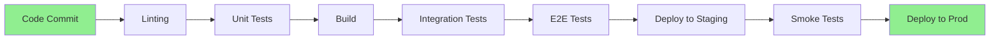

# Testing Approach

> Comprehensive testing strategy for DFMS

**Status**: ✅ Complete  
**Last Updated**: February 13, 2026

---

## 📋 Overview

This document outlines the comprehensive testing strategy for DFMS, covering all testing levels, types, and approaches to ensure quality, reliability, and performance.

---

## 🎯 Testing Principles

### 1. **Test Early, Test Often**
Testing starts from development and continues through deployment.

### 2. **Test at Multiple Levels**
Unit → Integration → System → Acceptance testing.

### 3. **Automate Where Possible**
Automate repetitive tests to ensure consistency.

### 4. **Test Realistic Scenarios**
Test with real-world data and scenarios.

### 5. **Continuous Testing**
Integrate testing into CI/CD pipeline.

---

## 📊 Testing Pyramid

```
                    /\
                   /  \
                  / E2E \        Few, Critical Paths
                 /--------\
                /          \
               / Integration \   Medium, Module Interactions
              /----------------\
             /                  \
            /    Unit Tests      \  Many, Fast, Isolated
           /----------------------\
```

**Distribution**:
- **Unit Tests**: 70% (fast, isolated)
- **Integration Tests**: 20% (module interactions)
- **E2E Tests**: 10% (critical paths)

---

## 🧪 Testing Levels

### Level 1: Unit Testing

**Purpose**: Test individual components in isolation

**Scope**:
- Functions and methods
- Classes and modules
- Business logic
- Data transformations

**Tools**:
- **Backend**: pytest (Python)
- **Frontend**: 
  - **Phase 1**: Django TestCase (server-side template testing)
  - **Phase 2+**: Vitest (Vue.js component testing)
- **Mobile**: Flutter Test (Dart)

**Coverage Target**: > 80%

**Example**:
```python
# Backend Unit Test
def test_calculate_trip_cost():
    trip = create_test_trip()
    cost = calculate_trip_cost(trip)
    assert cost.base_rate > 0
    assert cost.total_cost == cost.base_rate + cost.distance_cost
```

---

### Level 2: Integration Testing

**Purpose**: Test interactions between modules

**Scope**:
- API endpoints
- Database interactions
- External service integrations
- Module-to-module communication

**Tools**:
- **Backend**: pytest + Django TestCase
- **Frontend**: 
  - **Phase 1**: Django TestCase (template rendering tests)
  - **Phase 2+**: Vitest + Vue Test Utils
- **API**: pytest + requests

**Coverage Target**: > 60%

**Example**:
```python
# Integration Test
def test_transport_order_creation():
    # Create TR
    tr = create_transport_request()
    # Create TO from TR
    to = create_transport_order(tr.id)
    # Verify TO created
    assert to.tr_id == tr.id
    assert to.status == 'pending'
```

---

### Level 3: System Testing

**Purpose**: Test complete system functionality

**Scope**:
- End-to-end workflows
- User journeys
- System performance
- Security

**Tools**:
- **E2E**: Cypress
- **Performance**: Locust, k6
- **Security**: OWASP ZAP

**Coverage Target**: Critical paths only

**Example**:
```javascript
// E2E Test
it('should complete trip workflow', () => {
  cy.login('driver@example.com')
  cy.selectTrip('TRIP-001')
  cy.startTrip()
  cy.completeTrip()
  cy.verifyTripCompleted()
})
```

---

### Level 4: Acceptance Testing

**Purpose**: Validate business requirements

**Scope**:
- User stories
- Business workflows
- User acceptance criteria

**Approach**:
- Manual testing by QA team
- User acceptance testing (UAT)
- Business stakeholder validation

---

## 🔍 Testing Types

### 1. Functional Testing

**Purpose**: Verify system functions correctly

**Test Cases**:
- **CRUD Operations**: Create, Read, Update, Delete
- **Business Workflows**: Complete user journeys
- **Validation**: Input validation and error handling
- **Calculations**: Cost calculations, distance calculations

**Example Test Cases**:
- ✅ Create product requisition
- ✅ Approve product requisition
- ✅ Generate transport request from PR
- ✅ Create transport order
- ✅ Assign vehicle and driver
- ✅ Start trip
- ✅ Complete trip
- ✅ Calculate trip cost

---

### 2. Performance Testing

**Purpose**: Ensure system performs under load

**Types**:
- **Load Testing**: Normal expected load
- **Stress Testing**: Beyond normal capacity
- **Spike Testing**: Sudden load increases
- **Endurance Testing**: Sustained load over time

**Targets**:
- **API Response Time**: < 500ms (p95)
- **Database Query Time**: < 100ms (p95)
- **Concurrent Users**: 100+ users
- **Throughput**: 1000+ requests/minute

**Tools**:
- **Load Testing**: Locust, k6
- **Monitoring**: Prometheus, Grafana

**Test Scenarios**:
- 100 concurrent users creating trips
- 1000 trips processed per hour
- Real-time GPS tracking (500+ updates/minute)
- Report generation (large datasets)

---

### 3. Security Testing

**Purpose**: Identify security vulnerabilities

**Types**:
- **Authentication Testing**: Login, logout, session management
- **Authorization Testing**: Role-based access control
- **Input Validation**: SQL injection, XSS prevention
- **API Security**: Rate limiting, token validation
- **Data Encryption**: Data at rest and in transit

**Tools**:
- **Security Scanning**: OWASP ZAP
- **Dependency Scanning**: Snyk, Dependabot
- **Code Analysis**: Bandit (Python), ESLint (JavaScript)

**Test Cases**:
- ✅ Unauthorized access attempts
- ✅ SQL injection attempts
- ✅ XSS attacks
- ✅ CSRF protection
- ✅ Rate limiting
- ✅ Token expiration
- ✅ Data encryption

---

### 4. Usability Testing

**Purpose**: Ensure user-friendly interface

**Types**:
- **User Journey Testing**: Complete workflows
- **Accessibility Testing**: WCAG compliance
- **Mobile Testing**: Responsive design
- **Cross-browser Testing**: Browser compatibility

**Tools**:
- **Accessibility**: axe-core, Lighthouse
- **Browser Testing**: BrowserStack, Selenium

**Test Cases**:
- ✅ User can complete trip workflow
- ✅ Mobile app works on iOS and Android
- ✅ Web app works on Chrome, Firefox, Safari
- ✅ Accessibility standards met

---

### 5. Compatibility Testing

**Purpose**: Ensure compatibility across platforms

**Scopes**:
- **Browsers**: Chrome, Firefox, Safari, Edge
- **Mobile OS**: iOS 14+, Android 10+
- **Devices**: Various screen sizes
- **APIs**: External service compatibility

---

### 6. Regression Testing

**Purpose**: Ensure new changes don't break existing functionality

**Approach**:
- **Automated**: Run test suite on every commit
- **Manual**: Test critical paths before release
- **Smoke Tests**: Quick validation after deployment

---

## 🤖 Test Automation

### CI/CD Integration

**Pipeline Stages**:



**GitLab CI/CD Configuration**:
```yaml
stages:
  - lint
  - test
  - build
  - deploy

unit_tests:
  stage: test
  script:
    - pytest tests/unit/
    
integration_tests:
  stage: test
  script:
    - pytest tests/integration/
    
e2e_tests:
  stage: test
  script:
    - cypress run
```

---

### Test Data Management

**Strategy**:
- **Fixtures**: Reusable test data
- **Factories**: Generate test data dynamically
- **Seeding**: Seed database with test data
- **Isolation**: Each test uses isolated data

**Tools**:
- **Backend**: Factory Boy (Python)
- **Frontend**: Faker.js

---

## 📱 Mobile Testing

### Testing Strategy

**Types**:
- **Unit Tests**: Business logic
- **Widget Tests**: UI components
- **Integration Tests**: API interactions
- **E2E Tests**: Complete user journeys

**Tools**:
- **Flutter Test**: Unit and widget tests
- **Integration Test**: E2E tests
- **Device Testing**: Real devices + emulators

**Test Coverage**:
- ✅ Trip execution workflow
- ✅ GPS tracking
- ✅ Offline functionality
- ✅ Push notifications
- ✅ Photo/video capture

---

## 🔄 Test Execution Strategy

### Development Phase

**Frequency**: On every commit
**Scope**: Unit tests + linting
**Duration**: < 5 minutes

---

### Pre-Commit

**Frequency**: Before commit
**Scope**: Unit tests + linting
**Duration**: < 2 minutes

---

### Pre-Merge

**Frequency**: Before merge to main
**Scope**: All tests (unit + integration)
**Duration**: < 15 minutes

---

### Pre-Release

**Frequency**: Before release
**Scope**: All tests including E2E
**Duration**: < 1 hour

---

### Post-Deployment

**Frequency**: After deployment
**Scope**: Smoke tests
**Duration**: < 5 minutes

---

## 📊 Test Metrics

### Coverage Metrics

| Metric | Target | Current |
|--------|--------|---------|
| **Unit Test Coverage** | > 80% | TBD |
| **Integration Test Coverage** | > 60% | TBD |
| **E2E Test Coverage** | Critical paths | TBD |
| **Code Coverage** | > 75% | TBD |

---

### Quality Metrics

| Metric | Target | Measurement |
|--------|--------|-------------|
| **Test Pass Rate** | > 95% | % tests passing |
| **Bug Detection Rate** | > 80% | Bugs found in testing |
| **Test Execution Time** | < 1 hour | Full test suite |
| **Flaky Test Rate** | < 5% | % flaky tests |

---

## 🐛 Bug Tracking

### Bug Lifecycle

```
New → Assigned → In Progress → Testing → Resolved → Closed
  ↓                                    ↑
  └────────── Reopened ───────────────┘
```

**Severity Levels**:
- **Critical**: System down, data loss
- **High**: Major functionality broken
- **Medium**: Minor functionality broken
- **Low**: Cosmetic issues, minor bugs

**Tools**:
- **Issue Tracking**: GitLab Issues, Jira
- **Bug Reporting**: Detailed bug reports with steps to reproduce

---

## 🔗 Related Documents

- [Phase 1 Deployment](./deployment-strategy/phase-1-deployment.md)
- [Technology Considerations](./technology-considerations.md)
- [Rollout Plan](./rollout-plan.md)

---

**Document Status**: ✅ Complete  
**Last Reviewed**: February 13, 2026  
**Contact**: Md. Mahfuzur Rahman (Mahfuzur.rahman@brainstation-23.com)

