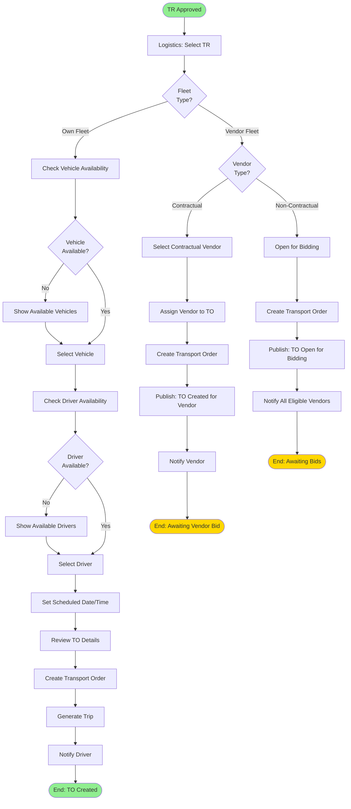

# Transport Order Creation Flow

> Converting Transport Requests to Transport Orders with vehicle/driver assignment

**Status**: ✅ Complete  
**Last Updated**: February 13, 2026  
**Complexity**: Medium  
**Estimated Duration**: 2-6 hours

---

## 📋 Overview

The Transport Order (TO) creation flow converts approved Transport Requests (TRs) into executable Transport Orders by assigning vehicles, drivers, and scheduling. This is where logistics planning meets execution.

**Trigger**: Approved Transport Request (TR) exists  
**Outcome**: Transport Order (TO) created with assigned resources

---

## 👥 Actors

| Actor | Role | Responsibilities |
|-------|------|------------------|
| **Logistics Coordinator** | Primary User | Creates TO, assigns resources |
| **System** | Automation | Validates availability, creates trip |
| **GPS/VTS Provider** | External System | Provides vehicle location |
| **Vendor Module** | Internal System | Handles vendor fleet routing |

---

## 🔄 Workflow Diagram



---

## 📝 Detailed Steps

### Phase 1: TR Selection & Fleet Type Decision

#### Step 1: Select Transport Request
**Actor**: Logistics Coordinator  
**Action**: Navigate to pending TRs and select one to convert

**UI Display**:
- List of approved TRs (status: `approved`)
- TR details: Number, product, quantity, origin, destination, date
- Priority indicator
- Age (days since TR creation)

**System Actions**:
- Query TRs with status = `approved`
- Sort by priority and requested date
- Display in table format

---

#### Step 2: Determine Fleet Type
**Actor**: Logistics Coordinator  
**Action**: Choose between own fleet or vendor fleet

**Decision Criteria**:
- **Own Fleet**: 
  - Preferred for regular routes
  - Better cost control
  - Direct management
  
- **Vendor Fleet**:
  - Used when own fleet unavailable
  - Specialized vehicle requirements
  - Peak demand periods

**Business Rules**:
- TO-001: Fleet type must be specified
- TO-002: Own fleet preferred if available
- TO-003: Vendor fleet requires vendor selection

---

### Phase 2A: Own Fleet Path

#### Step 3: Check Vehicle Availability
**Actor**: System (with user input)  
**Action**: Find available vehicles matching requirements

**Matching Criteria**:
```python
def find_available_vehicles(tr):
    vehicles = Vehicle.objects.filter(
        owner_type='own',
        status='available',
        type=tr.vehicle_type_required,
        capacity__gte=tr.quantity
    )
    
    # Exclude vehicles with maintenance
    vehicles = vehicles.exclude(
        maintenance_schedules__date=tr.requested_date
    )
    
    # Prefer vehicles near origin
    vehicles = vehicles.annotate(
        distance_from_origin=calculate_distance(location, tr.origin)
    ).order_by('distance_from_origin')
    
    return vehicles
```

**Display**:
- Vehicle registration number
- Type and capacity
- Current location (from GPS)
- Distance from origin
- Next scheduled trip (if any)

---

#### Step 4: Select Vehicle
**Actor**: Logistics Coordinator  
**Action**: Choose vehicle from available list

**Validation**:
- VR-001: Vehicle must be registered and active
- VR-002: Vehicle capacity must meet requirement
- VR-003: Vehicle must not have conflicting schedule
- VR-004: Vehicle must pass fitness check

**System Actions**:
- Reserve vehicle for this TO
- Update vehicle status: `available` → `assigned`
- Log assignment

---

#### Step 5: Check Driver Availability
**Actor**: System (with user input)  
**Action**: Find available drivers

**Matching Criteria**:
```python
def find_available_drivers(scheduled_date):
    drivers = Driver.objects.filter(
        status='available',
        license_valid_until__gte=scheduled_date
    )
    
    # Exclude drivers with trips on same date
    drivers = drivers.exclude(
        trips__scheduled_date=scheduled_date,
        trips__status__in=['pending', 'in_transit']
    )
    
    # Exclude drivers on leave
    drivers = drivers.exclude(
        leaves__date=scheduled_date
    )
    
    # Order by rating
    drivers = drivers.order_by('-rating')
    
    return drivers
```

**Display**:
- Driver name and contact
- License details
- Rating
- Last trip date
- Total trips completed

---

#### Step 6: Select Driver
**Actor**: Logistics Coordinator  
**Action**: Choose driver from available list

**Validation**:
- DR-001: Driver must have valid license
- DR-002: Driver must not exceed working hours limit
- DR-003: Driver must not have conflicting schedule
- DR-004: Driver must be marked as available

**System Actions**:
- Assign driver to TO
- Update driver status: `available` → `assigned`
- Log assignment

---

#### Step 7: Set Schedule
**Actor**: Logistics Coordinator  
**Action**: Set scheduled date and time for trip

**Input**:
- Scheduled date (default: TR requested date)
- Scheduled time (default: 08:00 AM)
- Expected duration (calculated from distance)
- Special instructions

**Validation**:
- TO-010: Scheduled date cannot be in past
- TO-011: Scheduled time must be within working hours
- TO-012: Must allow sufficient time for trip completion

**System Actions**:
- Calculate estimated arrival time using Maps API
- Check for route conflicts
- Validate schedule feasibility

---

#### Step 8: Create Transport Order (Own Fleet)
**Actor**: System  
**Action**: Create TO record with all details

**TO Data**:
```python
{
    "to_number": "TO-20260213-0001",
    "tr_id": tr.id,
    "fleet_type": "own",
    "vehicle_id": selected_vehicle.id,
    "driver_id": selected_driver.id,
    "helper_id": selected_helper.id,  # Optional
    "scheduled_date": scheduled_date,
    "scheduled_time": scheduled_time,
    "origin_poi_id": tr.origin_poi_id,
    "destination_poi_id": tr.destination_poi_id,
    "product_id": tr.product_id,
    "quantity": tr.quantity,
    "status": "pending",
    "created_by": current_user.id,
    "created_at": now()
}
```

**System Actions**:
- Generate TO number
- Create TO record
- Update TR status: `approved` → `to_created`
- Publish event: `TransportOrderCreated`

---

#### Step 9: Generate Trip
**Actor**: System (automated)  
**Action**: Create trip record from TO

**Trip Data**:
```python
{
    "trip_number": "TRIP-20260213-0001",
    "to_id": to.id,
    "vehicle_id": to.vehicle_id,
    "driver_id": to.driver_id,
    "scheduled_date": to.scheduled_date,
    "origin_poi_id": to.origin_poi_id,
    "destination_poi_id": to.destination_poi_id,
    "status": "pending",
    "created_at": now()
}
```

**System Actions**:
- Generate trip number
- Create trip record
- Link trip to TO
- Publish event: `TripCreated`

---

#### Step 10: Notify Driver
**Actor**: System (automated)  
**Action**: Send notification to assigned driver

**Notification Channels**:
- SMS: "Trip TRIP-001 assigned for 2026-02-14. Check app for details."
- Push Notification: Trip details
- In-app: Trip card in driver's dashboard

**Notification Content**:
- Trip number
- Scheduled date/time
- Origin and destination
- Product and quantity
- Vehicle details

---

### Phase 2B: Vendor Fleet Path

#### Step 11: Vendor Type Decision
**Actor**: Logistics Coordinator  
**Action**: Choose between contractual or non-contractual vendor

**Contractual Vendor**:
- Pre-agreed rates
- Direct assignment
- No bidding required

**Non-Contractual Vendor**:
- Competitive bidding
- Market rates
- Multiple vendors compete

---

#### Step 12A: Contractual Vendor Assignment
**Actor**: Logistics Coordinator  
**Action**: Select vendor from contractual list

**Selection Criteria**:
- Contract validity
- Vendor rating
- Vehicle availability
- Route coverage

**System Actions**:
- Create TO with vendor assignment
- Publish event: `TransportOrderCreated`
- Notify vendor via SMS/Email
- Vendor confirms vehicle/driver details

---

#### Step 12B: Open for Bidding
**Actor**: System (automated)  
**Action**: Open TO for vendor bidding

**System Actions**:
- Create TO with status: `open_for_bidding`
- Identify eligible vendors (based on vehicle type, location)
- Publish event: `TransportOrderOpenForBidding`
- Send notifications to all eligible vendors
- Set bidding deadline (e.g., 4 hours)

**Vendor Notification**:
- SMS: "New TO available. Bid by 2PM. TO-001: Dhaka to Mymensingh"
- Push: TO details with "Submit Bid" button

---

## 📊 Business Rules

| Rule ID | Description | Enforcement |
|---------|-------------|-------------|
| TO-001 | Fleet type must be specified | System validation |
| TO-002 | Own fleet preferred if available | Business logic |
| TO-003 | Vendor fleet requires vendor selection | Workflow |
| TO-004 | Vehicle capacity must meet requirement | System validation |
| TO-005 | Driver must have valid license | System validation |
| TO-006 | Vehicle and driver cannot have conflicting schedule | System validation |
| TO-007 | Scheduled date cannot be in past | System validation |
| TO-008 | TO must reference valid TR | Data integrity |
| TO-009 | One TO per TR (1:1 relationship) | Business logic |
| TO-010 | TO creation triggers trip creation | System automation |

---

## 🔔 Notifications

| Event | Recipients | Channel | Content |
|-------|-----------|---------|---------|
| TO Created (Own Fleet) | Driver | SMS + Push | "Trip assigned for {date}" |
| TO Created (Own Fleet) | Vehicle Owner (if vendor-owned) | SMS | "Vehicle {reg} assigned to trip" |
| TO Created (Vendor Fleet) | Vendor | SMS + Email | "TO available for bidding" |
| TO Created | Requester | In-app | "Your TR converted to TO" |

---

## 📡 Events Published

```python
# Event 1: TO Created (Own Fleet)
TransportOrderCreated(
    to_id=uuid,
    to_number=string,
    tr_id=uuid,
    fleet_type='own',
    vehicle_id=uuid,
    driver_id=uuid,
    scheduled_date=date,
    created_by=uuid,
    created_at=timestamp
)

# Event 2: TO Created (Vendor Fleet)
TransportOrderCreated(
    to_id=uuid,
    to_number=string,
    tr_id=uuid,
    fleet_type='vendor',
    vendor_id=uuid,  # If contractual
    bidding_deadline=timestamp,  # If non-contractual
    created_at=timestamp
)

# Event 3: Trip Created
TripCreated(
    trip_id=uuid,
    trip_number=string,
    to_id=uuid,
    vehicle_id=uuid,
    driver_id=uuid,
    scheduled_date=date,
    created_at=timestamp
)
```

---

## ⚠️ Exception Scenarios

### Scenario 1: No Vehicles Available
**Trigger**: All vehicles assigned or in maintenance  
**Handling**:
- Show "No vehicles available" message
- Suggest: Wait for vehicle to become available
- Suggest: Use vendor fleet
- Option to schedule for future date

### Scenario 2: No Drivers Available
**Trigger**: All drivers assigned or on leave  
**Handling**:
- Show "No drivers available" message
- Suggest: Reschedule for different date
- Suggest: Use vendor fleet
- Option to assign helper as backup driver (if licensed)

### Scenario 3: Vehicle/Driver Conflict
**Trigger**: Selected vehicle/driver already has trip on same date  
**Handling**:
- Show conflict warning
- Display conflicting trip details
- Prevent TO creation
- Suggest alternative vehicle/driver

### Scenario 4: GPS Location Unavailable
**Trigger**: Cannot fetch vehicle location from GPS provider  
**Handling**:
- Use last known location (with timestamp)
- Show warning: "Location data may be stale"
- Allow TO creation
- Log GPS failure for investigation

---

## 📈 Performance Metrics

| Metric | Target | Measurement |
|--------|--------|-------------|
| **TO Creation Time** | < 10 minutes | Time from TR selection to TO creation |
| **Vehicle Assignment Success** | > 95% | % of TOs with vehicle assigned on first attempt |
| **Driver Assignment Success** | > 95% | % of TOs with driver assigned on first attempt |
| **Same-Day TO Creation** | > 80% | % of TRs converted to TO on same day |
| **Own Fleet Utilization** | > 85% | % of TOs using own fleet vs vendor |

---

## 🔗 Related Documents

### Architecture
- [Module Boundaries](../../01-system-design/modules/module-boundaries.md#3-transport-management)
- [Module Interactions](../../01-system-design/modules/module-interactions.md)

### Business Context
- [User Story: US-017](../../../02-domain/04-backlog/phase-1/user-stories/US-017-to-creation-multiple.md)
- [User Story: US-018](../../../02-domain/04-backlog/phase-1/user-stories/US-018-to-creation-transport-planner.md)

### Other Workflows
- [Product Requisition Flow](./01-product-requisition-flow.md) - Previous step
- [Trip Execution Flow](./03-trip-execution-flow.md) - Next step
- [Vendor Bidding Flow](./04-vendor-bidding-flow.md) - Parallel for vendor fleet

---

**Document Status**: ✅ Complete  
**Last Reviewed**: February 13, 2026  
**Contact**: Md. Mahfuzur Rahman (Mahfuzur.rahman@brainstation-23.com)

