# QC Inspection Flow

> Quality control inspection workflow from creation to completion

**Status**: ✅ Complete  
**Last Updated**: February 13, 2026  
**Complexity**: Medium  
**Estimated Duration**: 30 minutes - 2 hours

---

## 📋 Overview

The QC Inspection flow manages quality control inspections after product unloading. It includes physical inspection, sampling, lab testing (if required), and pass/fail decision with escalation workflows.

**Trigger**: Unloading completed at destination  
**Outcome**: QC inspection completed with pass/fail decision

---

## 👥 Actors

| Actor | Role | Responsibilities |
|-------|------|------------------|
| **QC Supervisor** | Primary Inspector | Performs inspection, makes decision |
| **QC Assistant** | Support | Assists with sampling, documentation |
| **Lab Technician** | Lab Testing | Performs lab tests (if required) |
| **Manager** | Escalation | Reviews failed inspections |
| **System** | Automation | Creates inspection, triggers workflows |

---

## 🔄 Workflow Diagram

```mermaid
graph TD
    Start([Unloading Completed]) --> CreateQC[System: Create QC Inspection]
    CreateQC --> AssignQC[Assign to QC Supervisor]
    AssignQC --> NotifyQC[Notify QC Supervisor]
    
    NotifyQC --> QCStart{QC Supervisor<br/>Starts?}
    QCStart -->|No| RemindQC[Send Reminder]
    RemindQC --> QCStart
    
    QCStart -->|Yes| PhysicalInspection[Physical Inspection]
    PhysicalInspection --> CheckCondition{Product<br/>Condition?}
    
    CheckCondition -->|Good| CheckQuantity{Quantity<br/>Matches?}
    CheckCondition -->|Damaged| RecordDamage[Record: Damage Details]
    RecordDamage --> CheckQuantity
    
    CheckQuantity -->|Yes| CheckPackaging{Packaging<br/>Intact?}
    CheckQuantity -->|No| RecordShortage[Record: Quantity Shortage]
    RecordShortage --> CheckPackaging
    
    CheckPackaging -->|Yes| CheckDocs{Documentation<br/>Complete?}
    CheckPackaging -->|No| RecordPackaging[Record: Packaging Issues]
    RecordPackaging --> CheckDocs
    
    CheckDocs -->|Yes| SamplingRequired{Sampling<br/>Required?}
    CheckDocs -->|No| RecordDocs[Record: Documentation Issues]
    RecordDocs --> SamplingRequired
    
    SamplingRequired -->|No| MakeDecision[Make QC Decision]
    SamplingRequired -->|Yes| CollectSample[Collect Sample]
    CollectSample --> LabTest[Lab Testing]
    LabTest --> TestResult{Test<br/>Result?}
    
    TestResult -->|Pass| MakeDecision
    TestResult -->|Fail| RecordTestFail[Record: Test Failure]
    RecordTestFail --> MakeDecision
    
    MakeDecision --> QCDecision{QC<br/>Decision?}
    
    QCDecision -->|Pass| QCPass[QC Passed]
    QCPass --> UploadPhotos[Upload Photos/Videos]
    UploadPhotos --> SubmitQC[Submit QC Report]
    SubmitQC --> PublishPass[Publish: QCInspectionCompleted]
    PublishPass --> NotifyStakeholders1[Notify: All Stakeholders]
    NotifyStakeholders1 --> End1([End: QC Passed])
    
    QCDecision -->|Fail| QCFail[QC Failed]
    QCFail --> RecordFailReason[Record: Failure Reason]
    RecordFailReason --> Escalate[Escalate to Manager]
    Escalate --> ManagerReview{Manager<br/>Review?}
    
    ManagerReview -->|Approve| ManagerApprove[Manager Approves]
    ManagerApprove --> QCPass
    
    ManagerReview -->|Reject| ManagerReject[Manager Rejects]
    ManagerReject --> RejectTrip[Trip Rejected]
    RejectTrip --> InitiateReturn[Initiate Return Process]
    InitiateReturn --> PublishFail[Publish: QCInspectionFailed]
    PublishFail --> NotifyStakeholders2[Notify: All Stakeholders]
    NotifyStakeholders2 --> End2([End: QC Failed])
    
    style Start fill:#90EE90
    style End1 fill:#90EE90
    style End2 fill:#FFB6C1
    style QCPass fill:#90EE90
    style QCFail fill:#FFB6C1
    style ManagerApprove fill:#FFD700
    style ManagerReject fill:#FFB6C1
```



---

## 📝 Detailed Steps

### Phase 1: QC Inspection Creation

#### Step 1: Create QC Inspection
**Actor**: System (automated)  
**Action**: Create QC inspection record after unloading

**Trigger**: `UnloadingCompleted` event received

**System Actions**:
- Create QC inspection record
- Link to trip
- Set status: `pending`
- Assign to QC supervisor (based on location/workload)
- Publish event: `QCInspectionCreated`

**Data Created**:
```python
{
    "inspection_id": uuid,
    "trip_id": uuid,
    "qc_supervisor_id": uuid,
    "inspection_type": "physical",  # or "physical_and_lab"
    "status": "pending",
    "created_at": timestamp
}
```

---

#### Step 2: Notify QC Supervisor
**Actor**: System (automated)  
**Action**: Send notification to assigned QC supervisor

**Notification Channels**:
- SMS: "New QC inspection required. Trip TRIP-001. Check app for details."
- Push: Notification in QC mobile app
- Email: Detailed inspection assignment

**Notification Content**:
- Trip number
- Product and quantity
- Unloading completion time
- Inspection deadline (SLA: 2 hours)
- Link to inspection form

---

### Phase 2: Physical Inspection

#### Step 3: Start Inspection
**Actor**: QC Supervisor  
**Action**: Open inspection in mobile app and start

**Mobile App Actions**:
- Display trip details
- Show product information
- Display inspection checklist
- Enable photo/video capture
- Start inspection timer

**System Actions**:
- Update status: `pending` → `in_progress`
- Record start time
- Publish event: `QCInspectionStarted`

---

#### Step 4: Product Condition Check
**Actor**: QC Supervisor  
**Action**: Inspect product physical condition

**Inspection Criteria**:
- Product appearance
- Damage assessment
- Contamination check
- Temperature (if cold chain)
- Expiry date (if applicable)

**Data Captured**:
```python
{
    "condition": "good" | "damaged" | "contaminated",
    "damage_details": string,  # If damaged
    "damage_photos": [url, ...],  # Photo URLs
    "temperature": decimal,  # If applicable
    "expiry_date": date  # If applicable
}
```

**Business Rules**:
- QC-001: Product condition must be assessed
- QC-002: Damage must be photographed
- QC-003: Temperature must be within range (if cold chain)

---

#### Step 5: Quantity Verification
**Actor**: QC Supervisor  
**Action**: Verify unloaded quantity matches loaded quantity

**Verification Process**:
- Count/measure unloaded quantity
- Compare with loaded quantity
- Record any discrepancies

**Data Captured**:
```python
{
    "expected_quantity": decimal,
    "actual_quantity": decimal,
    "quantity_difference": decimal,
    "quantity_match": boolean
}
```

**Business Rules**:
- QC-004: Quantity must match loaded quantity (±1%)
- QC-005: Shortage must be documented with reason

---

#### Step 6: Packaging Inspection
**Actor**: QC Supervisor  
**Action**: Inspect packaging integrity

**Inspection Criteria**:
- Packaging intact
- Seals unbroken
- Labels correct
- No tampering signs

**Data Captured**:
```python
{
    "packaging_condition": "intact" | "damaged" | "tampered",
    "packaging_photos": [url, ...],
    "seal_status": "intact" | "broken",
    "label_status": "correct" | "incorrect" | "missing"
}
```

---

#### Step 7: Documentation Check
**Actor**: QC Supervisor  
**Action**: Verify all documentation is complete

**Documents to Check**:
- Delivery challan
- Invoice
- Quality certificates
- Transport documents

**Data Captured**:
```python
{
    "documents_complete": boolean,
    "missing_documents": [string, ...],
    "document_photos": [url, ...]
}
```

---

### Phase 3: Sampling & Lab Testing (If Required)

#### Step 8: Determine Sampling Requirement
**Actor**: QC Supervisor  
**Action**: Decide if sampling and lab testing required

**Sampling Criteria**:
- Product type (some products require mandatory sampling)
- Random sampling (10% of shipments)
- Customer request
- Previous quality issues

**If Sampling Required**:
- Proceed to Step 9
- Set inspection_type: `physical_and_lab`

**If No Sampling**:
- Proceed directly to Step 11 (Make Decision)

---

#### Step 9: Collect Sample
**Actor**: QC Assistant (supervised by QC Supervisor)  
**Action**: Collect sample for lab testing

**Sampling Process**:
1. Identify sampling points
2. Collect sample (following SOP)
3. Label sample
4. Record sample details
5. Send to lab

**Data Captured**:
```python
{
    "sample_id": uuid,
    "inspection_id": uuid,
    "sample_type": string,
    "quantity": decimal,
    "collection_time": timestamp,
    "collected_by": uuid,
    "sample_photos": [url, ...]
}
```

**Business Rules**:
- QC-006: Sample must be collected following SOP
- QC-007: Sample must be properly labeled
- QC-008: Sample must be sent to lab within 2 hours

---

#### Step 10: Lab Testing
**Actor**: Lab Technician  
**Action**: Perform lab tests on sample

**Lab Tests** (depending on product):
- Moisture content
- Protein content
- Contamination tests
- Chemical analysis
- Microbiological tests

**System Actions**:
- Create lab test record
- Link to sample
- Update status: `pending` → `testing`
- Publish event: `QCLabTestStarted`

**Lab Test Results**:
```python
{
    "lab_test_id": uuid,
    "sample_id": uuid,
    "test_type": string,
    "test_results": {
        "parameter": "value",
        ...
    },
    "result": "pass" | "fail",
    "tested_by": uuid,
    "tested_at": timestamp
}
```

**Business Rules**:
- QC-009: Lab tests must be completed within 24 hours
- QC-010: Test results must meet quality standards
- QC-011: Failed tests must be documented with details

---

### Phase 4: QC Decision

#### Step 11: Make QC Decision
**Actor**: QC Supervisor  
**Action**: Make pass/fail decision based on inspection

**Decision Criteria**:
- Product condition: Good
- Quantity: Matches (±1%)
- Packaging: Intact
- Documentation: Complete
- Lab tests: Pass (if required)

**Decision Logic**:
```python
def make_qc_decision(inspection):
    if (inspection.product_condition == "good" and
        inspection.quantity_match and
        inspection.packaging_condition == "intact" and
        inspection.documents_complete and
        (not inspection.sampling_required or inspection.lab_test_result == "pass")):
        return "pass"
    else:
        return "fail"
```

---

#### Step 12A: QC Passed
**Actor**: QC Supervisor  
**Action**: Submit QC report with pass decision

**System Actions**:
- Update inspection status: `in_progress` → `completed`
- Set result: `pass`
- Upload photos/videos to S3
- Generate QC report
- Publish event: `QCInspectionCompleted` (result: pass)
- Notify all stakeholders
- Allow trip to proceed to completion

**QC Report Generated**:
- Inspection summary
- Product condition
- Quantity verification
- Packaging status
- Documentation status
- Lab test results (if applicable)
- Photos/videos
- Inspector signature

---

#### Step 12B: QC Failed
**Actor**: QC Supervisor  
**Action**: Submit QC report with fail decision

**System Actions**:
- Update inspection status: `in_progress` → `failed`
- Set result: `fail`
- Record failure reason
- Upload photos/videos
- Generate QC report
- Escalate to manager
- Publish event: `QCInspectionFailed`

**Failure Reasons**:
- Product damaged
- Quantity mismatch
- Packaging damaged
- Documentation incomplete
- Lab test failed
- Contamination detected

---

### Phase 5: Escalation & Resolution

#### Step 13: Manager Review
**Actor**: Manager  
**Action**: Review failed QC inspection

**Manager Options**:
- **Approve**: Override QC decision, accept product
- **Reject**: Confirm QC decision, reject product
- **Request Re-inspection**: Ask for second opinion

**If Manager Approves**:
- Update inspection: `failed` → `approved_by_manager`
- Set result: `pass`
- Publish event: `QCInspectionApprovedByManager`
- Trip proceeds to completion

**If Manager Rejects**:
- Confirm rejection
- Initiate return process
- Trip status: `completed` → `rejected`
- Publish event: `QCInspectionRejected`

---

## 📊 Business Rules

| Rule ID | Description | Enforcement |
|---------|-------------|-------------|
| QC-001 | Product condition must be assessed | Workflow |
| QC-002 | Damage must be photographed | System validation |
| QC-003 | Temperature must be within range | System validation |
| QC-004 | Quantity must match loaded quantity (±1%) | System validation |
| QC-005 | Shortage must be documented | Workflow |
| QC-006 | Sample must be collected following SOP | Business rule |
| QC-007 | Sample must be properly labeled | System validation |
| QC-008 | Sample must be sent to lab within 2 hours | SLA |
| QC-009 | Lab tests must be completed within 24 hours | SLA |
| QC-010 | Test results must meet quality standards | System validation |
| QC-011 | Failed tests must be documented | Workflow |
| QC-012 | QC inspection must be completed within 2 hours | SLA |
| QC-013 | Failed QC must be escalated to manager | Workflow |
| QC-014 | Manager decision is final | Business rule |
| QC-015 | QC report must include photos/videos | System validation |

---

## 🔔 Notifications

| Event | Recipients | Channel | Content |
|-------|-----------|---------|---------|
| QC Inspection Created | QC Supervisor | SMS + Push | "New QC inspection: TRIP-001" |
| QC Inspection Started | Logistics | In-app | "QC inspection started for TRIP-001" |
| Lab Test Required | Lab Technician | SMS + In-app | "Sample received, lab test required" |
| QC Inspection Passed | All Stakeholders | Email + SMS | "QC passed for TRIP-001" |
| QC Inspection Failed | Manager, Logistics | Email + SMS | "QC failed for TRIP-001: {reason}" |
| Manager Approval | All Stakeholders | Email + SMS | "QC approved by manager for TRIP-001" |
| QC Inspection Rejected | All Stakeholders | Email + SMS | "QC rejected, return process initiated" |

---

## 📡 Events Published

```python
# Event 1: QC Inspection Created
QCInspectionCreated(
    inspection_id=uuid,
    trip_id=uuid,
    qc_supervisor_id=uuid,
    created_at=timestamp
)

# Event 2: QC Inspection Started
QCInspectionStarted(
    inspection_id=uuid,
    trip_id=uuid,
    started_by=uuid,
    started_at=timestamp
)

# Event 3: QC Inspection Completed (Pass)
QCInspectionCompleted(
    inspection_id=uuid,
    trip_id=uuid,
    result="pass",
    inspector_id=uuid,
    completed_at=timestamp,
    qc_report_url=string
)

# Event 4: QC Inspection Failed
QCInspectionFailed(
    inspection_id=uuid,
    trip_id=uuid,
    result="fail",
    failure_reason=string,
    inspector_id=uuid,
    failed_at=timestamp
)

# Event 5: QC Inspection Approved by Manager
QCInspectionApprovedByManager(
    inspection_id=uuid,
    trip_id=uuid,
    approved_by=uuid,
    approved_at=timestamp
)

# Event 6: QC Inspection Rejected
QCInspectionRejected(
    inspection_id=uuid,
    trip_id=uuid,
    rejected_by=uuid,
    rejected_at=timestamp
)
```

---

## ⚠️ Exception Scenarios

### Scenario 1: QC Supervisor Unavailable
**Trigger**: Assigned QC supervisor not available  
**Handling**:
- Reassign to another QC supervisor
- Extend inspection deadline
- Notify logistics coordinator

### Scenario 2: Lab Test Delayed
**Trigger**: Lab test not completed within SLA  
**Handling**:
- Send reminder to lab technician
- Escalate to lab manager
- Consider provisional approval (if low risk)

### Scenario 3: Multiple Failures
**Trigger**: Multiple QC failures for same vendor/product  
**Handling**:
- Flag vendor/product for review
- Increase sampling rate
- Require manager approval for all shipments

### Scenario 4: Disputed QC Decision
**Trigger**: Vendor disputes QC failure  
**Handling**:
- Manager reviews dispute
- May request re-inspection
- Final decision by manager

---

## 📈 Performance Metrics

| Metric | Target | Measurement |
|--------|--------|-------------|
| **QC Inspection Time** | < 2 hours | Time from creation to completion |
| **QC Pass Rate** | > 95% | % of inspections passing |
| **Lab Test Turnaround** | < 24 hours | Time from sample to results |
| **Manager Escalation Rate** | < 5% | % of inspections requiring escalation |
| **QC Report Accuracy** | > 99% | % of reports with complete data |

---

## 🔗 Related Documents

### Architecture
- [Module Boundaries](../../01-system-design/modules/module-boundaries.md#6-quality-control)
- [Module Interactions](../../01-system-design/modules/module-interactions.md)

### Business Context
- [User Story: US-061](../../../02-domain/04-backlog/phase-1/user-stories/_wbs-temp/US-061-qc-supervisor-mobile.md)
- [Business Process](../../../02-domain/01-business-domain/business-processes/business-processes-overview.md)

### Other Workflows
- [Gate & Operations Flow](./05-gate-operations-flow.md) - Previous step
- [Trip Execution Flow](./03-trip-execution-flow.md) - Part of trip execution
- [Trip Costing Flow](./07-trip-costing-invoicing-flow.md) - Next step after QC pass

---

**Document Status**: ✅ Complete  
**Last Reviewed**: February 13, 2026  
**Contact**: Md. Mahfuzur Rahman (Mahfuzur.rahman@brainstation-23.com)

