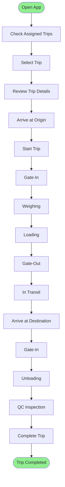
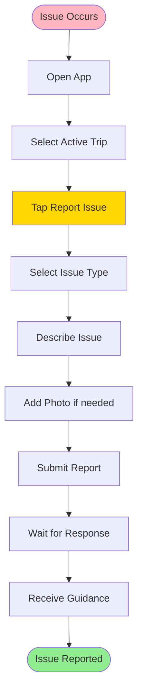

# Driver Workflows

> Mobile workflows for drivers

**Status**: ✅ Complete  
**Last Updated**: February 13, 2026  
**User Role**: Driver  
**Primary Device**: Mobile App (Android/iOS)

---

## 📋 Overview

Drivers use the DFMS mobile app to receive trip assignments, execute trips, provide real-time updates, and complete trips. This document covers their mobile workflows.

---

## 👤 User Profile

**Role**: Driver  
**Department**: Transport Operations  
**Primary Responsibilities**:
- Accept trip assignments
- Execute trips safely
- Provide real-time updates
- Complete trips
- Report issues

**Daily Tasks**:
- Check trip assignments
- Start trips
- Update location
- Complete trips
- Report incidents

---

## 🔄 Daily Workflow

### Morning Routine (Before First Trip)

#### Task 1: Check Trip Assignments
**Duration**: 5 minutes  
**Frequency**: Daily

**Steps**:
1. Open DFMS mobile app
2. Login (biometric or PIN)
3. Navigate to "My Trips"
4. Review assigned trips for today
5. Check trip details

**Mobile App Display**:
- Trip list (today's trips)
- Trip status indicators
- Scheduled time
- Route preview
- Quick actions

**Key Information**:
- Trip number
- Origin → Destination
- Scheduled time
- Product and quantity
- Vehicle assignment
- Estimated duration

---

#### Task 2: Review Trip Details
**Duration**: 2-3 minutes  
**Frequency**: Per trip

**Steps**:
1. Tap on trip card
2. Review trip details
3. View route on map
4. Check special instructions
5. Confirm readiness

**Trip Details Screen**:
- Full route map
- Waypoints
- Distance and ETA
- Product details
- Contact information
- Special instructions

---

### Trip Execution

#### Task 3: Start Trip
**Duration**: 1 minute  
**Frequency**: Per trip

**Steps**:
1. Arrive at origin location
2. Open trip in app
3. Tap "Start Trip"
4. Confirm start (odometer, location)
5. Begin navigation

**Pre-conditions**:
- Driver at origin (within 500m)
- Scheduled time reached (or within 30 min)
- Vehicle ready

**System Actions**:
- Record start time
- Record start odometer
- Record start location
- Update trip status: `pending` → `in_transit`
- Start GPS tracking
- Send notifications

**Mobile App Actions**:
- Enable navigation
- Start location tracking
- Display trip timer
- Show route on map

---

#### Task 4: Real-Time Location Updates
**Duration**: Continuous  
**Frequency**: Every 30-60 seconds (automatic)

**System Actions** (automatic):
- Capture GPS location
- Record speed and heading
- Update trip location
- Send to server
- Update dashboard

**Driver Actions** (if needed):
- Manually update location (if GPS fails)
- Report route deviation
- Report stops

**Mobile App Display**:
- Current location on map
- Route progress
- Distance traveled
- Distance remaining
- ETA to destination
- Current speed

---

#### Task 5: Arrive at Origin (Gate Operations)
**Duration**: 5-10 minutes  
**Frequency**: Per trip

**Steps**:
1. Arrive at origin gate
2. Wait for gate-in
3. Proceed to weighing
4. Wait for loading
5. Proceed to gate-out

**Driver Actions**:
- Follow gate operator instructions
- Present vehicle registration
- Wait for operations
- Proceed when cleared

**Mobile App**:
- Shows gate location
- Displays operation status
- Provides waiting time estimate

---

#### Task 6: In Transit to Destination
**Duration**: Trip duration  
**Frequency**: Per trip

**Driver Responsibilities**:
- Follow planned route
- Drive safely
- Maintain speed limits
- Report any issues
- Update location (automatic)

**Mobile App Features**:
- Turn-by-turn navigation
- Route guidance
- Speed alerts
- Route deviation alerts
- Emergency button

**Alerts Driver Receives**:
- Route deviation (> 500m)
- Speed violation
- Long stop (> 30 min)
- Low fuel (if IoT connected)

---

#### Task 7: Arrive at Destination (Gate Operations)
**Duration**: 5-10 minutes  
**Frequency**: Per trip

**Steps**:
1. Arrive at destination gate
2. Wait for gate-in
3. Wait for unloading
4. Wait for QC (if required)
5. Complete trip

**Driver Actions**:
- Follow gate operator instructions
- Wait for operations
- Sign delivery documents
- Complete trip in app

---

#### Task 8: Complete Trip
**Duration**: 1 minute  
**Frequency**: Per trip

**Steps**:
1. All operations completed
2. QC passed (if required)
3. Open trip in app
4. Tap "Complete Trip"
5. Confirm completion (odometer, location)
6. Submit

**Pre-conditions**:
- Unloading completed
- QC passed (if required)
- Driver at destination

**System Actions**:
- Record end time
- Record end odometer
- Record end location
- Calculate distance traveled
- Update trip status: `in_transit` → `completed`
- Stop GPS tracking
- Send notifications

**Mobile App Actions**:
- Show trip summary
- Display distance traveled
- Show trip duration
- Request feedback
- Show next trip (if any)

---

## 📱 Key User Journeys

### Journey 1: Complete Trip Execution

**Time**: 4-12 hours (trip duration)  
**Complexity**: Medium

---

### Journey 2: Report Issue During Trip

**Time**: 2-5 minutes  
**Complexity**: Low

---

## 🎯 Key Features Used

### 1. Trip Management
- View assigned trips
- Trip details
- Route navigation
- Trip status

### 2. Navigation
- Turn-by-turn directions
- Route map
- Waypoints
- ETA calculation

### 3. Location Tracking
- Automatic GPS updates
- Manual location update
- Route tracking
- Location history

### 4. Communication
- In-app messaging
- Emergency contact
- Issue reporting
- Status updates

### 5. Documentation
- Photo capture
- Document signing
- Trip completion
- Feedback submission

---

## 📊 Performance Metrics

| Metric | Target | Measurement |
|--------|--------|-------------|
| **Trip Start Time** | < 5 minutes | Time from arrival to start |
| **Route Adherence** | > 95% | % trips following route |
| **On-Time Arrival** | > 90% | % trips arriving on time |
| **Issue Reporting** | < 5 minutes | Time to report issue |
| **Trip Completion Time** | < 5 minutes | Time to complete trip |

---

## 💡 Tips & Best Practices

### Efficiency Tips
1. **Pre-trip Planning**: Review trip details before starting
2. **Navigation**: Use app navigation for accurate routing
3. **Location Updates**: Ensure GPS is enabled
4. **Battery Management**: Keep phone charged
5. **Offline Mode**: Download maps for offline use

### Safety Tips
1. **Safe Driving**: Follow traffic rules
2. **No Distraction**: Use hands-free navigation
3. **Emergency**: Know emergency contact
4. **Vehicle Check**: Check vehicle before trip
5. **Rest**: Take breaks as needed

---

## ⚠️ Common Issues & Solutions

### Issue 1: GPS Not Working
**Symptoms**: Location not updating  
**Solutions**:
- Check GPS settings
- Move to open area
- Restart app
- Use manual location update

### Issue 2: App Crashes
**Symptoms**: App closes unexpectedly  
**Solutions**:
- Restart app
- Clear cache
- Update app
- Contact support

### Issue 3: Cannot Start Trip
**Symptoms**: Start button disabled  
**Solutions**:
- Check location (must be at origin)
- Check scheduled time
- Verify trip status
- Contact logistics coordinator

### Issue 4: Route Deviation Alert
**Symptoms**: Alert for route deviation  
**Solutions**:
- Check if deviation is necessary
- Report reason if valid
- Return to route if possible
- Contact logistics coordinator

---

## 🔗 Related Documents

### Operational Flows
- [Trip Execution Flow](../operational-flows/03-trip-execution-flow.md)
- [Gate & Operations Flow](../operational-flows/05-gate-operations-flow.md)

### Business Context
- [User Story: US-052](../../../02-domain/04-backlog/phase-1/user-stories/US-052-driver-mobile-interface.md)
- [User Persona](../../../02-domain/02-requirements/user-personas.md)

---

**Document Status**: ✅ Complete  
**Last Reviewed**: February 13, 2026  
**Contact**: Md. Mahfuzur Rahman (Mahfuzur.rahman@brainstation-23.com)

