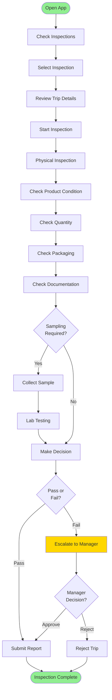

# QC Supervisor Workflows

> Mobile workflows for QC supervisors

**Status**: ✅ Complete  
**Last Updated**: February 13, 2026  
**User Role**: QC Supervisor  
**Primary Device**: Mobile App (Android/iOS)

---

## 📋 Overview

QC Supervisors use the DFMS mobile app to receive inspection assignments, perform quality inspections, make pass/fail decisions, and submit reports. This document covers their mobile workflows.

---

## 👤 User Profile

**Role**: QC Supervisor  
**Department**: Quality Control  
**Primary Responsibilities**:
- Perform quality inspections
- Make pass/fail decisions
- Document inspection results
- Escalate failures

**Daily Tasks**:
- Check inspection assignments
- Perform inspections
- Submit reports
- Handle escalations

---

## 🔄 Daily Workflow

### Task 1: Check Inspection Assignments
**Duration**: 5 minutes  
**Frequency**: Multiple times daily

**Steps**:
1. Open DFMS mobile app
2. Navigate to "My Inspections"
3. Review pending inspections
4. Check inspection details
5. Prioritize inspections

**Mobile App Display**:
- Inspection list
- Status indicators
- Trip information
- Product details
- Time remaining (SLA)

---

### Task 2: Start Inspection
**Duration**: 1 minute  
**Frequency**: Per inspection

**Steps**:
1. Select inspection
2. Review trip and product details
3. Tap "Start Inspection"
4. Begin inspection process

**Pre-conditions**:
- Unloading completed
- Product available for inspection

**System Actions**:
- Update status: `pending` → `in_progress`
- Record start time
- Start inspection timer

---

### Task 3: Perform Physical Inspection
**Duration**: 15-60 minutes  
**Frequency**: Per inspection

**Inspection Steps**:

1. **Product Condition Check**
   - Visual inspection
   - Damage assessment
   - Contamination check
   - Temperature check (if applicable)

2. **Quantity Verification**
   - Count/measure quantity
   - Compare with loaded quantity
   - Record discrepancies

3. **Packaging Inspection**
   - Check packaging integrity
   - Verify seals
   - Check labels

4. **Documentation Check**
   - Verify delivery challan
   - Check invoices
   - Verify certificates

**Mobile App Actions**:
- Display inspection checklist
- Enable photo/video capture
- Record inspection data
- Validate inputs

---

### Task 4: Collect Sample (If Required)
**Duration**: 10-15 minutes  
**Frequency**: As needed

**Steps**:
1. Determine if sampling required
2. Collect sample following SOP
3. Label sample
4. Take photos
5. Record sample details
6. Send to lab

**Mobile App**:
- Sample collection form
- Photo capture
- Label printing (if connected)
- Lab assignment

---

### Task 5: Make QC Decision
**Duration**: 2-3 minutes  
**Frequency**: Per inspection

**Decision Criteria**:
- Product condition: Good
- Quantity: Matches
- Packaging: Intact
- Documentation: Complete
- Lab tests: Pass (if required)

**Steps**:
1. Review all inspection data
2. Make pass/fail decision
3. Record decision reason
4. Submit decision

**If Pass**:
- Submit QC report
- Complete inspection
- Notify stakeholders

**If Fail**:
- Record failure reason
- Upload evidence photos
- Escalate to manager
- Wait for manager decision

---

### Task 6: Submit QC Report
**Duration**: 2-3 minutes  
**Frequency**: Per inspection

**Steps**:
1. Review inspection data
2. Upload photos/videos
3. Complete report
4. Add signature
5. Submit report

**Report Contents**:
- Inspection summary
- Product condition
- Quantity verification
- Packaging status
- Documentation status
- Lab test results (if applicable)
- Photos/videos
- Inspector signature

---

## 📱 Key User Journeys

### Journey 1: Complete QC Inspection

**Time**: 30 minutes - 2 hours  
**Complexity**: Medium

---

## 🎯 Key Features Used

### 1. Inspection Management
- View assigned inspections
- Inspection details
- Inspection checklist
- Status tracking

### 2. Data Capture
- Photo/video capture
- Form inputs
- Signature capture
- Sample recording

### 3. Decision Making
- Pass/fail decision
- Reason recording
- Escalation workflow
- Manager approval

### 4. Reporting
- Report generation
- Photo upload
- Report submission
- Report history

---

## 📊 Performance Metrics

| Metric | Target | Measurement |
|--------|--------|-------------|
| **Inspection Time** | < 2 hours | Time from start to completion |
| **QC Pass Rate** | > 95% | % of inspections passing |
| **Report Submission Time** | < 5 minutes | Time to submit report |
| **Escalation Rate** | < 5% | % requiring manager approval |

---

## 🔗 Related Documents

### Operational Flows
- [QC Inspection Flow](../operational-flows/06-qc-inspection-flow.md)

### Business Context
- [User Story: US-061](../../../business-context/04-phase-backlog/phase-1/user-stories/_wbs-temp/US-061-qc-supervisor-mobile.md)

---

**Document Status**: ✅ Complete  
**Last Reviewed**: February 13, 2026  
**Contact**: Md. Mahfuzur Rahman (Mahfuzur.rahman@brainstation-23.com)

