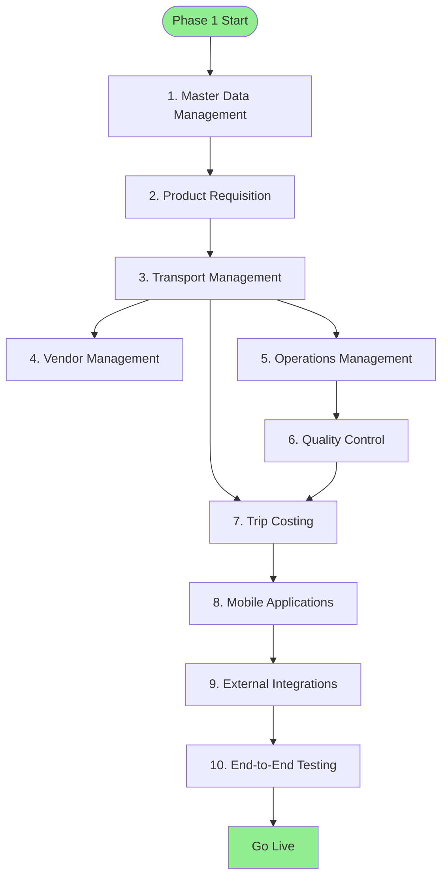

# Phase 1 Deployment Plan

> Core modules deployment strategy

**Status**: ✅ Complete  
**Last Updated**: February 13, 2026  
**Duration**: 3-4 months  
**Target Users**: 50-100 users

---

## 📋 Overview

Phase 1 deploys the core DFMS modules that form the foundation of the system. This phase focuses on establishing the basic transport management workflow from requisition to trip completion.

---

## Phase 1: Cost-Optimized Deployment

### Infrastructure Overview

**Approach**: Single EC2 instance with Docker Compose

**Components**:
- Single EC2 instance (t3.large)
- RDS PostgreSQL (db.t3.small)
- ElastiCache Redis (cache.t3.micro)
- S3 for file storage
- Nginx reverse proxy (no separate API Gateway)
- No Load Balancer (Nginx handles routing)

**Monthly Cost**: ~$107/month

### Architecture Diagram

```
┌─────────────────────────────────────────────────────────┐
│                     Route 53 (DNS)                      │
└─────────────────────────────────────────────────────────┘
                            │
┌─────────────────────────────────────────────────────────┐
│            EC2 Instance (t3.large)                      │
│  ┌─────────────────────────────────────────────────┐   │
│  │               Nginx (Port 80/443)                │   │
│  ├─────────────────────────────────────────────────┤   │
│  │         Docker Containers                        │   │
│  │  ┌──────────────┐  ┌──────────────┐            │   │
│  │  │   Django     │  │   Celery     │            │   │
│  │  │   Gunicorn   │  │   Workers    │            │   │
│  │  └──────────────┘  └──────────────┘            │   │
│  └─────────────────────────────────────────────────┘   │
└─────────────────────────────────────────────────────────┘
                     │                │
        ┌────────────┴───┐    ┌──────┴──────┐
        │  RDS PostgreSQL │    │ ElastiCache │
        │   (db.t3.small) │    │    Redis    │
        │                 │    │ (cache.t3.  │
        │                 │    │   micro)    │
        └─────────────────┘    └─────────────┘
```

**Rationale**:
- Cost-effective for single tenant (Nourish)
- Simpler operations and deployment
- Sufficient for 200-300 users
- Clear migration path to Phase 2

**See**: [ADR-004: Phase 1 Modular Monolith](../../03-decisions/adr-004-phase-1-modular-monolith.md)

### Phase 2 Evolution

See [Phase 2 Deployment](../deployment-strategy/README.md) for Kubernetes/ECS approach.

---

## 🎯 Deployment Objectives

1. **Establish Core Workflow**
   - Product Requisition → Transport Request → Transport Order → Trip Execution

2. **Enable Basic Operations**
   - Master data management
   - Transport planning and execution
   - Vendor management
   - Quality control

3. **Deploy Mobile Applications**
   - Driver mobile app
   - QC supervisor mobile app
   - Vendor mobile app

4. **Integrate External Systems**
   - GPS/VTS provider
   - ERP system
   - SMS gateway
   - Maps service

---

## 📦 Modules to Deploy

### 1. Master Data Management
**Priority**: Critical  
**Dependencies**: None

**Deployment Steps**:
1. Deploy master data API
2. Create initial master data (vehicles, drivers, vendors, POIs, products)
3. Configure data validation rules
4. Enable CRUD operations
5. Test data integrity

**Success Criteria**:
- ✅ All master data entities accessible
- ✅ CRUD operations working
- ✅ Data validation enforced
- ✅ Performance acceptable (< 200ms response time)

---

### 2. Product Requisition Management
**Priority**: Critical  
**Dependencies**: Master Data Management

**Deployment Steps**:
1. Deploy product requisition API
2. Configure approval workflows
3. Set up notifications
4. Test approval process
5. Enable TR generation

**Success Criteria**:
- ✅ PR creation working
- ✅ Approval workflow functional
- ✅ TR generation automatic
- ✅ Notifications sent correctly

---

### 3. Transport Management
**Priority**: Critical  
**Dependencies**: Master Data, Product Requisition

**Deployment Steps**:
1. Deploy transport API
2. Configure TR to TO conversion
3. Set up vehicle/driver assignment
4. Enable trip creation
5. Integrate GPS tracking
6. Test trip lifecycle

**Success Criteria**:
- ✅ TR to TO conversion working
- ✅ Vehicle/driver assignment functional
- ✅ Trip creation automatic
- ✅ GPS tracking integrated
- ✅ Trip status updates working

---

### 4. Vendor Management
**Priority**: High  
**Dependencies**: Transport Management

**Deployment Steps**:
1. Deploy vendor API
2. Set up vendor onboarding
3. Configure bidding portal
4. Enable bid submission and review
5. Test vendor assignment

**Success Criteria**:
- ✅ Vendor onboarding working
- ✅ Bidding portal functional
- ✅ Bid submission/review working
- ✅ Vendor assignment automatic

---

### 5. Operations Management
**Priority**: High  
**Dependencies**: Transport Management

**Deployment Steps**:
1. Deploy operations API
2. Configure gate management
3. Set up weighing operations
4. Enable loading/unloading tracking
5. Test operations workflow

**Success Criteria**:
- ✅ Gate entry/exit working
- ✅ Weighing operations functional
- ✅ Loading/unloading tracking working
- ✅ Operations integrated with trips

---

### 6. Quality Control
**Priority**: High  
**Dependencies**: Operations Management

**Deployment Steps**:
1. Deploy QC API
2. Configure inspection workflows
3. Set up photo/video upload
4. Enable pass/fail decision
5. Configure escalation workflow
6. Test QC process

**Success Criteria**:
- ✅ Inspection creation working
- ✅ Photo/video upload functional
- ✅ Pass/fail decision working
- ✅ Escalation workflow functional

---

### 7. Trip Costing & Finance
**Priority**: High  
**Dependencies**: Transport Management, Operations, QC

**Deployment Steps**:
1. Deploy costing API
2. Configure cost calculation logic
3. Set up invoice generation
4. Integrate ERP system
5. Enable payment tracking
6. Test costing workflow

**Success Criteria**:
- ✅ Cost calculation working
- ✅ Invoice generation functional
- ✅ ERP sync working
- ✅ Payment tracking enabled

---

### 8. Mobile Applications
**Priority**: Critical  
**Dependencies**: All backend modules

**Deployment Steps**:

**Driver Mobile App**:
1. Deploy iOS app to App Store
2. Deploy Android app to Play Store
3. Configure API endpoints
4. Enable GPS tracking
5. Test trip execution workflow

**QC Supervisor Mobile App**:
1. Deploy iOS app to App Store
2. Deploy Android app to Play Store
3. Configure inspection workflows
4. Enable photo/video capture
5. Test QC workflow

**Vendor Mobile App**:
1. Deploy iOS app to App Store
2. Deploy Android app to Play Store
3. Configure bidding interface
4. Enable trip tracking
5. Test vendor workflows

**Success Criteria**:
- ✅ All apps published
- ✅ API integration working
- ✅ Core workflows functional
- ✅ Offline capability (basic)

---

## 🔄 Deployment Sequence



**Timeline**:
- Week 1-2: Master Data + Product Requisition
- Week 3-4: Transport Management
- Week 5-6: Vendor + Operations
- Week 7-8: QC + Costing
- Week 9-10: Mobile Apps
- Week 11-12: Integration + Testing
- Week 13-16: Pilot + Rollout

---

## 🏗️ Infrastructure Requirements

### Phase 1: Cost-Optimized Infrastructure

#### Development Environment
- **Server**: Single EC2 instance (t3.medium) or local Docker Compose
- **Database**: PostgreSQL (single instance, local or RDS)
- **Cache**: Redis (single instance, local or ElastiCache)
- **Storage**: S3 (development bucket)
- **Monitoring**: Basic logging (CloudWatch or local)

#### Staging Environment
- **Server**: Single EC2 instance (t3.large)
- **Database**: RDS PostgreSQL (db.t3.small)
- **Cache**: ElastiCache Redis (cache.t3.micro)
- **Storage**: S3 (staging bucket)
- **Monitoring**: CloudWatch Logs + basic metrics
- **Reverse Proxy**: Nginx (on EC2 instance)

#### Production Environment
- **Server**: Single EC2 instance (t3.large)
- **Database**: RDS PostgreSQL (db.t3.small)
- **Cache**: ElastiCache Redis (cache.t3.micro)
- **Storage**: S3 (production bucket)
- **Monitoring**: CloudWatch Logs + Metrics
- **Reverse Proxy**: Nginx (on EC2 instance)
- **DNS**: Route 53
- **SSL**: Let's Encrypt or AWS Certificate Manager

**Note**: Phase 1 uses a simplified infrastructure to minimize costs. Phase 2 will evolve to Kubernetes/ECS with auto-scaling and load balancing.

### Phase 2+ Infrastructure (Future)

**Production Environment**:
- **Servers**: Kubernetes cluster or ECS (API cluster, Worker cluster)
- **Database**: PostgreSQL (primary + 2 read replicas)
- **Cache**: Redis cluster
- **Storage**: S3 (production bucket)
- **Monitoring**: Full observability stack (Prometheus + Grafana)
- **Load Balancer**: Application Load Balancer
- **API Gateway**: Kong or AWS API Gateway
- **CDN**: CloudFront

---

## 🔌 External Integrations

### 1. GPS/VTS Provider
**Integration Type**: Real-time API  
**Status**: Required for Phase 1

**Setup Steps**:
1. Obtain API credentials
2. Configure API endpoints
3. Test vehicle tracking
4. Enable real-time updates

---

### 2. ERP System
**Integration Type**: Batch + API  
**Status**: Required for Phase 1

**Setup Steps**:
1. Obtain ERP API credentials
2. Configure data mapping
3. Test invoice sync
4. Enable batch synchronization

---

### 3. SMS Gateway
**Integration Type**: Real-time API  
**Status**: Required for Phase 1

**Setup Steps**:
1. Obtain SMS gateway credentials
2. Configure sender IDs
3. Test SMS delivery
4. Enable notifications

---

### 4. Maps Service
**Integration Type**: Real-time API  
**Status**: Required for Phase 1

**Setup Steps**:
1. Obtain maps API key
2. Configure route planning
3. Test geocoding
4. Enable navigation

---

## 📊 Deployment Checklist

### Pre-Deployment
- [ ] Infrastructure provisioned
- [ ] Database schema deployed
- [ ] API servers deployed
- [ ] Background workers deployed
- [ ] Cache configured
- [ ] Storage configured
- [ ] Monitoring setup
- [ ] Security configured

### Module Deployment
- [ ] Master Data Management deployed
- [ ] Product Requisition deployed
- [ ] Transport Management deployed
- [ ] Vendor Management deployed
- [ ] Operations Management deployed
- [ ] Quality Control deployed
- [ ] Trip Costing deployed
- [ ] Mobile Apps deployed

### Integration
- [ ] GPS/VTS integrated
- [ ] ERP integrated
- [ ] SMS Gateway integrated
- [ ] Maps Service integrated

### Testing
- [ ] Unit tests passing
- [ ] Integration tests passing
- [ ] End-to-end tests passing
- [ ] Performance tests passing
- [ ] Security tests passing

### Go-Live
- [ ] Pilot users onboarded
- [ ] Training completed
- [ ] Support team ready
- [ ] Documentation complete
- [ ] Rollback plan ready

---

## 🚨 Risk Mitigation

### Risk 1: Data Migration Issues
**Mitigation**:
- Comprehensive data validation
- Staged migration approach
- Rollback procedures
- Data backup before migration

### Risk 2: Performance Issues
**Mitigation**:
- Load testing before deployment
- Performance monitoring
- Auto-scaling configured
- Database optimization

### Risk 3: Integration Failures
**Mitigation**:
- Integration testing
- Fallback mechanisms
- Circuit breakers
- Retry logic

### Risk 4: User Adoption
**Mitigation**:
- Comprehensive training
- User support
- Gradual rollout
- Feedback collection

---

## 📈 Success Metrics

| Metric | Target | Measurement |
|--------|--------|-------------|
| **Deployment Success Rate** | > 95% | % successful deployments |
| **System Uptime** | > 99.5% | Availability percentage |
| **API Response Time** | < 500ms | Average response time |
| **User Adoption Rate** | > 80% | % users actively using |
| **Error Rate** | < 1% | % failed requests |
| **Data Accuracy** | > 99% | % accurate data |

---

## 🔗 Related Documents

- [Technology Considerations](../technology-considerations.md)
- [Testing Approach](../testing-approach.md)
- [Rollout Plan](../rollout-plan.md)
- [Migration Strategy](../migration-strategy.md)

---

**Document Status**: ✅ Complete  
**Last Reviewed**: February 13, 2026  
**Contact**: Md. Mahfuzur Rahman (Mahfuzur.rahman@brainstation-23.com)

