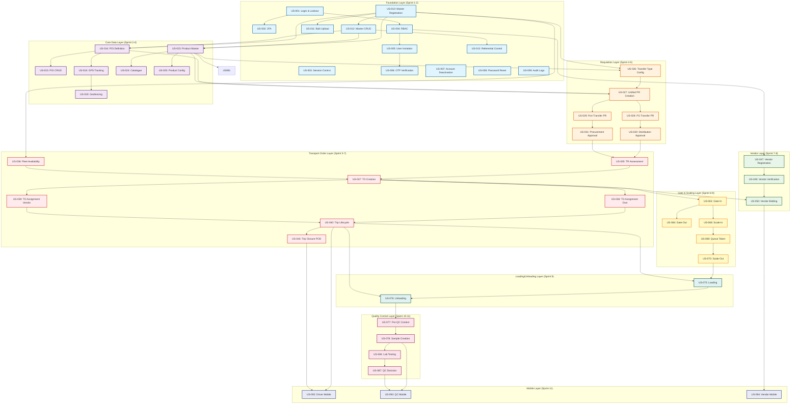

# DFMS Phase 1 - Story Breakdown

> Story-level implementation breakdown for DFMS Phase 1 (MVP)

**Source**: Based on `source-documents/04-wbs/stories-table.md`, `source-documents/03-sow/SOW Phase-1.md`, and `source-documents/01-prd/PRD_DFMS_v1.0.md`  
**Status**: Planned  
**Total Stories**: 94  
**Total Story Points**: 536 SP (estimated)  
**Duration**: 26 weeks (12 sprints)

---

## 📊 Story Summary by Epic

| Epic ID | Epic Name | Story Count | Stories |
|---------|-----------|-------------|---------|
| EPIC-001 | System Foundation | 4 | US-001 to US-004 |
| EPIC-002 | User & Tenant Foundation | 5 | US-005 to US-009 |
| EPIC-003 | Master Data & Configuration | 4 | US-010 to US-013 |
| EPIC-004 | POI Management & Geofencing | 9 | US-014 to US-022 |
| EPIC-005 | Product Inventory Management | 3 | US-023 to US-025 |
| EPIC-006 | Fleet & Vehicle Management | 10 | US-026 to US-035 (estimated) |
| EPIC-007 | Product Transfer Requisition | 4 | US-026 to US-029 |
| EPIC-008 | Distribution & Procurement | 5 | US-030 to US-034 (estimated) |
| EPIC-009 | Transport Order Management | 12 | US-035 to US-046 (estimated) |
| EPIC-010 | Vendor Management | 6 | US-047 to US-052 (estimated) |
| EPIC-011 | Gate Management | 5 | US-063 to US-067 |
| EPIC-012 | Scaling / Weight Management | 3 | US-068 to US-070 |
| EPIC-013 | Loading / Unloading Operations | 2 | US-075 to US-076 |
| EPIC-014 | Quality Control & QA | 15 | US-077 to US-091 |
| EPIC-015 | Command Center Operations | 4 | US-071 to US-074 |
| EPIC-016 | Mobile Interface (Driver/QC) | 2 | US-092 to US-093 |
| EPIC-017 | Mobile Applications (Vendor) | 1 | US-094 |

---

## 🔗 Story Dependencies

### Dependency Layers

#### Layer 1: Foundation Stories (No Dependencies)
**Sprint 1-2**

| Story ID | Description | Epic | Priority |
|----------|-------------|------|----------|
| US-001 | User Login & Account Lockout | EPIC-001 | Critical |
| US-002 | Multi-Factor Auth (2FA) | EPIC-001 | Critical |
| US-003 | Session Control | EPIC-001 | Critical |
| US-004 | Role Hierarchy (RBAC) | EPIC-001 | Critical |
| US-005 | User Invitation & Activation | EPIC-002 | Critical |
| US-006 | OTP Verification | EPIC-002 | Critical |
| US-007 | Account Deactivation | EPIC-002 | Critical |
| US-008 | Password & Account Reset | EPIC-002 | Critical |
| US-009 | User Activity & Audit Logs | EPIC-002 | Critical |
| US-010 | Master Entity Registration | EPIC-003 | Critical |
| US-011 | Bulk Upload & Inline Master Data | EPIC-003 | Critical |
| US-012 | Master CRUD Operations | EPIC-003 | Critical |
| US-013 | Data Consistency Referential Control | EPIC-003 | Critical |

**Dependencies**: None (Foundation layer)

---

#### Layer 2: Core Data Stories
**Sprint 2-4**

| Story ID | Description | Epic | Depends On | Priority |
|----------|-------------|------|------------|----------|
| US-014 | POI Definition | EPIC-004 | US-010, US-012 | High |
| US-015 | POI CRUD Operations | EPIC-004 | US-014 | High |
| US-016 | POI Classification | EPIC-004 | US-014 | High |
| US-017 | Map Layer Integration | EPIC-004 | US-014 | High |
| US-018 | Real-time Location Tracking | EPIC-004 | US-014 | High |
| US-019 | Geofencing & POI Tracking | EPIC-004 | US-014, US-018 | High |
| US-020 | Geofencing Boundaries | EPIC-004 | US-014 | High |
| US-021 | Vehicle Arrival Tracking | EPIC-004 | US-019 | High |
| US-022 | Dwell Time Tracking | EPIC-004 | US-021 | High |
| US-023 | Product Master Data | EPIC-005 | US-010, US-012 | High |
| US-024 | Catalogue Design | EPIC-005 | US-023 | High |
| US-025 | Product Configuration | EPIC-005 | US-023 | High |

**Dependencies**: Foundation layer (US-010, US-012)

---

#### Layer 3: Operations Stories - Requisition & Approval
**Sprint 4-5**

| Story ID | Description | Epic | Depends On | Priority |
|----------|-------------|------|------------|----------|
| US-026 | Requisition Transfer Type Config | EPIC-007 | US-010, US-023 | High |
| US-027 | Unified PR Creation | EPIC-007 | US-014, US-023, US-026 | High |
| US-028 | Finished Goods Transfer PR | EPIC-007 | US-027 | High |
| US-029 | Port Consignment Transfer PR | EPIC-007 | US-027 | High |
| US-030 | Distribution Approval Workflow | EPIC-008 | US-028 | High |
| US-031 | Procurement Approval Workflow | EPIC-008 | US-029 | High |
| US-032 | Stock Validation | EPIC-008 | US-028, US-029 | High |
| US-033 | Capacity Checking | EPIC-008 | US-028, US-029 | High |
| US-034 | Approval Notifications | EPIC-008 | US-030, US-031 | High |

**Dependencies**: Core Data layer (US-014, US-023)

---

#### Layer 4: Operations Stories - Transport Order
**Sprint 5-7**

| Story ID | Description | Epic | Depends On | Priority |
|----------|-------------|------|------------|----------|
| US-035 | TR Assessment by Transport Planner | EPIC-009 | US-030, US-031 | High |
| US-036 | Fleet Availability Validation | EPIC-009 | US-010 (Vehicle data) | High |
| US-037 | TO Creation (Multiple per TR) | EPIC-009 | US-035, US-036 | High |
| US-038 | TO Assignment (Own Fleet) | EPIC-009 | US-037 | High |
| US-039 | TO Assignment (Vendor Fleet) | EPIC-009 | US-037 | High |
| US-040 | Trip Lifecycle Management | EPIC-009 | US-038, US-039 | High |
| US-041 | Partial Delivery Handling | EPIC-009 | US-040 | High |
| US-042 | Incident Management | EPIC-009 | US-040 | High |
| US-043 | Trip Closure with POD | EPIC-009 | US-040 | High |
| US-044 | Real-time Trip Tracking | EPIC-009 | US-040, US-018 | High |
| US-045 | Trip History & Audit Trail | EPIC-009 | US-043 | High |
| US-046 | TO Dashboard & Monitoring | EPIC-009 | US-040 | High |

**Dependencies**: Requisition & Approval layer (US-030, US-031)

---

#### Layer 5: Vendor Management Stories
**Sprint 7-8**

| Story ID | Description | Epic | Depends On | Priority |
|----------|-------------|------|------------|----------|
| US-047 | Vendor Registration Portal | EPIC-010 | US-004 (RBAC) | Medium |
| US-048 | Vendor Document Upload | EPIC-010 | US-047 | Medium |
| US-049 | Vendor Verification Workflow | EPIC-010 | US-047, US-048 | Medium |
| US-050 | Vendor Bidding Portal | EPIC-010 | US-049, US-037 | Medium |
| US-051 | Bid Evaluation & Winner Selection | EPIC-010 | US-050 | Medium |
| US-052 | Vendor TO Dashboard | EPIC-010 | US-039, US-040 | Medium |

**Dependencies**: RBAC (US-004), TO Management (US-037, US-039)

---

#### Layer 6: Operations Stories - Gate & Scaling
**Sprint 8-9**

| Story ID | Description | Epic | Depends On | Priority |
|----------|-------------|------|------------|----------|
| US-063 | Gate-In Entry | EPIC-011 | US-037 (TO exists) | Medium |
| US-064 | Gate-Out Entry | EPIC-011 | US-063 | Medium |
| US-065 | On-Demand TO Creation | EPIC-011 | US-014, US-023 | Medium |
| US-066 | Gate Remarks Logging | EPIC-011 | US-063 | Medium |
| US-067 | Gate Dashboard | EPIC-011 | US-063, US-064 | Medium |
| US-068 | Scale-In Weight Recording | EPIC-012 | US-063 | Medium |
| US-069 | Queue Token Generation | EPIC-012 | US-068 | Medium |
| US-070 | Scale-Out with Net Weight | EPIC-012 | US-069 | Medium |

**Dependencies**: TO Management (US-037)

---

#### Layer 7: Operations Stories - Loading/Unloading
**Sprint 9**

| Story ID | Description | Epic | Depends On | Priority |
|----------|-------------|------|------------|----------|
| US-075 | Loading Operations | EPIC-013 | US-070, US-040 | Medium |
| US-076 | Unloading Operations | EPIC-013 | US-075, US-040 | Medium |

**Dependencies**: Scaling (US-070), Trip Lifecycle (US-040)

---

#### Layer 8: Command Center Stories
**Sprint 10-11**

| Story ID | Description | Epic | Depends On | Priority |
|----------|-------------|------|------------|----------|
| US-071 | View All Waiting Vehicles | EPIC-015 | US-063, US-068 | Medium |
| US-072 | Assign Loading/Unloading Point | EPIC-015 | US-071, US-075 | Medium |
| US-073 | Command Center Dashboard | EPIC-015 | US-040, US-063 | Medium |
| US-074 | Operational Monitoring | EPIC-015 | US-073 | Medium |

**Dependencies**: Gate (US-063), Scaling (US-068), Loading (US-075)

---

#### Layer 9: Quality Control Stories
**Sprint 10-11**

| Story ID | Description | Epic | Depends On | Priority |
|----------|-------------|------|------------|----------|
| US-077 | Pre-QC Context Display | EPIC-014 | US-076 (Unloading) | High |
| US-078 | Sample Creation | EPIC-014 | US-077 | High |
| US-079 | QR Code Generation | EPIC-014 | US-078 | High |
| US-080 | Physical Inspection | EPIC-014 | US-078 | High |
| US-081 | Configurable QC Checklists | EPIC-014 | US-023 (Product) | High |
| US-082 | Sampling from Multiple Sides | EPIC-014 | US-078 | High |
| US-083 | Lab Test Request Creation | EPIC-014 | US-078 | High |
| US-084 | Lab Testing with QR Scan | EPIC-014 | US-079, US-083 | High |
| US-085 | Lab Report Upload | EPIC-014 | US-084 | High |
| US-086 | Lab Status Monitoring | EPIC-014 | US-084 | High |
| US-087 | QC Pass/Fail Decision | EPIC-014 | US-084, US-085 | High |
| US-088 | QC Escalation Workflow | EPIC-014 | US-087 | High |
| US-089 | QC Report Generation | EPIC-014 | US-087 | High |
| US-090 | QC Checklist Management | EPIC-014 | US-081 | High |
| US-091 | QC Dashboard | EPIC-014 | US-087 | High |

**Dependencies**: Unloading (US-076), Product Data (US-023)

---

#### Layer 10: Mobile Interface Stories
**Sprint 11**

| Story ID | Description | Epic | Depends On | Priority |
|----------|-------------|------|------------|----------|
| US-092 | Driver Mobile Interface | EPIC-016 | US-040, US-042, US-043 | High |
| US-093 | QC Mobile Interface | EPIC-016 | US-077 to US-091 (QC APIs) | High |
| US-094 | Vendor Mobile Application | EPIC-017 | US-050, US-052 | High |

**Dependencies**: Backend APIs (Trip, QC, Vendor)

---

## 🗺️ Story Dependency Graph

---

## 🎯 Critical Path Stories

### Critical Path (Must Complete in Order)

**Path**: `US-001 → US-004 → US-010 → US-012 → US-014 → US-023 → US-027 → US-030/US-031 → US-035 → US-037 → US-040 → US-076 → US-078 → US-087`

**Sprint Sequence**: 
- Sprint 1: US-001, US-004
- Sprint 2: US-010, US-012
- Sprint 3: US-014
- Sprint 4: US-023
- Sprint 5: US-027, US-030, US-031
- Sprint 6-7: US-035, US-037, US-040
- Sprint 9: US-076
- Sprint 10-11: US-078, US-087

**Total Duration**: ~20 weeks (77% of timeline)

**Impact**: Any delay in this path will delay the entire project completion.

---

## 📋 Story Details by Epic

### EPIC-001: System Foundation (4 Stories)

| Story ID | Description | Priority | Sprint | PRD Ref |
|----------|-------------|----------|--------|---------|
| US-001 | User Login & Account Lockout | Critical | Sprint 1 | 6.1.1 |
| US-002 | Multi-Factor Auth (2FA) | Critical | Sprint 1 | 6.1.2 |
| US-003 | Session Control | Critical | Sprint 1 | 6.1.3 |
| US-004 | Role Hierarchy (RBAC) | Critical | Sprint 1 | 6.1.4 |

### EPIC-002: User & Tenant Foundation (5 Stories)

| Story ID | Description | Priority | Sprint | PRD Ref |
|----------|-------------|----------|--------|---------|
| US-005 | User Invitation & Activation | Critical | Sprint 1 | 6.2.3 |
| US-006 | OTP Verification | Critical | Sprint 1 | 6.2.4 |
| US-007 | Account Deactivation | Critical | Sprint 1 | 6.2.5 |
| US-008 | Password & Account Reset | Critical | Sprint 1 | 6.2.6 |
| US-009 | User Activity & Audit Logs | Critical | Sprint 1 | 6.2.7 |

### EPIC-003: Master Data & Configuration (4 Stories)

| Story ID | Description | Priority | Sprint | PRD Ref |
|----------|-------------|----------|--------|---------|
| US-010 | Master Entity Registration | Critical | Sprint 2 | 5.3.1 |
| US-011 | Bulk Upload & Inline Master Data | Critical | Sprint 2 | 5.3.2 |
| US-012 | Master CRUD Operations | Critical | Sprint 2 | 5.3.3 |
| US-013 | Data Consistency Referential Control | Critical | Sprint 2 | 5.3.4 |

### EPIC-004: POI Management & Geofencing (9 Stories)

| Story ID | Description | Priority | Sprint | PRD Ref |
|----------|-------------|----------|--------|---------|
| US-014 | POI Definition | High | Sprint 3 | 5.5.1 |
| US-015 | POI CRUD Operations | High | Sprint 3 | 5.5.2 |
| US-016 | POI Classification | High | Sprint 3 | 5.5.3 |
| US-017 | Map Layer Integration | High | Sprint 3 | 5.5.4 |
| US-018 | Real-time Location Tracking | High | Sprint 3 | 5.6.1 |
| US-019 | Geofencing & POI Tracking | High | Sprint 3 | 5.6.2 |
| US-020 | Geofencing Boundaries | High | Sprint 3 | 5.6.3 |
| US-021 | Vehicle Arrival Tracking | High | Sprint 3 | 5.6.4 |
| US-022 | Dwell Time Tracking | High | Sprint 3 | 5.6.5 |

### EPIC-005: Product Inventory Management (3 Stories)

| Story ID | Description | Priority | Sprint | PRD Ref |
|----------|-------------|----------|--------|---------|
| US-023 | Product Master Data | High | Sprint 4 | 5.4.1 |
| US-024 | Catalogue Design | High | Sprint 4 | 5.4.2 |
| US-025 | Product Configuration | High | Sprint 4 | 5.4.3 |

### EPIC-006: Fleet & Vehicle Management (10 Stories - Estimated)

| Story ID | Description | Priority | Sprint | PRD Ref |
|----------|-------------|----------|--------|---------|
| US-026+ | Vehicle Registration | High | Sprint 4 | 5.7.1 |
| US-027+ | Driver Registration | High | Sprint 4 | 5.7.2 |
| US-028+ | Helper Profile | High | Sprint 4 | 5.7.3 |
| US-029+ | Fleet Availability | High | Sprint 4 | 5.7.4 |

*Note: Story IDs for EPIC-006 overlap with EPIC-007. Refer to source table for exact mapping.*

### EPIC-007: Product Transfer Requisition (4 Stories)

| Story ID | Description | Priority | Sprint | PRD Ref |
|----------|-------------|----------|--------|---------|
| US-026 | Requisition Transfer Type Config | High | Sprint 5 | 5.8.1 |
| US-027 | Unified PR Creation | High | Sprint 5 | 5.8.2 |
| US-028 | Finished Goods Transfer PR | High | Sprint 5 | 5.8.3 |
| US-029 | Port Consignment Transfer PR | High | Sprint 5 | 5.8.4 |

### EPIC-008: Distribution & Procurement (5 Stories - Estimated)

| Story ID | Description | Priority | Sprint | PRD Ref |
|----------|-------------|----------|--------|---------|
| US-030 | Distribution Approval Workflow | High | Sprint 5 | 5.9.1 |
| US-031 | Procurement Approval Workflow | High | Sprint 5 | 5.9.2 |
| US-032 | Stock Validation | High | Sprint 5 | 5.9.3 |
| US-033 | Capacity Checking | High | Sprint 5 | 5.9.4 |
| US-034 | Approval Notifications | High | Sprint 5 | 5.9.5 |

### EPIC-009: Transport Order Management (12 Stories - Estimated)

| Story ID | Description | Priority | Sprint | PRD Ref |
|----------|-------------|----------|--------|---------|
| US-035 | TR Assessment | High | Sprint 6-7 | 5.10.1 |
| US-036 | Fleet Availability Validation | High | Sprint 6-7 | 5.10.2 |
| US-037 | TO Creation | High | Sprint 6-7 | 5.10.3 |
| US-038 | TO Assignment (Own Fleet) | High | Sprint 6-7 | 5.10.4 |
| US-039 | TO Assignment (Vendor Fleet) | High | Sprint 6-7 | 5.10.5 |
| US-040 | Trip Lifecycle Management | High | Sprint 6-7 | 5.10.6 |
| US-041 | Partial Delivery Handling | High | Sprint 6-7 | 5.10.7 |
| US-042 | Incident Management | High | Sprint 6-7 | 5.10.8 |
| US-043 | Trip Closure with POD | High | Sprint 6-7 | 5.10.9 |
| US-044 | Real-time Trip Tracking | High | Sprint 6-7 | 5.10.10 |
| US-045 | Trip History & Audit Trail | High | Sprint 6-7 | 5.10.11 |
| US-046 | TO Dashboard & Monitoring | High | Sprint 6-7 | 5.10.12 |

### EPIC-010: Vendor Management (6 Stories - Estimated)

| Story ID | Description | Priority | Sprint | PRD Ref |
|----------|-------------|----------|--------|---------|
| US-047 | Vendor Registration Portal | Medium | Sprint 8 | 5.11.1 |
| US-048 | Vendor Document Upload | Medium | Sprint 8 | 5.11.2 |
| US-049 | Vendor Verification Workflow | Medium | Sprint 8 | 5.11.3 |
| US-050 | Vendor Bidding Portal | Medium | Sprint 8 | 5.11.4 |
| US-051 | Bid Evaluation & Winner Selection | Medium | Sprint 8 | 5.11.5 |
| US-052 | Vendor TO Dashboard | Medium | Sprint 8 | 5.11.6 |

### EPIC-011: Gate Management (5 Stories)

| Story ID | Description | Priority | Sprint | PRD Ref |
|----------|-------------|----------|--------|---------|
| US-063 | Gate-In Entry | Medium | Sprint 8 | 5.12.1 |
| US-064 | Gate-Out Entry | Medium | Sprint 8 | 5.12.2 |
| US-065 | On-Demand TO Creation | Medium | Sprint 8 | 5.12.3 |
| US-066 | Gate Remarks Logging | Medium | Sprint 8 | 5.12.4 |
| US-067 | Gate Dashboard | Medium | Sprint 8 | 5.12.5 |

### EPIC-012: Scaling / Weight Management (3 Stories)

| Story ID | Description | Priority | Sprint | PRD Ref |
|----------|-------------|----------|--------|---------|
| US-068 | Scale-In Weight Recording | Medium | Sprint 9 | 5.13.1 |
| US-069 | Queue Token Generation | Medium | Sprint 9 | 5.13.2 |
| US-070 | Scale-Out with Net Weight | Medium | Sprint 9 | 5.13.3 |

### EPIC-013: Loading / Unloading Operations (2 Stories)

| Story ID | Description | Priority | Sprint | PRD Ref |
|----------|-------------|----------|--------|---------|
| US-075 | Loading Operations | Medium | Sprint 9 | 5.14.1 |
| US-076 | Unloading Operations | Medium | Sprint 9 | 5.14.2 |

### EPIC-014: Quality Control & QA (15 Stories)

| Story ID | Description | Priority | Sprint | PRD Ref |
|----------|-------------|----------|--------|---------|
| US-077 | Pre-QC Context Display | High | Sprint 10-11 | 5.15.1 |
| US-078 | Sample Creation | High | Sprint 10-11 | 5.15.2 |
| US-079 | QR Code Generation | High | Sprint 10-11 | 5.15.3 |
| US-080 | Physical Inspection | High | Sprint 10-11 | 5.15.4 |
| US-081 | Configurable QC Checklists | High | Sprint 10-11 | 5.15.5 |
| US-082 | Sampling from Multiple Sides | High | Sprint 10-11 | 5.15.6 |
| US-083 | Lab Test Request Creation | High | Sprint 10-11 | 5.15.7 |
| US-084 | Lab Testing with QR Scan | High | Sprint 10-11 | 5.15.8 |
| US-085 | Lab Report Upload | High | Sprint 10-11 | 5.15.9 |
| US-086 | Lab Status Monitoring | High | Sprint 10-11 | 5.15.10 |
| US-087 | QC Pass/Fail Decision | High | Sprint 10-11 | 5.15.11 |
| US-088 | QC Escalation Workflow | High | Sprint 10-11 | 5.15.12 |
| US-089 | QC Report Generation | High | Sprint 10-11 | 5.15.13 |
| US-090 | QC Checklist Management | High | Sprint 10-11 | 5.15.14 |
| US-091 | QC Dashboard | High | Sprint 10-11 | 5.15.15 |

### EPIC-015: Command Center Operations (4 Stories)

| Story ID | Description | Priority | Sprint | PRD Ref |
|----------|-------------|----------|--------|---------|
| US-071 | View All Waiting Vehicles | Medium | Sprint 11 | 5.16.1 |
| US-072 | Assign Loading/Unloading Point | Medium | Sprint 11 | 5.16.2 |
| US-073 | Command Center Dashboard | Medium | Sprint 11 | 5.16.3 |
| US-074 | Operational Monitoring | Medium | Sprint 11 | 5.16.4 |

### EPIC-016: Mobile Interface Driver/QC (2 Stories)

| Story ID | Description | Priority | Sprint | PRD Ref |
|----------|-------------|----------|--------|---------|
| US-092 | Driver Mobile Interface | High | Sprint 11 | 5.17.1 |
| US-093 | QC Mobile Interface | High | Sprint 11 | 5.17.2 |

### EPIC-017: Mobile Applications Vendor (1 Story)

| Story ID | Description | Priority | Sprint | PRD Ref |
|----------|-------------|----------|--------|---------|
| US-094 | Vendor Mobile Application | High | Sprint 11 | 5.18.1 |

---

## 📊 Story Distribution by Priority

| Priority | Story Count | Percentage |
|----------|-------------|------------|
| Critical | 13 | 14% |
| High | 58 | 62% |
| Medium | 23 | 24% |
| **Total** | **94** | **100%** |

---

## 📅 Story Distribution by Sprint

| Sprint | Story Count | Epics | Priority Focus |
|--------|-------------|-------|----------------|
| Sprint 1 | 9 | EPIC-001, EPIC-002 | Critical |
| Sprint 2 | 4 | EPIC-003 | Critical |
| Sprint 3 | 9 | EPIC-004 | High |
| Sprint 4 | 13 | EPIC-005, EPIC-006 | High |
| Sprint 5 | 9 | EPIC-007, EPIC-008 | High |
| Sprint 6-7 | 12 | EPIC-009 | High |
| Sprint 8 | 11 | EPIC-010, EPIC-011 | Medium |
| Sprint 9 | 5 | EPIC-012, EPIC-013 | Medium |
| Sprint 10-11 | 15 | EPIC-014 | High |
| Sprint 11 | 7 | EPIC-015, EPIC-016, EPIC-017 | Mixed |

---

## 🔗 Related Documents

- **[WBS Stories Table](../../source-documents/04-wbs/stories-table.md)** - Source story breakdown
- **[Epic Breakdown](./EPICS.md)** - Epic-level breakdown
- **[Implementation Timeline](./TIMELINE.md)** - Sprint-by-sprint timeline
- **[Feature Dependencies](../../business-context/04-phase-backlog/feature-dependencies.md)** - Detailed dependency analysis
- **[SOW Phase 1](../../source-documents/03-sow/SOW%20Phase-1.md)** - Statement of Work

---

**Last Updated**: February 17, 2026  
**Status**: Planned  
**Maintained By**: DFMS Implementation Team

