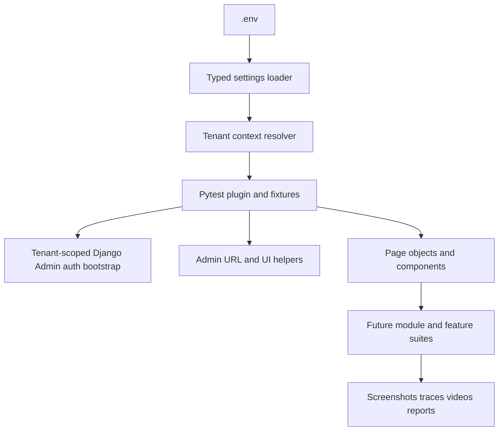

# Playwright Pytest Django Admin Core Setup Plan

> Implementation plan for a reusable Playwright + pytest automation foundation focused on Django Admin UI flows in a Phase 1 multi-tenant modular monolith.

**Status**: Updated for implementation  
**Scope**: Core setup only (no module-specific test case implementation, no CI wiring, no documentation generation)  
**Target**: Backend Django Admin UI automation framework

---

## 1) Objective and Boundaries

### Objective
Establish a maintainable, env-driven automation core for tenant-aware Django Admin flows so module teams can add tests feature-by-feature without changing framework fundamentals.

### In Scope
- Playwright + pytest configuration for Django Admin UI.
- Environment-driven credentials and base URL.
- Tenant context resolution and validation per run (schema-per-tenant compatible).
- Reusable fixtures, helpers, page objects, and artifact handling.

### Out of Scope
- API testing scope.
- Module-level test scenario implementation.
- Performance and load testing.
- Cross-tenant migration or tenant lifecycle provisioning automation.

---

## 2) References

### Repository References
- Existing pytest config: [`pytest.ini`](/home/bs-01426/Europe/real_project/nourish-backend/pytest.ini)
- Existing Playwright fixture baseline: [`tests/e2e/conftest.py`](/home/bs-01426/Europe/real_project/nourish-backend/tests/e2e/conftest.py)
- Existing development dependencies: [`requirements/development.txt`](/home/bs-01426/Europe/real_project/nourish-backend/requirements/development.txt)
- Existing CI pipeline: [`.github/workflows/ci.yml`](/home/bs-01426/Europe/real_project/nourish-backend/.github/workflows/ci.yml)
- Current env variable conventions: [`.env.example`](/home/bs-01426/Europe/real_project/nourish-backend/.env.example)
- Django Admin customization surface: [`templates/admin/users/user/change_list.html`](/home/bs-01426/Europe/real_project/nourish-backend/templates/admin/users/user/change_list.html)
- Django Admin business UI entrypoint example: [`apps/users/admin.py`](/home/bs-01426/Europe/real_project/nourish-backend/apps/users/admin.py)

### Product Context References
- Module specifications root: [`03-module-specifications/README.md`](/home/bs-01426/Europe/real_project/nourish-backend/DFMS-product-context/03-module-specifications/README.md)
- Module dependency map: [`03-module-specifications/INDEX.md`](/home/bs-01426/Europe/real_project/nourish-backend/DFMS-product-context/03-module-specifications/INDEX.md)
- Cross-cutting non-functional requirements: [`03-module-specifications/09-cross-cutting/non-functional-requirements.md`](/home/bs-01426/Europe/real_project/nourish-backend/DFMS-product-context/03-module-specifications/09-cross-cutting/non-functional-requirements.md)
- Existing implementation-level testing strategy: [`testing-approach.md`](/home/bs-01426/Europe/real_project/nourish-backend/DFMS-product-context/05-architecture/04-implementation/strategies/testing-approach.md)

---

## 3) Target Core Architecture

---

## 4) Step-by-Step Implementation Plan

## Step 1: Define the Environment Contract
- Use `.env` as the only env source (no dedicated `.env.e2e` or additional env templates) with required admin automation inputs:
  - `E2E_BASE_URL`
  - `E2E_TENANT_SCHEMA`
  - `E2E_USER_EMAIL`
  - `E2E_USER_PASSWORD`
  - Optional: `E2E_TENANT_DOMAIN`, `E2E_TENANT_SLUG`
  - Optional: `E2E_BROWSER`, `E2E_HEADLESS`, `E2E_TIMEOUT_MS`, `E2E_SLOW_MO_MS`, `E2E_TRACE`
- Add fail-fast validation to prevent partially configured runs.

**Implementation Notes**
- Use a single source of truth settings object loaded at test startup.
- Normalize URL values and parse booleans/integers centrally.
- Enforce tenant identity consistency rules:
  - if domain-based tenancy is used, require `E2E_TENANT_DOMAIN`
  - if path-based tenancy is used, require `E2E_TENANT_SLUG`

---

## Step 2: Build the Pytest Core Harness
- Refactor e2e fixture entrypoint to consume typed settings (instead of raw env reads).
- Provide stable fixtures:
  - tenant bootstrap fixture that resolves and validates tenant context before browser start
  - session-level browser fixture
  - context fixture with deterministic defaults and tenant-aware base URL
  - `admin_page` fixture that starts from tenant admin root
  - authenticated fixture that logs in once per tenant context and reuses storage state
- Add failure artifact hooks:
  - screenshot on failure
  - optional trace and video collection
  - predictable artifact folder naming by tenant schema + test node id

**Implementation Notes**
- Keep fixtures composable and side-effect minimal.
- Avoid hidden retries in fixtures; retries belong at test execution strategy level.
- Prevent fixture reuse across tenant boundaries in the same session.

---

## Step 3: Create Reusable Django Admin Utilities
- Add core helper layer for:
  - tenant-aware admin URL construction (`changelist`, `add`, `change`)
  - shared waits for admin page readiness
  - table row lookup helpers for list views
  - filter/search form helpers
- Add page object base class for common admin patterns:
  - login page actions
  - changelist actions
  - add/change form actions
- Keep assertions in tests, not in page object methods.

**Implementation Notes**
- Prefer stable selectors (`id`, `name`, labels, roles) from Django Admin markup.
- Use `data-testid` only where custom templates are unstable.
- Add a lightweight tenant guard helper that verifies current tenant context (UI marker, URL segment, or header text) before mutating actions.

---

## Step 4: Establish Framework Folder Layout
- Standardize folders to support long-term maintainability:
  - `tests/e2e/core/` for settings, fixtures, hooks
  - `tests/e2e/pages/` for page objects
  - `tests/e2e/components/` for reusable UI fragments
  - `tests/e2e/utils/` for waiters, naming helpers, artifact naming
  - `tests/e2e/modules/` reserved for future module/feature suites
- Add `__init__.py` where needed to keep imports explicit and stable.
- Reserve `tests/e2e/core/tenant_context.py` as canonical tenant resolution/validation entrypoint.

---

## Step 5: Configure Pytest Markers and Execution Profiles
- Extend markers for admin-focused automation:
  - `e2e`, `smoke`, `regression`, `admin_auth`, `admin_ui`, `tenant_isolation`, `flaky_quarantine`
- Keep execution profiles as pytest marker and CLI command conventions only (no documentation task in this scope).
- Keep deterministic defaults for timeouts and headless mode.
- Add a convention for tenant-targeted execution via CLI/env (single tenant per run by default).

---

## Step 6: Hardening the Core for Local/Shared Environments
- Ensure all core settings are loaded from `.env` at startup.
- Ensure startup fails with clear errors when required `E2E_*` variables are missing.
- Keep artifact output deterministic for local and shared runners.
- Enforce isolation guardrails:
  - reject unknown tenant schemas
  - prevent running without explicit tenant identity
  - keep tenant identifier in run metadata and artifact paths

---

## 5) Definition of Done (Core Setup)
- Playwright + pytest runs successfully against tenant-scoped Django Admin login flow using env-driven credentials/base URL.
- Missing env vars fail with clear startup errors.
- Tenant context is resolved and validated before test actions begin.
- Core fixtures and admin helpers are reusable.
- Artifact output includes tenant identity for traceability.
- No API-testing scaffolding included in this implementation.

---

## 6) Risks and Mitigations
- **Risk**: Selector brittleness due to admin template customizations.  
  **Mitigation**: Prefer semantic and stable Django Admin selectors; add helper abstractions.
- **Risk**: Flaky tests from timing and async page states.  
  **Mitigation**: Standardized explicit waits and no fixed sleeps policy.
- **Risk**: Cross-tenant data contamination due to mis-scoped context.  
  **Mitigation**: Mandatory tenant bootstrap fixture + tenant guard checks before mutating actions.
- **Risk**: Secret leakage in logs/artifacts.  
  **Mitigation**: Mask CI secrets, sanitize logs, avoid printing credential values.

---

## 7) Suggested Execution Order
1. Env contract and settings loader  
2. Tenant context resolver and bootstrap validation
3. Core fixtures and auth bootstrap  
4. Admin utilities and page object base  
5. Marker/execution profile setup  
6. Local/shared environment hardening and artifact pipeline

