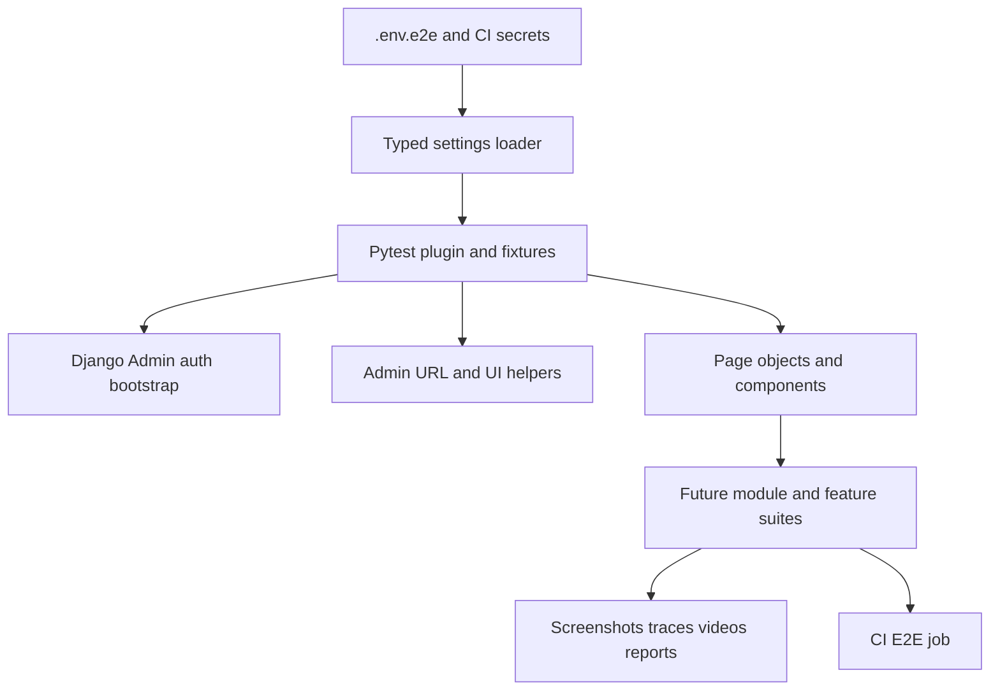

# Playwright Pytest Django Admin Core Setup Plan

> Implementation plan for a reusable Playwright + pytest automation foundation focused on Django Admin UI flows only.

**Status**: Proposed  
**Scope**: Core setup only (no module-specific test case implementation)  
**Target**: Backend Django Admin UI automation framework

---

## 1) Objective and Boundaries

### Objective
Establish a maintainable, env-driven, CI-ready automation core for Django Admin flows so module teams can add tests feature-by-feature without changing framework fundamentals.

### In Scope
- Playwright + pytest configuration for Django Admin UI.
- Environment-driven credentials and base URL.
- Reusable fixtures, helpers, page objects, and artifact handling.
- CI wiring for core framework execution.

### Out of Scope
- API testing scope.
- Module-level test scenario implementation.
- Performance and load testing.

---

## 2) References

### Repository References
- Existing pytest config: [`pytest.ini`](/home/bs-01426/Europe/real_project/nourish-backend/pytest.ini)
- Existing Playwright fixture baseline: [`tests/e2e/conftest.py`](/home/bs-01426/Europe/real_project/nourish-backend/tests/e2e/conftest.py)
- Existing development dependencies: [`requirements/development.txt`](/home/bs-01426/Europe/real_project/nourish-backend/requirements/development.txt)
- Existing CI pipeline: [`.github/workflows/ci.yml`](/home/bs-01426/Europe/real_project/nourish-backend/.github/workflows/ci.yml)
- Current env variable conventions: [`.env.example`](/home/bs-01426/Europe/real_project/nourish-backend/.env.example)
- Django Admin customization surface: [`templates/admin/users/user/change_list.html`](/home/bs-01426/Europe/real_project/nourish-backend/templates/admin/users/user/change_list.html)
- Django Admin business UI entrypoint example: [`apps/users/admin.py`](/home/bs-01426/Europe/real_project/nourish-backend/apps/users/admin.py)

### Product Context References
- Module specifications root: [`03-module-specifications/README.md`](/home/bs-01426/Europe/real_project/nourish-backend/DFMS-product-context/03-module-specifications/README.md)
- Module dependency map: [`03-module-specifications/INDEX.md`](/home/bs-01426/Europe/real_project/nourish-backend/DFMS-product-context/03-module-specifications/INDEX.md)
- Cross-cutting non-functional requirements: [`03-module-specifications/09-cross-cutting/non-functional-requirements.md`](/home/bs-01426/Europe/real_project/nourish-backend/DFMS-product-context/03-module-specifications/09-cross-cutting/non-functional-requirements.md)
- Existing implementation-level testing strategy: [`testing-approach.md`](/home/bs-01426/Europe/real_project/nourish-backend/DFMS-product-context/05-architecture/04-implementation/strategies/testing-approach.md)

---

## 3) Target Core Architecture

---

## 4) Step-by-Step Implementation Plan

## Step 1: Define the Environment Contract
- Create `E2E` env template (example file) with only required admin automation inputs:
  - `E2E_BASE_URL`
  - `E2E_USER_EMAIL`
  - `E2E_USER_PASSWORD`
  - Optional: `E2E_BROWSER`, `E2E_HEADLESS`, `E2E_TIMEOUT_MS`, `E2E_SLOW_MO_MS`, `E2E_TRACE`
- Keep real values in local `.env.e2e` and CI secrets only.
- Add fail-fast validation to prevent partially configured runs.

**Implementation Notes**
- Use a single source of truth settings object loaded at test startup.
- Normalize URL values and parse booleans/integers centrally.

---

## Step 2: Build the Pytest Core Harness
- Refactor e2e fixture entrypoint to consume typed settings (instead of raw env reads).
- Provide stable fixtures:
  - session-level browser fixture
  - context fixture with deterministic defaults
  - `admin_page` fixture that starts from Django Admin root
  - authenticated fixture that logs in once and reuses storage state
- Add failure artifact hooks:
  - screenshot on failure
  - optional trace and video collection
  - predictable artifact folder naming by test node id

**Implementation Notes**
- Keep fixtures composable and side-effect minimal.
- Avoid hidden retries in fixtures; retries belong at test execution strategy level.

---

## Step 3: Create Reusable Django Admin Utilities
- Add core helper layer for:
  - admin URL construction (`changelist`, `add`, `change`)
  - shared waits for admin page readiness
  - table row lookup helpers for list views
  - filter/search form helpers
- Add page object base class for common admin patterns:
  - login page actions
  - changelist actions
  - add/change form actions
- Keep assertions in tests, not in page object methods.

**Implementation Notes**
- Prefer stable selectors (`id`, `name`, labels, roles) from Django Admin markup.
- Use `data-testid` only where custom templates are unstable.

---

## Step 4: Establish Framework Folder Layout
- Standardize folders to support long-term maintainability:
  - `tests/e2e/core/` for settings, fixtures, hooks
  - `tests/e2e/pages/` for page objects
  - `tests/e2e/components/` for reusable UI fragments
  - `tests/e2e/utils/` for waiters, naming helpers, artifact naming
  - `tests/e2e/modules/` reserved for future module/feature suites
- Add `__init__.py` where needed to keep imports explicit and stable.

---

## Step 5: Configure Pytest Markers and Execution Profiles
- Extend markers for admin-focused automation:
  - `e2e`, `smoke`, `regression`, `admin_auth`, `admin_ui`, `flaky_quarantine`
- Define command profiles in test README:
  - local quick validation
  - headed debug run
  - CI artifact run
- Keep deterministic defaults for timeouts and headless mode.

---

## Step 6: CI Integration for Core Setup Validation
- Add a dedicated E2E CI job in [`.github/workflows/ci.yml`](/home/bs-01426/Europe/real_project/nourish-backend/.github/workflows/ci.yml):
  - install browser dependencies and Playwright browsers
  - load `E2E_*` values from secrets
  - run core framework smoke checks
  - upload artifacts when tests fail
- Keep initial CI scope small (framework validation only), then expand with future suites.

---

## Step 7: Documentation and Extension Guidelines
- Create/update `tests/e2e/README.md` with:
  - setup prerequisites and env configuration
  - run commands for local and CI
  - fixture usage patterns
  - selector and wait strategy standards
  - artifact and debugging workflow
- Add a short onboarding section: "How to add a new Django Admin feature test suite."

---

## 5) Definition of Done (Core Setup)
- Playwright + pytest runs successfully against Django Admin login flow using env-driven credentials/base URL.
- Missing env vars fail with clear startup errors.
- Core fixtures and admin helpers are reusable and documented.
- CI job executes core checks and uploads artifacts on failure.
- No API-testing scaffolding included in this implementation.

---

## 6) Risks and Mitigations
- **Risk**: Selector brittleness due to admin template customizations.  
  **Mitigation**: Prefer semantic and stable Django Admin selectors; add helper abstractions.
- **Risk**: Flaky tests from timing and async page states.  
  **Mitigation**: Standardized explicit waits and no fixed sleeps policy.
- **Risk**: Secret leakage in logs/artifacts.  
  **Mitigation**: Mask CI secrets, sanitize logs, avoid printing credential values.

---

## 7) Suggested Execution Order
1. Env contract and settings loader  
2. Core fixtures and auth bootstrap  
3. Admin utilities and page object base  
4. Marker/execution profile setup  
5. CI job and artifact pipeline  
6. Documentation and extension guide

