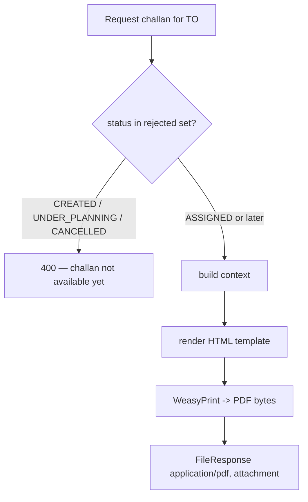

# Printable Delivery Challan — Implementation Plan

## 1. Business problem

Once a Transport Order (TO) reaches **`assigned`** status (vehicle, driver, and planned
milestones set for own fleet; vendor assigned for vendor fleet), the operator needs a
**printable Delivery Challan** to accompany the goods. The challan is the physical
document handed over with the shipment and signed on receipt.

The reference layout (Nourish paper challan) has:

- **Top-left:** Static company name `Nourish Poultry And Hatchery Ltd.`, then the
  **source POI** as the issuing unit (unit name + address + contact).
- **Top-right:** Static **Head Office** block (address + Tel/Fax).
- **Title:** `DELIVERY CHALLAN`.
- **Meta (two columns):** left = **destination POI** (Client Name / Address / Cell No);
  right = Challan No, Challan Date, Vehicle No, Contact (driver).
- **Product table:** `#` (product code), Product Name, Quantity (Bag), Quantity (Kg),
  Remarks, with a **Grand Total** row.
- **Footer:** "RECEIVED THE ABOVE GOODS IN GOOD CONDITION", printed timestamp, page
  number, and four signature blocks (Prepared / Checked / Delivered / Received By).

There is **no PDF generation** in the codebase today. The only printable precedent is
server-rendered HTML + `window.print()` (gate pass / queue token in
`apps/operations/scaling/admin.py`).

---

## 2. Terminology reconciliation

The business "TO" maps to the **`TransportOrder`** model (`apps/transport/models.py`).
There is **no** `TransferOrder` or `DeliveryChallan` model, and none is added by this plan.
The challan is built on top of `TransportOrder` + `TOLineItem`.

Challan number = `TransportOrder.to_number`.

---

## 3. Scope

| In scope (v1) | Out of scope (v1) |
|---------------|-------------------|
| PDF challan for a single TO at `assigned`+ status | Bulk / batch challan export |
| DRF endpoint `GET /transport-orders/{id}/challan/` | Category grouping (Broiler/Layer sections) |
| Django admin action "Print Delivery Challan" | Storing/persisting a challan snapshot on the TO |
| WeasyPrint dependency + Dockerfile system libs | Actual (loaded) bag/kg — uses planned quantities |
| Hardcoded company + head office header constants | Gate Pass No field (omitted) |
| Flat product table with Grand Total | Signature capture / digital signatures |

**Primary users:** Transport Planner / TDO / operations, via API (frontend button) and
Django admin action.

---

## 4. Data mapping

| Challan region | Source in code | Notes |
|---|---|---|
| Company name (top-left) | Hardcoded constant `COMPANY_NAME` | Exact brand text; not in DB |
| Issuing unit + address (top-left) | `to.origin_poi.name`, `.address`, `.city`, `.contact_phone` | POI has free-text `address` + `city` only (no unit/upazila fields) |
| Head Office (top-right) | Hardcoded constant `HEAD_OFFICE` | No fax / head-office entity in DB |
| Challan No | `to.to_number` | — |
| Challan Date | `to.created_at` (issue date) | — |
| Vehicle No | `to.vehicle.registration_number` (own) / `to.vendor_vehicle_registration` (vendor) | Reuse `gate_services.resolve_gate_vehicle_from_to` |
| Driver name + phone | `to.driver.user.full_name` + `to.driver.contact_number` (own) / `to.vendor_driver_name` (vendor) | Reuse `gate_services._driver_from_to` |
| Destination (Client) block | `to.destination_poi.name`, `.address`, `.city`, `.contact_phone` | — |
| Product rows | `to.line_items` (order by `line_number`) | Flat, no grouping |
| — code | `product.product_item_code` or `tr_line_item.pr_line_item.product_item_code` | Reuse `gate_services._line_product_label` |
| — name | `product.product_name` or `pr_line_item.product_name` | ″ |
| — Bag qty | `line.allocated_quantity` when UOM is bags | Via `vehicle_capacity.to_line_uom` |
| — Kg | `line.allocated_quantity × weight_per_unit` | Via `services.TOLineAllocationService.line_total_kg` |
| Grand Total (Bag / Kg) | Sum of line bags / line kg | — |

**Gaps flagged (not addressed in v1):**

- No POI `unit_name` field — `origin_poi.name` is used as the unit line.
- No product **category** field — table is flat (no Broiler/Layer sections).
- No structured Bangladesh address (upazila/district) — free-text `address` + `city` only.

---

## 5. Availability gate

Challan is downloadable only when the TO has resources assigned and is not cancelled:

- **Allowed:** `to.status` in `ASSIGNED` and any later execution state
  (`READY_FOR_DISPATCH` … `CLOSED`).
- **Rejected (4xx):** `CREATED`, `UNDER_PLANNING`, `CANCELLED`.



---

## 6. Technical design

### 6.1 Dependency

- `requirements/base.txt`: add `weasyprint`.
- `Dockerfile` (dev + runtime stages): add system libs
  `libpango-1.0-0 libpangocairo-1.0-0 libgdk-pixbuf-2.0-0 libcairo2 libffi-dev`.

### 6.2 New module — `apps/transport/challan.py`

- `COMPANY_NAME`, `HEAD_OFFICE` static constants.
- `build_challan_context(to) -> dict` — company block, source POI block, destination POI
  block, challan no/date, resolved driver + vehicle (reusing `gate_services` helpers),
  flat line rows `[{code, name, bags, kg, remarks}]`, and grand totals.
- `render_challan_pdf(to) -> bytes` — render `templates/transport/challan.html` with the
  context and return PDF bytes via WeasyPrint.

### 6.3 Template — `templates/transport/challan.html`

- Two-column branded header (company/unit/source-address left; static head office right).
- Meta block (destination left; challan/vehicle/driver right).
- Flat product table with Grand Total row.
- Footer: "RECEIVED THE ABOVE GOODS IN GOOD CONDITION" + 4 signature blocks.
- `@page` A4 CSS with margins.

### 6.4 Entry points

**DRF** — `apps/transport/views.py`, `TransportOrderViewSet`:

```python
@action(detail=True, methods=["get"], url_path="challan")
def challan(self, request, pk=None):
    to = self.get_object()
    # status gate -> 400 if not available
    pdf = render_challan_pdf(to)
    return FileResponse(
        io.BytesIO(pdf),
        content_type="application/pdf",
        as_attachment=True,
        filename=f"challan-{to.to_number}.pdf",
    )
```

Endpoint: `GET /api/v1/transport-orders/{id}/challan/`.

**Django admin** — `apps/transport/admin.py`, `TransportOrderAdmin`:

- `@admin.action(description="Print Delivery Challan")` (single-select), same status gate,
  returns the same `FileResponse`.

### 6.5 Query optimization

```python
TransportOrder.objects.select_related(
    "origin_poi", "destination_poi", "vehicle", "driver__user", "assigned_vendor",
).prefetch_related(
    "line_items__tr_line_item__pr_line_item", "line_items__product",
)
```

---

## 7. Reused code (do not re-implement)

| Need | Reuse from |
|---|---|
| Driver name + phone from TO | `apps/operations/gate/gate_services.py :: _driver_from_to` |
| Vehicle from TO | `apps/operations/gate/gate_services.py :: resolve_gate_vehicle_from_to` |
| Product code / name / UOM label | `apps/operations/gate/gate_services.py :: _line_product_label` |
| Line kg | `apps/transport/services.py :: TOLineAllocationService.line_total_kg` |
| Line UOM / bag detection | `apps/transport/vehicle_capacity.py :: to_line_uom, to_total_bags` |

---

## 8. Success criteria

1. `docker build` succeeds; `python -c "import weasyprint"` works in the container.
2. `GET /api/v1/transport-orders/{id}/challan/` returns a PDF for an `assigned`+ TO;
   returns 4xx for `created` / `under_planning` / `cancelled`.
3. Django admin action downloads the same PDF.
4. Rendered PDF matches the reference: static company + head office header, source POI as
   issuing unit, destination POI in the client block, resolved vehicle + driver, product
   code/name/bag/kg rows, and a correct Grand Total.

---

## 9. Files touched

| File | Change |
|---|---|
| `requirements/base.txt` | Add `weasyprint` |
| `Dockerfile` | Add WeasyPrint system libs (dev + runtime stages) |
| `apps/transport/challan.py` | **New** — constants, `build_challan_context`, `render_challan_pdf` |
| `templates/transport/challan.html` | **New** — challan layout + print CSS |
| `apps/transport/views.py` | Add `challan` `@action` on `TransportOrderViewSet` |
| `apps/transport/admin.py` | Add "Print Delivery Challan" admin action |

---

**Last Updated**: 2026-07-07
