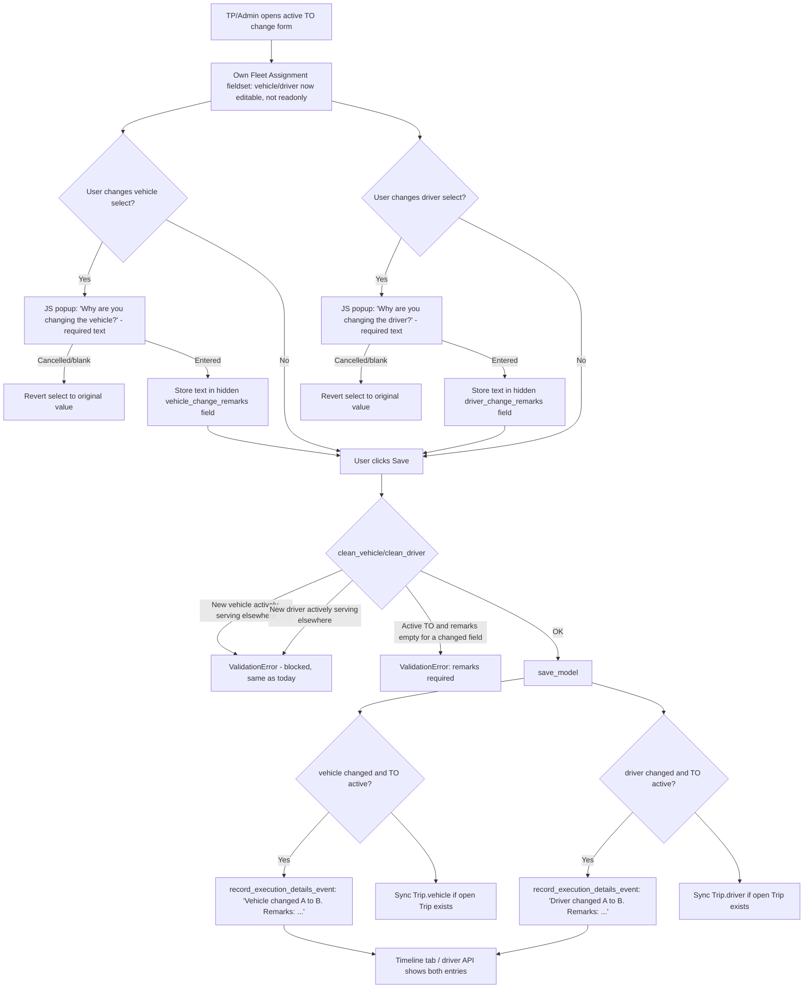

# Own-Fleet Active-TO Vehicle/Driver Reassignment — Implementation Plan

## 1. Business problem

Today, once a Transport Order (TO) leaves the planning statuses (`created` / `assigned` / `under_planning`), the own-fleet `vehicle` and `driver` fields on the admin change form become **readonly** (`TransportOrderAdmin._own_fleet_assignment_editable()` / `get_readonly_fields()`). There is **no way** for the Transport Planner (TP) or an Admin to change the vehicle or driver once the TO is actively executing (`ready_for_dispatch`, `driving_towards_source`, `at_source`, …).

In practice, vehicles break down, drivers fall sick, etc., and TP/Admin need to swap in a replacement mid-execution. We need a controlled way to do this that:

1. Requires a **remarks/reason** explaining the change whenever the TO is in an active state.
2. Records the change (old → new + remarks) on the **TO execution timeline** so anyone reviewing the TO later can see what changed, when, and why.

**Scope confirmed:** own fleet only. Vendor fleet already has an equivalent flow — `VendorExecutionService.update` (`apps/vendors/services.py`) requires a `reason` and writes to the same timeline via `record_execution_details_event`. This proposal brings the own-fleet path to parity, reusing the same timeline primitive.

---

## 2. Scope

| In scope (v1) | Out of scope (v1) |
|---|---|
| Own-fleet `vehicle` field change while TO is active | Vendor fleet (already covered by VM-07) |
| Own-fleet `driver` field change while TO is active | Bulk/changelist reassignment action |
| Remarks captured via popup, required only while active | Helper (`helpers` M2M) reassignment |
| Timeline entry per resource changed (vehicle and driver logged separately) | Persisting a dedicated "reassignment reason" field on `TransportOrder` |
| `Trip.vehicle` / `Trip.driver` kept in sync with the TO | Driver mobile app UI changes (read-only consumer of the same timeline API) |
| FB-011 exclusivity check on the *new* vehicle/driver | Changing vehicle/driver after terminal statuses (`completed`, `bill_disbursed`, `closed`, `cancelled` — stays fully locked) |

**Primary users:** Transport Planner and Admin, on `Transport → Transport orders → [TO] change form`, **Own Fleet Assignment** fieldset.

---

## 3. Current-state references (what this plan builds on)

| Concern | Existing code |
|---|---|
| TO status enum, `ACTIVE_TO_STATUSES` | `apps/transport/constants.py:69-88`, `165-175` |
| Own-fleet fields | `TransportOrder.vehicle` / `.driver` — `apps/transport/models.py:152-163` |
| Field lock today | `TransportOrderAdmin._own_fleet_assignment_editable()` (`admin.py:1424-1429`), `get_readonly_fields()` (`admin.py:1532-1567`) |
| Field-level validation | `TransportOrderAdminForm.clean_vehicle()` / `clean_driver()` (`admin.py:129-161`) |
| FB-011 exclusivity helpers | `apps/transport/assignment_availability.py` — `vehicle_is_actively_serving_elsewhere()` (already used in `clean_vehicle`), `driver_is_actively_serving_elsewhere()` (**not yet used** in `clean_driver` — gap) |
| Timeline model | `TOStatusTransitionLog` — `apps/transport/models.py:450-480` |
| Timeline write API | `apps/transport/lifecycle/timeline_service.py` — `record_execution_details_event()` (lines 67-86) is purpose-built for "resource changed, status unchanged" events; currently only called from the vendor path |
| Timeline read/display | `timeline_for_to()` (`timeline_service.py:96-114`), `TOTimelineInline` (`admin.py:330-397`), driver API `GET …/timeline` |
| Precedent for "reason required" mid-execution change | `VendorExecutionService.update` (`apps/vendors/services.py:2672-2757`) — required `reason`, writes `VendorExecutionConfirmationAudit` + `record_execution_details_event` |
| `Trip` model (separate vehicle/driver snapshot) | `apps/transport/models.py:364-392` — `Trip.vehicle` / `Trip.driver`, FK `transport_order` (`related_name="trips"`); **not currently synced** when TO vehicle/driver change |
| Existing admin popup pattern (JS `confirm()`, no data capture) | `templates/admin/transport/transportorder/change_form.html:44-50, 74-79` |

---

## 4. User flow



**Why a JS prompt/popup instead of a full intermediate confirmation page:** the change form already edits many other fields in the same save; routing through a separate confirmation page (like the QC checkpoint `_intermediate()` pattern) would mean either a second full-page round trip or duplicating the whole form. Capturing remarks inline via a JS popup that writes into a hidden field keeps this a single save, consistent with how the vehicle/driver fields are edited today.

---

## 5. Implementation detail

### 5.1 Unlock the fields for active statuses

`TransportOrderAdmin._own_fleet_assignment_editable()` (`admin.py:1424-1429`) currently gates on `obj.status in self._TDO_ASSIGNMENT_STATUSES` (`CREATED`, `ASSIGNED`, `UNDER_PLANNING`). Extend it to also return `True` when `obj.status in ACTIVE_TO_STATUSES` (constants.py:165-175), so `vehicle`/`driver` stay out of `readonly_fields` through the active window. `_LOCKED_STATUSES` (`COMPLETED`, `BILL_DISBURSED`, `CLOSED`, `CANCELLED`, line 407) is untouched — those stay fully locked as today.

### 5.2 Hidden remarks fields on the form

Add to `TransportOrderAdminForm` (`admin.py:58` onward):

```python
vehicle_change_remarks = forms.CharField(required=False, widget=forms.HiddenInput)
driver_change_remarks = forms.CharField(required=False, widget=forms.HiddenInput)
```

These are plain form fields (not model fields) — no migration.

### 5.3 Validation — remarks required only while active

Extend `clean_vehicle()` / `clean_driver()` (`admin.py:143-161`, `129-141`):

- Keep existing checks unchanged (maintenance/inactive vehicle, inactive/on-leave driver, `vehicle_is_actively_serving_elsewhere`).
- **Add to `clean_driver()`:** the same exclusivity check `clean_vehicle()` already does — `driver_is_actively_serving_elsewhere(driver.pk, exclude_to_pk=exclude_pk)` (helper already exists in `assignment_availability.py:94-97`, just not called from `clean_driver` today). This closes an existing gap and is needed so a driver already driving another TO can't be picked as the replacement.
- **New:** in `clean()` (admin.py:163+), if `self.instance.status in ACTIVE_TO_STATUSES` and the submitted `vehicle` differs from `self.instance.vehicle_id`, require `cleaned_data.get("vehicle_change_remarks")` to be non-empty — else `self.add_error("vehicle_change_remarks", "Remarks are required when changing the vehicle on an active Transport Order.")`. Same pattern for `driver_change_remarks`.

### 5.4 Remarks modal (design-system-consistent — replaces raw `window.prompt()`)

`window.prompt()` is a plain browser dialog — no styling, no dark-theme support, no field-level guidance, and it doesn't match how the rest of the admin collects structured input before a save (e.g. the QC checkpoint `remarks_intermediate.html` page, the tracking Live GPS `_live_gps_command_modal.html`). Instead, build one small, reusable **in-page modal component** in the `dfms-` namespace and use it for both the vehicle and the driver prompt.

This is also the first "collect remarks before confirming" pattern needed *inline on a change form* (the QC pattern is a separate full-page intermediate view, not usable here since the TO form has many other fields being edited in the same save — see §4). Worth extracting once since a future feature will likely need the same shape.

#### 5.4.1 New shared partial: `templates/admin/includes/dfms_remarks_modal.html`

Structure mirrors the existing Live GPS modal (`_live_gps_command_modal.html`) — backdrop + dialog + header/body/footer — but restyled with the `dfms-` design tokens already used across transport/requisitions admin (`--dfms-primary`, `--dfms-grey-100/200/300`, `--dfms-shadow-sm`, `dfms-btn-add` / `dfms-btn-secondary`), not the tracking module's `--lg-*` tokens:

```html

<div id="dfms-remarks-modal" class="dfms-modal" hidden aria-hidden="true">
  <div class="dfms-modal__backdrop" data-dfms-modal-dismiss></div>
  <div class="dfms-modal__dialog" role="dialog" aria-modal="true" aria-labelledby="dfms-remarks-modal-title">
    <div class="dfms-modal__header">
      <i class="bi bi-exclamation-triangle dfms-modal__icon" aria-hidden="true"></i>
      <h2 class="dfms-modal__title" id="dfms-remarks-modal-title"></h2>
      <button type="button" class="dfms-modal__close" data-dfms-modal-dismiss aria-label="">
        <i class="bi bi-x-lg" aria-hidden="true"></i>
      </button>
    </div>
    <div class="dfms-modal__body">
      <p class="dfms-modal__summary" id="dfms-remarks-modal-summary"></p>
      <label class="dfms-modal__label" for="dfms-remarks-modal-textarea">
         <span class="dfms-modal__required" aria-hidden="true">*</span>
      </label>
      <textarea id="dfms-remarks-modal-textarea" class="dfms-modal__textarea" rows="3" maxlength="500"
                placeholder=""></textarea>
      <p class="dfms-modal__error" id="dfms-remarks-modal-error" role="alert" hidden>
        
      </p>
      <p class="dfms-modal__hint">
        <i class="bi bi-clock-history" aria-hidden="true"></i>
        
      </p>
    </div>
    <div class="dfms-modal__footer">
      <button type="button" class="dfms-btn-secondary" id="dfms-remarks-modal-cancel"></button>
      <button type="button" class="dfms-btn-add" id="dfms-remarks-modal-confirm">
        <i class="bi bi-check-lg" aria-hidden="true"></i> 
      </button>
    </div>
  </div>
</div>
```

`` this once from `change_form.html` (only when `show_active_reassignment_prompts` is true), same as the existing `to_pod_review.html` include at `after_field_sets`.

#### 5.4.2 New shared CSS: `static/admin/css/dfms_modal.css`

Visual spec, using existing tokens (same source as `dfms-btn-add`/`dfms-btn-secondary` at `custom.css:1207-1379`):

| Element | Style |
|---|---|
| `.dfms-modal` | `position: fixed; inset: 0; z-index: 1300;` hidden via `[hidden]`; flex-centers `.dfms-modal__dialog` |
| `.dfms-modal__backdrop` | `rgba(15, 23, 42, .45)`, fade-in transition (match Live GPS backdrop timing, `0.2s ease`) |
| `.dfms-modal__dialog` | `width: min(440px, calc(100% - 32px))`, `background: var(--dfms-surface, #fff)`, `border-radius: 12px`, `box-shadow: var(--dfms-shadow-md, var(--dfms-shadow-sm))` |
| `.dfms-modal__header` | flex row, icon in `var(--dfms-primary)`, title 15px/600 |
| `.dfms-modal__textarea` | full width, `border: 1px solid var(--dfms-grey-300)`, `border-radius: 8px`, focus ring `var(--dfms-primary)` |
| `.dfms-modal__textarea.is-invalid` | `border-color: #dc2626`, subtle red focus ring — added when Confirm is clicked with empty text |
| `.dfms-modal__error` | `color: #dc2626`, 12px, shown/hidden by JS (no page reload) |
| `.dfms-modal__hint` | `color: var(--body-quiet-color)`, 12px, icon + text row |
| Dark theme | `[data-theme="dark"] .dfms-modal__dialog { background: var(--dfms-grey-100); }` etc., same convention as `[data-theme="dark"] .dfms-btn-secondary` (`custom.css:1369-1378`) |
| Mobile | `@media (max-width: 640px)`, dialog `width: calc(100% - 24px)`, footer buttons full width — same breakpoint already used in this template (`change_form.html:107`) |

Load once in `change_form.html` ``, alongside the existing conditional `poi_stock_panel.css` include (`change_form.html:100-102`).

#### 5.4.3 JS controller (generic, reusable for both fields)

```javascript
var DfmsRemarksModal = (function () {
  var modal = document.getElementById('dfms-remarks-modal');
  if (!modal) { return { open: function () {} }; }

  var textarea = document.getElementById('dfms-remarks-modal-textarea');
  var errorEl  = document.getElementById('dfms-remarks-modal-error');
  var summaryEl = document.getElementById('dfms-remarks-modal-summary');
  var confirmBtn = document.getElementById('dfms-remarks-modal-confirm');
  var cancelBtn  = document.getElementById('dfms-remarks-modal-cancel');
  var activeCallbacks = null;

  function close(reason) {
    modal.hidden = true;
    modal.setAttribute('aria-hidden', 'true');
    textarea.value = '';
    textarea.classList.remove('is-invalid');
    errorEl.hidden = true;
    if (activeCallbacks && reason === 'cancel') { activeCallbacks.onCancel(); }
    activeCallbacks = null;
  }

  function confirm() {
    var value = textarea.value.trim();
    if (!value) {
      textarea.classList.add('is-invalid');
      errorEl.hidden = false;
      textarea.focus();
      return;
    }
    var callbacks = activeCallbacks;
    modal.hidden = true;
    modal.setAttribute('aria-hidden', 'true');
    textarea.value = '';
    textarea.classList.remove('is-invalid');
    errorEl.hidden = true;
    activeCallbacks = null;
    callbacks.onConfirm(value);
  }

  modal.querySelectorAll('[data-dfms-modal-dismiss]').forEach(function (el) {
    el.addEventListener('click', function () { close('cancel'); });
  });
  cancelBtn.addEventListener('click', function () { close('cancel'); });
  confirmBtn.addEventListener('click', confirm);
  modal.addEventListener('keydown', function (evt) {
    if (evt.key === 'Escape') { close('cancel'); }
  });

  return {
    open: function (opts) {
      activeCallbacks = { onConfirm: opts.onConfirm, onCancel: opts.onCancel || function () {} };
      summaryEl.textContent = opts.summary || '';
      modal.hidden = false;
      modal.setAttribute('aria-hidden', 'false');
      window.setTimeout(function () { textarea.focus(); }, 30);
    }
  };
})();

function bindReassignmentPrompt(selectId, hiddenInputId, label) {
  var select = document.getElementById(selectId);
  var hiddenInput = document.getElementById(hiddenInputId);
  if (!select || !hiddenInput) { return; }
  var original = select.value;

  select.addEventListener('change', function () {
    if (select.value === original) { return; }
    var newLabel = select.options[select.selectedIndex].text;
    var oldLabel = Array.prototype.filter.call(select.options, function (o) {
      return o.value === original;
    })[0];
    DfmsRemarksModal.open({
      summary: label + ' change: ' + (oldLabel ? oldLabel.text : '—') + ' \u2192 ' + newLabel,
      onConfirm: function (remarks) {
        hiddenInput.value = remarks;
        original = select.value;
      },
      onCancel: function () {
        select.value = original;
      }
    });
  });
}
```

Wired up only when `show_active_reassignment_prompts` is true:

```javascript

bindReassignmentPrompt('id_vehicle', 'id_vehicle_change_remarks', '');
bindReassignmentPrompt('id_driver', 'id_driver_change_remarks', '');

```

**UX improvements over the raw `window.prompt()` draft:**

- Shows the actual **old → new** value in the modal (`"Vehicle change: DH-1234 → DH-5678"`) so the user confirms exactly what's changing, not just an abstract "why are you changing the vehicle?".
- Inline validation (red border + helper text) instead of silently reverting on blank input — user gets a clear reason the change didn't go through.
- Dismissible via Cancel button, backdrop click, ✕ button, or `Esc` — all revert the select, matching one consistent cancel path.
- Reuses existing `dfms-btn-add` / `dfms-btn-secondary` button styling and `bi-*` icon set — visually indistinguishable from the rest of the admin, including dark theme.
- One modal DOM node shared by both fields (and reusable by any future "confirm + remarks" need on this form) instead of duplicating markup per field.
- Textarea `maxlength="500"` keeps timeline notes readable, matching the vendor `reason` field's practical length.

### 5.5 `save_model` — timeline + Trip sync

In `TransportOrderAdmin.save_model()` (`admin.py:1619` onward), after `super().save_model()`, using the already-computed `changed_fields = _admin_form_changed_fields(form)`:

```python
from .lifecycle.timeline_service import record_execution_details_event
from .constants import ACTIVE_TO_STATUSES
from .constants import TripStatus

if obj.status in ACTIVE_TO_STATUSES:
    open_trip = obj.trips.exclude(
        status__in=(TripStatus.COMPLETED, TripStatus.CANCELLED)
    ).order_by("-created_at").first()

    if "vehicle" in changed_fields:
        old_vehicle = form.initial.get("vehicle")
        record_execution_details_event(
            obj, actor=request.user, source_module="transport",
            notes=f"Vehicle changed: {old_vehicle or '—'} → {obj.vehicle}. "
                  f"Remarks: {form.cleaned_data.get('vehicle_change_remarks', '')}",
        )
        if open_trip:
            open_trip.vehicle = obj.vehicle
            open_trip.save(update_fields=["vehicle"])

    if "driver" in changed_fields:
        old_driver = form.initial.get("driver")
        record_execution_details_event(
            obj, actor=request.user, source_module="transport",
            notes=f"Driver changed: {old_driver or '—'} → {obj.driver}. "
                  f"Remarks: {form.cleaned_data.get('driver_change_remarks', '')}",
        )
        if open_trip:
            open_trip.driver = obj.driver
            open_trip.save(update_fields=["driver"])
```

Two separate `record_execution_details_event` calls (not one combined row) when both fields change in the same save, so the timeline shows two distinct, independently-readable entries — matching the "separate actions, separate remarks" decision.

`form.initial.get("vehicle"/"driver")` gives the pre-change FK id/instance for the "old →" label; resolve to a display string (`str(old_vehicle_obj)`) rather than the raw id — implementation detail to confirm against how `_admin_form_changed_fields` exposes initial values (may need `TransportOrder.objects.get(pk=obj.pk)` fetched *before* `super().save_model()` instead, since `form.initial` on a bound `ModelForm` reflects the object at form-render time, which should still be correct here, but this needs a quick check during implementation).

### 5.6 No new model / no migration

`TOStatusTransitionLog.notes` (free text) is sufficient — same choice the vendor path made. If later we need to query "how many reassignments happened this month" as structured data, we can add dedicated fields then; not needed for the stated requirement (show it in the timeline).

---

## 6. Timeline display — no changes needed

`TOTimelineInline` (`admin.py:330-397`) and `timeline_for_to()` (`timeline_service.py:96-114`) already render any `TOStatusTransitionLog` row, including ones where `from_status == to_status` (the shape `record_execution_details_event` produces). Once §5.5 writes the rows, both the admin **Timeline** tab and the driver-app `GET …/timeline` API show:

```
[timestamp] Vehicle changed: DH-1234 → DH-5678. Remarks: Vehicle broke down at KM 40.
[timestamp] Driver changed: John Doe → Jane Roe. Remarks: Driver reported sick.
```

with actor name/role and source module (`transport`), consistent with every other timeline entry.

---

## 7. Files touched

| File | Change |
|---|---|
| `apps/transport/admin.py` | `_own_fleet_assignment_editable()` extend for active statuses; `TransportOrderAdminForm` — add hidden remarks fields, extend `clean_driver()` exclusivity check, add remarks-required validation in `clean()`; `save_model()` — timeline events + Trip sync; `change_view()` — pass `show_active_reassignment_prompts` to context |
| `templates/admin/includes/dfms_remarks_modal.html` | **New** — shared modal partial (see §5.4.1) |
| `static/admin/css/dfms_modal.css` | **New** — shared modal styling, design tokens (see §5.4.2) |
| `templates/admin/transport/transportorder/change_form.html` | Include the modal partial + CSS; JS controller + per-field bindings (see §5.4.3) |
| `apps/transport/assignment_availability.py` | No change — `driver_is_actively_serving_elsewhere()` already exists, just gets a new caller |
| `apps/transport/lifecycle/timeline_service.py` | No change — `record_execution_details_event()` already generic enough to reuse |
| `tests/unit/test_transport/test_admin.py` (or equivalent) | New tests — see §8 |

**No migrations.**

---

## 8. Test plan

1. **Planning stage (unchanged behaviour):** TO at `created`/`assigned`/`under_planning` — vehicle/driver changeable without remarks, no timeline event written (existing behaviour preserved).
2. **Active stage, remarks provided:** TO at `driving_towards_source` — change vehicle with remarks → save succeeds; one `TOStatusTransitionLog` row with `from_status == to_status == "driving_towards_source"` and notes containing old/new vehicle + remarks; open `Trip.vehicle` updated.
3. **Active stage, remarks missing:** same as above but `vehicle_change_remarks` empty → form validation error, save blocked, no timeline row written.
4. **Active stage, both vehicle and driver changed in one save:** two separate timeline rows, each with correct old/new value and its own remarks.
5. **New vehicle actively serving elsewhere:** `clean_vehicle` still blocks (regression) — unaffected by this change.
6. **New driver actively serving elsewhere:** `clean_driver` now blocks (new coverage — previously only checked active/on-leave, not exclusivity).
7. **Terminal status (`completed`/`closed`/etc.):** fields remain fully readonly (regression — `_LOCKED_STATUSES` untouched).
8. **Timeline display:** admin Timeline tab and driver `GET …/timeline` API both show the new entries with correct notes text.
9. **Modal manual check:** cancelling via Cancel button / backdrop / ✕ / `Esc` all revert the dropdown to the original vehicle/driver and the change is not submitted; submitting with blank remarks shows the inline error and keeps the modal open; dark theme and 640px mobile viewport render the modal legibly.

---

## 9. Open implementation details to confirm while building (not product decisions)

- Exact source for "old vehicle/driver" display value in the timeline notes (`form.initial` vs a pre-fetch of the DB row before `save_model` mutates `obj`) — needs a quick check against how Django admin populates `form.initial` for FK fields on a bound change form.
- Whether `Trip.vehicle` being a required (`on_delete=PROTECT`, non-null) FK vs `Trip.driver` (nullable) affects the sync logic — vehicle sync should always be safe since `obj.vehicle` is required at that point; driver sync should handle `obj.driver` being cleared if that's ever allowed (out of scope per §2, but worth a defensive check).

---

## 10. Success criteria

- [ ] TP/Admin can change own-fleet vehicle and/or driver on a TO while it is in any `ACTIVE_TO_STATUSES` status, via the existing change form (no new page).
- [ ] Changing vehicle or driver while active requires remarks; save is blocked without them.
- [ ] Changing vehicle or driver while in planning statuses behaves exactly as today (no remarks required).
- [ ] Every active-stage change produces a distinct, human-readable entry in the TO execution timeline (admin Timeline tab + driver API), showing old value → new value + remarks.
- [ ] FB-011 exclusivity is enforced on the new vehicle **and** new driver (closing the existing driver-exclusivity gap).
- [ ] The active `Trip`'s vehicle/driver stays in sync with the TO after reassignment.
- [ ] TOs in terminal statuses remain fully locked (no regression).

---

## 11. Related references

| Reference | Path |
|---|---|
| TO status enum + active status list | `apps/transport/constants.py` |
| FB-011 exclusivity helpers | `apps/transport/assignment_availability.py` |
| Timeline model + write API | `apps/transport/models.py` (`TOStatusTransitionLog`), `apps/transport/lifecycle/timeline_service.py` |
| Vendor mid-execution reassignment precedent | `apps/vendors/services.py` (`VendorExecutionService.update`) |
| TO admin form/fields | `apps/transport/admin.py` |
| TO change form template | `templates/admin/transport/transportorder/change_form.html` |
| Multi-TO exclusivity spec | `DFMS-product-context/05-modules/08-fleet-management/vehicle-driver-multi-to-exclusivity-v2.md` |
| TLS-01 lifecycle/timeline spec | `DFMS-product-context/05-modules/05-transport/transport-lifecycle-pod-sprint4.md` |
| Existing modal precedent (backdrop/dialog/header/body/footer structure, restyled with `dfms-` tokens) | `templates/admin/tracking/partials/_live_gps_command_modal.html`, `static/tracking/css/live-gps-modals.css` |
| Existing intermediate-confirmation-with-remarks precedent (different pattern — full-page, used for changelist actions) | `apps/quality/checkpoint/admin.py` (`_RemarksForm`, `_intermediate()`), `templates/admin/quality/checkpoint/remarks_intermediate.html` |
| Design tokens / button classes reused by the modal | `static/admin/css/custom.css` (`--dfms-primary`, `--dfms-grey-*`, `.dfms-btn-add`, `.dfms-btn-secondary`) |

---

**Status:** Proposal — reuses existing timeline primitive and FB-011 helpers, no new models
**Estimated effort:** ~1.5–2 SP
