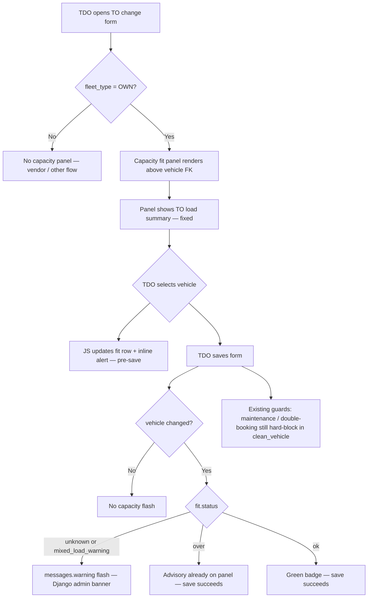

# Own-Fleet Vehicle Capacity Fit — Django Admin Implementation Plan

## 1. Business problem

When **TDO — Own Fleet** assigns a vehicle on the Transport Order change form, there is no comparison between TO load and the vehicle’s MDM capacity (`Vehicle.capacity` + `capacity_unit`).

Vendor fleet already shows allocated quantity as **MT + kg** on `vendor_fleet.html`; own fleet has no equivalent on the standard TO admin form.

**Product policy (confirmed):** **Warn only — never block.** Mandatory warnings when capacity is unknown or a bag-rated vehicle is used on a non-bag TO. Over-capacity when known is an **advisory** badge; TDO may save and proceed.

---

## 2. Scope

| In scope (v1) | Out of scope (v1) |
|---------------|-------------------|
| Django admin TO change form (TDO own fleet) | API `PATCH …/vehicle` metadata |
| Django admin TO changelist badge (phase 2) | Hard block on over-capacity |
| Shared domain module `vehicle_capacity.py` | Vendor confirmation capacity check |
| Design-consistent panel + badges + flash warnings | Persisting fit snapshot on TO |

**Primary user:** `tdo_own_fleet` on `Transport → Transport orders → [TO] change form`, **Own Fleet Assignment** fieldset.

---

## 3. Django admin user flow (TDO — Own Fleet)

### 3.1 Entry points

```
Sidebar → Transport → Transport orders
  ├── Changelist (optional phase 2): capacity_fit_badge column for own-fleet TOs
  └── Change form → Own Fleet Assignment fieldset
```

Role gating matches existing `TransportOrderAdmin.get_fieldsets()` — TDO own fleet sees **Own Fleet Assignment**, not vendor section.

### 3.2 Change form flow (step by step)



### 3.3 What TDO sees (wireframe)

**Own Fleet Assignment** fieldset (top → bottom):

1. **Fieldset description** (Django `description`) — one line: advisory, not blocking.
2. **Capacity fit panel** (readonly HTML — see §5) — load, vehicle capacity, utilization, status badge.
3. **Inline alert** (inside panel, `dfms-alert--warn`) — only for `unknown` / `mixed_load_warning`; hidden when `ok` / `over`.
4. **`vehicle`** FK — labels like `DH-1234 — 10.000 MT ✓` (see §5.4).
5. **`driver`**, **`helpers`**, planned milestones (unchanged).

**On save:** Django `messages.warning` banner at top of page (same pattern as `TransportOrderAdmin` line ~718 and requisitions admin) for mandatory warning cases only.

**On over-capacity:** amber `dfms-badge--warning` in panel + `⚠ over` in dropdown — **no** flash, **no** field error.

### 3.4 Interaction with existing TO admin patterns

| Existing pattern | Capacity feature must follow |
|------------------|------------------------------|
| `status_badge` / `_to_badge()` | Use same `dfms-badge` + Bootstrap icon markup |
| `to_pod_review.html` in `after_field_sets` | Panel is **inside** Own Fleet fieldset (contextual), not a separate bottom section |
| `closure_panel` + `errornote` / `help` | Over-capacity uses **warning** styling, not `errornote` (not an error) |
| `vendor_fleet.html` `to_info` MT + kg | Same copy: `12.500 MT` with `(12,500.000 kg)` quiet suffix |
| `poi_stock_panel` grid + threshold warning | Reuse panel grid + `__warning` strip for mandatory warnings |
| `clean_vehicle()` hard blocks | **Do not** add capacity to `clean_vehicle()` |
| `save_model` auto-advance status | Unchanged — capacity logic does not affect status transitions |

---

## 4. Design consistency (DFMS admin system)

### 4.1 Reuse existing design tokens — do not invent new colours

All styling must use variables and classes already in `static/admin/css/custom.css`:

| Semantic | Class / token | Use for capacity fit |
|----------|---------------|----------------------|
| Within capacity | `dfms-badge--approved` + `bi-check-circle` | `ok` |
| Over capacity (advisory) | `dfms-badge--warning` + `bi-exclamation-triangle` | `over` |
| Cannot verify | `dfms-badge--warning` + `bi-question-circle` | `unknown` |
| Mixed load advisory | `dfms-badge--neutral` + `bi-info-circle` | `mixed_load_warning` |
| Warning strip | `dfms-poi-stock-panel__warning` or shared `dfms-alert--warn` | Mandatory warning text |
| Primary accent | `var(--dfms-primary)` | Panel header icon |
| Quiet secondary text | `var(--body-quiet-color)` | kg parenthetical, hints |

**Do not** use raw hex colours inline except where existing transport templates already do for one-off cases. Prefer CSS classes.

### 4.2 Shared components to add (reduce duplication)

Today `tevf-alert--warn` is duplicated inline in `vendor_fleet.html` and `create_bid.html`. For this feature, **extract once** and reuse:

| Asset | Action |
|-------|--------|
| `static/admin/css/dfms_admin_alerts.css` | **New** — move `tevf-alert` / `dfms-alert--warn|info|success|error` from vendor templates into shared sheet |
| `templates/admin/includes/dfms_alert.html` | **New** — `` with `level` + `message` + optional `icon` |
| `static/admin/css/poi_stock_panel.css` | **Extend** or alias as `dfms-summary-panel.css` — capacity panel uses same grid + head pattern |

Load shared CSS in `templates/admin/transport/transportorder/change_form.html` `` alongside existing TO styles (same as PR forms load `poi_stock_panel.css`).

### 4.3 Capacity fit panel markup (target)

New partial: `templates/admin/transport/includes/to_capacity_fit_panel.html`

Structure mirrors `poi_stock_panel.html`:

```html
<section id="dfms-to-capacity-fit-panel" class="dfms-poi-stock-panel" aria-live="polite">
  <div class="dfms-poi-stock-panel__head">
    <i class="bi bi-truck-flatbed"></i>
    <span></span>
  </div>
  <div class="dfms-poi-stock-panel__hint">… advisory copy …</div>
  <div class="dfms-poi-stock-panel__grid">
    <div class="dfms-poi-stock-item"><label></label><span>…</span></div>
    <div class="dfms-poi-stock-item"><label></label><span>…</span></div>
    <div class="dfms-poi-stock-item"><label></label><span>…</span></div>
    <div class="dfms-poi-stock-item"><label></label><span>{{ badge_html }}</span></div>
  </div>
  <div class="dfms-poi-stock-panel__warning" hidden>
    {{ mandatory_warning_message }}
  </div>
</section>
```

Rendered from `TransportOrderAdmin.capacity_fit_panel_display()` via `format_html` + `render_to_string`, or included from `change_form.html` when `show_capacity_fit_panel` is in context.

### 4.4 Badge helper (match `_to_badge` pattern)

Add to `apps/transport/admin.py` (or `vehicle_capacity.py` if kept presentation-free):

```python
_CAPACITY_FIT_BADGE = {
    "ok":                  ("dfms-badge--approved", "bi-check-circle", _("Within capacity")),
    "over":                ("dfms-badge--warning",  "bi-exclamation-triangle", _("Over capacity")),
    "unknown":             ("dfms-badge--warning",  "bi-question-circle", _("Cannot verify")),
    "mixed_load_warning":  ("dfms-badge--neutral",  "bi-info-circle", _("Mixed load")),
}
```

Same HTML shape as `_to_badge()`:

```html
<span class="dfms-badge dfms-badge--warning">
  <i class="bi bi-exclamation-triangle" style="font-size:10px;"></i>Over capacity
</span>
```

### 4.5 Load copy — align with vendor fleet

| Context | Format (match `vendor_fleet.html` to_info) |
|---------|---------------------------------------------|
| Weight TO | `12.500 MT` + `<span class="quiet">(12,500.000 kg)</span>` |
| Single bag line | Use existing `allocated_quantity_display` logic: `250.000 Bags` |
| Multi-line mixed | Panel lists header kg **and** per-line bag subtotal if bag vehicle |

### 4.6 Mobile / dark mode

Follow `change_form.html` existing `@media (max-width: 640px)` fieldset rules and `poi_stock_panel` grid (`auto-fill`, `minmax(10rem, 1fr)`). Panel must not break TDO mobile assignment — test at 640px like other transport admin pages.

---

## 5. Django admin implementation detail

### 5.1 `change_view` context

Extend `TransportOrderAdmin.change_view()`:

```python
if obj and obj.fleet_type == FleetType.OWN:
    from .vehicle_capacity import build_capacity_fit_context
    extra_context["capacity_fit"] = build_capacity_fit_context(
        obj,
        vehicle=obj.vehicle,  # current selection
    )
    extra_context["show_capacity_fit_panel"] = user_is_tdo_own_fleet(request.user) or ...
```

`build_capacity_fit_context` returns JSON-serializable dict for JS + template: load labels, fit status, messages, vehicle options map `{vehicle_id: fit_status}` for dropdown hints.

### 5.2 Readonly field vs template include

**Recommended:** single readonly field `capacity_fit_panel_display` that renders the partial — keeps fieldset ordering simple and matches how other admins embed HTML displays.

Remove separate `to_load_summary_display` + `vehicle_capacity_fit_display` as two rows — **one panel** is cleaner and matches POI stock UX.

Fieldset:

```python
("Own Fleet Assignment", {
    "description": _(
        "Capacity fit is advisory — assignment is not blocked. "
        "You will see a warning if vehicle capacity is unknown or this is a bag-rated vehicle on a non-bag load."
    ),
    "fields": (
        "capacity_fit_panel_display",
        "vehicle",
        "driver",
        "helpers",
    ),
}),
```

Add `capacity_fit_panel_display` to `readonly_fields` for all roles that see this fieldset.

### 5.3 Live update on vehicle change (pre-save)

Extend `change_form.html` `admin_change_form_document_ready` block (alongside existing `fleet_type` visibility script):

1. Embed `capacity_fit_options_json` from `change_view` (all vehicles in queryset → precomputed fit).
2. On `#id_vehicle` `change`, update panel grid + warning strip + badge without round-trip.
3. If selected vehicle not in JSON map, show “Select a vehicle to compare capacity.”

**No new framework** — vanilla JS like gate prefills and fleet_type toggles.

### 5.4 Vehicle FK `label_from_instance`

In `formfield_for_foreignkey` for `vehicle`:

```text
DH-1234 — 10.000 MT ✓
DH-5678 — 7.500 MT ⚠ over
DH-9999 — —
```

Use Unicode only if Bootstrap icons unavailable in `<option>` — text suffixes `✓` / `⚠` match changelist badge semantics.

### 5.5 Post-save flash warnings

In `save_model`, after `super().save_model()`:

```python
if (
    change
    and obj.fleet_type == FleetType.OWN
    and obj.vehicle_id
    and "vehicle" in form.changed_data
):
    fit = assess_capacity_fit(obj, obj.vehicle)
    if fit.status in ("unknown", "mixed_load_warning"):
        messages.warning(request, format_capacity_message(fit, obj.vehicle))
```

Uses Django contrib messages — renders in standard admin message banner (warning yellow), consistent with TR/TO admin elsewhere.

### 5.6 Changelist badge (phase 2)

Add `capacity_fit_badge` to `list_display` **after** `allocated_quantity_display`, only when:

- `user_is_tdo_own_fleet(request)` in `get_list_display()`
- Row has `fleet_type=OWN`, `vehicle_id` set, status in assignment statuses

Reuse `_CAPACITY_FIT_BADGE` helper — same classes as change form.

Hidden metadata columns (`to_assign_meta` pattern) **not** needed — badge is visible.

---

## 6. Domain service (admin-backed, API-ready later)

### 6.1 Module: `apps/transport/vehicle_capacity.py`

Pure functions — no HTML. Admin calls these; templates never implement conversion math.

```python
@dataclass(frozen=True)
class CapacityFitResult:
    status: Literal["ok", "over", "unknown", "mixed_load_warning"]
    dimension: Literal["weight", "bags", "none"]
    payload_value: Decimal | None
    vehicle_capacity_value: Decimal | None
    utilization_pct: Decimal | None
    message: str

def assess_capacity_fit(to, vehicle) -> CapacityFitResult: ...
def build_capacity_fit_context(to, vehicle=None) -> dict: ...  # for admin template + JS
def format_capacity_message(fit, vehicle) -> str: ...
```

### 6.2 Unit semantics (unchanged)

| Vehicle unit | Compare |
|--------------|---------|
| `mt` / `kg` | `TO.allocated_quantity` (kg) vs vehicle → kg |
| `bag` | Sum bag `TOLineItem` qty vs `Vehicle.capacity` |
| null capacity | `unknown` |

### 6.3 Policy matrix

| Status | Panel | Flash on save | Blocks save |
|--------|-------|---------------|-------------|
| `ok` | Green badge | — | No |
| `over` | Amber badge | — | No |
| `unknown` | Warning strip + badge | **Yes** | No |
| `mixed_load_warning` | Warning strip | **Yes** | No |

---

## 7. Proposed business rule (TAR-004)

**TAR-004: Vehicle Capacity Fit Advisory (Own Fleet)**

- System SHALL **display** capacity fit on the own-fleet TO admin assignment form.
- Assignment SHALL NOT be blocked on capacity grounds.
- System SHALL **warn** (admin message banner) when capacity cannot be verified or bag-rated vehicle is used on a non-bag TO.

---

## 8. Implementation phases (admin-first)

### Phase 1 — Core admin experience (~1.5 SP)

| # | Task | Files |
|---|------|-------|
| 1 | Domain module + unit tests | `vehicle_capacity.py`, `test_vehicle_capacity.py` |
| 2 | Shared alert CSS extract (optional but recommended for consistency) | `dfms_admin_alerts.css`, vendor template cleanup |
| 3 | Capacity panel partial | `to_capacity_fit_panel.html` |
| 4 | `capacity_fit_panel_display`, fieldset, `change_view` context | `admin.py` |
| 5 | `save_model` flash warnings | `admin.py` |
| 6 | Vehicle dropdown labels | `admin.py` |
| 7 | Load panel CSS (extend poi_stock_panel or shared summary panel) | `static/admin/css/` |
| 8 | `change_form.html` JS live update + CSS include | `change_form.html` |
| 9 | Admin display tests | `test_admin.py` |

**Verify:** TDO walkthrough in §10.3 passes.

### Phase 2 — Changelist + docs (~0.5 SP)

| # | Task | Files |
|---|------|-------|
| 1 | `capacity_fit_badge` on changelist | `admin.py`, `change_list.html` if column labels need `data-label` |
| 2 | TAR-004 in transport rules | `transport-rules.md` |
| 3 | Amend `trip-management.md` §3 | module spec |
| 4 | TO-02 story AC | backlog story |

### Phase 3 — API metadata (deferred)

Only if a non-admin client needs the same assessor output. Not required for TDO admin v1.

---

## 9. Files touched

| File | Change |
|------|--------|
| `apps/transport/vehicle_capacity.py` | **New** |
| `apps/transport/admin.py` | Panel display, fieldset, change_view, save_model, list badge, FK labels |
| `templates/admin/transport/includes/to_capacity_fit_panel.html` | **New** |
| `templates/admin/transport/transportorder/change_form.html` | CSS include + JS |
| `static/admin/css/dfms_admin_alerts.css` | **New** (shared warn/info alerts) |
| `static/admin/css/poi_stock_panel.css` or `dfms_summary_panel.css` | Minor extend |
| `tests/unit/test_transport/test_vehicle_capacity.py` | **New** |
| `tests/unit/test_transport/test_admin.py` | Panel + save warning tests |

**No migrations.**

---

## 10. Test plan

### 10.1 Unit (`test_vehicle_capacity.py`)

Weight MT/KG, bag lines, unknown, mixed UOM — same matrix as v1.1 plan.

### 10.2 Admin (`test_admin.py`)

- Panel HTML contains `dfms-poi-stock-panel` and correct badge class for `over` / `unknown`
- Save with `unknown` vehicle capacity → `messages.warning` called; form valid
- Save over capacity → succeeds; no `ValidationError` on vehicle
- Maintenance vehicle → still hard-blocked (regression)

### 10.3 Manual UAT (TDO — Own Fleet)

1. Open own-fleet TO — panel shows load in **MT (kg)** matching vendor fleet style.
2. Select under-capacity vehicle — green `Within capacity` badge; no flash.
3. Select over-capacity vehicle — amber badge + dropdown hint; save succeeds.
4. Select vehicle with blank MDM capacity — warning strip in panel + yellow admin banner on save.
5. Bag vehicle on tons-only TO — warning strip + banner on save.
6. Mobile viewport 640px — panel grid readable, vehicle FK usable.
7. Dark theme — warning strip and badges use CSS variables (no invisible text).

---

## 11. Success criteria

- [ ] TDO sees a **single capacity panel** in Own Fleet Assignment, visually consistent with POI stock / vendor TO info panels.
- [ ] Badges use existing `dfms-badge--*` classes — not custom one-off styles.
- [ ] **No** capacity `ValidationError` — save always allowed on capacity grounds.
- [ ] **Mandatory warnings** use `messages.warning` banner + panel strip for unknown / bag-on-non-bag.
- [ ] Over-capacity is **advisory only** (badge + dropdown), no error styling.
- [ ] Domain logic in one module; admin is a thin presentation layer.

---

## 12. Related references

| Reference | Path |
|-----------|------|
| TO admin change form | `templates/admin/transport/transportorder/change_form.html` |
| Vendor fleet load display | `templates/admin/transport/transportorder/vendor_fleet.html` (`to_info`) |
| POI stock panel pattern | `templates/admin/requisitions/includes/poi_stock_panel.html` |
| Badge system | `static/admin/css/custom.css` (`.dfms-badge--*`) |
| TO status badges | `apps/transport/admin.py` `_to_badge` |
| TO-02 story | `03-backlog/sprints/sprint-3/05-transport/03-tdo-assignment.md` |

---

**Status:** Proposal — admin-first, design-consistent  
**Estimated effort:** ~2 SP (Phase 1–2)
