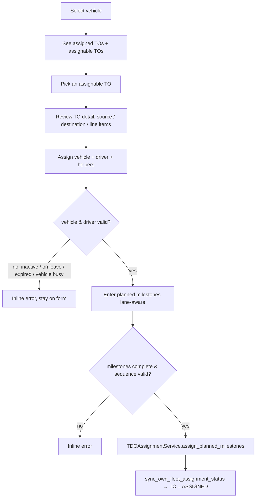

# Vehicle Planning View — Django Admin Implementation Plan

## 1. Business problem

Today, a Transport Planner assigns resources to a Transport Order (TO) by opening each
**TO** and picking a vehicle/driver/milestones on the TO change form. There is no
**vehicle-centric** planning surface: the planner cannot start from *"which vehicle am I
planning?"*, see everything already on that vehicle, and pull an unassigned TO onto it.

This plan adds a **Vehicle Planning** menu for the Transport Planner / admin:

1. **Select a vehicle** from a search/dropdown.
2. See **all TOs already assigned** to that vehicle.
3. See **assignable (unassigned) TOs** that fit the vehicle, and assign one.
4. Before confirming, **review the TO detail** — source POI, destination POI, and line
   items.
5. On assignment, capture **driver + helpers + planned milestones**, which drives the TO
   to **`ASSIGNED`** through the existing lifecycle rules.

This is a **new admin view over existing models and services** — no new data model.

---

## 2. Terminology & model reconciliation

| Business term | Code |
|---|---|
| Vehicle | `master_data.Vehicle` (own fleet; has `Vehicle` FK) |
| TO | `transport.TransportOrder` |
| "TOs assigned to a vehicle" | `vehicle.transport_orders` (reverse of `TransportOrder.vehicle` FK) |
| Source / destination | `to.origin_poi` / `to.destination_poi` |
| Line items | `to.line_items` (`TOLineItem`) |
| Planned milestones | five datetime fields on `TransportOrder` (lane-aware) |

The truth of *"this TO is on this vehicle"* already lives on `TransportOrder.vehicle`.
**No `VehiclePlan` / `Assignment` model is added** — a second store would drift from the TO.

---

## 3. Scope

| In scope (v1) | Out of scope (v1) |
|---|---|
| Own-fleet vehicles only (vehicle dropdown/search) | Vendor fleet (no `Vehicle` FK — free-text registration) |
| Assign an unassigned own-fleet TO to a vehicle | Reassigning an already-assigned TO to another vehicle |
| Capture vehicle + driver + helpers + planned milestones | Bulk / multi-TO assignment on one submit |
| TO detail preview (source, destination, line items) | Editing TO line items from this view |
| Auto-transition to `ASSIGNED` via existing services | New status transitions or lifecycle changes |
| RBAC: Transport Planner + tenant admin | Driver-supervisor dispatch (already exists elsewhere) |

**Decisions confirmed with problem owner:**

1. **Full capture** — vehicle + driver + helpers + milestones on this page, so the TO can
   reach `ASSIGNED` here.
2. **Own fleet only** for the vehicle selector.
3. **Strict assignable filter** — own-fleet, unassigned, `CREATED`/`UNDER_PLANNING`,
   matching `vehicle_type`, passing the availability check.
4. **Assign-only** — no reassignment in v1.

---

## 4. Assignment / status logic (reused, not re-implemented)

A TO reaches `ASSIGNED` **only** when vehicle **+ driver + all required planned
milestones** are set. This is enforced today by `own_fleet_ready_for_assigned_status`
and applied by `TDOAssignmentService.sync_own_fleet_assignment_status`. This view does
**not** invent a new "confirm → assigned" step: completing the inputs is what promotes
the TO.



**UX note (important):** vehicle and driver validation can fail *after* a TO is picked
(driver on leave / license expired / vehicle already actively serving). So the assign
panel is **two-step**: resources first (validated inline), then the milestone form. This
mirrors the existing `TDOAssignmentService` call order — no new business logic.

---

## 5. Assignable-TO filter (strict)

An unassigned TO appears in the "assignable" list for a selected vehicle when **all** of:

| Condition | Source |
|---|---|
| `fleet_type == OWN` | `TransportOrder.fleet_type` |
| `vehicle IS NULL` | `TransportOrder.vehicle_id` |
| `status in {CREATED, UNDER_PLANNING}` | `TOStatus` |
| `vehicle_type` matches the selected vehicle | `own_fleet_validation.validate_vehicle_matches_to_type` |
| vehicle passes availability for this TO | `own_fleet_validation.validate_vehicle_available_for_assignment` / `assignment_availability` |

Capacity fit is shown as an **advisory** (not a hard filter) via
`vehicle_capacity.assess_capacity_fit`.

---

## 6. Technical design

### 6.1 Permission + menu

- **`apps/core/constants_rbac.py`** — add `MENU_VEHICLE_PLANNING_VIEW`.
- **Role seed** — grant `MENU_VEHICLE_PLANNING_VIEW` to `transport_planner` (+ tenant admin
  via existing override), following the existing role-access seeding pattern.
- **`apps/core/portal_navigation.py`** — add one item to the **Transport** section:

```python
{
    "id": "vehicle_planning",
    "label": "Vehicle planning",
    "url": "/admin/transport/transportorder/vehicle-planning/",
    "icon": "truck-front",  # bootstrap-icons, consistent with existing "truck"
    "permission_any": [PermissionCodes.MENU_VEHICLE_PLANNING_VIEW],
    "role_any": ["transport_planner"],
    "role_exclude": ["driver_supervisor"],
},
```

### 6.2 Custom admin views — `apps/transport/admin.py` (`TransportOrderAdmin.get_urls()`)

Follows the in-repo precedent of `fleet_supervisor` `dispatch_queue_view` /
`maintenance_queue_view` (custom `get_urls()` + `TemplateResponse` + `admin_site.each_context`).

| URL name | Path | Purpose |
|---|---|---|
| `transport_transportorder_vehicle_planning` | `vehicle-planning/` | Vehicle search / select landing |
| `transport_transportorder_vehicle_planning_board` | `vehicle-planning/<uuid:vehicle_id>/` | Assigned TOs + assignable TOs for that vehicle |
| `transport_transportorder_vehicle_planning_assign` | `vehicle-planning/<uuid:vehicle_id>/assign/<uuid:to_id>/` | TO detail + resource + milestone form (GET), submit (POST) |

All wrapped in `self.admin_site.admin_view(...)`, platform-tenant excluded, gated by the
planner/admin RBAC check (reuse `user_can_assign_own_fleet_transport_order()`).

**Landing view** — vehicle selector (own-fleet, active). Reuse the search UX of
`maintenance_queue_view` (`?search=` on `registration_number`) or an autocomplete.

**Board view** context:
- `vehicle`
- `assigned_tos` = `vehicle.transport_orders` (with status badge, planned dest arrival)
- `assignable_tos` = strict filter (§5), each with capacity-fit advisory + assignment gaps
  (`planned_milestones.own_fleet_assignment_gaps`)

**Assign view**:
- GET → TO detail panel (source POI, destination POI, ordered `line_items`) + resource
  fields (driver, helpers) + planned-milestone form pre-filled from
  `planned_milestones.get_planned_milestone_suggestions`.
- POST → in order, inside the service's own `@transaction.atomic`:
  1. `TDOAssignmentService.assign_vehicle(to, vehicle_id)`
  2. `TDOAssignmentService.assign_driver(to, driver_id)`
  3. `TDOAssignmentService.assign_helpers(to, helper_ids)`
  4. `TDOAssignmentService.assign_planned_milestones(to, ...)`
  - `BusinessRuleError` → `messages.error` + re-render form (inline), matching
    `_admin_business_rule_message` handling used in `fleet_supervisor/admin.py`.

### 6.3 Templates (design consistency + professional planning view)

New templates under `templates/admin/transport/vehicle_planning/`, all
`` and using the **DFMS design system already in
`static/admin/css/custom.css`** — no new CSS framework:

| Template | Notes |
|---|---|
| `select_vehicle.html` | Search box + vehicle result cards/table; `.listing` table, `dfms-badge` for operational status |
| `board.html` | Two panels: **Assigned to this vehicle** and **Assignable TOs**; `#result_list.listing` tables, `dfms-badge--*` status chips, `.button` / `.button default` actions (same classes as `dispatch_queue.html`) |
| `assign.html` | TO detail summary (source → destination, line-item table with qty/kg), driver/helper selectors, lane-aware milestone datetime inputs; submit buttons follow the DFMS button classes (`dfms-btn-save`, `dfms-btn-secondary`) |

Design consistency rules to honour:
- Status chips reuse existing badge modifiers: `dfms-badge--under-planning`,
  `dfms-badge--approved`, `dfms-badge--neutral`, `dfms-badge--in-progress`,
  `dfms-badge--cancelled` (same mapping as `TOStatus` usage elsewhere).
- Tables use `class="listing"` inside `<div class="results">` (matches
  `dispatch_queue.html`).
- Breadcrumbs per `.cursor/rules/django-admin-draft-submit.mdc`: link Home → Transport
  orders changelist → *Vehicle planning* (never link to `admin:app_list` for operational
  roles).
- Bootstrap-icons already loaded in `base_site.html`; reuse `bi-*` icon set.

**Professional planning view intent:** the board reads as a dispatcher's worklist — one
vehicle in focus, a clear "already planned" panel vs. an "available to plan" panel, each
TO row showing origin → destination, quantity, planned window, and a visible
**assignment-gap / capacity-fit** hint so the planner knows what's missing before the TO
can go `ASSIGNED`.

### 6.4 Query optimization

```python
# Board — assigned
vehicle.transport_orders.select_related("origin_poi", "destination_poi", "driver__user")

# Board — assignable
TransportOrder.objects.filter(
    fleet_type=FleetType.OWN, vehicle__isnull=True,
    status__in=[TOStatus.CREATED, TOStatus.UNDER_PLANNING],
).select_related("origin_poi", "destination_poi").prefetch_related("line_items__product")
```

---

## 7. Reused code (do not re-implement)

| Need | Reuse from |
|---|---|
| Assign vehicle / driver / helpers / milestones | `apps/transport/services.py :: TDOAssignmentService` |
| `ASSIGNED` promotion rule | `apps/transport/planned_milestones.py :: own_fleet_ready_for_assigned_status` |
| Missing-input hints | `apps/transport/planned_milestones.py :: own_fleet_assignment_gaps` |
| Milestone pre-fill suggestions | `apps/transport/planned_milestones.py :: get_planned_milestone_suggestions` |
| Vehicle type / availability validation | `apps/transport/own_fleet_validation.py`, `assignment_availability.py` |
| Capacity-fit advisory | `apps/transport/vehicle_capacity.py :: assess_capacity_fit` |
| Custom admin view pattern | `apps/fleet_supervisor/admin.py :: dispatch_queue_view` |
| BusinessRuleError message formatting | `apps/fleet_supervisor/admin.py :: _admin_business_rule_message` |
| Planner/admin RBAC gate | `user_can_assign_own_fleet_transport_order()` |

---

## 8. Success criteria

1. `transport_planner` (and tenant admin) sees a **Vehicle planning** item in the Transport
   menu; other roles (incl. `driver_supervisor`, platform) do not.
2. Landing page lets the planner search/select an **own-fleet** vehicle.
3. Board shows that vehicle's **assigned TOs** and the **strict** set of assignable TOs.
4. Opening an assignable TO shows its **source, destination, and line items** before
   assignment.
5. Submitting vehicle + driver + helpers + complete, valid milestones transitions the TO to
   **`ASSIGNED`**; an incomplete submit leaves it `CREATED`.
6. Invalid driver (inactive / on leave / expired license), busy vehicle, or bad milestone
   sequence surface as **inline errors** without corrupting state.
7. Templates visually match the existing DFMS admin (badges, tables, buttons, breadcrumbs).

---

## 9. Files touched

| File | Change |
|---|---|
| `apps/core/constants_rbac.py` | Add `MENU_VEHICLE_PLANNING_VIEW` |
| `apps/requisitions/role_access.py` (or role seed) | Grant new permission to `transport_planner` |
| `apps/core/portal_navigation.py` | Add "Vehicle planning" item to Transport section |
| `apps/transport/admin.py` | Add 3 custom URLs + views on `TransportOrderAdmin` |
| `templates/admin/transport/vehicle_planning/select_vehicle.html` | **New** — vehicle selector |
| `templates/admin/transport/vehicle_planning/board.html` | **New** — assigned + assignable panels |
| `templates/admin/transport/vehicle_planning/assign.html` | **New** — TO detail + resource + milestone form |

No new models, no migrations (permission seeding aside), no changes to lifecycle services.

---

**Last Updated**: 2026-09-01
