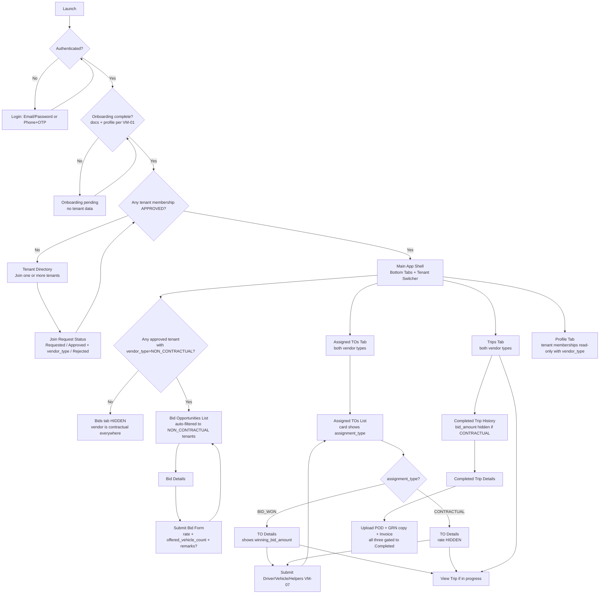
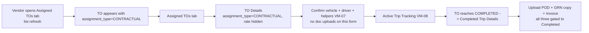

# Vendor Mobile — Navigation & Information Architecture (IA)

## Goals

- Define a **single, consistent** navigation model across all Vendor Mobile feature specs.
- Make **access gating** explicit (onboarding completeness + tenant membership approval + per-tenant vendor type).
- Support **multi-tenant** vendors (join multiple tenants; view data per-tenant).
- Make **Contractual vs Non-Contractual** flow branching explicit at the IA level so engineers know which screens are conditional.

---

## Access gating (what becomes visible when)

### 1) Authentication (login)

- Vendor authenticates via:
  - Email/Password, or
  - Phone + OTP

### 2) Platform onboarding gate (vendor status)

- Until **onboarding** is complete (mandatory documents + profile per VM-01), vendor is **platform-inactive** and cannot:
  - List tenants
  - Submit tenant join requests
  - View any tenant bids / TOs / trips

> Note: there is **no** Platform Admin approve/reject step. Gating is **completeness-based**.

### 3) Tenant membership gate (per-tenant approval)

- After onboarding is complete, vendor can request to join **one or more tenants** (VM-02).
- Vendor can view bids/TOs/trips **only for tenants where membership is `APPROVED`**.

### 4) **Vendor-type gate (per tenant)** — the bidding fork

- On approving a join request, the **Tenant Admin assigns `vendor_type`** for that **(vendor, tenant)** pair: `CONTRACTUAL` or `NON_CONTRACTUAL` (VM-02).
- This drives **screen visibility** for that tenant only:

  | Mobile surface | `CONTRACTUAL` | `NON_CONTRACTUAL` |
  |---|---|---|
  | **Bids** tab → opportunities list | **Empty / hidden** for this tenant | Populated |
  | **Bids** tab → bid submission form | Not accessible | Accessible |
  | **Assigned TOs** tab | Populated (direct assignments) | Populated (won bids) |
  | **Trips** tab | Populated | Populated |
  | Rate / bid_amount on TO Details + Completed Trip History | **Hidden** (rate is contractual + backend-controlled) | Visible (vendor's own bid amount) |
  | **Profile** tab | Same | Same |

- A vendor may have **different vendor types per tenant**. The Tenant switcher (below) is the source of truth for which gating is currently active.

---

## Global navigation model (Phase 1)

### App shell

- **Pre-access:** stack navigation only (no bottom tabs).
- **Post-access (verified + at least one tenant approved):** bottom tab navigation.

### Bottom tabs (post-access)

- **Bids**
- **Assigned TOs**
- **Trips**
- **Profile**

---

## Multi-tenant behavior (how vendor switches tenants)

Vendors may be approved for multiple tenants. The UI must clearly answer: “Which tenant’s data am I looking at?”

### Recommended pattern: Tenant switcher

- A **Tenant selector** is visible on data-bearing tabs:
  - Bids
  - Assigned TOs
  - Trips
- Selector options:
  - **All Approved Tenants** (optional)
  - Each **Approved Tenant** (Tenant A, Tenant B, …)

### Rules

- If current selection is a specific tenant, lists and details are **scoped to that tenant**.
- If “All Approved Tenants” is enabled:
  - Lists merge results across tenants.
  - Every card shows a **Tenant badge/name**.
  - Filters include **Tenant = [A, B, C]**.

### Membership states in Tenant Directory

Tenant cards should display one of:

- **Join** (not requested)
- **Requested** (pending approval)
- **Approved — Contractual** (no bid tab activity expected for this tenant)
- **Approved — Non-Contractual** (bid tab populated for this tenant)
- **Rejected** (with guidance to re-apply or contact admin, if allowed)

> The vendor does **not** choose between Contractual / Non-Contractual; the Tenant Admin sets it at approval. The mobile app shows the assigned type as **read-only** on the tenant card and in the Profile tab's tenant memberships section.

---

## Information Architecture (screen list)

### Pre-access stack

- **Login**
- **Onboarding / Registration** (vendor self-registration on Vendor Mobile — sole entry path; no invite flow in Phase 1)
- **Verification Pending** (blocked state, shows what is missing)
- **Tenant Directory**
- **Join Request Status** (pending / approved / rejected)

### Post-access (bottom tabs)

#### Bids tab — **visible only when at least one approved tenant has `vendor_type=NON_CONTRACTUAL`**

- **Bid Opportunities List** *(Non-Contractual tenants only)*
  - Filters: All / Submitted / Urgent
  - Search: TO number, POIs, product name
- **Bid Details (TO details)** *(Non-Contractual only)*
- **Bid Submission Form** *(Non-Contractual only — rate + offered vehicle count + remarks?)*
- **Bid Submission Confirmation**

> If a vendor is `CONTRACTUAL` for **all** their approved tenants, the **Bids tab is hidden** from the bottom tab bar.
> If a vendor is `NON_CONTRACTUAL` for some tenants and `CONTRACTUAL` for others, the **Bids tab is visible** but the list is auto-filtered to **only** non-contractual tenants (regardless of tenant switcher selection).

#### Assigned TOs tab — **both vendor types**

- **Assigned TOs List**
  - Filters: All / Pending Assignment / In Progress / Completed
  - Each card shows `assignment_type: BID_WON | CONTRACTUAL`
- **TO Details**
  - For `assignment_type=CONTRACTUAL`: **rate field is hidden**
  - For `assignment_type=BID_WON`: shows `winning_bid_amount`
- **Post-award Submission** (Driver/Vehicle/Helpers per-TO) — same form for both types (VM-07)

#### Trips tab — **both vendor types**

- **Active Trips**
  - Active Trip Tracking (map + status timeline + call driver)
- **Completed Trip History**
  - Filters: date range, payment status, assignment type
  - For `assignment_type=CONTRACTUAL`: `bid_amount` is **hidden / replaced with "—"** in cards and detail; `payment_status` still shown
- **Completed Trip Details** — **the only vendor mobile surface for POD / GRN / Invoice uploads**
  - **Upload POD** (vendor record copy) — gated to `to_status=COMPLETED`
  - **Upload GRN copy** — gated to `to_status=COMPLETED`
  - **Upload Invoice** — gated to `to_status=COMPLETED`
  - Download POD / GRN / Invoice (if previously uploaded)

#### Profile tab — **both vendor types**

- **Vendor Profile**
  - Vendor information + contact details
  - Documents/status (as applicable)
  - **Tenant memberships** section: list of `(tenant, status, vendor_type)` read-only
  - Note: no driver/vehicle master lists in Phase 1

---

## Navigation flow (end-to-end, vendor-type aware)

---

## Vendor-type sub-flows (entry → execution)

> The TO-assignment fork happens **off-app** (TDO action). The mobile app reflects the outcome differently based on `assignment_type` on the assigned TO. Phase 1 vendor mobile has **no notifications** — vendors discover newly assigned TOs / published bids by refreshing the relevant tab.

### Contractual entry (no bidding)

### Non-Contractual entry (bidding)

```mermaid
flowchart LR
  REF[Vendor opens Bids tab<br/>list refresh] --> BL[Bid Opportunities list<br/>shows new TOs]
  BL --> BD[Bid Details / TO requirements]
  BD --> BS[Submit bid: rate + offered_vehicle_count]
  BS --> WAIT[Status badge: Submitted]
  WAIT --> OUT{TDO decision VM-06}
  OUT -- Rejected / Reject-all --> ENDX[Bid card flips to Not awarded on next refresh]
  OUT -- Won --> ATO[Assigned TOs tab<br/>assignment_type=BID_WON, winning_bid_amount visible]
  ATO --> VM7[Confirm vehicle + driver + helpers VM-07<br/>no doc uploads on this form]
  VM7 --> TRIP[Active Trip Tracking VM-08]
  TRIP --> COMP[TO reaches COMPLETED -> Completed Trip Details<br/>bid_amount visible]
  COMP --> UP[Upload POD + GRN copy + Invoice<br/>all three gated to Completed]
```

---

