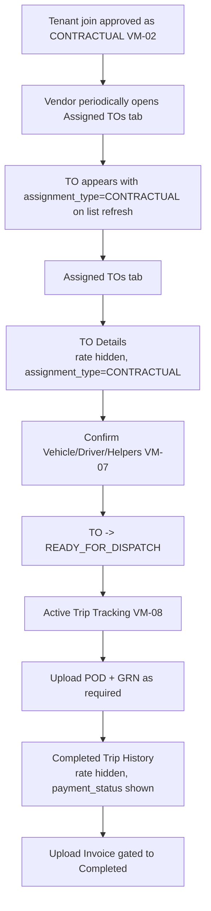
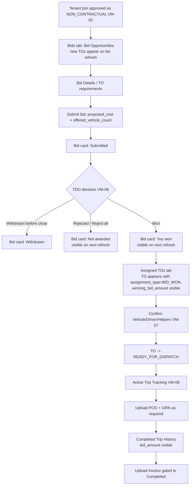

# Vendor Mobile — Contractual vs Non-Contractual User Journeys

This file is the **canonical map** of how Contractual and Non-Contractual vendor types behave on the Vendor Mobile app. It exists to keep the rest of the screen specs short and consistent, and to give engineers / designers / QA one place to reason about per-vendor-type behavior.

## 1. Where the type comes from

`vendor_type` is **not** chosen by the vendor. It is set by the **Tenant Admin** when **approving** a tenant-join request (VM-02).

- It is stored **per (vendor, tenant)** pair on the membership record.
- A single vendor MAY be:
  - `CONTRACTUAL` for Tenant A
  - `NON_CONTRACTUAL` for Tenant B
  - Pending / Rejected for Tenant C
- Mobile gating evaluates **per tenant**, not globally.

## 2. The TO-assignment fork (off-app)

The actual TO assignment happens **off-app** in TDO surfaces. The mobile app reflects the outcome:

| Vendor type (for tenant T) | TO assignment path | Mobile entry point |
|---|---|---|
| `CONTRACTUAL` | TDO direct assignment (TEVF-01) | TO appears in **Assigned TOs** tab with `assignment_type=CONTRACTUAL` |
| `NON_CONTRACTUAL` | TDO publishes (VM-04) → vendor bids (VM-05) → TDO awards (VM-06) | Bid appears in **Bids** tab; on win, TO appears in **Assigned TOs** tab with `assignment_type=BID_WON` |

> The mobile app does **not** decide assignment. It must correctly reflect `assignment_type` from the server and apply the rendering rules in §4.

## 3. Per-tenant gating matrix

For each approved tenant, the mobile app evaluates these rules:

| Surface | `CONTRACTUAL` | `NON_CONTRACTUAL` |
|---|---|---|
| Show in tenant switcher | Yes | Yes |
| Tenant card label | "Approved — Contractual" | "Approved — Non-Contractual" |
| Bid opportunities (03) | **Empty for this tenant** | Populated |
| Bid submission (04) | Not reachable | Reachable |
| Assigned TOs (05) | Populated (direct assignments) | Populated (won bids) |
| Active Trip tracking (07) | Populated | Populated |
| Completed Trip history (08) | Populated; **rate hidden** | Populated; vendor's `bid_amount` visible |
| Profile (09) memberships row | "Contractual" (read-only) | "Non-Contractual" (read-only) |

### Bids tab visibility (whole-app rule)

- **Hidden** if vendor is `CONTRACTUAL` for **every** approved tenant.
- **Visible** if vendor is `NON_CONTRACTUAL` for at least one approved tenant. The list is auto-filtered to NC tenants regardless of tenant switcher selection.

## 4. Rendering rules per assigned TO

Render decisions are driven by the **`assignment_type`** field on the TO, NOT by global vendor flags. This keeps mixed vendors (NC for one tenant, C for another) rendered correctly.

| Field / element | `assignment_type=BID_WON` | `assignment_type=CONTRACTUAL` |
|---|---|---|
| Card chip | "Bid Won" | "Contractual" |
| `winning_bid_amount` | Show | **Hide / omit** |
| Contractual / payable rate | n/a | **Hide / omit** (backend MUST NOT return) |
| `awarded_vehicle_count` | Show | Show (from contractual allocation) |
| "Confirm Vehicle & Driver" CTA | Show until confirmed | Show until confirmed |
| POD / GRN upload | Same rules (per policy) | Same rules (per policy) |
| Invoice upload | Gated to Completed | Gated to Completed |
| Status timeline (VM-08) | Same | Same |

## 5. How vendors discover events (no notifications in mobile app)

Phase 1 vendor mobile has **no notifications** — no push, no in-app banners, no email/SMS triggered by the app. Vendors discover events by opening the app and viewing the relevant tab. State is refreshed via list/detail polling (see `07-active-trip-tracking.md` for trip polling cadence; bid/TO list refresh on pull-to-refresh or tab focus).

| Event | How a Contractual vendor sees it | How a Non-Contractual vendor sees it |
|---|---|---|
| Bid published (VM-04) | — (no bids on this tenant) | TO appears in Bid Opportunities list on next refresh |
| Bid closing soon | — | `time_remaining` field decreases on each list refresh |
| Award won (VM-06) | — | Bid card status flips to "You won"; TO appears in Assigned TOs tab |
| Award lost / reject-all | — | Bid card status flips to "Not awarded" |
| TO assigned directly (TEVF-01) | TO appears in Assigned TOs tab on next refresh | — |
| Status change (Assigned / Completed / Closed — VM-08) | TO status field updates on next poll | Same |

> If a notification subsystem is introduced later, it would be additive — the mobile app must still function correctly via polling alone.

## 6. Full mobile journey (mermaid)

### Contractual end-to-end (this tenant)



### Non-Contractual end-to-end (this tenant)



## 7. State machine reference

### Bid lifecycle (Non-Contractual only)

```
            ┌──── (vendor submit) ────┐
[no bid] ───┤                          ├──> SUBMITTED ──(TDO award)──> ACCEPTED
            │                          ├──> SUBMITTED ──(TDO reject/reject-all)──> REJECTED
            │                          └──> SUBMITTED ──(vendor withdraw if policy)──> WITHDRAWN
            └─ (window closes, no submit) ──> no-bid (terminal, no record on vendor side)
```

### TO lifecycle (both vendor types — VM-08 + VM-07)

```
ASSIGNED ──(VM-07 confirm vehicle/driver/helpers)──> READY_FOR_DISPATCH
       ──(dispatch)──> IN_PROGRESS
       ──(arrived/loaded/unloaded steps — own-fleet or vendor-fleet domain)──>
       ──(yard / supervisor / driver actions)──>
       COMPLETED ──(closure)──> CLOSED
```

Invoice upload is **only** valid once `to_status >= COMPLETED`.

## 8. Server-side enforcement summary (must-haves)

- Bid endpoints (VM-05) MUST reject calls from members whose `vendor_type != NON_CONTRACTUAL` for the TO's tenant.
- Bid list endpoints (VM-03 / VM-04 consumption) MUST NOT return TOs to vendors who are not `(APPROVED, NON_CONTRACTUAL)` for the owning tenant.
- TO list/detail endpoints MUST NOT return rate fields when `assignment_type=CONTRACTUAL`, regardless of caller's other memberships.
- Invoice upload endpoint MUST reject before `to_status=COMPLETED` (both types).
- VM-07 confirmation endpoint MUST be reachable for both `assignment_type` values; the form contract is identical.

## 9. Open questions / future hooks

- **Type change** (Contractual ↔ Non-Contractual within same tenant) — not in Phase 1; controlled Tenant Admin action only. Mobile would show updated chip on next sync; in-flight bids would need a policy decision (out of scope).
- **Hybrid auctions** (contractual fallback when no acceptable bid) — out of scope for Phase 1.
- **Vendor self-service vendor-type request** — out of scope; type remains Tenant-Admin-controlled.
