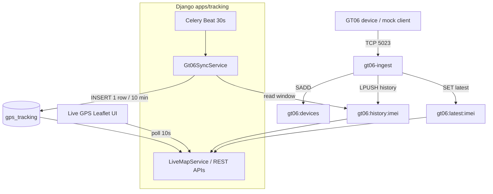

---

## module: 09-tracking
specification: GT06 ingest + Live GPS backend architecture
version: 1.0
phase: Phase 1
sprint: Sprint 5
last_updated: 2026-06-07
related_stories: GPS-01 (DFS-070)
status: Implemented (MVP)
code_root: apps/tracking
service_root: services/gt06-ingest
supersedes:
  - live-gps-sprint5-implementation.md
  - ../../06-contracts/04-integration/gt06-ingest-server.md

# GT06 Server & Live GPS — Backend Architecture

> **Single source of truth** for GPS tracking implementation in DFMS.  
> **Product / sprint context:** [GPS-01 story](../../03-backlog/sprints/sprint-5/12-gps-maps-dashboard/GPS-01-maps-dashboard-gps-tracking.md)  
> **Hardware:** Jimi IoT GT06N (Concox GT06 protocol over TCP)

---

## How to use this document

An engineer or AI agent should be able to:

1. Understand the full pipeline: device → Redis → Postgres → API → map UI.
2. Know which files to change for ingest, sync, APIs, or map behaviour.
3. Carry forward Phase 1 work without re-discovering architecture.

**Code roots**


| Area                        | Path                                     |
| --------------------------- | ---------------------------------------- |
| GT06 TCP ingest sidecar     | `services/gt06-ingest/`                  |
| Django tracking module      | `apps/tracking/`                         |
| Live GPS SSR + Leaflet UI   | `templates/admin/tracking/live_gps.html` |
| Five-truck mock (removable) | `apps/tracking/mock/`                    |


---

## Executive summary

Sprint 5 delivers a **tenant-scoped Live GPS MVP**: a read-only map of vehicles on **active trips** with live position/speed from **Redis**, downsampled trail in **Postgres**, history modal, and follow panels. Location enters via **GT06 device ingest** (Concox sidecar) or **demo/mock seeding**; production GPSWOX REST polling remains deferred.


| Track                                        | Sprint 5 status |
| -------------------------------------------- | --------------- |
| Live GPS admin page + APIs                   | **Done**        |
| `GPSTracking` model + migration              | **Done**        |
| GT06 ingest + Redis + Celery sync            | **Done**        |
| Hybrid storage (Redis live + Postgres trail) | **Done**        |
| History graph + activity summary APIs        | **Done**        |
| Five-truck OSM mock fleet                    | **Done**        |
| Map SDK (Leaflet + OpenStreetMap)            | **Done**        |
| Geofence engine / dwell / TLS timeline       | **Deferred**    |
| Full `/api/v1/maps/`** dashboard             | **Deferred**    |


### Storage at a glance


| Tier                                                   | Update rate                            | Read by                        | Write by                         |
| ------------------------------------------------------ | -------------------------------------- | ------------------------------ | -------------------------------- |
| **Redis** `gt06:latest:{imei}` + `gt06:history:{imei}` | Each GT06 packet (~10s)                | `LiveMapService`, history APIs | `gt06-ingest`                    |
| **Postgres** `gps_tracking`                            | **One row per 10 min** per trip (prod) | Trail fallback, history merge  | `Gt06SyncService` via Celery     |
| **Live map UI**                                        | Poll every **10s**                     | —                              | `GET /api/v1/tracking/live-map/` |


**Postgres row rules** (each 10-minute flush): **last** lat/lng in window; `**speed_kmh` = mean** of non-null speeds in window (0 counts).

---

## 1. What is the GT06 ingest server?

DFMS runs its **own GT06 TCP ingest server** instead of TrackSolid / GPSWOX as the system of record.


| Component                     | Role                                                                                   |
| ----------------------------- | -------------------------------------------------------------------------------------- |
| `**services/gt06-ingest/`**   | Device gateway — TCP listener, protocol parse, ACK, Redis writer                       |
| `**apps/tracking/` (Django)** | Business layer — IMEI → vehicle → trip, Redis → Postgres sync, REST APIs, Live GPS map |


The ingest sidecar does **not** know tenants, trips, or Postgres. Django owns business rules and persistence.

**Why Redis first?** ~10s device reports would bloat Postgres. Redis = **live view**; Postgres = **downsampled trail**.

---

## 2. The big picture

Instead of relying on third-party platforms like TrackSolid or GPSWOX to store and serve GPS data, DFMS runs its own TCP server that directly receives raw binary packets from Jimi IoT GT06N GPS trackers installed in vehicles.


| Interval   | What happens                                              |
| ---------- | --------------------------------------------------------- |
| **~10s**   | GT06 device → `gt06-ingest` → Redis                       |
| **10s**    | Browser `GET /api/v1/tracking/live-map/` → Redis latest   |
| **30s**    | Celery **checks** Postgres gate (usually skips)           |
| **10 min** | Celery **inserts one** `gps_tracking` row when gate opens |


**Live map never waits for Celery** — operators see instantaneous speed from Redis.

**Identity chain**

```
IMEI (device login)
  → Vehicle.gps_tracker_id (master_data)
    → Trip (TRACKABLE_TRIP_STATUSES)
      → gps_tracking rows (Postgres)
```

**Separate path (not GT06, not wired to Live GPS today):**

```text
Driver mobile app ──POST /api/v1/tracking/location/──► GPSTracking (Postgres direct)
```

---

## 3. Data flow

### 3.1 Endpoint call map


| #   | Caller              | Calls                                           | Handler                                                                 | Reads                    | Writes                               |
| --- | ------------------- | ----------------------------------------------- | ----------------------------------------------------------------------- | ------------------------ | ------------------------------------ |
| A   | GT06 device / mock  | **TCP** `gt06-ingest:5023`                      | `tcp_server.py`                                                         | —                        | Redis `latest`, `history`, `devices` |
| B   | Browser (10s poll)  | `GET /api/v1/tracking/live-map/`                | `LiveMapView` → `LiveMapService`                                        | Redis + Postgres         | —                                    |
| C   | Browser (history)   | `GET /api/v1/tracking/vehicle-history/`         | `VehicleHistoryService`                                                 | Postgres + Redis history | —                                    |
| D   | Browser (history)   | `GET /api/v1/tracking/vehicle-history-summary/` | `VehicleHistorySummaryService` → `**VehicleHistoryService` (internal)** | Same as C                | —                                    |
| E   | Celery Beat (30s)   | `tracking.sync_gt06_all_tenants`                | `Gt06SyncService`                                                       | Redis                    | Postgres *(if ≥10 min gate)*         |
| F   | Driver app (future) | `POST /api/v1/tracking/location/`               | `LocationUpdateView`                                                    | —                        | Postgres + `evaluate_geofence`       |
| G   | Ops / curl          | `GET gt06-ingest:8080/...`                      | FastAPI                                                                 | Redis                    | —                                    |
| H   | Browser (popup)     | `GET nominatim.openstreetmap.org/reverse`       | External                                                                | OSM                      | —                                    |


**Production Live GPS does not call gt06-ingest HTTP (`:8080`).** Django reads Redis via `Gt06RedisReader`.

### 3.2 ASCII overview

```text
┌─────────────────┐     TCP :5023      ┌──────────────────┐
│ GT06N device    │ ─────────────────► │ gt06-ingest      │
│ (or mock client)│                    │ parse + ACK      │
└─────────────────┘                    └────────┬─────────┘
                                                ▼
                                       ┌──────────────────┐
                                       │ Redis DB 3       │
                                       │gt06:latest:{imei}│
                                       │gt06:history:{imei}
                                       └────────┬─────────┘
                    ┌──────────────────────────┼──────────────────────────┐
         every 10s  ▼                          │ every 30s (check)        │
         ┌────────────────────┐               ▼                          │
         │ GET live-map API   │      ┌──────────────────┐                 │
         │ LiveMapService     │      │ Celery sync      │                 │
         └─────────┬──────────┘      └────────┬─────────┘                 │
                   ▼                           │ INSERT if ≥10 min        ▼
         ┌────────────────────┐      ┌──────────────────┐                 │
         │ Live GPS map (UI)  │      │ gps_tracking     │◄────────────────┘
         └────────────────────┘      │ (Postgres)       │
                                     └──────────────────┘
```

### 3.3 Mermaid




### 3.4 Redis keys and event shape

**Location JSON** (each `0x12` packet):

```json
{
  "event_type": "location",
  "imei": "353419032348801",
  "latitude": 23.815519,
  "longitude": 90.388503,
  "speed_kmh": 58,
  "heading": 142,
  "satellite_count": 8,
  "recorded_at": "2026-06-07T14:00:00+00:00",
  "received_at": "2026-06-07T14:00:01+00:00"
}
```


| Redis key             | Type           | Writer      | Reader                              |
| --------------------- | -------------- | ----------- | ----------------------------------- |
| `gt06:latest:{imei}`  | String (JSON)  | gt06-ingest | `LiveMapService`, `Gt06SyncService` |
| `gt06:history:{imei}` | List (max 500) | gt06-ingest | Trail, sync avg, history APIs       |
| `gt06:devices`        | Set of IMEIs   | gt06-ingest | `Gt06SyncService.list_imeis()`      |
| `gt06:device:{imei}`  | Hash           | gt06-ingest | HTTP `/devices` debug API           |


`GT06_REDIS_URL` — default `redis://redis:6379/3` (separate from Celery broker DB 0, cache DB 1).


| Field         | Meaning                                  |
| ------------- | ---------------------------------------- |
| `recorded_at` | Device clock                             |
| `received_at` | Server ingest — **live vs stale** on map |
| `speed_kmh`   | **Instantaneous** — live marker only     |


---

## 4. Django layering


| Layer            | Path                                                             | Responsibility                                                                         |
| ---------------- | ---------------------------------------------------------------- | -------------------------------------------------------------------------------------- |
| GT06 sidecar     | `services/gt06-ingest/`                                          | TCP protocol, Redis writer, optional HTTP read API                                     |
| Redis reader     | `apps/tracking/gt06_store.py`                                    | `Gt06RedisReader`                                                                      |
| Postgres sync    | `apps/tracking/sync_service.py`                                  | IMEI → `Vehicle` → `Trip` → `GPSTracking`                                              |
| Live map payload | `apps/tracking/live_map_service.py`                              | Latest position, trail, movement status                                                |
| History          | `apps/tracking/history_service.py`, `history_summary_service.py` | Chart + activity cards                                                                 |
| Movement         | `apps/tracking/movement_status.py`                               | moving / idle / parked / offline                                                       |
| REST API         | `apps/tracking/views.py`, `urls.py`, `permissions.py`            | `LiveMapView`, `VehicleHistoryView`, `VehicleHistorySummaryView`, `LocationUpdateView` |
| SSR page         | `apps/tracking/portal_views.py`                                  | `live_gps_page`                                                                        |
| Map UI           | `templates/admin/tracking/live_gps.html`                         | Leaflet, polling, follow, history                                                      |
| Celery           | `apps/tracking/tasks.py`                                         | `sync_gt06_`*, `evaluate_geofence`                                                     |
| Mock fleet       | `apps/tracking/mock/`                                            | OSM routes, simulator, GT06 client                                                     |


---

## 5. API endpoints

### 5.1 GT06 ingest HTTP (debug / ops only)

Base: `http://gt06-ingest:8080`


| Method | Path                                | Purpose                         |
| ------ | ----------------------------------- | ------------------------------- |
| `GET`  | `/health`                           | Health + active TCP connections |
| `GET`  | `/devices`                          | Registered IMEIs                |
| `GET`  | `/devices/{imei}/latest`            | Latest location JSON            |
| `GET`  | `/devices/{imei}/history?limit=100` | Recent history                  |


Implementation: `services/gt06-ingest/gt06_server/api/app.py`

### 5.2 Django tracking REST (production)

Base: `/api/v1/tracking/`  
Auth: `IsTenantUser` + `CanViewLiveGps` (`Menu.LiveGps.View`; tenant/super admin bypass)


| Method | Path                        | Service                          | Purpose                                            |
| ------ | --------------------------- | -------------------------------- | -------------------------------------------------- |
| `GET`  | `/live-map/`                | `LiveMapView` → `LiveMapService` | Fleet snapshot for map                             |
| `GET`  | `/vehicle-history/`         | `VehicleHistoryService`          | Speed/position time series                         |
| `GET`  | `/vehicle-history-summary/` | `VehicleHistorySummaryService`   | Drive / stopped / parked cards                     |
| `POST` | `/location/`                | `LocationUpdateView`             | Driver app GPS (not GT06; not used by Live GPS UI) |


#### `GET /api/v1/tracking/live-map/`

Poll every **10 seconds** (`LIVE_MAP_REFRESH_SECONDS`).

**Example response:**

```json
{
  "success": true,
  "refreshed_at": "2026-06-07T14:00:00+00:00",
  "refresh_interval_seconds": 10,
  "signal_lost_minutes": 10,
  "moving_speed_kmh": 3.0,
  "parked_min_minutes": 10,
  "vehicle_count": 1,
  "vehicles": [
    {
      "trip_id": "uuid",
      "trip_number": "TRIP-…",
      "trip_status": "en_route_to_destination",
      "trip_status_label": "En Route to Destination",
      "transport_order_id": "uuid",
      "to_number": "TO-…",
      "vehicle_id": "uuid",
      "registration_number": "DH-GA-18-4521",
      "driver_name": "Driver One",
      "latitude": 23.8103,
      "longitude": 90.4125,
      "speed_kmh": 58.0,
      "heading_degrees": 142,
      "recorded_at": "2026-06-07T13:59:50+00:00",
      "received_at": "2026-06-07T13:59:51+00:00",
      "device_id": "353419032348801",
      "connection_status": "live",
      "movement_status": "moving",
      "stop_duration_seconds": 0,
      "trail": [[23.81, 90.41], [23.8103, 90.4125]],
      "position_source": "redis",
      "planned_route": [[23.81, 90.38], [22.35, 91.78]]
    }
  ]
}
```


| Rule                | Detail                                                                            |
| ------------------- | --------------------------------------------------------------------------------- |
| `connection_status` | `live` / `stale` / `signal_lost` from `received_at` vs `SIGNAL_LOST_MINUTES` (10) |
| `speed_kmh`         | **Live** — Redis latest; else latest Postgres row                                 |
| `trail`             | Redis history if live (≥2 pts); else Postgres (~10 min spacing)                   |
| `heading_degrees`   | Trail bearing (last 2 points), not raw device course                              |
| `movement_status`   | `moving` / `idle` / `parked` / `offline`                                          |
| `planned_route`     | Mock fleet only — gray dashed OSM corridor                                        |
| Empty `vehicles`    | Valid — no active trackable trip with coordinates                                 |


#### `GET /api/v1/tracking/vehicle-history/`

Query: `trip_id` + `range=last_hour|today|yesterday` OR `from` + `to` (ISO).  
Returns: `points[]` — merges Postgres + Redis for window.

#### `GET /api/v1/tracking/vehicle-history-summary/`

Query: `trip_id` + time window.  
Returns: `events[]` — `trip_start`, `drive`, `stopped`, `parked`, `trip_end`. No fabricated events when GPS missing.

#### `POST /api/v1/tracking/location/`

Driver mobile stub: creates `GPSTracking`, queues `evaluate_geofence`. Permission: `IsTenantUser` only. **Not used by Sprint 5 Live GPS demo.**

### 5.3 Admin UI — Live GPS (SSR)


| Item            | Value                                                                                                     |
| --------------- | --------------------------------------------------------------------------------------------------------- |
| URL             | `/admin/tracking/live-gps/`                                                                               |
| View            | `portal_views.live_gps_page`                                                                              |
| Template        | `templates/admin/tracking/live_gps.html`                                                                  |
| Menu            | Overview → **Live GPS** (`portal_navigation.py`, `Menu.LiveGps.View`)                                     |
| Layout          | DFMS admin shell (sidebar, topbar, breadcrumbs) via `admin.site.each_context(request)` in `live_gps_page` |
| Map             | Leaflet 1.9 + OpenStreetMap tiles                                                                         |
| Refresh         | Client polls `GET /api/v1/tracking/live-map/` every **10s**                                               |
| Vehicle list    | Left panel (Objects); click focuses marker + popup                                                        |
| Marker          | `static/tracking/car_image_marker.png` — rotates with trail heading (0° = north)                          |
| Platform schema | `live_gps_page` redirects to `/admin/` (tenant-only feature)                                              |


---

## 6. GT06 protocol


| Property      | Value                                                                    |
| ------------- | ------------------------------------------------------------------------ |
| Transport     | TCP binary                                                               |
| Framing       | `0x7878` → length → protocol → payload → serial → CRC-16/X-25 → `0x0D0A` |
| Message types | `0x01` login, `0x12` location, `0x13` status, `0x16` alarm               |
| Identity      | IMEI (8-byte BCD in login)                                               |


Per session: login → ACK → location packets → `save_location()` to Redis.

Implementation: `services/gt06-ingest/gt06_server/protocol/`, `tcp_server.py`

---

## 7. Service ports and Celery


| Port   | Protocol | Service                            |
| ------ | -------- | ---------------------------------- |
| `5023` | TCP      | gt06-ingest (devices, mock client) |
| `8080` | HTTP     | gt06-ingest FastAPI (debug)        |
| `8000` | HTTP     | Django (`live-map`, SSR page)      |


**Docker Compose:** `db`, `redis`, `web`, `celery_worker`, `celery_beat`, `gt06-ingest`


| Task                                   | Schedule                     |
| -------------------------------------- | ---------------------------- |
| `tracking.sync_gt06_all_tenants`       | Every 30s (beat)             |
| `tracking.sync_gt06_locations(schema)` | Per tenant (queued by above) |
| `tracking.evaluate_geofence`           | On `POST /location/`         |


**Management command:** `python manage.py sync_gt06_locations --schema=<tenant>`

---

## 8. Device setup and local development

### Quick Operation Instructions

> **Further reference:** Full device behaviour, wiring, LED indicators, and alarm details are in **`GT06N-User-Manual.pdf`** (GT06N User Manual — §5 Quick Operation Instructions, §6 Operation of device).

Send SMS commands to the **SIM card number inside the tracker**. Use **English commas** with **no spaces** before or after commas. Commands end with `#`. On success the device usually replies **`OK`**.

#### DFMS provisioning sequence

Run in order when fitting a new tracker or re-pointing a device to DFMS. Default OEM platform (`tracksolid.com`) is **not used**.

| Step | SMS command | Purpose |
|------|-------------|---------|
| 1 | `APN,<carrier_apn>#` | Carrier GPRS APN |
| 2 | `SERVER,0,<public_ip>,5023,0#` | DFMS `gt06-ingest` — TCP port **5023** |
| 3 | `TIMER,30,300#` | Upload interval: **30s** ACC ON, **300s** ACC OFF |
| 4 | `GPRSON,1#` | Enable GPRS (if disabled) |
| 5 | `GPRSSET#` | Verify APN, server, GPRS status |

```text
APN,<carrier_apn>#
SERVER,0,<public_ip>,5023,0#
TIMER,30,300#
GPRSON,1#
GPRSSET#
```

**Field verification:** `GPRSSET#` should show `GPRS:ON` and `Server:0,<your_ip>,5023,0`. Then confirm IMEI in DFMS and marker on **Overview → Live GPS**.

---

#### SMS command reference (GT06N manual §5)

##### 5.1 APN setting

| Variant | Format | Example |
|---------|--------|---------|
| Basic | `APN,<apn_name>#` | `APN,internet#` |
| With credentials | `APN,<apn>,<user>,<password>#` | `APN,internet,CLIENTE,AMENA#` |

GPRS will not work until APN is correct.

##### 5.2 Server setting

| Mode | Format | Example |
|------|--------|---------|
| **IP** (DFMS) | `SERVER,0,<ip>,<port>,0#` | `SERVER,0,203.0.113.10,5023,0#` |
| DNS | `SERVER,1,<hostname>,<port>,0#` | `SERVER,1,gpsdev.tracksolid.com,21100,0#` |

OEM default is `www.tracksolid.com` — override with the DFMS row above.

##### 5.3 GPRS on / off

| Action | Command |
|--------|---------|
| Enable | `GPRSON,1#` |
| Disable | `GPRSON,0#` |

##### 5.4 Add SOS numbers

Up to **3** numbers for alarms and monitoring.

| Action | Format | Example |
|--------|--------|---------|
| Add up to 3 | `SOS,A,<no1>,<no2>,<no3>#` | `SOS,A,13510905991,13510905992,13510905993#` |
| Slot 1 only | `SOS,A,<no1>#` | `SOS,A,13510905991#` |
| Slot 2 only | `SOS,A,,<no2>#` | `SOS,A,,13510905992#` |
| Slot 3 only | `SOS,A,,,<no3>#` | `SOS,A,,,13510905993#` |

##### 5.5 Delete SOS numbers

Send `PARAM#` first to see serial numbers for stored SOS entries.

| Method | Format | Examples |
|--------|--------|----------|
| By serial (1–3) | `SOS,D,<serial>[,<serial>...]#` | `SOS,D,1#` · `SOS,D,1,3#` |
| By phone number | `SOS,D,<mobile>#` | `SOS,D,13527852360#` |

##### 5.6 Set center number

| Format | Example |
|--------|---------|
| `CENTER,A,<mobile>#` | `CENTER,A,15942703401#` |

Only an **SOS number** can set the center number. Required for remote fuel cut-off / restore (device relay — not DFMS Live GPS).

##### 5.7 Delete center number

| Command | Notes |
|---------|-------|
| `CENTER,D#` | Only an SOS number can send this; one center number supported |

##### 5.8 Check parameter setting

| Command | `PARAM#` |

Returns IMEI, upload timer, SOS numbers, center number, sensor/defense settings, timezone, etc.

Example reply fields: `IMEI:353419032348877; Timer:10,10; SENDS:5; SOS:15942703401; Center Number:15942703401; Sensorset:10,1,5,180; Defense time:10; TimeZone:E,8,0;`

##### 5.9 Check GPRS parameters

| Command | `GPRSSET#` |

Example reply:

```text
GPRS:ON
Currently use APN:internet,,;
Server:0,203.0.113.10,5023,0;
URL:http://maps.google.com/maps?q=;
```

##### 5.10 GPS data uploading interval

| Item | Detail |
|------|--------|
| Default | `10,10` — 10s ACC ON, 10s ACC OFF |
| Command | `TIMER,<time1>,<time2>#` |
| Range | **10–18000** seconds per value |
| Example | `TIMER,10,20#` — 10s ON / 20s OFF |
| **DFMS** | `TIMER,30,300#` — 30s driving / 300s parked |

##### 5.11 Sensor alarm time setting

| Command | Detail |
|---------|--------|
| `DEFENSE,<minutes>#` | Defense delay before sensor alarm arms (1–60 min); e.g. `DEFENSE,15#` |
| `SENALM,OFF#` | Disable vibration alarm |

##### 5.12 Restore factory settings

| Command | `FACTORY#` — resets all parameters; SOS numbers must be reconfigured |

##### 5.13 Reboot device

| Command | `RESET#` — reboots ~1 min later; use when settings are correct but device is not tracking on platform |

---

#### Field checks (manual §6)

| Command | Returns |
|---------|---------|
| `WHERE#` | Lat/lng, course, speed, datetime — or `No data` |
| `URL#` | Google Maps link — or `No data` |
| `PARAM#` | Full parameter dump |
| `GPRSSET#` | GPRS + APN + server verification |

**Power-on (§6.1):** insert SIM → connect wiring → power on. GPS LED **solid** = fix acquired; device uploads position automatically.

> **Out of scope for DFMS Live GPS MVP:** SOS button alarms, wire cut-off, low-battery SMS, vibration/defense, and relay (fuel) commands are device-local features. Sprint 5 map ingest uses GT06 location packets only. See **`GT06N-User-Manual.pdf`** §6.3–6.6 for alarm behaviour.

### DFMS master data

- **Vehicle** `gps_tracker_id` = device **IMEI**
- **Trip** in `TRACKABLE_TRIP_STATUSES` (dispatched, en route, yard steps, unloading, etc. — see `apps/tracking/constants.py`)
- Vehicles without active trackable trip **do not appear** on Live GPS

### Prerequisites

```bash
docker compose up -d db redis web celery_worker celery_beat gt06-ingest
docker compose exec web python manage.py migrate_schemas --noinput
```

### Single-truck demo

1. Active POI + vehicle with `gps_tracker_id` + trackable trip
2. `docker compose exec web python manage.py seed_live_gps_demo --schema=nourish`
3. Optional: `fake_gt06_client.py` against port 5023
4. Open **Overview → Live GPS** as tenant admin

### Five-truck long-haul mock

```bash
docker compose exec web python manage.py generate_mock_road_routes
docker compose exec web python manage.py seed_live_gps_fleet --schema=nourish
docker compose exec web python manage.py run_live_gps_fleet_mock --schema=nourish
```

Mock: `apps/tracking/mock/` — `LIVE_GPS_MOCK=1`, 2 min Postgres trail, `LIVE_GPS_MOCK_FLEET_ONLY=1` in compose.  
`clear_mock_fleet_redis()` runs before each mock session.

Developer cheat sheet: `[apps/tracking/LIVE_GPS.md](../../../apps/tracking/LIVE_GPS.md)`

---

## 9. Data model

### `gps_tracking` (tenant schema)


| Column                                        | Type                       | Notes                             |
| --------------------------------------------- | -------------------------- | --------------------------------- |
| `id`                                          | UUID                       | PK                                |
| `trip_id`                                     | FK → `transport.Trip`      | CASCADE                           |
| `vehicle_id`                                  | FK → `master_data.Vehicle` | CASCADE                           |
| `latitude`, `longitude`                       | Decimal(10,7)              | WGS84                             |
| `speed_kmh`                                   | Decimal(6,2)               | **Window average** on Celery sync |
| `heading_degrees`, `altitude_m`, `accuracy_m` | Optional                   |                                   |
| `recorded_at`                                 | DateTime                   | Indexed                           |
| `device_id`                                   | Char(50)                   | IMEI                              |
| `is_geofence_event`                           | Boolean                    | Reserved                          |


Migration: `apps/tracking/migrations/0001_initial_gpstracking.py` — `migrate_schemas` on all tenants.

### Related tables (other Django apps)


| Table      | App           | Link                               |
| ---------- | ------------- | ---------------------------------- |
| `vehicles` | `master_data` | `gps_tracker_id` = IMEI            |
| `trips`    | `transport`   | Status ∈ `TRACKABLE_TRIP_STATUSES` |


### Speed: live vs average


| Context              | Value                                          |
| -------------------- | ---------------------------------------------- |
| Live map marker      | Redis latest `speed_kmh`                       |
| Postgres row         | `mean(non-null speeds in 10-min Redis window)` |
| History graph        | Per-point from merged Redis/Postgres           |
| Drive card max speed | `max(speed_kmh)` in segment                    |


```python
# Gt06RedisReader.average_speed_kmh — 0 counts; nulls excluded
sum(speeds) / len(speeds)
```

---

## 10. Map implementation

### 10.1 Hybrid storage Q&A


| Question        | Answer                                             |
| --------------- | -------------------------------------------------- |
| Live speed?     | Redis `gt06:latest`                                |
| Trail on map?   | Redis history while live; Postgres when stale      |
| History graph?  | Merged Postgres + Redis                            |
| Why Celery 30s? | **Checker** for 10-min gate, not per-packet writer |


### 10.2 Coordinates and heading


| Layer       | Format                                  |
| ----------- | --------------------------------------- |
| Redis / API | `float` WGS84                           |
| Postgres    | `Decimal(10,7)`                         |
| Leaflet     | `[latitude, longitude]`                 |
| Address     | Nominatim reverse geocode on popup open |


Heading: 0° = north. Icon uses trail bearing.

### 10.3 Marker movement

Each 10s poll: `loadData()` → `updateMap()` → `ensureVehicleMarker()`

- Distance 2m–2000m → `glideMarkerTo()` for `MARKER_GLIDE_MS` (= `REFRESH_MS - 800` → **9200 ms** at default 10s poll)
- <2m snap; >2km teleport
- Icon: `static/tracking/car_image_marker.png`
- Co-located: `markerDisplayLatLng()` spider-offset
- Clustering: union-find; **disabled at zoom ≥ 16**

### 10.4 Polylines


| Line             | Colour            | Source                                                                                                                                                                                 |
| ---------------- | ----------------- | -------------------------------------------------------------------------------------------------------------------------------------------------------------------------------------- |
| Trail (actual)   | Green             | API `trail`; `sanitizeTrail()` drops outliers (**25 km** max segment, **80 km** from anchor by default; `buildDisplayTrail()` uses **120 km** anchor); stays **behind** gliding marker |
| Planned route    | Gray dashed       | `planned_route` (mock)                                                                                                                                                                 |
| History playback | Light + dark blue | `vehicle-history` client-side                                                                                                                                                          |


### 10.5 Movement status


| Status    | Colour | Rule                          |
| --------- | ------ | ----------------------------- |
| `moving`  | Green  | speed > 3 km/h                |
| `idle`    | Yellow | stopped < 10 min              |
| `parked`  | Red    | stopped ≥ 10 min              |
| `offline` | Red    | not `connection_status: live` |


### 10.6 Celery sync (`Gt06SyncService`)

1. `list_imeis()` → match `Vehicle` + active `Trip`
2. `_should_persist()` — ≥10 min since last row (or ≥10 min of Redis history for first row)
3. `get_locations_since()` → last position + mean speed → `GPSTracking.create()`

Mock: `LIVE_GPS_MOCK=1` → 2 min gate (`MOCK_GPS_TRAIL_MIN_INTERVAL_SECONDS=120`).

---

## 11. History and follow

### History write paths


| Path             | Writer               | Frequency       |
| ---------------- | -------------------- | --------------- |
| GT06 → Redis     | gt06-ingest          | ~10s            |
| Redis → Postgres | Celery               | ~1 row / 10 min |
| Driver POST      | `LocationUpdateView` | Per POST        |
| Demo seed        | management commands  | Manual          |


### History read (modal)

- **Chart:** `GET /vehicle-history/` → `VehicleHistoryService`
- **Activity cards:** `GET /vehicle-history-summary/` → calls `VehicleHistoryService` **in-process** (not HTTP-to-HTTP)
- **Playback:** client-side scrubber + `updateHistoryMapPlayback()`; read-only

### Follow feature

Floating mini-map per vehicle (`#live-gps-follow-stack`): own Leaflet instance, same `live-map` poll via `updateFollowMaps()`, auto-centres on vehicle. No extra API.

- Popup on follow map sets `openPopupSurface = 'follow'` (main map uses `'main'`) so only one surface shows an open vehicle popup at a time.
- Implementation: `openFollowPanel()`, `updateFollowPanel()`, `createFollowMapForPanel()` in `live_gps.html`.

---

## 12. RBAC


| Code                | Usage                               |
| ------------------- | ----------------------------------- |
| `Menu.LiveGps.View` | Menu + `CanViewLiveGps` on map APIs |


**SSR** (`portal_views._can_view_live_gps`): tenant admin, super admin, or menu permission.

**API** (`permissions.CanViewLiveGps`): same bypass as SSR.

Seeded roles: Tenant Admin, Transport Planner, TDO variants (`apps/core/role_seed_data.py`).

`POST /location/`: `IsTenantUser` only (driver-specific permission not yet wired).

---

## 13. Configuration reference


| Constant / env                        | Default        | Meaning                                    |
| ------------------------------------- | -------------- | ------------------------------------------ |
| `LIVE_MAP_REFRESH_SECONDS`            | 10             | UI/API poll                                |
| `GPS_TRAIL_MIN_INTERVAL_SECONDS`      | 600 (10 min)   | Min gap between Postgres trail rows (prod) |
| `MOCK_GPS_TRAIL_MIN_INTERVAL_SECONDS` | 120            | Postgres gap (mock)                        |
| `GT06_SYNC_INTERVAL_SECONDS`          | 30             | Celery beat                                |
| `SIGNAL_LOST_MINUTES`                 | 10             | Stale / signal lost                        |
| `MOVING_SPEED_KMH`                    | 3.0            | Moving threshold                           |
| `PARKED_MIN_MINUTES`                  | 10             | Idle vs parked                             |
| `GT06_REDIS_URL`                      | redis://…/3    | Shared ingest + Django                     |
| `LIVE_GPS_MOCK_FLEET_ONLY`            | `1` in compose | Map filters to mock fleet                  |


---

## 14. Tests


| File                              | Coverage                                      |
| --------------------------------- | --------------------------------------------- |
| `test_live_map.py`                | `LiveMapService`, API permissions, portal nav |
| `test_gt06_store.py`              | Redis reader                                  |
| `test_movement_status.py`         | moving / idle / parked                        |
| `test_vehicle_history.py`         | History merge                                 |
| `test_vehicle_history_summary.py` | Activity segments                             |
| `test_mock_simulator.py`          | Fleet simulator ticks                         |
| `test_mock_trail_interval.py`     | Mock trail interval env                       |
| `test_mock_gt06_packets.py`       | Packet encoding                               |
| `test_mock_provider_fields.py`    | Provider field enrichment                     |


---

## 15. Known limitations (Sprint 5)


| Limitation                  | Notes                                 |
| --------------------------- | ------------------------------------- |
| No POI markers on map       | POI master not layered                |
| No geofence circles         | `geofence_radius_meters` not rendered |
| No production GPSWOX client | GT06 + mock only                      |
| Trip required               | No active trackable trip → hidden     |
| `evaluate_geofence`         | Minimal — no TLS-01 events            |
| Driver POST not on live map | Phone GPS → Postgres only, no Redis   |
| Degraded-mode banner        | API failure UX not fully UAT-verified |
| Platform admin              | Live GPS tenant-only                  |


---

## 16. File index


| Area       | Paths                                                                                                                      |
| ---------- | -------------------------------------------------------------------------------------------------------------------------- |
| Sidecar    | `services/gt06-ingest/`**                                                                                                  |
| Models     | `apps/tracking/models.py`                                                                                                  |
| Services   | `live_map_service.py`, `sync_service.py`, `gt06_store.py`, `history_*.py`, `movement_status.py`                            |
| API        | `views.py`, `urls.py`, `permissions.py`                                                                                    |
| SSR        | `portal_views.py`                                                                                                          |
| UI         | `templates/admin/tracking/live_gps.html`                                                                                   |
| Static     | `static/tracking/car_image_marker.png`                                                                                     |
| Commands   | `seed_live_gps_demo`, `seed_live_gps_fleet`, `run_live_gps_fleet_mock`, `sync_gt06_locations`, `generate_mock_road_routes` |
| Mock       | `apps/tracking/mock/**`                                                                                                    |
| Config     | `config/urls.py`, `config/settings/base.py` (Celery beat), `docker-compose.yml`                                            |
| RBAC / nav | `constants_rbac.py`, `portal_navigation.py`, `role_seed_data.py`                                                           |


---

## 17. Multi-tenancy (planned)

TCP carries IMEI only. Today: Celery sync per tenant schema; IMEI → vehicle within tenant.  
**Planned:** public-schema registry `IMEI → tenant_schema + vehicle_id`.

---

## 18. Deferred (Phase 1)

- `GET /api/v1/maps/`** dashboard APIs
- POI markers / geofence circles on Live GPS
- Full geofence engine, dwell, TLS-01 GPS events
- GPSWOX REST production poller
- Platform admin Live GPS
- Driver mobile wired to Redis / live map
- IMEI global registry

---

## Related documents


| Document                                                                                                      | Purpose                        |
| ------------------------------------------------------------------------------------------------------------- | ------------------------------ |
| [GPS-01 story](../../03-backlog/sprints/sprint-5/12-gps-maps-dashboard/GPS-01-maps-dashboard-gps-tracking.md) | Product context, AC validation |
| [LIVE_GPS.md](../../../apps/tracking/LIVE_GPS.md)                                                             | Developer command cheat sheet  |
| [gt06-ingest README](../../../services/gt06-ingest/README.md)                                                 | Sidecar local run              |
| [mock/README.md](../../../apps/tracking/mock/README.md)                                                       | Five-truck demo                |
| [gps-vts-integration.yaml](../../06-contracts/04-integration/gps-vts-integration.yaml)                        | External GPSWOX contract       |


---

*GPS-01 Sprint 5 | DFS-070 | Backend architecture SSOT | Last updated: 2026-06-07*