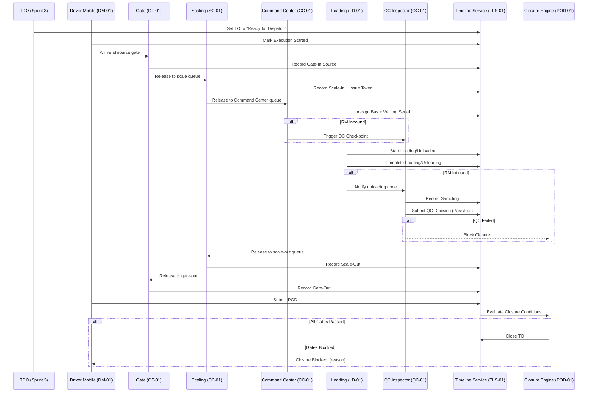

# Sprint 4 Implementation Overview — Own-Fleet TO Execution (TO-Centric)

## Executive Summary

This document provides a comprehensive overview of Sprint 4 implementation context across all module specifications. Sprint 4 delivers **end-to-end Transport Order (TO) execution** for own-fleet operations — from supervisor compliance checks through yard chain operations to driver POD capture and TO closure.

**Key Characteristics**:
- **TO-Centric**: All operations anchor to Transport Order (no separate Trip entity in Sprint 4)
- **Django Admin First**: All operational UIs delivered via Django admin with custom views
- **Three Flow Lanes**: FG Outbound, FG Inbound, RM Inbound (each with specific closure rules)
- **Event-Driven Timeline**: All actions write to unified `TOExecutionEvent` timeline (TLS-01)
- **Closure Engine**: Rule-based closure evaluation triggered by POD, QC decision, or gate-out

**Total Story Points**: 83 SP  
**Total Stories**: 12 stories across 6 epics  
**Total Specifications Created**: 6 comprehensive documents (3,800+ lines combined)

---

## Sprint 4 Module Specifications Index

### 1. Driver Supervisor Operations
**File**: [`08-fleet-management/driver-supervisor-operations.md`](./08-fleet-management/driver-supervisor-operations.md)  
**Stories**: DS-01, DS-02 (10 SP)  
**Focus**: Pre-movement compliance, vehicle checklists, driver attendance/leave

**Key Models**:
- `ChecklistTemplate` + `ChecklistItemTemplate`
- `VehicleChecklistSubmission` + `VehicleChecklistReview`
- `DriverAttendance`
- `DriverLeave`

**Admin Flows**:
- Template configuration (8–10 inspection points per checklist)
- Submission → Review workflow (Approve/Reject → vehicle state update)
- Attendance punch in/out tracking
- Leave registration + TDO assignment conflict checks

**Integration**: Guards TDO assignment (Sprint 3) + first driver execution action (Sprint 4)

---

### 2. Driver Interface (Sprint 4 — Responsive Web)
**File**: [`03-users/driver-interface-sprint4.md`](./03-users/driver-interface-sprint4.md)  
**Stories**: DM-01 (8 SP)  
**Focus**: Mobile-responsive web interface for TO list, milestone recording, POD capture (no map/GPS in Sprint 4)

**Technology**: Responsive web application accessed via mobile browser (not a native mobile app)

**Key Models**:
- `TOMilestone` (execution checkpoints: gate-in, loading, gate-out, etc.)
- `TOPOD` (photo, signature, notes)

**Web UI (Mobile-First)**:
- My Transport Orders (tabs: Ready / In Progress / Completed)
- TO Detail (timeline, milestones, POD capture form)
- Milestone recording (tap → modal → timestamp + photo + notes)
- POD submission (photo required, signature optional)
- Camera access via HTML5 APIs (no native app required)

**Integration**: Triggers closure engine (POD-01), writes timeline events (TLS-01)

---

### 3. Gate Operations (Sprint 4)
**File**: [`06-poi-operations/gate-operations-sprint4.md`](./06-poi-operations/gate-operations-sprint4.md)  
**Stories**: GT-01, GT-02 (16 SP)  
**Focus**: TO-linked gate-in/out, on-demand TO creation (Dealer DO / Supplier PO)

**Key Models**:
- `GateVisitSession` (visit container: gate-in → gate-out)
- `GateOnDemandTORequest` (audit log for GT-02 wizard)

**Admin Flows**:
- Gate-In: TO lookup → vehicle capture → document validation → gate-in recorded
- On-Demand TO Wizard: Document → Party → Product → Routing → TO created + gate-in
- Gate-Out: TO lookup → clearance checks (scale-out, QC) → gate-out recorded

**Clearance Gates**:
- Scale-out must be done
- QC must pass (if RM inbound)

**Integration**: Triggers scale queue (SC-01), writes timeline events (TLS-01)

---

### 4. Scaling Operations (Sprint 4)
**File**: [`06-poi-operations/scaling-operations-sprint4.md`](./06-poi-operations/scaling-operations-sprint4.md)  
**Stories**: SC-01 (8 SP)  
**Focus**: Weighbridge scale-in/out, queue token (P.C. code) issuance, net weight calculation

**Key Models**:
- `ScaleRecord` (gross weight, tare weight, net weight)
- `QueueToken` (P.C. code: `PC-YYYYMMDD-XXXX`)
- `Weighbridge` (master data — optional Phase 2)

**Admin Flows**:
- Scale-In Queue → Scale-In Form → gross weight capture → token issued
- Scale-Out Queue → Scale-Out Form → tare weight capture → net weight calculated
- Token Issuance → QR code print/reprint

**Integration**: Gate-in prerequisite (GT-01), Command Center queue handoff (CC-01), gate-out clearance (GT-01)

---

### 5. Command Center & Loading/Unloading (Sprint 4)
**File**: [`06-poi-operations/command-center-loading-sprint4.md`](./06-poi-operations/command-center-loading-sprint4.md)  
**Stories**: LUP-01, CC-01, LD-01 (18 SP)  
**Focus**: Bay master data, queue management, bay assignment, loading/unloading timestamp capture

**Key Models**:
- `POIOperationPoint` (bay/line/dock master: code, name, type: load/unload/both)
- `BayAssignment` (TO → bay + waiting serial)
- `LoadingOperation` (start/end timestamps, bags count, seal number)

**Admin Flows**:
- LUP-01: Operation Points master (per POI)
- CC-01: Queue Dashboard → Assign Bay → waiting serial issued → QC trigger (RM)
- LD-01: My Assignments → Start Loading/Unloading → End → bags + seal capture

**Integration**: Scale-in handoff (SC-01), QC trigger (QC-01), scale-out release, timeline events (TLS-01)

---

### 6. Transport Lifecycle, POD & QC Checkpoint (Sprint 4)
**File**: [`05-transport/transport-lifecycle-pod-sprint4.md`](./05-transport/transport-lifecycle-pod-sprint4.md)  
**Stories**: TLS-01, POD-01, QC-01 (23 SP)  
**Focus**: TO execution state machine, event timeline, closure rule engine, QC checkpoint (RM only)

**Key Models**:
- `TOExecutionEvent` (timeline backbone: event_type, from_state, to_state, actor, payload)
- `TOClosureChecklist` (closure gate status cache)
- `TOPOD` (POD artifacts — defined in DM-01)
- `TOQCCheckpoint` (sampling + pass/fail decision)

**Services**:
- Timeline Service: `record_execution_event()` (all yard actions call this)
- Closure Engine: `evaluate_closure_conditions()` (flow-specific closure matrices)
- QC Service: Sampling → Decision workflow

**Closure Matrices**:
- **FG Outbound**: Loading ✓ + Scale-Out ✓ + Gate-Out ✓ + POD ✓ → Closed
- **FG Inbound**: Unloading ✓ + Scale-Out ✓ + Gate-Out ✓ + POD ✓ → Closed
- **RM Inbound**: Unloading ✓ + QC Sampling ✓ + QC Pass ✓ + Scale-Out ✓ + Gate-Out ✓ + POD ✓ → Closed

**Integration**: Central integration point for all Sprint 4 modules (all write timeline events)

---

## Implementation Architecture

### App Structure (Django Backend)

```
apps/
├── transport/                          # Core TO models (Sprint 3 + Sprint 4 extensions)
│   ├── lifecycle/                      # NEW: State machine + execution guards (TLS-01)
│   ├── closure/                        # NEW: Closure rule engine (POD-01)
│   ├── pod/                            # NEW: POD model + capture (POD-01 + DM-01)
│   └── models.py                       # TransportOrder (+ execution_state, flow_type fields)
│
├── users/                              # User management (Sprint 1/2)
│   ├── supervisor/                     # NEW: Checklist, attendance, leave (DS-01, DS-02)
│   └── driver_mobile/                  # NEW: Driver responsive web interface — TO list, milestones (DM-01)
│
├── operations/                         # Operational workflows
│   ├── gate/                           # EXTENDED: TO-linked gate, on-demand TO (GT-01, GT-02)
│   ├── scaling/                        # EXTENDED: TO-linked scale, queue tokens (SC-01)
│   ├── command_center/                 # NEW: Queue, bay assignment (CC-01)
│   └── loading/                        # EXTENDED: L/U points + operations (LUP-01, LD-01)
│
├── quality/                            # Quality workflows
│   └── checkpoint/                     # NEW: Simplified QC checkpoint (QC-01)
│
├── master_data/                        # Master data (Sprint 2)
│   └── models.py                       # POI, Vehicle, Driver (no changes in Sprint 4)
│
└── core/                               # Platform foundation (Sprint 1)
    ├── constants_rbac.py               # EXTENDED: Sprint 4 permission codes
    └── portal_navigation.py            # EXTENDED: Sprint 4 menu items
```

### Data Flow (End-to-End)



---

## Key Design Decisions

### 1. TO-Centric (No Trip in Sprint 4)

**Decision**: All Sprint 4 operations anchor directly to `TransportOrder`. No separate `Trip` entity.

**Rationale**:
- Simplifies data model (fewer joins)
- TO already exists from Sprint 3 (no new resource for driver)
- Trip lifecycle deferred to later sprint (costing, multi-leg routes)

**Implications**:
- `GateVisitSession`, `ScaleRecord`, `BayAssignment`, `LoadingOperation` all FK to `TransportOrder`
- Driver sees "My Transport Orders" (not "My Trips")

### 2. Execution State Parallel Tracking

**Decision**: Add `TransportOrder.execution_state` field (parallel to existing `status` field).

**Rationale**:
- Sprint 3 `status` field has coarse-grained states (`confirmed`, `in_progress`, `completed`)
- Sprint 4 needs fine-grained substates (`gate_in_source`, `loading`, `qc_passed`, etc.)
- Parallel field avoids breaking Sprint 3 contract

**Implications**:
- Two state fields on TO model (both updated by timeline service)
- `execution_state` is Sprint 4+ only; `status` continues for backward compatibility

### 3. Flow Type Determines Closure Rules

**Decision**: `TransportOrder.flow_type` enum drives all branching (closure, QC, milestones).

**Rationale**:
- Centralizes lane resolution (FG outbound, FG inbound, RM inbound)
- Closure engine reads one field instead of many `if` conditions
- Gate routing type maps to flow type (GT-01 AC-2)

**Implications**:
- Gate sets `flow_type` at gate-in (for planner TOs) or at on-demand TO creation (GT-02)
- All services (closure, QC trigger, milestone sequencing) key off `flow_type`

### 4. Event-Driven Timeline (TLS-01)

**Decision**: All yard/driver actions write to unified `TOExecutionEvent` timeline.

**Rationale**:
- Single source of truth for TO execution history
- Append-only audit trail (no updates/deletes)
- Easy to query for TO detail timeline view
- Supports future KPI analytics

**Implications**:
- Every module service calls `timeline_service.record_execution_event()`
- Timeline service also updates TO denormalized timestamp fields (for fast queries)

### 5. Closure as Post-Evaluation (Not Inline)

**Decision**: Closure engine evaluates conditions **after** triggering events (POD, QC, gate-out).

**Rationale**:
- Decouples closure logic from operational modules (gate, scale, loading don't know about closure)
- Allows manual override (admin can force close)
- Supports complex multi-gate conditions

**Implications**:
- Closure evaluation is a service hook (called by POD submission, QC decision, gate-out)
- TO may remain in `pod_submitted` or `qc_decision_pending` if gates blocked

### 6. QC Trigger by Command Center (Not Auto)

**Decision**: Command Center **manually** triggers QC checkpoint (via checkbox at bay assignment).

**Rationale**:
- Gives operational control to Command Center (not all RM may need QC per policy)
- Allows FG inbound to skip QC (default: no QC)
- Sprint 4 scope: simplified QC (sampling + pass/fail only)

**Implications**:
- `TOQCCheckpoint` created by CC-01 (not auto-created at gate-in)
- If CC forgets to trigger QC for RM, closure blocks (missing checkpoint)

---

## RBAC Summary (Sprint 4 Additions)

### New Roles

- **Driver Supervisor**: Checklist, attendance, leave management
- **Gateman**: Gate entry/exit, on-demand TO creation
- **Scaling Operator**: Scale-in/out, queue token issuance
- **Command Center Officer**: Queue management, bay assignment, QC trigger
- **Loading / Unloading Personnel**: Start/end timestamp capture
- **QC Inspector**: QC sampling + pass/fail decision

### New Permission Codes (add to `apps/core/constants_rbac.py`)

```python
# Driver Supervisor (DS-01, DS-02)
Fleet.DriverSupervisor.Checklist.Configure
Fleet.DriverSupervisor.Checklist.Submit
Fleet.DriverSupervisor.Checklist.Review
Fleet.DriverSupervisor.Attendance.Write
Fleet.DriverSupervisor.Attendance.Read
Fleet.DriverSupervisor.Leave.Write
Fleet.DriverSupervisor.Leave.Read
Fleet.Vehicle.SetUnderMaintenance

# Driver Mobile (DM-01)
Transport.TO.Milestone.Write
Transport.POD.Submit
Transport.POD.Read

# Gate (GT-01, GT-02)
Operations.Gate.Entry.Create
Operations.Gate.Exit.Write
Operations.Gate.Remarks.Write
Operations.Gate.OnDemandTO.CreateDealer
Operations.Gate.OnDemandTO.CreateSupplier

# Scaling (SC-01)
Operations.Scale.In.Write
Operations.Scale.Out.Write
Operations.Scale.Token.Issue
Operations.Scale.Token.Print

# Command Center (CC-01)
Operations.CommandCenter.Queue.Read
Operations.CommandCenter.AssignBay
Operations.CommandCenter.Serial.Issue
Operations.CommandCenter.QCTrigger

# Loading/Unloading (LUP-01, LD-01)
Operations.OperationPoint.Write
Operations.LoadUnload.Start
Operations.LoadUnload.End
Operations.LoadUnload.Read

# QC Checkpoint (QC-01)
Quality.QCCheckpoint.Trigger
Quality.QCCheckpoint.Sampling.Write
Quality.QCCheckpoint.Decision.Write
Quality.QCCheckpoint.Read

# Timeline & Closure (TLS-01, POD-01)
Transport.TO.ExecutionTimeline.Read
Transport.TO.Close                      # Manual override
```

### New Menu Items (add to `apps/core/portal_navigation.py`)

```python
# Fleet section
Menu.Fleet.Supervisor.View

# Mobile section (driver-only)
Menu.DriverMobile.View

# Operations section
Menu.Gate.View
Menu.Gate.OnDemandTO.View
Menu.Scaling.View
Menu.CommandCenter.View
Menu.CommandCenter.Queue.View
Menu.LoadUnload.View

# Quality section
Menu.QC.Checkpoint.View

# Master Data section
Menu.MasterData.OperationPoints.View
```

---

## Testing Strategy

### Unit Tests

**Coverage targets**: 80%+ for all new models and services

**Priority modules**:
- `apps/transport/lifecycle/timeline_service.py` (event recording)
- `apps/transport/closure/closure_engine.py` (closure matrices)
- `apps/operations/scaling/services/token_service.py` (token generation)
- `apps/quality/checkpoint/services/qc_service.py` (sampling + decision)

### Integration Tests

**Key flows to test** (end-to-end):

1. **FG Outbound Happy Path**:
   - TDO → Ready for Dispatch → Driver Start → Gate-In → Scale-In → Bay Assignment → Loading → Scale-Out → Gate-Out → POD → Closed
   - Assertions: All timeline events recorded, closure gates passed, TO state = `closed`

2. **RM Inbound with QC Pass**:
   - TDO → Ready for Dispatch → Gate-In Dest → Scale-In → Bay Assignment (QC trigger) → Unloading → QC Sampling → QC Pass → Scale-Out → Gate-Out → POD → Closed
   - Assertions: QC checkpoint created, QC pass recorded, closure gates passed

3. **RM Inbound with QC Fail** (blocked closure):
   - Same flow as above, but QC decision = Fail
   - Assertions: TO state = `qc_failed`, closure blocked, scale-out/gate-out not allowed

4. **On-Demand TO (Dealer DO)**:
   - Gate → No TO found → On-Demand Wizard → TO created → Gate-In → (rest of FG outbound flow)
   - Assertions: TO created with `source_channel='gate_on_demand'`, `flow_type='fg_outbound'`

5. **Driver On Leave (blocked execution)**:
   - Driver on leave → Attempt to start execution → Error: "Driver is on leave"
   - Assertions: Execution blocked, no timeline event recorded

### Manual Testing Scenarios (QA)

**Admin workflows**:
- Checklist template configuration (8–10 items)
- Checklist submission → review (approve/reject)
- Attendance entry (punch in/out)
- Leave registration + TDO assignment conflict
- Gate-in → on-demand TO wizard (Dealer DO, Supplier PO)
- Scale-in → token print → QR code scan
- Command Center queue → bay assignment → waiting serial
- Loading start → bags count → seal number → end
- QC sampling → decision (pass/fail)
- POD submission (mobile) → closure evaluation → TO closed

**Edge cases**:
- Duplicate gate-in (same TO, same POI) — should error
- Scale-out before loading done — should error
- Gate-out without scale-out — should error (clearance check)
- QC fail → manual override by Procurement Manager (Phase 2)
- Manual TO closure override (admin action)

---

## Deployment Checklist

### Database Migrations

**New models** (require migrations):
- `ChecklistTemplate`, `ChecklistItemTemplate`, `VehicleChecklistSubmission`, `VehicleChecklistReview`
- `DriverAttendance`, `DriverLeave`
- `TOMilestone`, `TOPOD`
- `GateVisitSession`, `GateOnDemandTORequest`
- `ScaleRecord` (extend existing), `QueueToken`, `Weighbridge`
- `POIOperationPoint`, `BayAssignment`, `LoadingOperation`
- `TOExecutionEvent`, `TOClosureChecklist`, `TOQCCheckpoint`

**Extended models** (add fields):
- `TransportOrder`: `execution_state`, `flow_type`, `source_channel`, denormalized timestamps
- `Vehicle`: `current_state` enum add `'under_maintenance'`
- `Driver/User`: `current_state` enum add `'on_leave'` (computed property, no migration)

### RBAC Setup

**Steps**:
1. Run migration to add new permission codes to `Permission` table
2. Create new role records: `driver_supervisor`, `gateman`, `scaling_operator`, `command_center_officer`, `loading_personnel`, `unloading_personnel`, `qc_inspector`
3. Assign permissions to roles (bulk SQL script or admin UI)
4. Assign roles to users (via tenant admin)

### Menu Configuration

**Steps**:
1. Update `apps/core/portal_navigation.py` with new menu items
2. Restart Django server to load new navigation
3. Test role-based menu visibility (driver sees only "My TOs", gateman sees "Gate", etc.)

### Data Seeding (Dev/Staging)

**Required master data**:
- POI Operation Points (at least 2 per POI: BAY-01 load, BAY-02 unload)
- Checklist Templates (1 handover template, 1 long-trip template)
- Weighbridges (optional — can use manual entry in Sprint 4)

**Test data**:
- 5–10 TOs in `ready_for_dispatch` state (assigned vehicle/driver from Sprint 3)
- 3 TOs per flow type (FG outbound, FG inbound, RM inbound)

---

## Known Limitations & Phase 2 Enhancements

### Sprint 4 Limitations (Out of Scope)

- **No native mobile app**: Sprint 4 delivers responsive web only (native apps deferred to Phase 2)
- **No map/GPS**: Driver interface does not show map or track location (deferred)
- **No live vehicle tracking**: GPS tracking for in-transit state (deferred)
- **No push notifications**: All notifications are in-app pull (no Firebase/SMS — requires native app or PWA)
- **No offline mode**: Driver interface requires network connection (offline sync is Phase 2)
- **No trip costing**: §6.8.8 trip costing deferred (no cost calculation in Sprint 4)
- **No incident management**: §6.8.6 halt/re-delivery deferred
- **No multi-vehicle bays**: `POIOperationPoint.capacity_vehicles = 1` (fixed in Sprint 4)
- **No detailed QC workflow**: Sprint 4 QC is simplified (sampling + pass/fail only)

### Phase 2 Roadmap

1. **Driver Interface Enhancements**:
   - Native mobile apps (iOS/Android) or Progressive Web App (PWA)
   - Map & turn-by-turn navigation
   - Real-time GPS tracking
   - Offline mode (Service Worker for web, local DB for native apps)
   - Push notifications (Firebase for native apps)

2. **QC Workflow Expansion**:
   - Full physical inspection checklists (§6.15.1)
   - Lab test request + result tracking (§6.15.2)
   - Photo/video evidence with GPS metadata
   - Re-check workflow (§6.15.3)

3. **Trip Costing** (§6.8.8):
   - Fuel cost capture (linked to TO)
   - Distance-based costing (GPS odometer)
   - Vendor billing (contractual rates)
   - Cost variance analysis

4. **Command Center Dashboard**:
   - Real-time queue metrics (wait times, bottlenecks)
   - Bay utilization charts
   - Exception alerts (long dwell times, QC fails)
   - Predictive queue management (ETA-based assignment)

5. **Advanced Analytics**:
   - TO cycle time analysis (heatmaps, bottleneck detection)
   - Driver performance KPIs (on-time %, POD quality)
   - QC pass rate trends (by supplier, product)
   - Fleet utilization dashboards (planned vs actual)

---

## Glossary

| Term | Definition |
|------|------------|
| **TO** | Transport Order — executable dispatch unit (Sprint 3 + Sprint 4) |
| **TR** | Transport Request — demand input from Distribution/Procurement (Sprint 3) |
| **TDO** | Transport Dispatch Officer — assigns vehicle/driver to TO (Sprint 3) |
| **Flow Type** | TO classification: `fg_outbound`, `fg_inbound`, `rm_inbound` |
| **Execution State** | Fine-grained TO substate (Sprint 4): `gate_in_source`, `loading`, `closed`, etc. |
| **Gate Visit Session** | Container for full vehicle visit (gate-in → gate-out) |
| **Queue Token (P.C. Code)** | Unique identifier issued at scale-in (format: `PC-YYYYMMDD-XXXX`) |
| **Bay Assignment** | Command Center action: assign TO to loading/unloading point + waiting serial |
| **POD** | Proof of Delivery — photo + signature captured by driver (DM-01) |
| **QC Checkpoint** | Simplified QC for RM inbound: sampling + pass/fail decision (QC-01) |
| **Closure Engine** | Service that evaluates flow-specific closure gates and closes TO (POD-01) |
| **Timeline Event** | Append-only audit record: `TOExecutionEvent` (TLS-01) |

---

## Reference Documents

### Sprint 4 Module Specifications (This Directory)

1. [Driver Supervisor Operations](./08-fleet-management/driver-supervisor-operations.md) — DS-01, DS-02
2. [Driver Interface (Sprint 4 — Responsive Web)](./03-users/driver-interface-sprint4.md) — DM-01
3. [Gate Operations (Sprint 4)](./06-poi-operations/gate-operations-sprint4.md) — GT-01, GT-02
4. [Scaling Operations (Sprint 4)](./06-poi-operations/scaling-operations-sprint4.md) — SC-01
5. [Command Center & Loading/Unloading (Sprint 4)](./06-poi-operations/command-center-loading-sprint4.md) — LUP-01, CC-01, LD-01
6. [Transport Lifecycle, POD & QC Checkpoint (Sprint 4)](./05-transport/transport-lifecycle-pod-sprint4.md) — TLS-01, POD-01, QC-01

### Sprint 4 Backlog

- [Sprint 4 README](../03-backlog/sprints/sprint-4/README.md) — Full backlog, stories, PRD traceability
- [Sprint 4 Plan](../README.md) — High-level implementation plan

### Sprint 3 Dependencies (Foundation)

- [Requisitions Module Spec](./04-requisitions/README.md) — FG PR, Port Shipment, Distribution, Procurement
- [Transport Module Spec](./05-transport/README.md) — TR queue, TO creation, TDO assignment

---

**Last Updated**: 2026-05-06  
**Document Owner**: Senior Software Engineer  
**Status**: Implementation Ready — All specifications complete, ready for development kickoff
