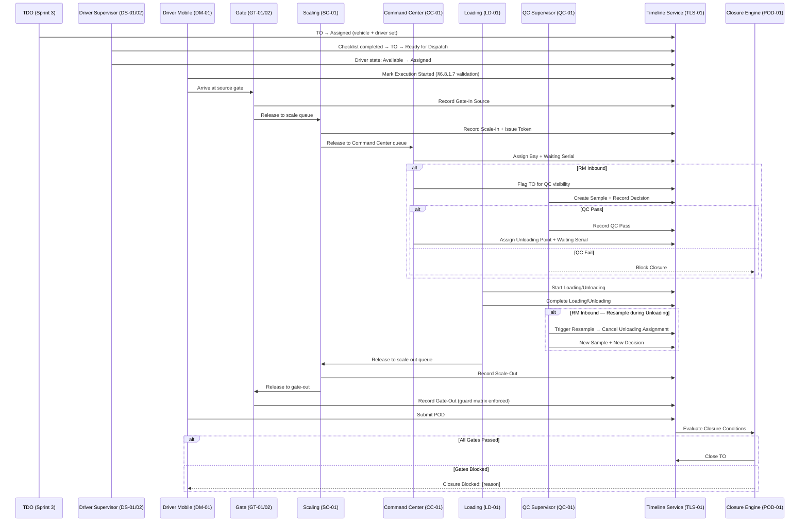

# Sprint 4 Implementation Overview — Own-Fleet TO Execution (TO-Centric)

## Executive Summary

This document provides a comprehensive overview of Sprint 4 implementation context across all module specifications. Sprint 4 delivers **end-to-end Transport Order (TO) execution** for own-fleet operations — from supervisor compliance checks through yard chain operations to driver POD capture and TO closure.

**Key Characteristics**:
- **TO-Centric**: All operations anchor to Transport Order (no separate Trip entity in Sprint 4)
- **Django Admin First**: All operational UIs delivered via Django admin with custom views
- **Three Flow Lanes**: FG Outbound, FG Inbound, RM Inbound (each with specific closure rules)
- **Event-Driven Timeline**: All actions write to unified `TOStatusTransitionLog` timeline (TLS-01)
- **Closure Engine**: Rule-based closure evaluation triggered by POD, QC decision, or gate-out
- **Predefined Checklists**: Vehicle inspection uses immutable 7-section daily checklist (no configurable templates)
- **QC-Gated Unloading**: For RM inbound, QC records Pass/Fail; **Command Center** assigns the unloading point only after QC Pass (QC does not assign bays)

**Total Story Points**: 83 SP  
**Total Stories**: 12 stories across 6 epics  
**Total Specifications Created**: 7 comprehensive documents (6 operations + 1 master data)

---

## Django Admin design language (consistency contract)

Sprint 4 is **Django Admin first**. New `ModelAdmin` classes, custom admin views, and templates must align with the existing DFMS admin stack below so behaviour, permissions, and visuals stay consistent.

### Platform vs tenant visibility (RBAC shell)

| Concern | Canonical implementation | File(s) |
|--------|---------------------------|---------|
| **Single `AdminSite`** | All URLs use default `admin.site` (no second `AdminSite` class) | [`config/urls.py`](../../config/urls.py) |
| **Tenant-only models** | Mixin: `TenantOnlyAdminMixin` — hidden on platform schema; tenant admins get full CRUD; other users fall through to Django permissions | [`apps/core/admin.py`](../../apps/core/admin.py) (`TenantOnlyAdminMixin`) |
| **Platform-only models** | Mixin: `PlatformOnlyAdminMixin` — visible only when `request.tenant.schema_name == "platform"` (use request tenant, not raw DB connection, for checks) | [`apps/core/admin.py`](../../apps/core/admin.py) (`PlatformOnlyAdminMixin`, `_is_platform_tenant_request`) |
| **Shared catalog in `public` schema** | Mixin: `PublicSchemaModelAdminMixin` — CRUD runs in `public`; `LogEntry` still logged in the active tenant schema | [`apps/core/admin.py`](../../apps/core/admin.py) (`PublicSchemaModelAdminMixin`) |
| **Composition pattern** | Typical tenant app: `class XAdmin(TenantOnlyAdminMixin, admin.ModelAdmin)`. Platform + public catalog: combine `PublicSchemaModelAdminMixin` + `PlatformOnlyAdminMixin` where applicable (see `PermissionAdmin`, `RoleAdmin`). | [`apps/core/admin.py`](../../apps/core/admin.py), examples across [`apps/master_data/admin.py`](../../apps/master_data/admin.py), [`apps/transport/admin.py`](../../apps/transport/admin.py), [`apps/requisitions/admin.py`](../../apps/requisitions/admin.py) |
| **Third-party registrations** | Celery beat / JWT blacklist / celery results admins are auto-wrapped with the same mixins on first request; `auth.Group` is unregistered (RBAC is `core.Role` / `core.Permission`). | [`apps/core/apps.py`](../../apps/core/apps.py) (`_patch_third_party_admin`) |

**Implementers must not** register Sprint 4 models without the correct mixin: operational data belongs in tenant schemas and must use `TenantOnlyAdminMixin` unless explicitly a platform-shared model.

### Index, KPIs, and role widgets

| Concern | Canonical implementation | File(s) |
|--------|---------------------------|---------|
| **Dashboard context** | `patch_admin_index()` injects `dashboard`, `schema_type`, and on tenant hosts `role_widgets` + `tenant_name` into the admin index context. | [`config/admin.py`](../../config/admin.py) (`patch_admin_index`, `get_platform_stats`, `get_tenant_stats`), wired from [`apps/core/apps.py`](../../apps/core/apps.py) |
| **Tenant admin index UI** | Template renders stats charts and cards. | [`templates/admin/index.html`](../../templates/admin/index.html) |
| **Operational user widgets** | Non–tenant-admin users get role-based KPI cards with links into filtered changelists (`id`, `label`, `icon`, `count`, `url`, `color`, `urgency`). Extend `get_role_widgets()` when Sprint 4 roles need home-dashboard shortcuts. | [`apps/core/dashboard_service.py`](../../apps/core/dashboard_service.py) |

### Navigation sidebar and labels

| Concern | Canonical implementation | File(s) |
|--------|---------------------------|---------|
| **Structured nav** | Sections/items with Bootstrap Icons (`bi-` prefix in templates), `permission_any` gating using `Menu.*` / role semantics. Platform vs tenant sections are separate structures. | [`apps/core/portal_navigation.py`](../../apps/core/portal_navigation.py) (`PLATFORM_NAV_SECTIONS`, `PORTAL_NAV_SECTIONS`) |
| **Sidebar chrome** | Custom sidebar replaces Django default; must stay compatible with portal nav data shape when adding entries for Sprint 4 flows. | [`templates/admin/nav_sidebar.html`](../../templates/admin/nav_sidebar.html) |
| **Master Data app order** | Models under `master_data` are sorted on the **index app list** (not only the custom sidebar) via `patched_get_app_list`. New master models should be inserted in the ordered list when product expects a fixed menu position. | [`config/admin.py`](../../config/admin.py) (`master_data_menu_order`) |

### Chrome, theming, and design tokens

| Concern | Canonical implementation | File(s) |
|--------|---------------------------|---------|
| **Global admin shell** | Extends Django admin base: fonts (Inter, JetBrains Mono), Bootstrap Icons, Chart.js, theme/sidebar state before first paint (`data-theme`, `data-sidebar-collapsed`). | [`templates/admin/base_site.html`](../../templates/admin/base_site.html) |
| **Design tokens & component styling** | CSS variables (`--dfms-*`), light/dark themes, buttons (e.g. `dfms-btn-save`, `dfms-btn-secondary`, draft/submit variants), tables, cards. | [`static/admin/css/custom.css`](../../static/admin/css/custom.css) (header references product docs: `DFMS-product-context/11-design-system/`) |
| **Client behaviours** | Theme toggle, sidebar, changelist row actions/toolbar, full time list, label title-casing / acronyms (POI, TO, etc.). | [`static/admin/js/dfms_theme.js`](../../static/admin/js/dfms_theme.js), [`dfms_sidebar.js`](../../static/admin/js/dfms_sidebar.js), [`dfms_actions.js`](../../static/admin/js/dfms_actions.js), [`dfms_timepicker.js`](../../static/admin/js/dfms_timepicker.js), [`dfms_labels.js`](../../static/admin/js/dfms_labels.js) |
| **Browser title / header** | `site_header`, `site_title`, `index_title` set per request from resolved tenant (platform → “DFMS Platform Admin”; client → “{Tenant} Admin”). | [`apps/core/middleware.py`](../../apps/core/middleware.py) (`AdminTitleMiddleware`) |

### Lists, forms, and actions

| Concern | Canonical implementation | File(s) |
|--------|---------------------------|---------|
| **Pagination** | `DynamicPaginationMixin` / alias `AdminPaginationMixin`: session-backed `per_page` query param, allowed values `{15, 25, 50, 100, 200}`, default 25. | [`apps/core/admin.py`](../../apps/core/admin.py), template [`templates/admin/dynamic_pagination_changelist.html`](../../templates/admin/dynamic_pagination_changelist.html) |
| **Required fields on forms** | `RequiredFieldMarkAdminMixin`: asterisk labels, `vRequiredField` class, `required` / `aria-required` on widgets. Use when custom forms would otherwise hide required markers. | [`apps/core/admin.py`](../../apps/core/admin.py) (`RequiredFieldMarkAdminMixin`) |
| **Global change form / list overrides** | Shared breadcrumbs, title blocks, and submit row patterns apply to all models unless a model template overrides specific blocks. | [`templates/admin/change_form.html`](../../templates/admin/change_form.html), [`templates/admin/change_list.html`](../../templates/admin/change_list.html), [`templates/admin/submit_line.html`](../../templates/admin/submit_line.html) |
| **Draft → Submit flows** | Requisitions-style lifecycle: `ModelForm.clean` with `_is_submitting`, `save_model` branching, dedicated `change_form.html` with `dfms-btn-draft` / `dfms-btn-submit-*` and breadcrumb rules **documented in project rule** — follow exactly if Sprint 4 introduces the same pattern. | [`.cursor/rules/django-admin-draft-submit.mdc`](../../.cursor/rules/django-admin-draft-submit.mdc), reference CSS classes in [`static/admin/css/custom.css`](../../static/admin/css/custom.css) |

### Security and login hardening (do not bypass)

| Concern | Canonical implementation | File(s) |
|--------|---------------------------|---------|
| **OTP gate (when enabled)** | Login flow patched on `AdminSite` class. | [`apps/core/admin_otp.py`](../../apps/core/admin_otp.py), feature flag in [`apps/core/apps.py`](../../apps/core/apps.py) |
| **Password change → re-login** | Patched `password_change` on admin site class. | [`apps/core/admin_password_change.py`](../../apps/core/admin_password_change.py) |

### Sprint 4 implementation checklist (admin)

When adding or changing admin for Sprint 4, confirm:

1. **Mixin** — `TenantOnlyAdminMixin` (or correct platform/public combination) on every new `ModelAdmin`.
2. **Nav** — New operational areas appear in [`apps/core/portal_navigation.py`](../../apps/core/portal_navigation.py) with correct `permission_any` codes (aligned with [`apps/core/constants_rbac.py`](../../apps/core/constants_rbac.py) / seed matrix).
3. **Dashboard** — If a role needs a KPI shortcut, extend [`apps/core/dashboard_service.py`](../../apps/core/dashboard_service.py) (shape matches existing widgets).
4. **Templates** — Prefer extending [`templates/admin/change_form.html`](../../templates/admin/change_form.html) / [`change_list.html`](../../templates/admin/change_list.html); use **`dfms-*` button classes** and Bootstrap Icons consistent with [`base_site.html`](../../templates/admin/base_site.html).
5. **Master data ordering** — If a new model sits under `master_data`, update [`config/admin.py`](../../config/admin.py) `master_data_menu_order` when product expects a fixed index order.
6. **Design tokens** — Prefer existing CSS variables and patterns in [`static/admin/css/custom.css`](../../static/admin/css/custom.css) over new ad hoc styles.

---

## Sprint 4 Module Specifications Index

### 1. Driver Supervisor Operations
**File**: [`08-fleet-management/driver-supervisor-operations.md`](./08-fleet-management/driver-supervisor-operations.md)  
**Stories**: DS-01, DS-02 (10 SP)  
**Focus**: Pre-movement compliance, predefined vehicle checklists, driver attendance/leave/state management

**Key Models**:
- `ChecklistSection` + `ChecklistItem` (predefined, immutable, seeded via data migration)
- `VehicleInspection` + `ChecklistResponse` (FK to TO, vehicle, supervisor)
- `DriverAttendance` (driver, POI, entry/exit datetime, unique-together driver+date)
- `DriverLeave` (start/end dates, reason)
- `DriverStateLog` (audit trail for all driver state transitions)

**Admin Flows**:
- Predefined daily inspection checklist (7 sections, 60+ items — Engine, Clutch, Gear Box, Container, Electric, Chassis, Cabin)
- `VehicleInspectionAdmin` — **dispatch queue** (TOs in **`ready_for_dispatch`** — implemented), checklist inline, complete → TO **Dispatched** / reject → vehicle **Under Maintenance** + TO **Under Planning**
- **Maintenance queue** *(planned DS-01-15)* — vehicles **Under Maintenance**; re-inspection → vehicle **Available** on pass (no TO dispatch)
- Reject action with mandatory reason; `VehicleAdmin.mark_under_maintenance` resets linked **`assigned`** TOs to **`created`**
- `DriverAttendanceAdmin` — date/driver uniqueness, working hours warning (configurable max, default 12h)
- `DriverLeaveAdmin` — date range, overlap validation, driver state → On Leave
- `DriverStateAdmin` — state badges, filterable by state/POI

**DS-02-16 (Sprint 4 scope)**: “Attendance grid”, “leave calendar”, and “state board” are **Django Admin** experiences only — rich `ModelAdmin` changelists (`list_display`, `list_filter`, `date_hierarchy`, search, ordering) plus standard forms. No separate responsive calendar component or data-grid SPA in Sprint 4 unless product files a new story.

**Key APIs** (see [`driver-supervisor-operations.md`](./08-fleet-management/driver-supervisor-operations.md) §7 for authoritative contracts):
- `GET /api/v1/inspections/queue` — TOs **ready for dispatch**
- `POST /api/v1/transport-orders/{to_id}/dispatch` — `skip_inspection` | `start_inspection`
- `PATCH/POST /api/v1/inspections/{id}/responses|approve|reject` — checklist + outcomes
- `POST /api/v1/vehicles/{id}/under-maintenance` — mark Under Maintenance
- `GET /api/v1/checklist-template` — read-only sections + items
- **Planned (DS-01-15–17):** `GET /api/v1/vehicles/under-maintenance`, `POST /api/v1/vehicles/{id}/re-inspection`; `approve`/`reject` branch on `inspection_purpose` for return-to-service
- CRUD: `/api/v1/driver-attendance`, `/api/v1/driver-leave`
- `GET /api/v1/drivers/state-board` — filterable driver state board

**Integration**: Guards TDO assignment (Sprint 3) + first driver execution action (Sprint 4). TLS-01 hooks auto-update driver state on TO assignment/execution/completion.

---

### 2. Driver Interface (Sprint 4 — Responsive Web)
**File**: [`03-users/driver-interface-sprint4.md`](./03-users/driver-interface-sprint4.md)  
**Stories**: DM-01 (8 SP)  
**Focus**: Mobile-responsive web interface for TO list, milestone recording, POD capture (no map/GPS in Sprint 4)

**Technology**: Responsive web application accessed via mobile browser (not a native mobile app)

**Key Models**:
- `ExecutionMilestone` (FK to TO, milestone_type enum, recorded_at, recorded_by)
- `ProofOfDelivery` (FK to TO, photo ImageField, optional signature, submitted_by, submitted_at)

**Web UI (Mobile-First)**:
- My Transport Orders (tabs: Ready / In Progress / Completed)
- TO Detail (timeline, milestones, POD capture form)
- Milestone recording (tap → modal → timestamp + photo + notes)
- POD submission (photo required, signature optional)
- Camera access via HTML5 APIs (no native app required)
- Photo auto-compression before upload (max dimension + file size)

**Key APIs**:
- `GET /api/v1/driver/transport-orders` — driver's assigned TOs
- `GET /api/v1/driver/transport-orders/{to_id}` — TO detail
- `PATCH /api/v1/driver/transport-orders/{to_id}/milestones` — record milestone + §6.8.1.7 validation
- `POST /api/v1/driver/transport-orders/{to_id}/pod` — submit POD

**Admin Views**: Read-only `ProofOfDeliveryAdmin` and `ExecutionMilestoneAdmin` for support/debug

**Integration**: §6.8.1.7 fleet availability validation on first execution action. Triggers closure engine (POD-01), writes timeline events (TLS-01).

---

### 3. Gate Operations (Sprint 4)
**File**: [`06-poi-operations/gate-operations-sprint4.md`](./06-poi-operations/gate-operations-sprint4.md)  
**Stories**: GT-01, GT-02 (16 SP)  
**Focus**: TO-linked gate-in/out, document category routing, on-demand TO creation (Dealer DO / Supplier PO)

**Key Models**:
- `GateVisitSession` (visit container: gate-in → gate-out)
- `GateIn` + `GateOut` (FK to session, TO, vehicle; timestamps, document category, remarks)
- `GateOnDemandTORequest` (audit log for GT-02 wizard)
- `GateActivityLog` (audit: user, POI, timestamp, action)

**Admin Flows**:
- Gate-In: vehicle registration required, TO lookup, document category capture (Internal Transfer / Dealer / Supplier), vehicle validation, remarks
- Document Category Routing (AC-2): `Supplier (PO)` → Inbound QC, `Dealer (DO)` → Outbound FG, `Internal Transfer` → TO-Linked (Sprint 4 E2E priority; others feature-flagged)
- On-Demand TO Wizard (GT-02): Dealer DO → FG TO with `transfer_type=FG_DEALER_OUTBOUND`; Supplier PO → RM TO with `transfer_type=RM_SUPPLIER_INBOUND` + QC linkage flag
- Gate-Out: guard matrix per flow lane (FG outbound: scale-out + loading; FG inbound: scale-out + unloading; RM inbound: scale-out + unloading + QC not failed)

**Key APIs**:
- `POST /api/v1/gate/gate-in` — create gate-in with TO lookup + vehicle validation
- `POST /api/v1/gate/gate-out` — create gate-out with guard matrix enforcement
- `POST /api/v1/gate/on-demand-to/dealer` — create FG TO from Dealer DO
- `POST /api/v1/gate/on-demand-to/supplier` — create RM TO from Supplier PO
- `GET /api/v1/gate/visit-sessions/{session_id}` — full visit session

**Clearance Gates** (gate-out guard matrix):
- FG outbound: scale-out completed + loading completed
- FG inbound: scale-out completed + unloading completed
- RM inbound: scale-out completed + unloading completed + QC not failed

**Integration**: Triggers scale queue (SC-01), writes timeline events (TLS-01). On-demand TOs tagged `source=GATE`.

---

### 4. Scaling Operations (Sprint 4)
**File**: [`06-poi-operations/scaling-operations-sprint4.md`](./06-poi-operations/scaling-operations-sprint4.md)  
**Stories**: SC-01 (8 SP)  
**Focus**: Weighbridge scale-in/out, queue token (P.C. code) issuance, net weight calculation, printable gate pass

**Key Models**:
- `WeighingSession` (container for full weigh cycle: scale-in → scale-out, FK to GateVisitSession + TO)
- `ScaleIn` (loaded or empty vehicle weight, discrepancy flags, operator, timestamp)
- `ScaleOut` (remaining weight, net weight auto-calculated, timestamp)
- `QueueToken` (P.C. code: unique serial per scale-in, FK to WeighingSession)

**Admin Flows**:
- Scale-In: vehicle number lookup, gate-in prerequisite validation, weight capture (loaded or empty), discrepancy flag checkboxes
- Scale-Out: remaining weight capture, net weight auto-calculation (loaded − empty), immutability enforcement via `get_readonly_fields`
- Token Issuance: auto-generated on scale-in, printable via browser print CSS (vehicle number, product type, P.C. code serial, weights, TO reference)
- Gate Pass: printable after scale-out (vehicle number, item name, net weight, P.C. code)

**Key APIs**:
- `POST /api/v1/scaling/scale-in` — create scale-in (gate-in prerequisite enforced)
- `POST /api/v1/scaling/scale-out` — create scale-out (net weight auto-calculated, records locked)
- `GET /api/v1/scaling/queue-tokens?status=waiting&poi=` — active queue for CC-01 feed
- `GET /api/v1/scaling/queue-tokens/{token_id}/print` — printable queue token
- `GET /api/v1/scaling/scale-out/{id}/gate-pass` — printable gate pass

**Integration**: Gate-in prerequisite (GT-01), Command Center queue handoff via signal/webhook (CC-01), gate-out clearance (GT-01). Weight records immutable after scale-out.

---

### 5. Loading/Unloading Points — Master Data (Sprint 4)
**File**: [`02-master-data/loading-unloading-points.md`](./02-master-data/loading-unloading-points.md)  
**Stories**: LUP-01 (5 SP)  
**Focus**: POI sub-location master data — bays, lines, docks used by CC-01 and LD-01

**Key Models**:
- `LoadingUnloadingPoint` (bay/line/dock master: name, short_code unique per POI, operation_type: LOAD/UNLOAD, is_active; lives in `apps/master_data/`)

**Admin Flows**:
- `LoadingUnloadingPointAdmin` — standalone CRUD with POI FK dropdown, unique code per POI, active POI check
- `LoadingUnloadingPointInline` — TabularInline under POIAdmin for quick point management

**Key APIs**:
- `POST /api/v1/pois/{poi_id}/loading-unloading-points` — create L/U point
- `GET /api/v1/pois/{poi_id}/loading-unloading-points` — list by POI (filterable)
- `GET /api/v1/loading-unloading-points/{id}` — point detail
- `PATCH /api/v1/loading-unloading-points/{id}` — update / deactivate

**Integration**: Consumed by CC-01 (bay assignment target, including RM unloading after QC Pass), LD-01 (event location); QC-01 gates CC assignment (no L/U point on QCDecision)

---

### 6. Command Center & Loading/Unloading Operations (Sprint 4)
**File**: [`06-poi-operations/command-center-loading-sprint4.md`](./06-poi-operations/command-center-loading-sprint4.md)  
**Stories**: CC-01, LD-01 (13 SP)  
**Focus**: Queue management, bay assignment, loading/unloading timestamp capture, QC handoff

**Key Models**:
- `QueueEntry` (FK to TO, ScaleIn; auto-populated from scale-in events)
- `BayAssignment` (TO → LoadingUnloadingPoint + waiting serial)
- `WaitingSerial` (unique per loading point, immutable after issue)
- `LoadEvent` (start/end timestamps, bags loaded, weight, seal number, FK to TO + BayAssignment)
- `UnloadEvent` (start/end timestamps, bags unloaded, weight, FK to TO + BayAssignment; persists QC handoff context for RM TOs)

**Admin Flows**:
- CC-01: Queue Dashboard → Assign Bay (product/vehicle type match warnings) → Issue Waiting Serial
- CC-01 AC-6 (RM QC handoff): For RM TOs, Command Center flags TO for QC visibility and does **not** assign an unloading point until QC Pass; **CC Officer** then assigns unloading point via `[Assign Bay]` (QC-01 records Pass/Fail only)
- LD-01: `LoadEventAdmin` / `UnloadEventAdmin` — start/end datetime, bags/weight/seal, end ≥ start validation, TLS-01 event emission

**Key APIs**:
- `GET /api/v1/command-center/queue` — eligible vehicles (scale-in complete, not assigned)
- `POST /api/v1/command-center/assignments` — assign vehicle to L/U point
- `POST /api/v1/command-center/waiting-serials` — issue waiting serial
- `GET /api/v1/command-center/my-bay` — loading personnel current bay assignments
- `POST /api/v1/load-events` — record load start/end
- `POST /api/v1/unload-events` — record unload start/end
- `GET /api/v1/unload-events/{id}/qc-handoff` — QC handoff context for RM TOs

**Integration**: Scale-in handoff (SC-01), QC trigger for RM TOs (QC-01), scale-out release, timeline events (TLS-01). Consumes LoadingUnloadingPoint from master data (LUP-01).

---

### 7. Transport Lifecycle, POD & QC Checkpoint (Sprint 4)
**File**: [`05-transport/transport-lifecycle-pod-sprint4.md`](./05-transport/transport-lifecycle-pod-sprint4.md)  
**Stories**: TLS-01, POD-01, QC-01 (23 SP)  
**Focus**: TO execution state machine (full §6.8.5), event timeline, closure rule engine, QC checkpoint (RM only)

**Key Models**:
- `TOStatusTransitionLog` (timeline backbone: from_status, to_status, actor, timestamp, payload JSON)
- `ClosureChecklist` (per-TO prerequisite flags: pod_uploaded, scale_out_done, gate_out_done, loading_complete, unloading_complete, qc_passed)
- `ProofOfDelivery` (POD artifacts — defined in DM-01)
- `QCSample` (FK to TO, auto-gen sample_id, physical_analysis text, remarks, timestamp)
- `QCDecision` (FK to TO, decision enum Pass/Fail, timestamp, remarks — no unloading_point FK; assignment is CC-01's responsibility after Pass)

**Services**:
- State Machine Service: code-first rules table defining valid transitions per flow lane (FG outbound, FG inbound, RM inbound)
- Event Ingest Service: receives events from GT-01, SC-01, CC-01, LD-01, QC-01, DM-01 and triggers appropriate state transitions
- Closure Rule Engine: `evaluate_closure_conditions()` — flow-specific closure matrices
- QC Service: Sample creation → Decision (Pass/Fail) → Resample/Override during unloading

**TO Lifecycle States (per PRD §6.8.5)**:
- Draft → Planned → Assigned → Dispatched (Sprint 3)
- In Transit – Source → At Source → Loaded/Pickup Completed → In Transit – Destination → At Destination → Delivered/Unloaded → Completed → Closed (Sprint 4)
- Halted sub-state reserved (§6.8.6 Phase 2 — no trigger in Sprint 4)

**QC Workflow (Sprint 4 Simplified)**:
- Entry: CC-01 flags RM TO for QC visibility; CC does **not** assign an unloading point at this stage
- Sample creation: QC Supervisor creates sample with physical analysis + remarks
- Decision: Pass → TO marked `qc_passed=True`; **CC Officer then assigns the unloading point** in CC-01 (QC Supervisor does not assign it); Fail → unloading blocked, CC assignment blocked
- Resample (AC-4): During unloading, QC Supervisor can trigger resample → clears decision, cancels active CC-01 unloading assignment, TO returns to QC queue
- Override to failed (AC-5): During unloading, QC Supervisor can change decision to Fail → cancels CC-01 unloading assignment; CC blocked until new QC Pass

**Closure Matrices**:
- **FG Outbound**: Loading ✓ + Scale-Out ✓ + Gate-Out ✓ + POD ✓ → Closed
- **FG Inbound**: Unloading ✓ + Scale-Out ✓ + Gate-Out ✓ + POD ✓ → Closed
- **RM Inbound**: Unloading ✓ + Sampling Done ✓ + QC Pass ✓ + Scale-Out ✓ + Gate-Out ✓ + POD ✓ → Closed

**Key APIs**:
- `GET /api/v1/transport-orders/{to_id}/timeline` — TO transition history
- `GET /api/v1/transport-orders/{to_id}/status` — current status + sub-state
- `POST /api/v1/transport-orders/{to_id}/transitions` — trigger state transition
- `POST /api/v1/transport-orders/{to_id}/close` — attempt TO closure
- `GET /api/v1/transport-orders/{to_id}/closure-status` — closure checklist state
- `GET /api/v1/transport-orders/closure-exceptions` — TOs blocked from closing
- `POST /api/v1/transport-orders/{to_id}/qc/samples` — create QC sample
- `POST /api/v1/transport-orders/{to_id}/qc/decision` — record QC decision
- `POST /api/v1/transport-orders/{to_id}/qc/resample` — trigger resample
- `POST /api/v1/transport-orders/{to_id}/qc/override` — override decision to failed

**Integration**: Central integration point for all Sprint 4 modules (all write timeline events)

---

## Implementation Architecture

### App Structure (Django Backend)

```
apps/
├── transport/                          # Core TO models (Sprint 3 + Sprint 4 extensions)
│   ├── lifecycle/                      # NEW: State machine + event ingest (TLS-01)
│   │   ├── state_machine.py           #   Code-first transition rules per flow lane
│   │   ├── event_ingest.py            #   Receives events from all yard modules
│   │   └── timeline_service.py        #   Record + query transition log
│   ├── closure/                        # NEW: Closure rule engine (POD-01)
│   │   ├── closure_engine.py          #   Lane-aware closure evaluation
│   │   └── auto_close.py             #   Signal/hook for auto-close trigger
│   ├── pod/                            # NEW: POD model + capture (POD-01 + DM-01)
│   └── models.py                       # TransportOrder (+ execution_state, flow_type fields)
│
├── fleet_supervisor/                   # NEW: Fleet supervisor ops (DS-01, DS-02) — tenant app
│   ├── models.py                      #   ChecklistSection, ChecklistItem, VehicleInspection,
│   │                                  #   ChecklistResponse, DriverAttendance, DriverLeave,
│   │                                  #   DriverStateLog, WorkingHoursConfig
│   ├── admin.py                       #   Inspection / attendance / leave / state-log admin
│   └── services.py                    #   Driver state machine, inspection, under-maintenance
│
├── users/                              # User management (Sprint 1/2)
│   └── driver_mobile/                  # NEW: Driver responsive web interface (DM-01)
│       ├── models.py                  #   ExecutionMilestone, ProofOfDelivery
│       ├── admin.py                   #   Read-only admin views for support/debug
│       ├── views.py                   #   Driver TO list/detail, milestone, POD APIs
│       └── utils.py                   #   Photo compression utility
│
├── operations/                         # Operational workflows
│   ├── gate/                           # EXTENDED: TO-linked gate, on-demand TO (GT-01, GT-02)
│   │   ├── models.py                  #   GateVisitSession, GateIn, GateOut,
│   │   │                              #   GateOnDemandTORequest, GateActivityLog
│   │   ├── admin.py                   #   GateInAdmin, GateOutAdmin, OnDemandTOAdmin
│   │   └── services.py               #   Gate-out guard matrix, on-demand TO creation
│   ├── scaling/                        # EXTENDED: TO-linked scale, queue tokens (SC-01)
│   │   ├── models.py                  #   WeighingSession, ScaleIn, ScaleOut, QueueToken
│   │   ├── admin.py                   #   ScaleInAdmin, ScaleOutAdmin, QueueTokenAdmin
│   │   └── services.py               #   Net weight calculation, token generation
│   ├── command_center/                 # NEW: Queue, bay assignment (CC-01)
│   │   ├── models.py                  #   QueueEntry, BayAssignment, WaitingSerial
│   │   ├── admin.py                   #   QueueEntryAdmin, BayAssignmentAdmin
│   │   └── services.py               #   RM QC trigger, queue feed
│   └── loading/                        # EXTENDED: Load/unload operations (LD-01)
│       ├── models.py                  #   LoadEvent, UnloadEvent
│       ├── admin.py                   #   LoadEventAdmin, UnloadEventAdmin
│       └── services.py               #   QC handoff context, chronological validation
│
├── quality/                            # Quality workflows
│   └── checkpoint/                     # NEW: Simplified QC checkpoint (QC-01)
│       ├── models.py                  #   QCSample, QCDecision
│       ├── admin.py                   #   QCSampleAdmin, QCDecisionAdmin + custom actions
│       └── services.py               #   Resample, override-to-failed, CC-01 cancellation
│
├── master_data/                        # Master data (Sprint 2 + Sprint 4 extension)
│   ├── models.py                       # POI, Vehicle, Driver + LoadingUnloadingPoint (LUP-01)
│   └── admin.py                        # EXTENDED: LoadingUnloadingPointAdmin/Inline under POIAdmin
│
└── core/                               # Platform foundation (Sprint 1)
    ├── constants_rbac.py               # EXTENDED: Sprint 4 permission codes
    └── portal_navigation.py            # EXTENDED: Sprint 4 menu items
```

### Data Flow (End-to-End)



---

## Key Design Decisions

### 1. TO-Centric (No Trip in Sprint 4)

**Decision**: All Sprint 4 operations anchor directly to `TransportOrder`. No separate `Trip` entity for execution.

**Rationale**:
- Simplifies data model (fewer joins)
- TO already exists from Sprint 3 (no new resource for driver)
- Trip lifecycle deferred to later sprint (costing, multi-leg routes)

**Implications**:
- `GateVisitSession`, `WeighingSession`, `BayAssignment`, `LoadEvent` all FK to `TransportOrder`
- Driver sees "My Transport Orders" (not "My Trips")
- Existing `Trip` model (Sprint 3 scaffold) remains but is not used for Sprint 4 execution

### 2. Predefined Immutable Checklist (DS-01)

**Decision**: Vehicle inspection uses a **single predefined daily checklist** with 7 sections and 60+ items, seeded via data migration. No configurable templates.

**Rationale**:
- Business requirement explicitly states checklist is predefined and immutable
- Simplifies implementation (no template CRUD, no template versioning)
- All vehicles use the same checklist (no short-distance / long-distance distinction)

**Implications**:
- `ChecklistSection` and `ChecklistItem` models seeded once via migration
- `VehicleInspection` + `ChecklistResponse` capture per-TO inspection results
- Sections: Engine (9), Clutch (6), Gear Box (5), Container (6), Electric (13), Chassis (5), Cabin (10)

### 2b. Maintenance return-to-service (DS-01 — planned)

**Decision**: Vehicles in **`under_maintenance`** are cleared back to **`available`** only via a **maintenance-clearance** `VehicleInspection` (same checklist, **no** linked TO). Reuse `PATCH/POST …/inspections/{id}/responses|approve|reject` with purpose branching — **do not** call `dispatch_to_after_ready` on clearance approve.

**Rationale**: Closes the inspection loop without master-data admin; preserves audit trail; keeps pre-dispatch and return-to-service side-effects isolated.

**Implications** (see module spec §3.7, §6.7):
- Migration: `VehicleInspection.inspection_purpose` + nullable `transport_order`
- Admin maintenance queue + portal nav item; `GET /vehicles/under-maintenance`, `POST /vehicles/{id}/re-inspection`
- Block clearance when `vehicle.is_active is False` (MDM reactivation required)

### 3. Execution State via Status + Sub-State (TLS-01)

**Decision**: Extend `TransportOrder` with full §6.8.5 lifecycle using `TOStatus` + `TOSubState` enums, tracked via `TOStatusTransitionLog`.

**Rationale**:
- Sprint 3 `status` field has coarse states (`created`, `assigned`, `ready_for_dispatch`)
- Sprint 4 needs the full PRD state chain with sub-states per state
- Forward-only transition rules enforced per flow lane

**Implications**:
- Migration extends existing Sprint 3 statuses to new expanded set
- Halted sub-state reserved but no trigger implemented (§6.8.6 Phase 2)
- Every module writes transitions via event ingest service

### 4. Flow Type Determines Closure Rules

**Decision**: `TransportOrder.flow_type` enum drives all branching (closure, QC, milestones).

**Rationale**:
- Centralizes lane resolution (FG outbound, FG inbound, RM inbound)
- Closure engine reads one field instead of many `if` conditions
- Gate routing type maps to flow type (GT-01 AC-2)

**Implications**:
- Gate sets `flow_type` at gate-in (for planner TOs) or at on-demand TO creation (GT-02)
- All services (closure, QC trigger, milestone sequencing) key off `flow_type`

### 5. Event-Driven Timeline (TLS-01)

**Decision**: All yard/driver actions write to unified `TOStatusTransitionLog` timeline.

**Rationale**:
- Single source of truth for TO execution history
- Append-only audit trail (no updates/deletes)
- Easy to query for TO detail timeline view
- Supports future KPI analytics

**Implications**:
- Every module service calls event ingest service with transition + payload
- Timeline service also updates TO denormalized timestamp fields (for fast queries)
- Sampling/QC events store explicit outcome payload (`sampling_done`, `qc_passed`)

### 6. Closure as Post-Evaluation (Not Inline)

**Decision**: Closure engine evaluates conditions **after** triggering events (POD, QC, gate-out).

**Rationale**:
- Decouples closure logic from operational modules
- Allows manual override (admin can force close)
- Supports complex multi-gate conditions
- Auto-close trigger fires when the final prerequisite is fulfilled

**Implications**:
- Closure evaluation is a service hook (called by POD submission, QC decision, gate-out)
- `ClosureChecklist` model caches per-TO prerequisite flags for fast lookup
- Exceptions list view shows TOs blocked from closing with blocking reasons

### 7. CC Assigns Unloading Point After QC Pass (QC-01 AC-3 / CC-01 AC-6)

**Decision**: For RM inbound TOs, **QC Supervisor** records sample + Pass/Fail only. On **Pass**, the TO is marked `qc_passed=True` and re-enters the Command Center queue; the **CC Officer** assigns the unloading point from LUP-01 master (same `[Assign Bay]` flow as FG inbound). QC does **not** hold an `unloading_point` FK on `QCDecision`.

**Rationale**:
- QC is the quality gate between scale-in and unloading assignment
- Bay/serial issuance stays with Command Center (consistent with FG inbound and loading flows)
- Avoids split ownership of queue tokens and waiting serials across QC and CC

**Implications**:
- CC-01 AC-6: CC flags TO for QC visibility; `[Assign Bay]` for RM unloading is disabled until an active QC Pass exists
- QC-01 AC-3: On Pass, TO is QC-passed only — CC assigns unloading point separately
- QC-01 AC-4/AC-5: Resample or override-to-failed during unloading cancels active **CC** unloading assignment

### 8. Document Category Routing at Gate (GT-01 AC-2)

**Decision**: Gate-in document category determines downstream operational flow routing.

**Rationale**:
- PRD §6.10.1 defines document categories (Supplier PO, Dealer DO, Internal Transfer, etc.)
- Sprint 4 E2E prioritises Internal Transfer → TO-Linked Workflow
- Other categories (Supplier, Dealer) are feature-flagged for progressive enablement

**Implications**:
- `Supplier (PO)` → Inbound QC Workflow
- `Dealer (DO)` / `Distributor (PO/DO)` → Outbound FG Workflow
- `Internal Transfer (TO/Challan)` → TO-Linked Workflow (Sprint 4 active)

---

## RBAC Summary (Sprint 4 Additions)

### New Roles

- **Driver Supervisor**: Checklist, attendance, leave management, driver state board
- **Gateman**: Gate entry/exit, on-demand TO creation (Dealer DO / Supplier PO)
- **Scaling Operator**: Scale-in/out, queue token issuance, gate pass print
- **Command Center Officer**: Queue management, bay assignment, QC trigger for RM TOs
- **Loading / Unloading Personnel**: Start/end timestamp capture, bags/weight/seal
- **QC Supervisor / Inspector**: QC sampling, pass/fail decision, resample/override (no bay assignment — CC assigns unloading point after Pass)

### New Permission Codes (add to `apps/core/constants_rbac.py`)

```python
# Driver Supervisor (DS-01, DS-02)
Fleet.DriverSupervisor.Inspection.View
Fleet.DriverSupervisor.Inspection.Submit
Fleet.DriverSupervisor.Inspection.Reject
Fleet.DriverSupervisor.Attendance.Write
Fleet.DriverSupervisor.Attendance.Read
Fleet.DriverSupervisor.Leave.Write
Fleet.DriverSupervisor.Leave.Read
Fleet.DriverSupervisor.StateBoard.Read
Fleet.Vehicle.SetUnderMaintenance

# Driver Mobile (DM-01)
Transport.TO.Milestone.Write
Transport.POD.Submit
Transport.POD.Read

# Gate (GT-01, GT-02)
Operations.Gate.Entry.Create
Operations.Gate.Exit.Write
Operations.Gate.Remarks.Write
Operations.Gate.OnDemandTO.CreateDealer
Operations.Gate.OnDemandTO.CreateSupplier

# Scaling (SC-01)
Operations.Scale.In.Write
Operations.Scale.Out.Write
Operations.Scale.Token.Issue
Operations.Scale.Token.Print
Operations.Scale.GatePass.Print

# Command Center (CC-01)
Operations.CommandCenter.Queue.Read
Operations.CommandCenter.AssignBay
Operations.CommandCenter.Serial.Issue
Operations.CommandCenter.QCTrigger

# Loading/Unloading Points — Master Data (LUP-01)
MasterData.LoadingUnloadingPoint.Write
MasterData.LoadingUnloadingPoint.Read

# Loading/Unloading Events (LD-01)
Operations.LoadUnload.Start
Operations.LoadUnload.End
Operations.LoadUnload.Read

# QC Checkpoint (QC-01)
Quality.QCCheckpoint.Sample.Create
Quality.QCCheckpoint.Decision.Write
Quality.QCCheckpoint.Resample
Quality.QCCheckpoint.Override
Quality.QCCheckpoint.Read

# Timeline & Closure (TLS-01, POD-01)
Transport.TO.Timeline.Read
Transport.TO.Status.Read
Transport.TO.Close
Transport.TO.ClosureStatus.Read
Transport.TO.ClosureExceptions.Read
```

### New Menu Items (add to `apps/core/portal_navigation.py`)

```python
# Fleet section
Menu.Fleet.Supervisor.View
Menu.Fleet.Supervisor.Inspection.View
Menu.Fleet.Supervisor.Attendance.View
Menu.Fleet.Supervisor.Leave.View
Menu.Fleet.Supervisor.StateBoard.View

# Mobile section (driver-only)
Menu.DriverMobile.View

# Operations section
Menu.Gate.View
Menu.Gate.OnDemandTO.View
Menu.Scaling.View
Menu.Scaling.Token.View
Menu.CommandCenter.View
Menu.CommandCenter.Queue.View
Menu.LoadUnload.View
Menu.LoadUnload.Points.View

# Quality section
Menu.QC.Checkpoint.View

# Transport section (extensions)
Menu.Transport.Timeline.View
Menu.Transport.Closure.View
Menu.Transport.ClosureExceptions.View

# Master Data section
Menu.MasterData.OperationPoints.View
```

---

## Testing Strategy

### Unit Tests

**Coverage targets**: 80%+ for all new models and services

**Priority modules**:
- `apps/transport/lifecycle/state_machine.py` (transition rules per flow lane)
- `apps/transport/lifecycle/event_ingest.py` (event reception + transition triggering)
- `apps/transport/closure/closure_engine.py` (closure matrices)
- `apps/operations/scaling/services.py` (token generation, net weight calculation)
- `apps/quality/checkpoint/services.py` (sampling, decision, resample, override)
- `apps/fleet_supervisor/services.py` (driver state machine, working hours guardrail)

### Integration Tests

**Key flows to test** (end-to-end):

1. **FG Outbound Happy Path**:
   - TDO → Assigned → Supervisor checklist → Ready for Dispatch → Driver Start (§6.8.1.7) → Gate-In → Scale-In → Bay Assignment → Loading → Scale-Out → Gate-Out → POD → Closed
   - Assertions: All timeline events recorded, closure gates passed, TO state = `closed`

2. **RM Inbound with QC Pass**:
   - TDO → Ready for Dispatch → Gate-In Dest → Scale-In → CC flags for QC → QC Sample → QC Pass → **CC Officer assigns unloading point** → Unloading → Scale-Out → Gate-Out → POD → Closed
   - Assertions: QC checkpoint created, QC pass recorded, unloading point assigned by CC (after Pass), closure gates passed

3. **RM Inbound with QC Fail** (blocked closure):
   - Same flow as above, but QC decision = Fail
   - Assertions: TO sub-state reflects QC fail, unloading blocked, closure blocked, scale-out/gate-out not allowed

4. **RM Inbound — Resample during Unloading**:
   - RM TO in unloading → QC Supervisor triggers resample → unloading assignment cancelled → new sample → new decision (Pass/Fail)
   - Assertions: Previous decision cleared, unloading assignment cancelled, TO returns to QC queue

5. **On-Demand TO (Dealer DO)**:
   - Gate → No TO found → On-Demand Wizard (Dealer DO) → TO created → Gate-In → (rest of FG outbound flow)
   - Assertions: TO created with `source=GATE`, `transfer_type=FG_DEALER_OUTBOUND`

6. **On-Demand TO (Supplier PO)**:
   - Gate → No TO found → On-Demand Wizard (Supplier PO) → TO created → Gate-In → (RM inbound flow with QC)
   - Assertions: TO created with `source=GATE`, `transfer_type=RM_SUPPLIER_INBOUND`, QC linkage flag set

7. **Driver On Leave (blocked execution)**:
   - Driver on leave → Attempt to start execution → Error: "Driver is on leave"
   - Assertions: Execution blocked, no timeline event recorded

8. **Vehicle Under Maintenance (TO reset)**:
   - Supervisor marks vehicle Under Maintenance → linked `Assigned` TO reset to `Created`
   - Assertions: TO status = `Created`, vehicle unlinked, vehicle excluded from new assignments

### Manual Testing Scenarios (QA)

**Admin workflows**:
- Predefined checklist completion (all 7 sections, remarks per item)
- Checklist → TO status transition (Assigned → Ready for Dispatch)
- Vehicle rejection with mandatory reason
- Under Maintenance action + TO reset
- Attendance entry (punch in/out, working hours warning)
- Leave registration + TDO assignment conflict validation
- Driver state board (filterable by state, POI)
- Gate-in → document category routing (Internal Transfer active; Dealer/Supplier feature-flagged)
- On-demand TO wizard (Dealer DO, Supplier PO)
- Scale-in → token print → queue token
- Scale-out → net weight calculation → gate pass print
- Command Center queue → bay assignment → waiting serial
- RM TO → CC flags for QC → QC sample → QC pass → CC Officer assigns unloading point
- Loading start → bags count → seal number → end
- Unloading start → bags → weight → end
- QC resample during unloading → unloading assignment cancelled
- QC override to failed during unloading → unloading assignment cancelled
- POD submission (mobile) → closure evaluation → TO closed

**Edge cases**:
- Duplicate gate-in (same TO, same POI) — should error
- Scale-in without completed gate-in — should error
- Scale-out before loading done — should error
- Gate-out without scale-out — should error (clearance check)
- QC fail → closure blocked
- QC resample → previous decision cleared, unloading cancelled
- Manual TO closure override (admin action with all prerequisites)
- Driver On Leave → assignment blocked at API level
- Working hours exceeded → soft warning returned

---

## Deployment Checklist

### Database Migrations

**New models** (require migrations):
- `ChecklistSection`, `ChecklistItem` (+ data migration to seed 7 sections and all items)
- `VehicleInspection`, `ChecklistResponse` (+ **planned** migration: `inspection_purpose`, nullable `transport_order` for DS-01-16)
- `DriverAttendance`, `DriverLeave`, `DriverStateLog`
- `ExecutionMilestone`, `ProofOfDelivery`
- `GateVisitSession`, `GateIn`, `GateOut`, `GateOnDemandTORequest`, `GateActivityLog`
- `WeighingSession`, `ScaleIn`, `ScaleOut`, `QueueToken`
- `LoadingUnloadingPoint` (master data — `apps/master_data/`, LUP-01)
- `QueueEntry`, `BayAssignment`, `WaitingSerial`
- `LoadEvent`, `UnloadEvent`
- `TOStatusTransitionLog`, `ClosureChecklist`
- `QCSample`, `QCDecision`

**Extended models** (add fields):
- `TransportOrder`: `execution_state`, `flow_type`, `source_channel`, `transfer_type`, denormalized timestamps
- `Vehicle`: `operational_status` uses existing `under_maintenance` / `available` values (no new enum on Vehicle for DS-01 clearance)
- `Driver`: `state` enum field (Available, Assigned, On Leave, On Execution)

### RBAC Setup

**Steps**:
1. Run migration to add new permission codes to `Permission` table
2. Create new role records: `driver_supervisor`, `gateman`, `scaling_operator`, `command_center_officer`, `loading_personnel`, `unloading_personnel`, `qc_supervisor`, `qc_inspector`
3. Assign permissions to roles (bulk SQL script or admin UI)
4. Assign roles to users (via tenant admin)

### Menu Configuration

**Steps**:
1. Update `apps/core/portal_navigation.py` with new menu items
2. Restart Django server to load new navigation
3. Test role-based menu visibility (driver sees only "My TOs", gateman sees "Gate", etc.)

### Data Seeding (Dev/Staging)

**Required master data**:
- Checklist sections and items (seeded via data migration — 7 sections, 60+ items)
- Loading/Unloading Points (at least 2 per POI: one LOAD, one UNLOAD)
- Weighbridges (optional — can use manual entry in Sprint 4)

**Test data**:
- 5–10 TOs in `ready_for_dispatch` state (assigned vehicle/driver from Sprint 3)
- 3 TOs per flow type (FG outbound, FG inbound, RM inbound)

---

## Known Limitations & Phase 2 Enhancements

### Sprint 4 Limitations (Out of Scope)

- **No native mobile app**: Sprint 4 delivers responsive web only (native apps deferred to Phase 2)
- **No map/GPS**: Driver interface does not show map or track location (deferred)
- **No live vehicle tracking**: GPS tracking for in-transit state (deferred)
- **No push notifications**: All notifications are in-app pull (no Firebase/SMS — requires native app or PWA)
- **No offline mode**: Driver interface requires network connection (offline sync is Phase 2)
- **No trip costing**: §6.8.8 trip costing deferred (no cost calculation in Sprint 4)
- **No incident management**: §6.8.6 halt/re-delivery deferred (Halted sub-state reserved only)
- **No multi-vehicle bays**: Single vehicle per bay (fixed in Sprint 4)
- **No detailed QC workflow**: Sprint 4 QC is simplified (sampling + pass/fail only — no physical-vs-lab branch)
- **No Auto-Pass QC option**: Sprint 4 QC uses Pass/Fail only
- **No configurable checklists**: Predefined immutable checklist (no template management)

### Phase 2 Roadmap

1. **Driver Interface Enhancements**:
   - Native mobile apps (iOS/Android) or Progressive Web App (PWA)
   - Map & turn-by-turn navigation
   - Real-time GPS tracking
   - Offline mode (Service Worker for web, local DB for native apps)
   - Push notifications (Firebase for native apps)

2. **QC Workflow Expansion**:
   - Full physical inspection checklists (§6.15.1)
   - Lab test request + result tracking (§6.15.2)
   - Photo/video evidence with GPS metadata
   - Re-check workflow (§6.15.3)
   - Auto-Pass configuration

3. **Trip Costing** (§6.8.8):
   - Fuel cost capture (linked to TO)
   - Distance-based costing (GPS odometer)
   - Vendor billing (contractual rates)
   - Cost variance analysis

4. **Command Center Dashboard**:
   - Real-time queue metrics (wait times, bottlenecks)
   - Bay utilization charts
   - Exception alerts (long dwell times, QC fails)
   - Predictive queue management (ETA-based assignment)

5. **Advanced Analytics**:
   - TO cycle time analysis (heatmaps, bottleneck detection)
   - Driver performance KPIs (on-time %, POD quality)
   - QC pass rate trends (by supplier, product)
   - Fleet utilization dashboards (planned vs actual)

6. **Incident Management** (§6.8.6):
   - Halted sub-state trigger
   - Re-delivery workflow
   - Incident logging with location

---

## Glossary

| Term | Definition |
|------|------------|
| **TO** | Transport Order — executable dispatch unit (Sprint 3 + Sprint 4) |
| **TR** | Transport Request — demand input from Distribution/Procurement (Sprint 3) |
| **TDO** | Transport Dispatch Officer — assigns vehicle/driver to TO (Sprint 3) |
| **Flow Type** | TO classification: `fg_outbound`, `fg_inbound`, `rm_inbound` |
| **Transfer Type** | On-demand TO classification: `FG_DEALER_OUTBOUND`, `RM_SUPPLIER_INBOUND` |
| **Execution State** | Fine-grained TO substate (Sprint 4): per §6.8.5 lifecycle |
| **Gate Visit Session** | Container for full vehicle visit (gate-in → gate-out) |
| **Weighing Session** | Container for full weigh cycle (scale-in → scale-out) |
| **Queue Token (P.C. Code)** | Unique identifier issued at scale-in for Command Center queue management |
| **Bay Assignment** | Command Center action: assign TO to loading/unloading point + waiting serial |
| **Loading/Unloading Point** | Physical bay/line/dock within a POI (master data, LUP-01) |
| **POD** | Proof of Delivery — photo + optional signature captured by driver (DM-01) |
| **QC Sample** | Quality sample record created by QC Supervisor with physical analysis + remarks (QC-01) |
| **QC Decision** | Pass/Fail outcome recorded by QC Supervisor; Pass unblocks CC unloading assignment (QC-01) |
| **QC Checkpoint** | Simplified QC for RM inbound: sample → decision → CC assigns bay after Pass (QC-01) |
| **Closure Engine** | Service that evaluates flow-specific closure gates and closes TO (POD-01) |
| **Closure Checklist** | Per-TO prerequisite flags cache for fast closure evaluation (POD-01) |
| **Timeline Event** | Append-only audit record: `TOStatusTransitionLog` (TLS-01) |
| **Event Ingest** | Service that receives events from all modules and triggers state transitions (TLS-01) |
| **Resample** | QC action: reset QC decision + cancel unloading assignment during unloading (QC-01 AC-4) |
| **Override** | QC action: change decision to Fail + cancel unloading assignment during unloading (QC-01 AC-5) |

---

## Reference Documents

### Sprint 4 Module Specifications (This Directory)

1. [Driver Supervisor Operations](./08-fleet-management/driver-supervisor-operations.md) — DS-01, DS-02
2. [Driver Interface (Sprint 4 — Responsive Web)](./03-users/driver-interface-sprint4.md) — DM-01
3. [Gate Operations (Sprint 4)](./06-poi-operations/gate-operations-sprint4.md) — GT-01, GT-02
4. [Scaling Operations (Sprint 4)](./06-poi-operations/scaling-operations-sprint4.md) — SC-01
5. [Loading/Unloading Points — Master Data](./02-master-data/loading-unloading-points.md) — LUP-01
6. [Command Center & Loading/Unloading Operations (Sprint 4)](./06-poi-operations/command-center-loading-sprint4.md) — CC-01, LD-01
7. [Transport Lifecycle, POD & QC Checkpoint (Sprint 4)](./05-transport/transport-lifecycle-pod-sprint4.md) — TLS-01, POD-01, QC-01

### Sprint 4 Backlog

- [Sprint 4 README](../03-backlog/sprints/sprint-4/README.md) — Full backlog, stories, PRD traceability
- [Sprint 4 Plan](../README.md) — High-level implementation plan

### Sprint 3 Dependencies (Foundation)

- [Requisitions Module Spec](./04-requisitions/README.md) — FG PR, Port Shipment, Distribution, Procurement
- [Transport Module Spec](./05-transport/README.md) — TR queue, TO creation, TDO assignment

---

**Last Updated**: 2026-05-12  
**Document Owner**: Senior Software Engineer  
**Status**: Implementation Ready — All specifications updated to reflect latest sprint stories
