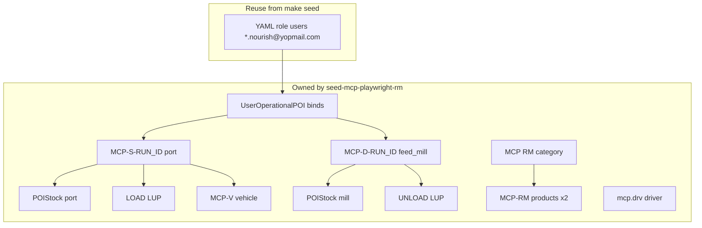

# Playwright MCP — Raw Materials Isolated Fixture Seed & Wipe

## Overview

This document is the **backend implementation plan** for a **session-scoped Raw Materials (RM) fixture sandbox** used by Playwright MCP against the [RM workflow runbook](../../09-testing/backend/e2e-scenarios/raw-material-workflow/playwright-mcp-runbook.md).

**Problem:** Local Nourish DBs accumulate residue (shared `PORT-01` / `CTG-*`, contended drivers/vehicles, drifted stock, incomplete `UserOperationalPOI`). RM MCP runs that bind to seed port/mill POIs and leftover fleet are flaky and non-reproducible. `scripts/seed-data.py` only seeds **identity/RBAC** — not RM master/ops eligibility (port POI, RM products, yard UOP, QC-enabled catalogue).

**Solution:**

1. Add a **separate** script (same pattern as `scripts/seed-mcp-playwright-fg.py`) that creates a **closed MCP-owned graph** for one `RUN_ID`.
2. Playwright MCP exercises admin SSR on that graph only (port source ≠ mill destination MCP POIs).
3. After the suite (or on failure), **wipe** only session-owned rows via a manifest — never seed login users and never “whatever looks old.”

**Primary paths:** `scripts/seed-mcp-playwright-rm.py`, Makefile targets, manifest under `tests/e2e/playwright-mcp/`  
**Cross-module models:** `apps/master_data` (POI, Product, Vehicle, LUP), `apps/users` (Driver, UserOperationalPOI), `apps/operations/stock` (POIStock), ops chain under `apps/requisitions` / `apps/transport` / `apps/operations/*` / `apps/quality/checkpoint` (wipe only)

---

## 0. Scope boundary

| In scope | Out of scope |
|----------|--------------|
| Session fixture **ensure** (Layer 1): MCP port + mill POIs, RM products (QC + non-QC), stock, LUPs, vehicle, MCP driver, UOP binds for YAML yard/QC actors | Expanding `scripts/seed-data.py` with RM master data |
| Manifest write/read (`rm-mcp-<RUN_ID>.json` + optional `rm-chain-state.json` merge) | Using `PORT-01` / `CTG-001` / shared fleet as the MCP chain sites |
| Manifest-driven **wipe** (Layer 1 assets + UI-created PS/TR/TO/yard/QC for that `RUN_ID`) | Mass tenant wipe; deleting `*.nourish@yopmail.com` seed logins |
| Makefile `seed-mcp-rm` / `wipe-mcp-rm` | Staging/prod seeding |
| Runbook + credentials YAML notes for MCP POI codes | Rewriting all 176 scenario TCs in one pass (scenarios consume manifest; `PORT-01`/`CTG-*` examples become illustrative only) |
| Optional Layer 2 `--bootstrap-to=<status>` (domain services) for yard-only resume | Default pre-creation of full PS→Closed path (UI owns §§1–6 happy path) |
| Wiring wipe skill to prefer this script | Mobile driver app / vendor fleet bid flows (Vendor Fleet TCs clone fixtures in-suite) |

### Locked decisions

| Topic | Decision | Rationale |
|-------|----------|-----------|
| Isolation | **Do not engage** existing tenant master/ops data for the MCP RM chain | Reproducible; wipe does not fight shared stock/fleet |
| Source / dest POIs | Create `MCP-S-<RUN_ID>` (port) and `MCP-D-<RUN_ID>` (feed mill) (`poi_code` ≤ 20) | Same naming contract as FG sandbox; closed graph; source ≠ dest |
| POI types | Source **`port`**; destination **`feed_mill`** | Port TR Source POI dropdown filters `poi_type=port`; dest is mill inbound site |
| Login actors | Keep YAML / `seed-data.py` role emails (`*.nourish@yopmail.com`) | Credentials registry stays source of truth |
| UOP | Session **binds** yard/QC actors onto MCP POIs; wipe removes **only** seeder-created UOP PKs | Yard queues fail-closed without UOP; don’t permanently steal `PORT-01`/`CTG-*` assignments |
| Trip driver (§6) | Session MCP driver `mcp.drv.<run_id>@example.com` (not dirty `driver1@…`) | Availability + wipe-safe; `Driver.user` PROTECT handled in wipe order |
| Products | MCP RM SKUs (`MCP-RM-<RUN_ID>-1` QC-on, `MCP-RM-<RUN_ID>-2` QC-off), not shared catalogue | Wipe-safe; §14 needs QC-enabled line; § alternate path can use `-2` |
| PS / TR / TO | **Not** created by default ensure | Admin SSR fidelity for §§1–6 |
| Stock | `POIStock` is **POI-level MT** — modest MT on port source; free capacity on dest mill | Matches `apps/operations/stock/models.py`; dest stock rises only after QC Pass + unload |
| Script home | `scripts/seed-mcp-playwright-rm.py` — **not** inside `seed-data.py` | Same separation as FG / vendor dev fixtures |
| RUN_ID vs FG | **Do not reuse** the same `RUN_ID` for FG and RM seeders | Both use `MCP-S/D-<RUN_ID>` codes — colliding RUN_ID overwrites POI type |

---

## 1. Current vs expected

| Aspect | Current | Expected |
|--------|---------|----------|
| RM MCP prerequisites | Runbook assumes `PORT-01`/`CTG-001`, RM products, UOP, free fleet — **not** created by `make seed` | `make seed-mcp-rm RUN_ID=…` creates a private sandbox |
| Driver for My Trips | YAML `driver1.nourish@…` often missing / contended | Manifest MCP driver email for §6 |
| Yard eligibility | Partial / legacy UOP on mixed emails | Dual-POI UOP on MCP-S (port) / MCP-D (mill) for gateman, scaling, CC, loading, unloading, QC |
| After run | Ad-hoc wipe skill heuristics (`PS-…`, `TR-PORT-…`) | `make wipe-mcp-rm RUN_ID=…` deletes manifest graph + tagged ops chain |
| Dirty DB | Affects pass/fail | Irrelevant to MCP RM chain |

---

## 2. Naming contract

| Field | Pattern | Example (`RUN_ID=989F50AE`) |
|-------|---------|------------------------------|
| Run ID | 8 uppercase hex | `989F50AE` |
| Source POI code | `MCP-S-<RUN_ID>` | `MCP-S-989F50AE` |
| Dest POI code | `MCP-D-<RUN_ID>` | `MCP-D-989F50AE` |
| POI display name | `MCP <Role> <RUN_ID>` | `MCP Port 989F50AE` / `MCP Mill 989F50AE` |
| Product SKU / item | `MCP-RM-<RUN_ID>-n` | `MCP-RM-989F50AE-1` |
| Product name | `MCP RM <RUN_ID> n` | unique per tenant |
| Category (if created) | `MCP-CAT-RM-<RUN_ID>` (trim to model limits) | wipe with products |
| Vehicle registration | `MCP-V-<RUN_ID>` | ≤ 20 chars — **distinct RUN_ID from FG** if both sandboxes exist |
| Driver email | `mcp.drv.<run_id_lower>@example.com` | never `@yopmail.com` |
| Driver license / contact | unique `MCP-DL-<RUN_ID>`, `+88017…` derived from RUN_ID | avoid collisions |
| LUP short_code | `MCP-L1` / `MCP-U1` (unique per POI) | |
| Free-text on PS/TR/TO | `MCP PS <RUN_ID>`, `MCP TR <RUN_ID>`, `MCP TO <RUN_ID>` | wipe / search |
| B/L / vessel (§1) | embed `MCP PS <RUN_ID>` in `bill_of_lading_number` or `vessel_name` | heuristic wipe when manifest incomplete |
| Manifest | `tests/e2e/playwright-mcp/rm-mcp-<RUN_ID>.json` | |

**Never** use wipe prefixes on seed login emails. **Never** delete codes outside the manifest / `MCP-` contract for this script.

---

## 3. Data to seed (Layer 1 — ensure)

Examples below use **`RUN_ID=989F50AE`**. Substitute the real session id everywhere `<RUN_ID>` appears. All of this is **created by** `seed-mcp-playwright-rm`; none of it may come from leftover `PORT-*` / `CTG-*` / shared fleet.

### 3.0 Inventory (what gets seeded)

| # | Model | Count | Wipe? |
|---|-------|------:|-------|
| 1 | `POI` (port source + mill dest) | 2 | Yes |
| 2 | `ProductCategory` | 1 | Yes (if unused after product delete) |
| 3 | `Product` (RawMaterial) | 2 | Yes |
| 4 | `POIStock` | 2 (one per MCP POI) | Cascades with POI |
| 5 | `LoadingUnloadingPoint` | 2 (LOAD @ port, UNLOAD @ mill) | Yes |
| 6 | `Vehicle` | 1 | Yes |
| 7 | `User` + `UserRole` + `Driver` (MCP trip driver) | 1 | Yes (`mcp.drv.*@example.com` only) |
| 8 | `UserOperationalPOI` | ~11–13 binds | Yes (manifest PKs only) |

**Not seeded by this script** (reuse `make seed` / YAML only):

| Item | Why |
|------|-----|
| Tenant `nourish`, platform | Already from `seed-data.py` |
| Role users (`commercial.officer1`, `procurement.officer1`, TP, DS, gateman, …) | Login identities from credentials YAML |
| Passwords / RBAC roles | `seed_dfms_rbac` + `seed-data.py` |
| `PORT-01`, `CTG-001`, existing vehicles | Explicitly out of band — do not reference |
| Port Shipment / Port TR / TO / yard visits / QC samples | Created by Playwright UI (Layer 1 default) |



### 3.1 POIs (2 rows)

| Field | Source POI (port) | Dest POI (feed mill) |
|-------|-------------------|----------------------|
| `poi_code` | `MCP-S-989F50AE` | `MCP-D-989F50AE` |
| `name` | `MCP Port 989F50AE` | `MCP Mill 989F50AE` |
| `poi_type` | `port` | `feed_mill` |
| `classification_type` | `neutral` | `neutral` |
| `address` | `MCP fixture port` | `MCP fixture mill` |
| `city` | `Chattogram` | `Chattogram` |
| `country` | `Bangladesh` | `Bangladesh` |
| `latitude` | `22.2400000` | `22.3700000` |
| `longitude` | `91.8200000` | `91.8000000` |
| `geofence_radius_meters` | `200` | `200` |
| `storage_capacity_mt` | `10000.00` | `5000.00` |
| `capacity_threshold_pct` | `80` | `80` |
| `number_of_gates` | `1` | `1` |
| `number_of_scales` | `1` | `1` |
| `is_active` | `True` | `True` |
| `contact_person` | `MCP Port Contact` | `MCP Mill Contact` |
| `contact_phone` | `+8801710000001` | `+8801710000002` |

`poi_code` max length **20** — pattern `MCP-S-<8 hex>` / `MCP-D-<8 hex>` is required.

### 3.2 Product category (1 row)

| Field | Value |
|-------|-------|
| `category_name` | `MCP RM Cat 989F50AE` |
| `product_type` | `RawMaterial` |
| (other required category fields) | defaults / minimal valid per model |

Optional: skip `ProductSubCategory` unless forms require it (default **no** subcategory).

### 3.3 Products (2 RawMaterial rows)

| Field | Product 1 (QC path) | Product 2 (non-QC) |
|-------|---------------------|----------------------|
| `product_sku_code` | `MCP-RM-989F50AE-1` | `MCP-RM-989F50AE-2` |
| `product_item_code` | `MCP-RM-989F50AE-1` | `MCP-RM-989F50AE-2` |
| `product_name` | `MCP RM 989F50AE 1` | `MCP RM 989F50AE 2` |
| `product_type` | `RawMaterial` | `RawMaterial` |
| `category` | FK → §3.2 | FK → §3.2 |
| `sub_category` | `null` | `null` |
| `unit_of_measure` | `Ton` | `Ton` |
| `weight_per_unit` | `null` (not required for Ton) | `null` |
| `requires_qc` | `True` | `False` |
| `is_active` | `True` | `True` |
| `preferred_vehicle_body_type` | blank or `open_truck` | same |
| `description` | `MCP RM fixture QC` | `MCP RM fixture no QC` |

Used on Port Shipment RM cargo lines (§1) and inherited on Port TR/TO. **Happy path §§1–17:** use product `-1` (QC-enabled) so §14 QC checkpoint + §16 unload stock assertions apply.

### 3.4 Stock (2 `POIStock` rows)

`POIStock` is **one aggregate MT per POI** (not per product).

| Field | Port source (`MCP-S-…`) | Mill dest (`MCP-D-…`) |
|-------|-------------------------|------------------------|
| `poi` | source POI | dest POI |
| `current_stock_mt` | `500.000` | `50.000` |
| `in_transit_outgoing_mt` | `0` | `0` |
| `in_transit_incoming_mt` | `0` | `0` |

Rationale: port panel shows stock/capacity on TR create (§2 TC02); mill has free capacity for inbound unload. RM loading deducts at **Loading Completed** (source); dest increases only after **QC Pass** + **Unloading Completed**. Record before/after in manifest `stock_snapshot`.

### 3.5 Loading / unloading points (2 LUPs)

| Field | Port LOAD | Mill UNLOAD |
|-------|-----------|-------------|
| `poi` | source | dest |
| `name` | `MCP Load Bay 989F50AE` | `MCP Unload Bay 989F50AE` |
| `short_code` | `MCP-L1` | `MCP-U1` |
| `operation_type` | `LOAD` | `UNLOAD` |
| `is_active` | `True` | `True` |
| `notes` | `MCP fixture` | `MCP fixture` |
| `created_by` | `admin.nourish@…` (or any staff user) | same |

Unique on `(poi, short_code)`.

### 3.6 Vehicle (1 row)

| Field | Value |
|-------|-------|
| `registration_number` | `MCP-V-989F50AE` |
| `vehicle_type` | `open_truck` (bulk RM) or `covered_truck` if Own Fleet picker requires it |
| `body_type` | match RM preferred body if set; else blank/default allowed |
| `capacity` | `25.000` |
| `capacity_unit` | `MT` |
| `operational_status` | `no_active_to` |
| `is_active` | `True` |
| `assigned_poi` | source port POI |
| `assigned_driver` | MCP driver (§3.7) optional at ensure time |
| `remarks` | `MCP vehicle 989F50AE` |
| `chassis_number` | `MCP-CH-989F50AE` (unique if set) |

### 3.7 MCP driver (1 User + Driver)

**Do not** use `driver1@yopmail.com` / `driver1.nourish@…` for the chain vehicle.

| Layer | Field | Value |
|-------|-------|-------|
| User | `email` | `mcp.drv.989f50ae@example.com` |
| User | `password` | `Nourish@1234!` |
| User | `first_name` / `last_name` | `MCP` / `Driver989F50AE` |
| User | `employee_id` | `MCP-DRV-989F50AE` |
| User | `is_staff` / `is_active` / `is_email_verified` | `True` |
| UserRole | `role` | public `driver` |
| Driver | `driver_type` | `own` |
| Driver | `contact_number` | unique E.164 derived from RUN_ID |
| Driver | `driving_license_number` | `MCP-DL-989F50AE` |
| Driver | `license_type` | `Heavy` |
| Driver | `license_expiry_date` | `2027-12-31` |
| Driver | `current_state` | `available` |
| Driver | `is_active` | `True` |

§6 My Trips logs in as this email (document in runbook / manifest), not the YAML seed driver.

### 3.8 `UserOperationalPOI` binds (session)

Bind existing **YAML** role users onto MCP POIs. Create rows; store PKs in `uop_ids`.

| # | User email (domain `yopmail.com`) | Role code | POI | `is_primary` |
|---|-----------------------------------|-----------|-----|--------------|
| 1 | `feed.mill.officer1.nourish@…` | `feed_mill_officer` | **dest** `MCP-D-…` | `True` |
| 2 | `gateman1.nourish@…` | `gateman` | source `MCP-S-…` | `True` |
| 3 | `gateman1.nourish@…` | `gateman` | dest `MCP-D-…` | `False` |
| 4 | `scaling.operator1.nourish@…` | `scaling_operator` | source | `True` |
| 5 | `scaling.operator1.nourish@…` | `scaling_operator` | dest | `False` |
| 6 | `command.center.officer1.nourish@…` | `command_center_officer` | source | `True` |
| 7 | `command.center.officer1.nourish@…` | `command_center_officer` | dest | `False` |
| 8 | `loading.personnel1.nourish@…` | `loading_personnel` | **source only** | `True` |
| 9 | `unloading.personnel1.nourish@…` | `unloading_personnel` | **dest only** | `True` |
| 10 | `qc.inspector.physical1.nourish@…` | `qc_inspector_physical` | **dest only** | `True` |

**Not bound by this seeder:** `commercial.officer1`, `procurement.officer1`, `transport.planner1`, `driver.supervisor1` (global ops; no yard POI required).

Leave any pre-existing `PORT-01` / `CTG-*` UOP rows on those users untouched. Wipe removes **only** the PKs listed in the manifest.

Working site in admin: choose **`MCP Port …` / `MCP Mill …`**, never `ctg-port-01` / `ctg-depot`.

### 3.9 Idempotency

`get_or_create` / update-in-place by natural keys (`poi_code`, SKU, registration, driver email, `(user, poi, role)`). Re-running ensure for the same `RUN_ID` must not duplicate rows; may refresh stock to defaults in §3.4.

### 3.10 Layer 2 — optional bootstrap (default **off**)

Flag: `--bootstrap-to=<status>` (e.g. `assigned`, `ready_for_dispatch`, `driving_towards_source`, `flagged_for_qc`).

Creates Port Shipment → Port TR → TO via **domain services** on the MCP graph only (products/POIs/vehicle/driver from §3.1–3.7). Persist numbers in manifest `ops_chain`. Use for Mode C / isolated §§7–17 — **not** default Mode A/B.

---

## 4. Manifest schema

Path: `tests/e2e/playwright-mcp/rm-mcp-<RUN_ID>.json`

```json
{
  "run_id": "989F50AE",
  "schema": "nourish",
  "workflow": "raw_materials",
  "created_at": "ISO-8601",
  "source_poi": { "id": "…", "poi_code": "MCP-S-989F50AE", "poi_type": "port" },
  "dest_poi": { "id": "…", "poi_code": "MCP-D-989F50AE", "poi_type": "feed_mill" },
  "products": [
    { "id": "…", "sku": "MCP-RM-989F50AE-1", "requires_qc": true },
    { "id": "…", "sku": "MCP-RM-989F50AE-2", "requires_qc": false }
  ],
  "vehicle": { "id": "…", "registration_number": "MCP-V-989F50AE" },
  "driver": { "id": "…", "email": "mcp.drv.989f50ae@example.com" },
  "lups": [
    { "id": "…", "short_code": "MCP-L1", "poi_code": "MCP-S-989F50AE" },
    { "id": "…", "short_code": "MCP-U1", "poi_code": "MCP-D-989F50AE" }
  ],
  "uop_ids": ["…"],
  "stock_snapshot": {
    "MCP-S-989F50AE": { "current_stock_mt": "0", "after_ensure_mt": "500" },
    "MCP-D-989F50AE": { "current_stock_mt": "0", "after_ensure_mt": "50" }
  },
  "ops_chain": {
    "ps_number": null,
    "tr_number": null,
    "to_number": null,
    "remarks_tag": "MCP … 989F50AE"
  }
}
```

After each MCP suite stage, runners **update** `ops_chain` (and may mirror into `rm-chain-state.json` per runbook).

---

## 5. Wipe (Layer 1 + ops chain)

### 5.1 CLI

```bash
# Ensure
python scripts/seed-mcp-playwright-rm.py --run-id 989F50AE
# optional: --source-code / --dest-code overrides (still MCP-prefixed)

# Wipe (require explicit RUN_ID)
python scripts/seed-mcp-playwright-rm.py --wipe --run-id 989F50AE
python scripts/seed-mcp-playwright-rm.py --wipe --run-id 989F50AE --dry-run
```

Makefile (mirror `seed-mcp-fg`):

```make
seed-mcp-rm: ## Seed isolated MCP RM sandbox (RUN_ID=required)
	$(DC_LOCAL) exec -w /app -e PYTHONPATH=/app web \
	  python scripts/seed-mcp-playwright-rm.py --run-id $(RUN_ID)

wipe-mcp-rm: ## Wipe MCP RM sandbox + ops chain for RUN_ID
	$(DC_LOCAL) exec -w /app -e PYTHONPATH=/app web \
	  python scripts/seed-mcp-playwright-rm.py --wipe --run-id $(RUN_ID)
```

### 5.2 Delete order

1. Resolve TO/TR/Port Shipment from manifest `ops_chain` and/or remarks/`RUN_ID` search (`MCP PS/TR/TO …`, `PS-…`, `TR-PORT-…`).  
2. QC samples/decisions tied to those TOs.  
3. Yard children → weighing/gate/CC/load/unload tied to those TOs.  
4. TO → TR → Port Shipment (lines, activity logs).  
5. Seeder `UserOperationalPOI` by `uop_ids`.  
6. MCP LUPs → Vehicle (respect soft-delete) → Driver → User (`mcp.drv.…` only).  
7. MCP Products → MCP categories if unused.  
8. MCP POIs (stock cascades via `POIStock.poi` CASCADE).  
9. Delete or archive manifest file; print BEFORE/AFTER counts.

**Hard bans:** delete any user email ending in `@yopmail.com`; delete `CTG-*`, `SUP-01`, `PORT-01`, non-manifest vehicles.

### 5.3 Skill alignment

Update `.cursor/skills/detect-wipe-mcp-test-data/SKILL.md` to prefer:

> If `rm-mcp-<RUN_ID>.json` exists, run `seed-mcp-playwright-rm.py --wipe --run-id …` (still confirm with user before wipe).

---

## 6. Implementation phases

### Phase A — Script skeleton + Layer 1 ensure

| Step | Work | Verify |
|------|------|--------|
| A1 | Add `scripts/seed-mcp-playwright-rm.py` with argparse, `django.setup()`, `schema_context("nourish")` | `--dry-run` prints plan |
| A2 | Create port + mill POIs, category, RM products (QC flag), stock, LUPs, vehicle, driver | Codes match §2; source `poi_type=port` |
| A3 | UOP binds §3.8 incl. QC inspector on dest | Yard + QC queues non-empty for MCP POIs |
| A4 | Write manifest | File present under `tests/e2e/playwright-mcp/` |
| A5 | Makefile targets | `make seed-mcp-rm RUN_ID=…` works via compose |

### Phase B — Wipe

| Step | Work | Verify |
|------|------|--------|
| B1 | Implement `--wipe` using manifest | Dry-run lists targets |
| B2 | Ops-chain wipe when numbers present (incl. QC rows) | PS/TR/TO gone; seed users intact |
| B3 | Re-ensure same RUN_ID after wipe | Idempotent clean recreate |

### Phase C — Docs & skills

| Step | Work | Verify |
|------|------|--------|
| C1 | RM runbook prerequisites → MCP POIs + `seed-mcp-rm` / `wipe-mcp-rm` | Link to this plan |
| C2 | `docs/guides/playwright-mcp-admin.md` + credentials YAML `rm_mcp_session` block | Agents pick MCP codes from manifest |
| C3 | Wipe skill points at script | Confirm-before-delete preserved |
| C4 | Scenario plans: `PORT-01`/`CTG-*` examples marked illustrative; “use manifest port/mill” | No silent shared-POI dependency |

### Phase D — Optional bootstrap

| Step | Work | Verify |
|------|------|--------|
| D1 | `--bootstrap-to=` via domain services on MCP graph | Status matches; numbers in manifest |
| D2 | Document Mode C usage in runbook | Yard-only suite can start mid-chain |

---

## 7. Code touchpoint summary

| Path | Change |
|------|--------|
| `scripts/seed-mcp-playwright-rm.py` | **New** — ensure + wipe |
| `Makefile` | `seed-mcp-rm`, `wipe-mcp-rm` |
| `tests/e2e/playwright-mcp/rm-mcp-<RUN_ID>.json` | Generated artifact (gitignored if needed; dir kept) |
| `docs/guides/playwright-mcp-admin.md` | RM session seeder section |
| `docs/testing/playwright-mcp-credentials.yaml` | Optional `rm_mcp_session` defaults |
| `.cursor/skills/detect-wipe-mcp-test-data/SKILL.md` | Prefer script wipe |
| `.cursor/skills/playwright-mcp-admin/SKILL.md` | Prerequisite: seed-mcp-rm for RM suites |
| RM runbook / README under `09-testing/.../raw-material-workflow/` | Prerequisites + links |

No production app feature flag required — **dev/local tooling only**.

---

## 8. MCP run procedure (consumers)

1. `make seed` — role logins if missing  
2. `make seed-mcp-rm RUN_ID=…` — create isolated RM graph + write `rm-mcp-<RUN_ID>.json`  
3. Run Playwright MCP against manifest POIs/products/driver (not `PORT-01`/`CTG-*`)  
4. §1: Commercial Officer creates Port Shipment using `MCP-RM-<RUN_ID>-1` cargo line; tag B/L/vessel with `MCP PS <RUN_ID>`  
5. §2+: Procurement selects **MCP Port …** source and **MCP Mill …** dest on Port TR  
6. `make wipe-mcp-rm RUN_ID=…` — delete that session’s graph + tagged ops chain  

Source/dest for the run: `MCP-S-<RUN_ID>` (port) → `MCP-D-<RUN_ID>` (mill).

---

## 9. Risks & mitigations

| Risk | Mitigation |
|------|------------|
| `poi_code` / registration length | Enforce ≤ 20 in script; reject long RUN_ID formats |
| FG + RM same RUN_ID | Document mutual exclusion; codes collide on `MCP-S/D-<RUN_ID>` |
| `Product.product_name` unique | Include RUN_ID in name |
| Port TR source dropdown empty | Ensure source POI `poi_type=port` and `is_active=True` |
| QC path without `requires_qc=True` product | Product `-1` seeded QC-on; document in manifest |
| `Driver.user` PROTECT | Wipe Driver then User only for `mcp.drv.*@example.com` |
| Vehicle soft-delete | Use same delete API as admin / hard-delete if soft leaves unique reg blocked |
| UOP unique `(user, poi, role)` | get_or_create; wipe by PK list |
| Partial failure mid-chain | Wipe is idempotent; allow wipe without full ops_chain |
| Scenario docs still say `PORT-01`/`CTG-*` | Phase C doc updates; agents follow runbook + manifest |

---

## 10. Definition of Done

- [x] `scripts/seed-mcp-playwright-rm.py` implements ensure + wipe + dry-run
- [x] `make seed-mcp-rm` / `make wipe-mcp-rm` documented and working on local compose
- [x] Manifest written and sufficient for MCP to pick port/mill/products/driver without reading `PORT-01`/`CTG-*`
- [x] Fresh ensure on empty or dirty DB does **not** require shared port/mill POIs or fleet
- [x] Wipe removes MCP graph + tagged ops chain (incl. QC); seed `@yopmail.com` users and non-MCP masters remain
- [x] RM runbook prerequisites updated to this flow
- [x] Wipe skill prefers manifest script (still confirm before delete)
- [ ] Optional: Layer 2 bootstrap behind flag only

---

## 11. Related documentation

| Doc | Path |
|-----|------|
| RM MCP runbook | `../../09-testing/backend/e2e-scenarios/raw-material-workflow/playwright-mcp-runbook.md` |
| RM scenario index | `../../09-testing/backend/e2e-scenarios/raw-material-workflow/README.md` |
| FG fixture precedent | `./mcp-playwright-fg-fixture-seed.md` |
| MCP admin guide | `../../../docs/guides/playwright-mcp-admin.md` |
| Credentials YAML | `../../../docs/testing/playwright-mcp-credentials.yaml` |
| Identity seed (unchanged role) | `../../../scripts/seed-data.py` |
| FG seeder reference (adapt) | `../../../scripts/seed-mcp-playwright-fg.py` |
| Wipe skill | `../../../.cursor/skills/detect-wipe-mcp-test-data/SKILL.md` |

---

## 12. Implementation TODOs

- [x] Implement Phase A (ensure + manifest)
- [x] Implement Phase B (wipe)
- [x] Implement Phase C (docs/skills/runbook)
- [ ] (Optional) Phase D bootstrap-to status
- [x] Smoke: ensure → CO Add Port Shipment shows `MCP-RM-…` products → PO TR create lists `MCP Port …` source → wipe
