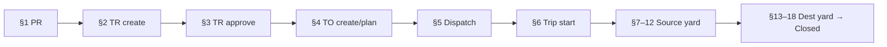

# Finished Goods Workflow — Playwright MCP Runbook

How to execute the FG scenario plans (Sections 1–18) with **Playwright MCP** against Django Admin SSR on the seeded Nourish tenant.

> **2026-08-11 — Happy path Closed** on `RUN_ID=BE16C49E` / `TO-20260811-0006` with Bag UOM (no Tons workaround). Per-section RESULTS under `01-pr-artifacts` … `13-18-dest-yard-artifacts`. Multi-point / dispatch-conflict TCs left Planned. `stock-capacity-uom` not run this session.

### MCP run history

| Date | Pass / Total | Notes |
|------|--------------|-------|
| 2026-08-11 | **Closed** (`BE16C49E` / `TO-20260811-0006`) | Clean happy path (Bag UOM). §1 15/15 · §2 14/15 (TC03 past date) · §3 11/11 · §4 27/27 (+4 Planned) · yard happy path + RBAC 403. Details: `fg-chain-state.json`. |
| 2026-07-30 | **Blocked §16** (Closed only with UOM workaround) | Happy path `B9C11F92` / `TO-20260730-0001`. Clean pass: **no**. Artifacts: `tests/e2e/playwright-mcp/fg-happy-path-artifacts/RESULTS.md`. |
| 2026-07-20 | **18/18** (prior) | Prior full chain `6A8DCB50` → Closed (see suite RESULTS under `01-pr-artifacts` … `13-18-dest-yard-artifacts`). |

This runbook is the operational companion to the [scenario index](./README.md). Generic MCP mechanics live in [`docs/guides/playwright-mcp-admin.md`](../../../../../docs/guides/playwright-mcp-admin.md). Credentials: [`docs/testing/playwright-mcp-credentials.yaml`](../../../../../docs/testing/playwright-mcp-credentials.yaml) (keep in sync with `scripts/seed-data.py`).

**Isolated FG fixtures (seed + wipe):** implementation plan [`mcp-playwright-fg-fixture-seed.md`](../../../../05-modules/testing-plan/mcp-playwright-fg-fixture-seed.md) — session sandbox `MCP-S-<RUN_ID>` / `MCP-D-<RUN_ID>` via `scripts/seed-mcp-playwright-fg.py` (do **not** bind the chain to leftover `CTG-*` / shared fleet).

---

## Purpose

- Run FG E2E scenarios in **dependency order** so each stage reuses the previous stage’s fixture (`PR` → `TR` → `TO` → yard → **Closed**).
- Persist one `RUN_ID` and a shared `state.json` so runners and humans can continue after a partial failure.
- Keep wipe-friendly data (`MCP … <RUN_ID>` remarks) and produce `RESULTS.md` + failure screenshots per suite.

---

## Prerequisites

| Check | Detail |
|-------|--------|
| Stack | Local compose up; seed applied (`make seed` / `scripts/seed-data.py`) |
| Hosts | `nourish.dev.dfms.local` → `127.0.0.1` |
| Base URL | `http://nourish.dev.dfms.local:8000` |
| Login | `/admin/login/` — **never** bare `localhost` for tenant users |
| Credentials | Use emails from `playwright-mcp-credentials.yaml` only (pattern `<role.slug><n>.nourish@yopmail.com`) |
| OTP | Local `.env` must have `ADMIN_LOGIN_OTP_ENABLED=False`. Recreate web after changing. If login lands on OTP (`?otp=1`), **stop and fix env** — do not hardcode OTP. |
| FG sandbox | `make seed-mcp-fg RUN_ID=…` per [fixture seed plan](../../../../05-modules/testing-plan/mcp-playwright-fg-fixture-seed.md) — source `MCP-S-<RUN_ID>`, dest `MCP-D-<RUN_ID>` (not `CTG-*`) |
| Manifest | `tests/e2e/playwright-mcp/fg-mcp-<RUN_ID>.json` — products, vehicle, MCP driver, UOP binds |
| Yard | UOP on MCP POIs created by the seeder; select working site **MCP-S / MCP-D** when prompted |
| Wipe | After suite: `make wipe-mcp-fg RUN_ID=…` (manifest-driven; never delete `@yopmail.com` seed logins) |
| MCP | Playwright MCP browser available in Cursor |

---

## Dependency graph (why order matters)

Sections 7–18 mutate **one** Transport Order’s lifecycle. Isolating a mid-yard section without an upstream fixture fails eligibility guards (e.g. Gate-Out needs Scale-Out + Loading Completed).

**Happy path:** one continuous TO from **Created** → **Assigned** → **Ready for Dispatch** → **Driving Towards Source** → source yard → **Driving Towards Destination** → destination yard → **Closed**.

**Negatives / RBAC / multi-point:** clone a second PR/TR/TO (or second LUP) inside the suite that needs it; do not break the main chain.

> **Live GPS history** after an FG TO is served: [`../09-tracking/live-gps-e2e-scenarios.md`](../09-tracking/live-gps-e2e-scenarios.md) (Part D), not an FG section.

---

## Artifact layout

Root: `tests/e2e/playwright-mcp/`

| Suite folder | Sections | Scenario plan(s) |
|--------------|----------|------------------|
| `01-pr-artifacts/` | 1 | [`01-pr-creation/…`](./01-pr-creation/fg-depot-feed-mill-officer-product-requisition-pr-creation-e2e-scenarios.md) |
| `02-tr-create-artifacts/` | 2 | [`02-tr-creation/…`](./02-tr-creation/fg-distribution-officer-transport-request-e2e-scenarios.md) |
| `03-tr-approval-artifacts/` | 3 | [`03-tr-approval/…`](./03-tr-approval/fg-distribution-manager-transport-request-approval-e2e-scenarios.md) |
| `04-to-artifacts/` | 4 | [`04-to-creation/…`](./04-to-creation/fg-transport-planner-transport-order-e2e-scenarios.md) |
| `05-dispatch-artifacts/` | 5 | [`05-dispatch/…`](./05-dispatch/fg-driver-supervisor-dispatch-e2e-scenarios.md) |
| `06-driver-trip-artifacts/` | 6 | [`06-trip-start/…`](./06-trip-start/fg-driver-my-trips-e2e-scenarios.md) |
| `07-12-source-yard-artifacts/` | 7–12 | [`07-gate-in-source/`](./07-gate-in-source/) … [`12-gate-out-source/`](./12-gate-out-source/) (+ [`08-scaling-source/`](./08-scaling-source/) for §8+§11) |
| `13-18-dest-yard-artifacts/` | 13–18 | [`13-gate-in-destination/`](./13-gate-in-destination/) … [`18-gate-out-destination/`](./18-gate-out-destination/) (+ [`14-scaling-destination/`](./14-scaling-destination/) for §14+§17) |

Each suite folder should contain:

| File | Role |
|------|------|
| `RESULTS.md` | PASS/FAIL table, notes, bugs found |
| `state.json` | Fixture handles for the next suite (`RUN_ID`, `pr_number`, `tr_number`, `to_number`, POI codes, status) |
| `<TC-ID>-failure.png` | Full-page screenshot on FAIL |
| Optional `run-*.js` | Scripted batch when used; MCP chat runs are also valid |

Shared chain state (recommended): `tests/e2e/playwright-mcp/fg-chain-state.json` updated after each suite so a later suite can resume without re-deriving numbers.

---

## Run order (matches dependency graph)

Execute **in order**. Do not start §N until the previous suite’s happy-path fixture is in the expected status.

### Phase A — Requisition → Transport Request

| Step | Suite | Actor (seed email) | Happy-path exit status |
|------|-------|--------------------|-------------------------|
| 1 | `01-pr-artifacts` | `depot.officer1.nourish@yopmail.com` (parity: feed mill officer) | PR **Submitted** (`PR-FG-…`) |
| 2 | `02-tr-create-artifacts` | `distribution.officer1.nourish@yopmail.com` | TR **Pending Approval** (`TR-FG-…`) |
| 3 | `03-tr-approval-artifacts` | `distribution.manager1.nourish@yopmail.com` | TR **Available for Transport Planning** |

### Phase B — Transport Order → Trip

| Step | Suite | Actor | Happy-path exit status |
|------|-------|-------|-------------------------|
| 4 | `04-to-artifacts` | `transport.planner1.nourish@yopmail.com` | TO **Assigned** (own fleet: vehicle + driver + 5 planned milestones) |
| 5 | `05-dispatch-artifacts` | `driver.supervisor1.nourish@yopmail.com` | TO **Ready for Dispatch** |
| 6 | `06-driver-trip-artifacts` | `driver1.nourish@yopmail.com` | TO **Driving Towards Source** |

### Phase C — Source yard (one TO)

| Step | Suite / module | Actor | Exit |
|------|----------------|-------|------|
| 7 | Gate-In source | `gateman1.nourish@yopmail.com` @ source POI | **At Source** |
| 8 | Scale-In source | `scaling.operator1.nourish@yopmail.com` | Queue token + **Waiting for Command Center** |
| 9 | CC bay / loading assign | `command.center.officer1.nourish@yopmail.com` | **Assigned Loading Point** |
| 10 | Loading start/end | `loading.personnel1.nourish@yopmail.com` | **Loading Completed** (stock ↓ source) |
| 11 | Scale-Out source | Scaling Operator | Scale-out sub-state |
| 12 | Gate-Out source | Gateman | **Driving Towards Destination** |

Store artifacts under `07-12-source-yard-artifacts/` (one `RESULTS.md` with subsections, or per-module RESULT blocks).

### Phase D — Destination yard → Closed

| Step | Suite / module | Actor | Exit |
|------|----------------|-------|------|
| 13 | Gate-In dest | Gateman @ destination POI | **At Destination** |
| 14 | Scale-In dest | Scaling Operator | Waiting CC (dest) |
| 15 | CC unload assign | Command Center Officer | **Assigned Unloading Point** |
| 16 | Unloading | `unloading.personnel1.nourish@yopmail.com` | **Unloading Completed** (stock ↑ dest) |
| 17 | Scale-Out dest | Scaling Operator | Toward **Completed** |
| 18 | Gate-Out dest | Gateman | TO **Closed** (auto; no TP Close queue) |

Store under `13-18-dest-yard-artifacts/`.

---

## Session conventions

1. **One `RUN_ID`** per full chain (8 uppercase hex chars). Tag free-text fields: `MCP PR <RUN_ID>`, `MCP TR <RUN_ID>`, `MCP TO <RUN_ID>`.
2. **Login:** seeded role → password → assert no OTP page → select **Working site** when the bar requires it (yard roles).
3. **Selectors:** prefer accessibility snapshots / role+name over brittle CSS; neutralize Django Debug Toolbar before clicks.
4. **Assert UI labels + enum values** from scenario Implementation Notes (e.g. badge **Pending Approval** / `pending_approval`).
5. **Known gaps:** treat unexpected acceptance as FAIL (e.g. past delivery date on TR create) and file a bug in `RESULTS.md`.
6. **Stop on OTP** or unexpected permission denial for the seed role — environment/seed issue, not a TC fail.
7. **Wipe** after the chain (or after a failed long run) via `make wipe-mcp-fg RUN_ID=…` / [fixture seed plan](../../../../05-modules/testing-plan/mcp-playwright-fg-fixture-seed.md) (prefer over ad-hoc DB deletes). Confirm before wipe; never delete `@yopmail.com` seed logins or non-MCP masters (`SUP-01`, etc.).

---

## Recommended MCP execution modes

| Mode | When | How |
|------|------|-----|
| **A — Sections 1–6 first** | Safer first pass | Complete Phase A–B; green `RESULTS.md` before yard |
| **B — Full chain 1–18** | Regression / release | One `RUN_ID`; continue until Closed or hard stop |
| **C — Resume** | Mid-chain failure | Load `fg-chain-state.json` / suite `state.json`; re-run only the failed suite and below |

Suggested first MCP prompt (Mode A):

> Run Playwright MCP against Section 1 PR creation scenario plan. Use `depot.officer1.nourish@yopmail.com`, `RUN_ID=<new>`, write `tests/e2e/playwright-mcp/01-pr-artifacts/RESULTS.md`, update `fg-chain-state.json`. Screenshot failures as `TC##-failure.png`.

Then continue with Section 2 using the `pr_number` from state, and so on.

---

## Primary actors cheat sheet

| Section | Role | Email (default domain `yopmail.com`) |
|---------|------|--------------------------------------|
| 1 | Depot Officer | `depot.officer1.nourish@…` |
| 1 | Feed Mill Officer | `feed.mill.officer1.nourish@…` |
| 2 | Distribution Officer | `distribution.officer1.nourish@…` |
| 3 | Distribution Manager | `distribution.manager1.nourish@…` |
| 4 | Transport Planner | `transport.planner1.nourish@…` |
| 5 | Driver Supervisor | `driver.supervisor1.nourish@…` |
| 6 | Driver | `driver1.nourish@…` |
| 7–12 / 13–18 | Gateman, Scaling, CC, Loading, Unloading | `*.nourish@…` per role |
| Audit / History | Tenant Admin | `admin.nourish@…` |

Password for operational + drivers: `Nourish@1234!`. Tenant admin: `NourishAdmin@1234!`.

---

## What is out of scope for this MCP chain

- Port Consignment / Procurement TR flows
- Vendor fleet full path (optional smoke only in §4)
- Mobile driver app binary (use Django Admin **My Trips**)
- Push/email notification delivery
- REST API fuzz / XSS suites
- Staging/prod OTP-enabled login (local OTP off only)

---

## Related docs

| Doc | Path |
|-----|------|
| Scenario index (§1–18) | [README.md](./README.md) |
| Generic MCP admin runbook | `docs/guides/playwright-mcp-admin.md` |
| Credentials registry | `docs/testing/playwright-mcp-credentials.yaml` |
| Cursor skill | `.cursor/skills/playwright-mcp-admin/SKILL.md` |
| FG fixture seed / wipe (implementation) | `../../../../05-modules/testing-plan/mcp-playwright-fg-fixture-seed.md` |
| Wipe MCP data | `.cursor/skills/detect-wipe-mcp-test-data/SKILL.md` |
| Run scenarios skill | `.cursor/skills/run-playwright-mcp-scenarios/SKILL.md` |
