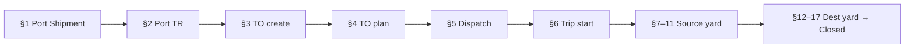

# Raw Materials Workflow — Playwright MCP Runbook

How to execute the RM scenario plans (Sections 1–17) with **Playwright MCP** against Django Admin SSR on the seeded Nourish tenant.

Companion to the [scenario index](./README.md). Generic MCP mechanics: [`docs/guides/playwright-mcp-admin.md`](../../../../../docs/guides/playwright-mcp-admin.md). Credentials: [`docs/testing/playwright-mcp-credentials.yaml`](../../../../../docs/testing/playwright-mcp-credentials.yaml).

**Isolated RM fixtures (seed + wipe):** implementation plan [`mcp-playwright-rm-fixture-seed.md`](../../../../05-modules/testing-plan/mcp-playwright-rm-fixture-seed.md) — session sandbox `MCP-S-<RUN_ID>` (port) / `MCP-D-<RUN_ID>` (mill) via `scripts/seed-mcp-playwright-rm.py` (do **not** bind the chain to leftover `PORT-01` / `CTG-*` / shared fleet).

---

## Purpose

- Run RM E2E scenarios in **dependency order** so each stage reuses the previous fixture (`Port Shipment` → `TR` → `TO` → yard → **Closed**).
- Persist one `RUN_ID` and shared `state.json` for partial-failure resume.
- Use wipe-friendly remarks (`MCP … <RUN_ID>`) and produce `RESULTS.md` + failure screenshots per suite.

---

## Prerequisites

| Check | Detail |
|-------|--------|
| Stack | Local compose up; seed applied (`make seed` / `scripts/seed-data.py`) |
| Base URL | `http://nourish.dev.dfms.local:8000` |
| Login | `/admin/login/` |
| RM sandbox | `make seed-mcp-rm RUN_ID=…` per [fixture seed plan](../../../../05-modules/testing-plan/mcp-playwright-rm-fixture-seed.md) — source `MCP-S-<RUN_ID>` (`poi_type=port`), dest `MCP-D-<RUN_ID>` (`feed_mill`; not `PORT-01`/`CTG-*`) |
| Manifest | `tests/e2e/playwright-mcp/rm-mcp-<RUN_ID>.json` — RM products (`MCP-RM-<RUN_ID>-1` QC-on for §14 path), vehicle, MCP driver, UOP binds |
| Yard | UOP on MCP POIs created by the seeder; select working site **MCP Port / MCP Mill** when prompted |
| OTP | `ADMIN_LOGIN_OTP_ENABLED=False` in local `.env` |
| Wipe | After suite: `make wipe-mcp-rm RUN_ID=…` (manifest-driven; never delete `@yopmail.com` seed logins). Fallback: `.cursor/skills/detect-wipe-mcp-test-data/SKILL.md` — track `PS-…`, `TR-PORT-…`, `TO-…` by remarks |

---

## Dependency graph

**RM-specific:** Port TR skips DM approval → status **Available for Transport Planning** immediately. Trip start transitions to **Driving Towards Source** (`rm_inbound`). Destination stock increases only after **QC Pass** + **Unloading Completed** (QC-enabled products).

---

## Artifact layout

Root: `tests/e2e/playwright-mcp/`

| Suite folder | Sections | Scenario plan(s) |
|--------------|----------|------------------|
| `rm-01-port-shipment-artifacts/` | 1 | [`01-port-shipment/…`](./01-port-shipment/rm-commercial-officer-port-shipment-e2e-scenarios.md) |
| `rm-02-tr-create-artifacts/` | 2 | [`02-tr-creation/…`](./02-tr-creation/rm-procurement-officer-port-tr-e2e-scenarios.md) |
| `rm-03-04-to-artifacts/` | 3–4 | [`03-to-creation/`](./03-to-creation/) + [`04-to-planning/`](./04-to-planning/) |
| `rm-05-dispatch-artifacts/` | 5 | [`05-dispatch/…`](./05-dispatch/rm-driver-supervisor-dispatch-e2e-scenarios.md) |
| `rm-06-driver-trip-artifacts/` | 6 | [`06-trip-start/…`](./06-trip-start/rm-driver-trip-start-e2e-scenarios.md) |
| `rm-07-11-source-yard-artifacts/` | 7–11 | [`07-gate-in-source/`](./07-gate-in-source/) … [`11-gate-out-source/`](./11-gate-out-source/) |
| `rm-12-17-dest-yard-artifacts/` | 12–17 | [`12-gate-in-destination/`](./12-gate-in-destination/) … [`17-gate-out-destination/`](./17-gate-out-destination/) |

Each folder should contain `RESULTS.md`, `state.json` (optional), and failure screenshots.

---

## Key actors (seed)

| Role | Email |
|------|-------|
| Commercial Officer | `commercial.officer1.nourish@yopmail.com` |
| Procurement Officer | `procurement.officer1.nourish@yopmail.com` |
| Transport Planner | `transport.planner1.nourish@yopmail.com` |
| Driver Supervisor | `driver.supervisor1.nourish@yopmail.com` |
| Driver | `driver1.nourish@yopmail.com` |
| Gateman | `gateman1.nourish@yopmail.com` |
| Scaling Operator | `scaling.operator1.nourish@yopmail.com` |
| Command Center Officer | `command.center.officer1.nourish@yopmail.com` |
| Loading Personnel | `loading.personnel1.nourish@yopmail.com` |
| Unloading Personnel | `unloading.personnel1.nourish@yopmail.com` |
| QC Inspector | `qc.inspector.physical1.nourish@yopmail.com` |
| Tenant Admin | `admin.nourish@yopmail.com` |

Password: `Nourish@1234!` (admin: `NourishAdmin@1234!`)
