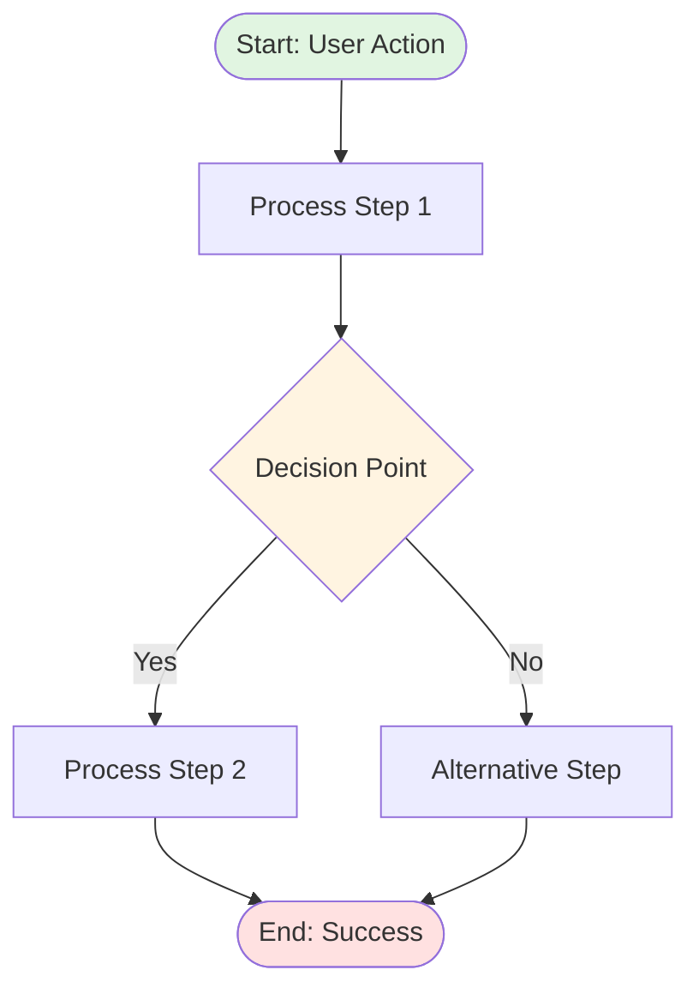

# Technical Context Generation Plan

> Plan for building high-level technical architecture, workflows, and interface contracts

## 📘 Overview

This plan focuses on building the **technical-context/** folder, which contains high-level technical architecture, workflows, implementation approach, architectural decisions, and interface contracts for the DFMS product.

**Related Plans:**
- [BUSINESS_CONTEXT_PLAN.md](BUSINESS_CONTEXT_PLAN.md) - Business domain knowledge
- [REPOSITORY_PURPOSE.md](REPOSITORY_PURPOSE.md) - Overall repository purpose and architecture

---

## 🎯 Objective

Create high-level technical documentation that defines:
1. **System Architecture** (C4 Level 1-2) - How components interact
2. **Workflows** - Operational and user flows
3. **Implementation Approach** - High-level strategy
4. **Architectural Decisions** - Key technical choices
5. **Interface Contracts** - APIs, events, and data models

### Target Audience
- **Primary**: Software architects, tech leads, developers
- **Secondary**: Product managers, DevOps engineers
- **Tertiary**: LLMs for technical context understanding

---

## 📋 Scope

### What's Included
- ✅ High-level system architecture (C4 Level 1-2)
- ✅ Module boundaries and interactions
- ✅ Operational and user workflows
- ✅ Integration patterns (NOT specific implementations)
- ✅ Implementation approach and deployment strategy
- ✅ Architectural Decision Records (ADRs)
- ✅ **Interface contracts** (APIs, Events, Data Models)

### What's NOT Included
- ❌ Detailed class diagrams (Level 3-4)
- ❌ Specific technology stack choices
- ❌ Database schemas or migrations
- ❌ Concrete code implementation
- ❌ Infrastructure as code
- ❌ Framework-specific details

### Abstraction Level
This repo defines **WHAT and HOW (high-level)**, not **HOW (implementation details)**.

---

## 🏗️ Folder Structure

```
technical-context/
├── 00-overview/
│   ├── README.md
│   ├── architecture-summary.md
│   └── design-principles.md
│
├── 01-architecture/               # HIGH-LEVEL ONLY (C4 Level 1-2)
│   ├── README.md
│   ├── system-overview.md         # System context (C4 Level 1)
│   ├── architectural-principles.md
│   ├── modules/
│   │   ├── README.md
│   │   ├── module-boundaries.md   # Container view (C4 Level 2)
│   │   └── module-interactions.md
│   ├── data-architecture/
│   │   ├── README.md
│   │   ├── data-model-overview.md # High-level entities only
│   │   └── data-flow.md
│   ├── integration/
│   │   ├── README.md
│   │   ├── integration-patterns.md
│   │   └── external-systems.md
│   └── diagrams/
│       ├── system-context.mmd     # C4 Level 1
│       └── container-view.mmd     # C4 Level 2
│
├── 02-workflows/
│   ├── README.md
│   ├── operational-flows/
│   │   ├── README.md
│   │   ├── transport-request-flow.mmd
│   │   ├── transport-order-flow.mmd
│   │   ├── trip-execution-flow.mmd
│   │   ├── quality-control-flow.mmd
│   │   ├── vendor-bidding-flow.mmd
│   │   └── invoice-processing-flow.mmd
│   ├── user-workflows/
│   │   ├── README.md
│   │   ├── logistics-coordinator.md
│   │   ├── driver.md
│   │   ├── qc-supervisor.md
│   │   ├── vendor.md
│   │   └── finance-team.md
│   └── exception-handling/
│       ├── README.md
│       └── exception-scenarios.md
│
├── 03-implementation/             # HIGH-LEVEL implementation approach
│   ├── README.md
│   ├── deployment-strategy/
│   │   ├── README.md
│   │   ├── phase-1-deployment.md
│   │   ├── phase-2-deployment.md
│   │   └── phase-3-deployment.md
│   ├── technology-considerations.md  # Not decisions, considerations
│   ├── testing-approach.md      # High-level testing strategy
│   ├── migration-strategy.md    # Data migration approach
│   └── rollout-plan.md
│
├── 04-decisions/
│   ├── README.md
│   └── adr/                       # HIGH-LEVEL decisions only
│       ├── 0001-record-architecture-decisions.md
│       ├── 0002-multi-tenant-architecture.md
│       ├── 0003-microservices-vs-monolith.md
│       ├── 0004-async-communication-pattern.md
│       └── template.md
│
├── 05-contracts/                  # INTERFACE CONTRACTS (Git Submodule Usage)
│   ├── README.md
│   ├── api/                       # API Contracts (OpenAPI/GraphQL)
│   │   ├── README.md
│   │   ├── openapi/
│   │   │   └── openapi-spec.yaml
│   │   ├── rest/
│   │   │   ├── transport-management.yaml
│   │   │   ├── fleet-management.yaml
│   │   │   ├── quality-control.yaml
│   │   │   └── vendor-management.yaml
│   │   └── graphql/
│   │       └── schema.graphql
│   ├── events/                    # Event Contracts (Async Communication)
│   │   ├── README.md
│   │   ├── trip-events.yaml
│   │   ├── vehicle-events.yaml
│   │   └── qc-events.yaml
│   ├── data-models/               # Shared Data Contracts
│   │   ├── README.md
│   │   ├── entities/
│   │   │   ├── transport-order.yaml
│   │   │   ├── trip.yaml
│   │   │   ├── vehicle.yaml
│   │   │   └── driver.yaml
│   │   ├── enums/
│   │   │   ├── trip-status.yaml
│   │   │   └── vehicle-type.yaml
│   │   └── value-objects/
│   │       ├── address.yaml
│   │       └── location.yaml
│   ├── messages/                  # Message Queue Contracts
│   │   ├── README.md
│   │   ├── commands/
│   │   └── queries/
│   └── integration/               # External Integration Contracts
│       ├── README.md
│       ├── erp-integration.yaml
│       └── gps-device-integration.yaml
│
└── 06-reference/
    ├── README.md
    └── appendix/
        ├── source-document-mapping.md
        └── version-history.md
```

---

## 📊 Source-to-Technical-Context Mapping

### From `source-documents/business-proposal/`

**Source**: `BS23_Proposal_Nourish_LFMS_v1.3.1_No_Commercial.docx`

**Extract To**:
- Deployment phases → `technical-context/03-implementation/deployment-strategy/`
- Technology considerations → `technical-context/03-implementation/technology-considerations.md`
- System architecture overview → `technical-context/01-architecture/system-overview.md`

### From `source-documents/discovery-phase/flow-diagrams/`

**Sources**: All flow diagram images (PNG, JPG)

**Extract To**:
- Convert to Mermaid diagrams → `technical-context/02-workflows/operational-flows/`
- Document workflow descriptions → `technical-context/02-workflows/`

**Method**: 
1. Analyze each flow diagram
2. Recreate as Mermaid diagram
3. Add descriptive markdown for each workflow

### From `source-documents/planning/work-breakdown/`

**Sources**: All WBS XLSX files

**Extract To**:
- Tasks by phase → `technical-context/03-implementation/deployment-strategy/`
- Timeline → `technical-context/03-implementation/rollout-plan.md`
- Resource allocation → `technical-context/03-implementation/`

### From `business-context/03-features/`

**Cross-reference**: User stories and features

**Extract To**:
- API requirements → `technical-context/05-contracts/api/`
- Event requirements → `technical-context/05-contracts/events/`
- Data model requirements → `technical-context/05-contracts/data-models/`

---

## 🔄 Extraction & Creation Process

### Phase 1: Architecture (Week 1)

#### Step 1.1: System Context (C4 Level 1)
- [ ] Identify all external actors (users, external systems)
- [ ] Define DFMS system boundary
- [ ] Document interactions between actors and system
- [ ] Create `system-context.mmd` diagram
- [ ] Write `system-overview.md`

#### Step 1.2: Container View (C4 Level 2)
- [ ] Identify major containers (web app, mobile app, backend API, database, etc.)
- [ ] Define container boundaries
- [ ] Document inter-container communication
- [ ] Create `container-view.mmd` diagram
- [ ] Write `module-boundaries.md` and `module-interactions.md`

#### Step 1.3: Integration Patterns
- [ ] Document how system integrates with ERP
- [ ] Document GPS device integration approach
- [ ] Document SMS gateway integration
- [ ] Define integration patterns (sync vs async, REST vs events)

### Phase 2: Workflows (Week 2)

#### Step 2.1: Operational Flows
- [ ] Convert flow diagrams to Mermaid
- [ ] Create transport-request-flow.mmd
- [ ] Create transport-order-flow.mmd
- [ ] Create trip-execution-flow.mmd
- [ ] Create quality-control-flow.mmd
- [ ] Create vendor-bidding-flow.mmd
- [ ] Create invoice-processing-flow.mmd

#### Step 2.2: User Workflows
- [ ] Document logistics coordinator workflows
- [ ] Document driver workflows
- [ ] Document QC supervisor workflows
- [ ] Document vendor workflows
- [ ] Document finance team workflows

#### Step 2.3: Exception Handling
- [ ] Document error scenarios
- [ ] Define recovery procedures
- [ ] Create exception flow diagrams

### Phase 3: Implementation Approach (Week 3)

#### Step 3.1: Deployment Strategy
- [ ] Extract Phase 1 deployment from business proposal
- [ ] Extract Phase 2 deployment from business proposal
- [ ] Extract Phase 3 deployment from business proposal
- [ ] Document rollout approach
- [ ] Create timeline and milestones

#### Step 3.2: Technology Considerations
- [ ] Document technology evaluation criteria
- [ ] List technology options (NOT decisions)
- [ ] Document trade-offs

#### Step 3.3: Testing & Migration
- [ ] Define high-level testing strategy
- [ ] Document data migration approach

### Phase 4: Contracts - APIs (Week 4)

#### Step 4.1: Define API Contracts
- [ ] Extract API requirements from user stories
- [ ] Group APIs by module
- [ ] Define OpenAPI 3.0 contracts for:
  - Transport Management APIs
  - Fleet Management APIs
  - Quality Control APIs
  - Vendor Management APIs
- [ ] Document request/response schemas
- [ ] Add examples for each endpoint

### Phase 5: Contracts - Events & Data (Week 5)

#### Step 5.1: Event Contracts
- [ ] Identify async communication needs
- [ ] Define event schemas:
  - Trip events
  - Vehicle events
  - QC events
  - Notification events

#### Step 5.2: Data Model Contracts
- [ ] Define shared entities (TransportOrder, Trip, Vehicle, Driver)
- [ ] Define enums (TripStatus, VehicleType, etc.)
- [ ] Define value objects (Address, Location, etc.)

#### Step 5.3: Integration Contracts
- [ ] Define ERP integration contract
- [ ] Define GPS device integration contract
- [ ] Define SMS gateway integration contract

### Phase 6: ADRs & Polish (Week 6)

#### Step 6.1: Architectural Decisions
- [ ] Document ADR template
- [ ] Create ADR for multi-tenant architecture
- [ ] Create ADR for microservices vs monolith
- [ ] Create ADR for async communication pattern
- [ ] Create ADR for authentication approach

#### Step 6.2: Quality & Cross-Reference
- [ ] Add cross-references throughout
- [ ] Enhance all READMEs
- [ ] Validate all contracts
- [ ] Quality review all documents

---

## 📝 Document Templates

### Architecture Document Template

```markdown
---
title: [Document Title]
category: architecture
abstraction_level: high-level
c4_level: [1|2|n/a]
status: [draft|review|approved]
created: YYYY-MM-DD
updated: YYYY-MM-DD
related_docs:
  - ../path/to/related.md
tags: [architecture, system-design]
---

# [Document Title]

## Overview
[High-level summary of architectural component or decision]

## Context
[Why this architecture exists, what problem it addresses]

## Architecture Description
[Main architectural details - components, boundaries, interactions]

### Components
[List and describe major components]

### Interactions
[How components communicate]

## Design Principles
[Key principles guiding this design]

## Trade-offs
[What was gained, what was compromised]

## Integration Points
[How this integrates with other parts of system]

## Non-Functional Considerations
- **Performance**: [considerations]
- **Scalability**: [considerations]
- **Security**: [considerations]

## References
- Related ADRs: [links]
- Business requirements: [links to business-context]

---

**Last Updated**: YYYY-MM-DD  
**Status**: [Current status]
```

### Mermaid Workflow Template



### ADR Template

```markdown
---
title: ADR-XXXX: [Decision Title]
status: [proposed|accepted|deprecated|superseded]
date: YYYY-MM-DD
decision_makers: [list of people/roles]
related_adrs:
  - ADR-YYYY
tags: [architecture, decision]
---

# ADR-XXXX: [Decision Title]

## Status
[proposed | accepted | deprecated | superseded by ADR-YYYY]

## Context
[What is the issue that we're addressing? What factors are at play?]

## Decision
[What is the change that we're proposing and/or doing?]

## Consequences

### Positive
- [Benefit 1]
- [Benefit 2]

### Negative
- [Trade-off 1]
- [Trade-off 2]

### Neutral
- [Side effect 1]

## Alternatives Considered
1. **[Alternative 1]**: [Why not chosen]
2. **[Alternative 2]**: [Why not chosen]

## References
- [Link to related documentation]
- [Link to business requirements]

---

**Date**: YYYY-MM-DD  
**Status**: [Current status]
```

### API Contract Template (OpenAPI 3.0)

```yaml
openapi: 3.0.3
info:
  title: DFMS - Transport Management API
  description: API for managing transport requests and orders
  version: 1.0.0
  contact:
    name: Brain Station 23
    url: https://brainstation-23.com

servers:
  - url: https://api.dfms.example.com/v1
    description: Production server
  - url: https://api-staging.dfms.example.com/v1
    description: Staging server

tags:
  - name: Transport Requests
    description: Operations related to transport requests
  - name: Transport Orders
    description: Operations related to transport orders

paths:
  /transport-requests:
    post:
      summary: Create a new transport request
      tags:
        - Transport Requests
      requestBody:
        required: true
        content:
          application/json:
            schema:
              $ref: '#/components/schemas/TransportRequestCreate'
      responses:
        '201':
          description: Transport request created successfully
          content:
            application/json:
              schema:
                $ref: '#/components/schemas/TransportRequest'
        '400':
          $ref: '#/components/responses/BadRequest'
        '401':
          $ref: '#/components/responses/Unauthorized'

components:
  schemas:
    TransportRequestCreate:
      type: object
      required:
        - origin
        - destination
        - requestedDate
      properties:
        origin:
          type: string
          description: Origin location ID
        destination:
          type: string
          description: Destination location ID
        requestedDate:
          type: string
          format: date-time
          description: Requested delivery date

    TransportRequest:
      type: object
      properties:
        id:
          type: string
          format: uuid
        trNumber:
          type: string
        origin:
          type: string
        destination:
          type: string
        status:
          $ref: '#/components/schemas/TRStatus'

    TRStatus:
      type: string
      enum:
        - PENDING
        - APPROVED
        - CONVERTED
        - CANCELLED

  responses:
    BadRequest:
      description: Bad request
      content:
        application/json:
          schema:
            $ref: '#/components/schemas/Error'

    Unauthorized:
      description: Unauthorized
      content:
        application/json:
          schema:
            $ref: '#/components/schemas/Error'

    Error:
      type: object
      properties:
        code:
          type: string
        message:
          type: string
```

### Event Contract Template (AsyncAPI-style YAML)

```yaml
# technical-context/05-contracts/events/trip-events.yaml
asyncapi: 2.6.0
info:
  title: DFMS Trip Events
  version: 1.0.0
  description: Events related to trip lifecycle

channels:
  trip.created:
    description: Published when a new trip is created
    publish:
      message:
        $ref: '#/components/messages/TripCreated'

  trip.started:
    description: Published when a trip is started
    publish:
      message:
        $ref: '#/components/messages/TripStarted'

  trip.completed:
    description: Published when a trip is completed
    publish:
      message:
        $ref: '#/components/messages/TripCompleted'

components:
  messages:
    TripCreated:
      payload:
        type: object
        properties:
          tripId:
            type: string
            format: uuid
          toNumber:
            type: string
          vehicleId:
            type: string
          driverId:
            type: string
          createdAt:
            type: string
            format: date-time

    TripStarted:
      payload:
        type: object
        properties:
          tripId:
            type: string
            format: uuid
          startedAt:
            type: string
            format: date-time
          startLocation:
            $ref: '#/components/schemas/Location'

    TripCompleted:
      payload:
        type: object
        properties:
          tripId:
            type: string
            format: uuid
          completedAt:
            type: string
            format: date-time
          endLocation:
            $ref: '#/components/schemas/Location'

  schemas:
    Location:
      type: object
      properties:
        latitude:
          type: number
        longitude:
          type: number
```

---

## 🔍 Quality Criteria

### Architecture Documents
- [ ] High-level only (C4 Level 1-2)
- [ ] No implementation details
- [ ] Clear component boundaries
- [ ] Well-documented integration points

### Workflows
- [ ] All operational flows documented
- [ ] Mermaid diagrams for all major flows
- [ ] User workflows for all personas
- [ ] Exception scenarios covered

### Contracts
- [ ] All contracts valid OpenAPI/AsyncAPI
- [ ] Complete request/response schemas
- [ ] Examples for every endpoint/event
- [ ] Versioning strategy clear

### ADRs
- [ ] Context clearly stated
- [ ] Decision rationale documented
- [ ] Alternatives considered
- [ ] Consequences identified

---

## 📅 Execution Timeline

### Week 1: Architecture Foundation
**Focus**: System architecture (C4 Level 1-2)

- [ ] Create system context diagram
- [ ] Create container view diagram
- [ ] Document module boundaries
- [ ] Document integration patterns

**Deliverables**: `00-overview/`, `01-architecture/` (complete)

### Week 2: Workflows
**Focus**: Operational and user workflows

- [ ] Convert all flow diagrams to Mermaid
- [ ] Create operational flow documents
- [ ] Create user workflow documents
- [ ] Document exception handling

**Deliverables**: `02-workflows/` (complete)

### Week 3: Implementation Approach
**Focus**: Deployment and implementation strategy

- [ ] Extract deployment phases
- [ ] Document technology considerations
- [ ] Create testing approach
- [ ] Document migration strategy

**Deliverables**: `03-implementation/` (complete)

### Week 4: API Contracts
**Focus**: REST API contracts

- [ ] Define API contracts for all modules
- [ ] Create OpenAPI specifications
- [ ] Add examples and documentation

**Deliverables**: `05-contracts/api/` (complete)

### Week 5: Event & Data Contracts
**Focus**: Async events and data models

- [ ] Define event contracts
- [ ] Define data model contracts
- [ ] Define integration contracts

**Deliverables**: `05-contracts/events/`, `05-contracts/data-models/`, `05-contracts/integration/` (complete)

### Week 6: ADRs & Polish
**Focus**: Decisions and quality

- [ ] Create ADR template
- [ ] Document key ADRs
- [ ] Add cross-references
- [ ] Validate all contracts
- [ ] Quality review

**Deliverables**: `04-decisions/`, `06-reference/` (complete), all validation passing

---

## 🛠️ Tools & Automation

### Required Tools

#### For Architecture & Workflows
- Mermaid CLI - Generate diagrams
- Draw.io converter - Convert existing diagrams
- Markdown editor

#### For Contracts
- **OpenAPI Tools**:
  - Swagger Editor - Validate OpenAPI specs
  - OpenAPI Generator - Generate types
  - Spectral - Lint OpenAPI files
- **Schema Validation**:
  - `ajv` - JSON Schema validator
- **Type Generation**:
  - `openapi-typescript` - Generate TypeScript types
  - `quicktype` - Generate types for multiple languages

### Validation Scripts

**Validate OpenAPI Contracts**:
```bash
#!/bin/bash
# scripts/validate-contracts.sh
for file in technical-context/05-contracts/api/rest/*.yaml; do
  echo "Validating $file..."
  spectral lint "$file"
done
```

**Generate TypeScript Types**:
```bash
#!/bin/bash
# scripts/generate-types.sh
npx openapi-typescript technical-context/05-contracts/api/openapi/openapi-spec.yaml \
  -o generated-types/api-types.ts
```

---

## 📈 Success Metrics

### Quantitative
- **Architecture Coverage**: C4 Level 1-2 complete
- **Workflow Coverage**: All major flows documented
- **API Coverage**: 100% of features have API contracts
- **Contract Validation**: All contracts pass validation
- **ADR Coverage**: All major decisions documented

### Qualitative
- **Clarity**: Architects understand system boundaries
- **Consistency**: All contracts follow same structure
- **Usability**: Types can be generated for target languages
- **Maintainability**: Easy to update when architecture evolves
- **Implementation-Ready**: Teams can start building from contracts

---

## 🔄 Maintenance Plan

### Ongoing Updates
- When architecture changes, update FIRST, then implementation
- Version contracts using semantic versioning
- Document breaking changes clearly
- Coordinate contract changes across all implementation repos

### Review Cycle
- **Per Feature**: Update contracts when adding features
- **Pre-Release**: Validate all contracts before deployment
- **Post-Release**: Verify implementation matches contracts
- **Quarterly**: Review and update ADRs

### Git Submodule Updates

**For Implementation Repos**:
```bash
# Update to latest
cd DFMS-backend
git submodule update --remote domain
git commit -m "Update domain contracts to v1.2.0"

# Pin to specific version
cd domain
git checkout v1.2.0
cd ..
git add domain
git commit -m "Pin domain to v1.2.0"
```

---

## 📚 Related Documents

- [BUSINESS_CONTEXT_PLAN.md](BUSINESS_CONTEXT_PLAN.md) - Business domain plan
- [PRODUCT_VISION.md](PRODUCT_VISION.md) - Product vision and strategy
- [REPOSITORY_PURPOSE.md](REPOSITORY_PURPOSE.md) - Repository architecture

---

## 📦 Deliverables Summary

At completion, `technical-context/` will contain:

- **High-level architecture** (C4 Level 1-2 diagrams and documentation)
- **~15+ workflow diagrams** in Mermaid format
- **Implementation approach** documents
- **~10+ ADRs** for key decisions
- **~50+ YAML contract files** (APIs, Events, Data Models)
- **Complete validation** pipeline for contracts
- **Usage examples** for generating types

---

**Plan Version**: 1.0  
**Created**: February 2026  
**Status**: Ready for execution  
**Timeline**: 6 weeks  
**Next Step**: Begin Week 1 - Architecture Foundation

