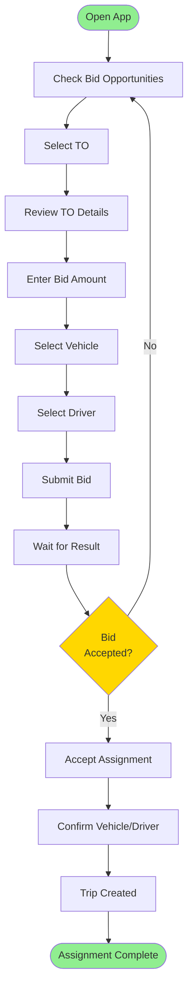

# Vendor Workflows

> Mobile and web workflows for vendors

**Status**: ✅ Complete  
**Last Updated**: February 13, 2026  
**User Role**: Vendor  
**Primary Device**: Mobile App / Web Portal

---

## 📋 Overview

Vendors use DFMS to receive trip opportunities, submit bids, accept trip assignments, track trips, and manage invoices. This document covers vendor workflows.

---

## 👤 User Profile

**Role**: Vendor  
**Type**: External Stakeholder  
**Primary Responsibilities**:
- Submit bids for transport orders
- Accept trip assignments
- Provide vehicle and driver details
- Track trip progress
- Manage invoices

**Daily Tasks**:
- Check bid opportunities
- Submit bids
- Accept assignments
- Track trips
- Manage invoices

---

## 🔄 Daily Workflow

### Task 1: Check Bid Opportunities
**Duration**: 10-15 minutes  
**Frequency**: Multiple times daily

**Steps**:
1. Open DFMS app/portal
2. Navigate to "Bid Opportunities"
3. Review available TOs
4. Filter by route, vehicle type, amount
5. Select TOs to bid on

**Display**:
- TO list with details
- Route information
- Bid amount range
- Bidding deadline
- Vehicle requirements

---

### Task 2: Submit Bid
**Duration**: 5-10 minutes  
**Frequency**: Per bid

**Steps**:
1. Select TO
2. Review TO details
3. Enter bid amount
4. Select vehicle
5. Select driver
6. Add notes (optional)
7. Submit bid

**Bid Data**:
- Bid amount
- Vehicle registration
- Driver name and contact
- Driver license number
- Estimated arrival time

**Validation**:
- Bid amount > 0
- Vehicle belongs to vendor
- Driver has valid license
- Bid before deadline

---

### Task 3: Accept Trip Assignment
**Duration**: 5 minutes  
**Frequency**: When bid accepted

**Steps**:
1. Receive bid acceptance notification
2. Open app/portal
3. Review assignment details
4. Confirm vehicle and driver
5. Accept assignment
6. Provide vehicle/driver details

**System Actions**:
- Create trip
- Assign vendor
- Send notifications
- Update TO status

---

### Task 4: Track Trip Progress
**Duration**: Ongoing  
**Frequency**: During trip

**Steps**:
1. Navigate to "My Trips"
2. Select active trip
3. View trip status
4. Monitor location (if shared)
5. Check ETA

**Display**:
- Trip status
- Current location
- Route progress
- ETA to destination
- Operations status

---

### Task 5: Manage Invoices
**Duration**: 15-20 minutes  
**Frequency**: Weekly

**Steps**:
1. Navigate to "Invoices"
2. Review pending invoices
3. Download invoice PDF
4. Process payment
5. Update payment status

**Invoice Management**:
- View invoice list
- Download invoices
- Track payment status
- View payment history

---

## 📱 Key User Journeys

### Journey 1: Submit Bid and Get Assignment

**Time**: 15-30 minutes  
**Complexity**: Medium

---

## 🎯 Key Features Used

### 1. Bidding
- View opportunities
- Submit bids
- Track bid status
- Bid history

### 2. Trip Management
- View assignments
- Track trips
- Trip details
- Status updates

### 3. Invoice Management
- View invoices
- Download PDFs
- Payment tracking
- Payment history

### 4. Performance
- Rating display
- Performance metrics
- Trip history
- Analytics

---

## 📊 Performance Metrics

| Metric | Target | Measurement |
|--------|--------|-------------|
| **Bid Response Time** | < 2 hours | Time to submit bid |
| **Bid Acceptance Rate** | > 60% | % of bids accepted |
| **Assignment Acceptance** | > 95% | % accepting assignments |
| **On-Time Delivery** | > 90% | % trips on time |

---

## 🔗 Related Documents

### Operational Flows
- [Vendor Bidding Flow](../operational-flows/04-vendor-bidding-flow.md)

### Business Context
- [User Story: US-063](../../../business-context/03-features/phase-1/user-stories/US-063-vendor-mobile-app.md)

---

**Document Status**: ✅ Complete  
**Last Reviewed**: February 13, 2026  
**Contact**: Md. Mahfuzur Rahman (Mahfuzur.rahman@brainstation-23.com)

